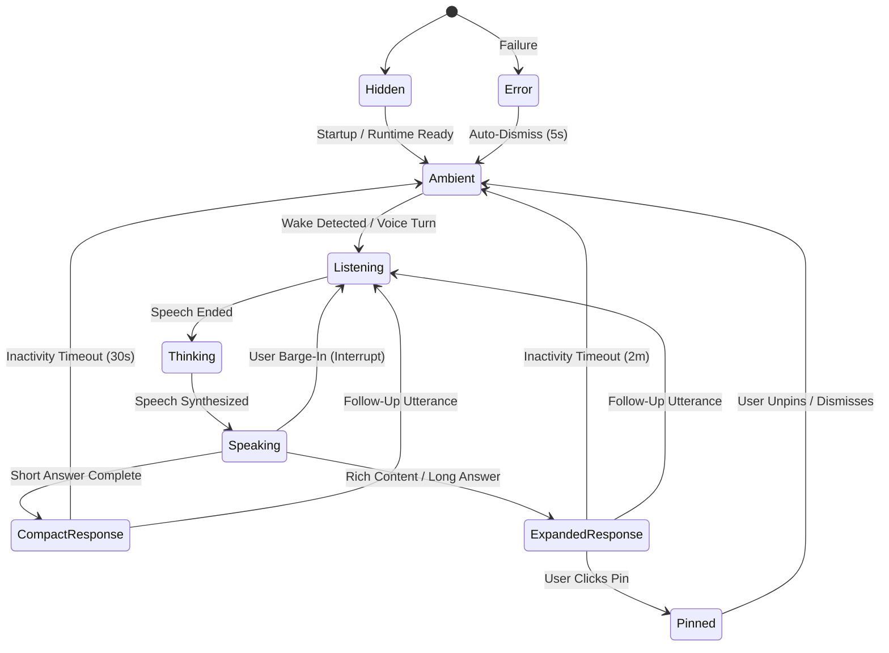

# MAVE Ambient Surface Runtime — Architecture & Specification

**Status:** Architecture Baseline  
**Milestone Target:** Milestone 4 — MAVE Surface  
**Depends on:** M0 Foundation, M1 Wake Subsystem, M2 Conversation Runtime, M3 Voice Loop  
**Source of Truth:** `docs/architecture/MAVE_AMBIENT_ADAPTIVE_SURFACE.md`  

---

## 1. Purpose & Vision

The **MAVE Ambient Surface** establishes a persistent, adaptive visual presence on the desktop. It is the visual expression of MAVE as a personal AI operating layer.

### The Fundamental Product Principle:
> **MAVE is not an application window the user opens. MAVE is a calm, ambient presence that quietly exists near the user and expands only when visual complexity is genuinely useful.**

MAVE rejects the traditional *"ChatGPT in a rectangle window"* model. Most of the time, MAVE remains unobtrusive or compact. When spoken to or invoked, it reacts organically, presents only what is needed, and collapses automatically once the interaction concludes.

```text
Traditional Assistant:  [Open 1200x800 App] ──> [Type in Box] ──> [Read Wall of Text] ──> [Minimize App]
MAVE Ambient Surface:   [Quiet Desktop] ──> "Hey MAVE" ──> [Compact Capsule Reacts] ──> [Speaks Answer] ──> [Collapses to Sleep]
```

---

## 2. Core Product Principles

1. **Quiet by Default**: MAVE does not compete for the user's attention. Idle presence is minimal, calm, and zero-distraction.
2. **Adaptive Geometry**: The surface expands only as much as required by the incoming content:
   - Voice only $\rightarrow$ compact Voice Capsule ($260 \times 60$ DIP).
   - Quick factual answer / vocabulary $\rightarrow$ Quick Information Card ($340 \times 140$ DIP).
   - Complex code / research / task $\rightarrow$ Expanded Context Panel ($420 \times 540$ DIP).
   - Once completed $\rightarrow$ collapses back to ambient state.
3. **Strict Focus Invariance (Zero Focus-Stealing)**: MAVE **never** steals keyboard focus when waking, listening, thinking, speaking, or displaying an ambient response. Voice activation must never disrupt active typing in another application. Focus shifts to MAVE only on explicit user click or explicit summon.
4. **Fluid Motion, Zero Window Jitter**: Transitions morph organically using hardware-accelerated CSS transforms within a stable native bounding envelope. Native window handles are never resized at 60 FPS over IPC.
5. **Decoupled Presentation Engine**: Visual presentation is driven by a generic `SurfaceStateController`. The Surface is **not** hardcoded to Voice; it is designed to seamlessly present future Tool executions, Agent tasks, and Permission requests (Milestones 5 & 6).
6. **Privacy & Ephemerality**: Ambient cards do not linger indefinitely displaying sensitive context on screen. Information collapses on inactivity unless pinned by the user. Raw audio never crosses into the presentation layer.

---

## 3. Surface Conceptual Hierarchy & Runtime Boundaries

The surface architecture is structured into clear tiers of responsibility:

```text
┌──────────────────────────────────────────────────────────────────────────┐
│                             ELECTRON MAIN                                │
│                                                                          │
│  ┌─────────────────────────┐          ┌───────────────────────────────┐  │
│  │   MAVE Core Runtimes    │          │     SurfaceStateController    │  │
│  │  - VoiceManager (M3)    │─────────▶│  - Normalizes external inputs │  │
│  │  - ConversationRuntime  │          │  - Applies presentation policy│  │
│  │  - TaskRuntime (M5)     │          │  - Manages priority & timeouts│  │
│  │  - Permissions (M5)     │          └───────────────┬───────────────┘  │
│  └─────────────────────────┘                          │                  │
│                                                       ▼                  │
│                                       ┌───────────────────────────────┐  │
│                                       │      SurfaceWindowManager     │  │
│                                       │  - Native BrowserWindow owner │  │
│                                       │  - Anchoring & Work Area DIP  │  │
│                                       │  - Always-on-top & focus guard│  │
│                                       │  - Click-through hit testing  │  │
│                                       └───────────────┬───────────────┘  │
└───────────────────────────────────────────────────────┼──────────────────┘
                                                        │ Typed IPC
                                                        │ (JSON Schema Only)
                                                        ▼
┌──────────────────────────────────────────────────────────────────────────┐
│                            ELECTRON PRELOAD                              │
│  ┌────────────────────────────────────────────────────────────────────┐  │
│  │ Context Bridge (`window.mave.surface`)                             │  │
│  │ - getSnapshot(): Promise<SurfaceSnapshot>                          │  │
│  │ - subscribe(cb): () => void                                        │  │
│  │ - sendIntent(intent: SurfaceIntent): Promise<void>                 │  │
│  └────────────────────────────────────────────────────────────────────┘  │
└───────────────────────────────────────────────────────┬──────────────────┘
                                                        │
                                                        ▼
┌──────────────────────────────────────────────────────────────────────────┐
│                            ELECTRON RENDERER                             │
│                                                                          │
│  ┌────────────────────────────────────────────────────────────────────┐  │
│  │ SurfaceView (React Component Root)                                 │  │
│  │  - Subscribes to SurfaceSnapshot & SurfaceEvents                   │  │
│  │  - Orchestrates CSS Morphing & Layout Transitions                  │  │
│  │  - Renders Active Mode Container:                                  │  │
│  │      * AmbientIndicator (Level 0)                                  │  │
│  │      * VoiceCapsule (Level 1)                                      │  │
│  │      * QuickInfoCard (Level 2)                                     │  │
│  │      * ExpandedContextPanel (Level 3)                              │  │
│  │      * TaskWorkspace / ApprovalModal (Level 4 / M5)                │  │
│  │  - Reacts to inputLevel / outputLevel telemetry for organic motion │  │
│  └────────────────────────────────────────────────────────────────────┘  │
└──────────────────────────────────────────────────────────────────────────┘
```

### Responsibility Matrix:
- **`SurfaceStateController` (Main)**: Single source of truth for visual state. Computes the active `SurfaceMode`, priority, auto-collapse timers, and content blocks.
- **`SurfaceWindowManager` (Main)**: Manages native OS primitives (`BrowserWindow`, display metrics, window positioning, `setAlwaysOnTop`, `setIgnoreMouseEvents`, `showInactive`).
- **`window.mave.surface` (Preload)**: Secure, context-isolated bridge exposing strictly validated serializable snapshots and intents.
- **`SurfaceView` (Renderer)**: Renders UI, drives hardware-accelerated CSS animations, and translates user gestures into surface intents.

---

## 4. Window Strategy: The Hybrid Envelope Architecture

A critical architectural decision is choosing between **One Adaptive Window**, **Separate Multiple Windows**, or a **Hybrid Strategy**.

### Comparative Evaluation:
| Architectural Factor | Option A: Single Dynamic Window | Option B: Multi-Window (Capsule + Panel) | Option C: Hybrid Envelope Window (Recommended) |
|---|---|---|---|
| **Native Resize Smoothness** | Poor on Windows DWM; calling `setBounds` at 60 FPS causes noticeable repaint tearing and jitter. | Good within individual windows, but popping panel window causes z-order flashes. | **Excellent**; native window snaps bounds to discrete size envelopes, while internal container morphs smoothly via CSS transforms. |
| **Focus Invariance** | Excellent; single window allows strict `showInactive()` enforcement. | Poor; synchronizing non-focus across two distinct OS windows is prone to OS focus races. | **Excellent**; single OS window guarantees zero focus stealing across transitions. |
| **State Synchronization** | Atomic; single React tree. | Complex; requires cross-window IPC synchronization and re-hydration on every turn. | **Atomic**; single React context preserves all local and conversation state seamlessly. |
| **Multi-Monitor / Scaling** | Simple; single display anchoring. | High risk of coordinate divergence or DPI mismatch across two windows. | **Simple**; anchored to active display work area as a unified entity. |
| **Click-Through Boundary** | Difficult if large transparent areas remain interactive. | Clean per-window boundaries, but cross-window mouse routing is fragile. | **Clean**; `setIgnoreMouseEvents` dynamically toggled on transparent padding vs content container. |
| **Memory / GPU Overhead** | Low; single webContents. | High; 2 separate Chromium render processes ($2\times$ memory and GPU context). | **Low**; single lightweight webContents. |

### Architectural Decision: Option C (Hybrid Envelope Window)
MAVE uses a **single frameless, transparent, hardware-accelerated Electron BrowserWindow** whose native bounds step between discrete size classes (Envelope sizes), while all fluid visual transitions are handled internally via CSS transforms:

```text
Envelope Size Class 1 (Ambient / Capsule):  280 x 80 DIP
Envelope Size Class 2 (Quick Card):         360 x 180 DIP
Envelope Size Class 3 (Expanded Panel):     440 x 580 DIP
```

When transitioning from Capsule to Quick Card:
1. `SurfaceWindowManager` immediately adjusts native window bounds to Envelope 2 without activating/focusing the window (`showInactive()`).
2. Inside the Renderer, the visual container performs a fluid 250 ms CSS cubic-bezier transition into the new dimensions.
3. This completely prevents Windows DWM frame stutter and eliminates cross-window state bugs.

---

## 5. Surface Presentation State Model

The surface state is distinct from the low-level voice runtime state. Voice runtime states (`listening`, `transcribing`, `thinking`) inform presentation, but the visual surface represents a broader, user-facing interaction mode:



### Surface Modes Defined:
1. **`hidden`**: Completely invisible (`win.hide()` or opacity 0). Background runtimes remain 100% active.
2. **`ambient`**: Small, unobtrusive indicator (capsule or mini dot) in the bottom-right work area.
3. **`listening`**: Capsule active; visualizer reacts dynamically to normalized `inputLevel` ($0.0\text{--}1.0$).
4. **`thinking`**: Capsule active; calm, rhythmic indeterminate pulse.
5. **`speaking`**: Capsule active; signature MAVE visualizer reacts dynamically to normalized `outputLevel` ($0.0\text{--}1.0$).
6. **`compact_response`**: Temporary card ($340 \times 140$ DIP) displaying short text answers, vocabulary, or definitions.
7. **`expanded_response`**: Rich context panel ($440 \times 580$ DIP) rendering markdown, code snippets, sources, images, or dialogue history.
8. **`confirmation`**: Interactive modal surface presenting an explicit approval request (M5 permission readiness).
9. **`progress`**: Compact task bar showing step progress for autonomous background tasks (M5 agent readiness).
10. **`error`**: Compact warning pill displaying user-friendly recovery cues.
11. **`pinned`**: User has explicitly locked the current card; auto-collapse timers are suspended.

---

## 6. Voice Runtime $\longrightarrow$ Surface Mode Mapping

The `SurfaceStateController` maps low-level Voice runtime events into high-level surface modes:

| Low-Level Voice Event / State | Target Surface Mode | Visual Presentation Behavior |
|---|---|---|
| `voice:sleeping` (Mic: Wake) | `ambient` | Calm idle indicator; silent, non-distracting. |
| `voice:waking` (Handoff active) | `listening` | Capsule morphs in; subtle listening indicator blooms. |
| `voice:listening` (Mic: Voice) | `listening` | Live waveform driven by `inputLevel` telemetry (no raw PCM). |
| `voice:transcribing` (Whisper) | `listening` | **Visually folded into listening**: Retains listening visual to prevent high-frequency visual flicker ($< 600$ms). |
| `voice:thinking` (Brain active) | `thinking` | Rhythmic, calm breathing pulse (no fake percentage bars). |
| `voice:speaking` (TTS playing) | `speaking` | Waveform pulses to `outputLevel`; streaming text updates in memory. |
| `voice:interrupted` (Barge-in) | `listening` | **Immediate visual yield**: Smoothly pivots from speaking waveform back to listening waveform in $< 50$ms. Never flashes red error text. |
| `voice:session_completed` | `compact_response` or `ambient` | If response contains visual content $\rightarrow$ holds compact card; if purely voice $\rightarrow$ brief hold then collapses to `ambient`. |
| `voice:session_failed` | `error` | Subtle amber/red alert pill with polite recovery suggestion. |

---

## 7. Display Anchoring, Multi-Monitor & DPI Strategy

### 7.1 Bottom-Right Work Area Anchoring
MAVE positions itself relative to the **active display work area**, not physical screen resolution:
- The Windows Taskbar can be on the bottom, top, left, or right, or set to auto-hide.
- Electron's `display.workArea` automatically subtracts the taskbar dimensions.
- Target position:
  $$\text{Target } X = \text{workArea.x} + \text{workArea.width} - \text{windowWidth} - \text{margin}$$
  $$\text{Target } Y = \text{workArea.y} + \text{workArea.height} - \text{windowHeight} - \text{margin}$$
  *Provisional margin*: 16 DIP from the work area boundary.

### 7.2 Multi-Monitor Policy
- **Active Display Resolution**: MAVE anchors to the display **currently containing the mouse cursor** when invoked:
  ```typescript
  const currentCursor = screen.getCursorScreenPoint();
  const activeDisplay = screen.getDisplayNearestPoint(currentCursor);
  ```
- **Stability Rule**: While MAVE is visible and interacting with the user, it **locks** to the current display and does not jump abruptly between monitors if the mouse moves away.
- **Display Disconnect / Metrics Change**: Handled cleanly by listening to `screen.on('display-metrics-changed')` and `screen.on('display-removed')`. Bounds are recalculated within $< 50$ms to prevent off-screen clipping.

### 7.3 Windows DPI Scaling
- Windows users frequently operate at 100%, 125%, 150%, or 200% scaling.
- Electron APIs (`screen`, `BrowserWindow.setBounds()`, `BrowserWindow.getPosition()`) operate in **Device Independent Pixels (DIP)**.
- All M4 layout tokens and window coordinates use DIP values. Raw device pixels are never hardcoded.

---

## 8. Focus Policy & The "Show-Inactive" Rule

### The Invariant:
> **MAVE must NEVER steal keyboard focus on Wake, Listening, Thinking, Speaking, or Response Arrival.**

```text
User is typing in VS Code:  [function calculate() { ... }]
MAVE wakes:                 "Hey MAVE" -> Capsule appears in bottom-right
Focus stays in VS Code:     User typing continues uninterrupted!
```

### Native Implementation Mechanism:
1. **Creation Flags**: The surface window is instantiated with `focusable: false` and `show: false`.
2. **Display Activation**: To show the window without stealing focus, `SurfaceWindowManager` calls:
   ```typescript
   win.showInactive();
   ```
3. **Interactive Promotion**: Only when the user explicitly clicks the window or focuses an input box does the window enable focus:
   ```typescript
   win.setFocusable(true);
   win.focus();
   ```
4. **Demotion on Blur**: When the surface loses focus, it immediately resets `win.setFocusable(false)` to prevent trapping subsequent OS Tab/Enter keys.

---

## 9. Always-On-Top, Click-Through & Hit Testing

### 9.1 Always-On-Top Policy
- In `ambient`, `listening`, `thinking`, and `speaking` modes, MAVE is set to `alwaysOnTop: true` with level `'screen-saver'` or `'status'`. Because the capsule is small and located in the corner, it remains visible above browser tabs and document windows without obstructing primary work.
- When fullscreen applications (e.g., games or presentations) take exclusive display control, MAVE respects native OS suppression and avoids forcing an overlay.

### 9.2 Click-Through & Region Hit Testing
A major challenge with frameless transparent Electron windows is that transparent window regions can inadvertently intercept mouse clicks intended for underlying desktop icons or apps.

**The Solution:**
1. In pure ambient mode with padding, `SurfaceWindowManager` utilizes:
   ```typescript
   win.setIgnoreMouseEvents(true, { forward: true });
   ```
2. When the user hovers over the actual visual capsule or an expanded card, the Renderer dispatches a pointer enter signal, and Main restores mouse capture:
   ```typescript
   win.setIgnoreMouseEvents(false);
   ```
3. Interactive buttons, drag handles, and inputs are explicitly marked with CSS `pointer-events: auto`, while outer transparent envelopes use `pointer-events: none`.

---

## 10. Motion Design & Animation Architecture

### Motion Principles:
- **Calm, Organic Morphology**: The surface morphs smoothly between modes rather than popping in and out.
- **No Idle Noise**: Idle ambient state has zero distracting motion.
- **Physical Coherence**: Elements expand outward from the bottom-right anchor and collapse back cleanly.
- **High-Performance CSS**: All visual transitions leverage CSS `transform` (GPU composited) and `opacity`. Layout properties like `width`, `height`, `top`, `left` are never animated dynamically.

### Animation Ownership Boundary:
- **Main Process**: Sets the discrete native window bounds when entering a new size envelope.
- **Renderer Process**: Drives the 60 FPS visual easing curves, spring physics, and telemetry-reactive waveforms inside that envelope.

---

## 11. Content & Response Sizing Policy

MAVE surfaces content using discrete, semantic content blocks rather than a raw streaming string.

### Response Size Classes:
```text
┌────────────────────────────────────────────────────────┐
│ Compact Response Card (340 x 140 DIP)                  │
│ - 1-2 sentence direct spoken answer                     │
│ - Vocabulary card / pronunciation guide                │
│ - Quick factual confirmation                           │
│ - Single status indicator                              │
└────────────────────────────────────────────────────────┘
                           │ Grow if required
                           ▼
┌────────────────────────────────────────────────────────┐
│ Expanded Context Panel (440 x 580 DIP)                 │
│ - Markdown explanations with headers & lists           │
│ - Syntactic Code blocks with copy button               │
│ - Multi-source search citations                        │
│ - Rich images, charts, and media cards                 │
│ - Multi-turn conversational history                     │
└────────────────────────────────────────────────────────┘
```

### Sizing Policy Engine:
The `SurfaceStateController` evaluates incoming content structure:
1. Does the response contain code blocks (````...````)? $\rightarrow$ **Expanded Panel**.
2. Does the response contain structured tables or images? $\rightarrow$ **Expanded Panel**.
3. Does the text exceed 280 characters or multiple paragraphs? $\rightarrow$ **Expanded Panel**.
4. Is it a short conversational clarification or definition? $\rightarrow$ **Compact Response**.
5. Is it a simple voice acknowledgment ("Playing song", "Timer set")? $\rightarrow$ **Voice Capsule only** (collapses directly to ambient).

---

## 12. Streaming Text Rendering Strategy

During voice turn execution, the Brain streams tokens progressively. To prevent jarring visual layout jitter:
1. **Stable Response Container**: The response card opens with predetermined base bounds based on intent classification.
2. **Text Accumulation**: Streaming tokens are appended smoothly within an internal scrolling viewport.
3. **Thresholded Resizing**: The container dimensions do not recalculate on every token; layout expands only when discrete line/height thresholds are crossed.

---

## 13. Auto-Collapse, Pinning & Dismissal

### 13.1 Auto-Collapse Policy
The surface uses deterministic, event-driven timers:
- **Voice Capsule**: Collapses to `ambient` $3\text{--}5$ seconds after speech playback finishes.
- **Compact Response Card**: Collapses to `ambient` after $30$ seconds of user inactivity.
- **Expanded Context Panel**: Collapses to `ambient` after $2$ minutes of user inactivity.
- **User Activity Reset**: Any mouse movement over the card, scrolling, or text selection instantly resets the collapse timer.

### 13.2 Pinning Policy
- The user can click a **Pin** icon on any card or say *"Hey MAVE, pin this"*.
- When pinned, `surface.isPinned = true`. Auto-collapse timers are completely disabled.
- The card remains visible until explicitly closed or unpinned by the user.

### 13.3 Dismissal Semantics
- Clicking **Close** or pressing **Escape** collapses the visible UI back to `ambient` or `hidden`.
- **Dismissing the UI does NOT kill the MAVE runtime**:
  - The Python wake service remains active.
  - The state machine remains in `sleeping`.
  - Microphones and audio hardware remain correctly managed.
  - Full application exit occurs only via System Tray or explicit quit.

---

## 14. Priority Arbitration Model

When multiple subsystems attempt to present content simultaneously:

$$\text{Critical Error} > \text{Permission Confirmation (M5)} > \text{User-Pinned Content} > \text{Active Voice Turn} > \text{Task Progress (M5)} > \text{Ambient}$$

- If a voice turn finishes while a critical permission request is pending, the permission modal takes immediate visual precedence.
- If a background task updates while the user is actively speaking, task progress is rendered as an unobtrusive sub-indicator rather than overriding the active voice capsule.

---

## 15. Surface IPC Data Contract

All data crossing between Electron Main, Preload, and Renderer adheres strictly to JSON-serializable Zod schemas:

```typescript
export interface SurfaceSnapshot {
  mode: SurfaceMode;
  visibility: 'visible' | 'hidden';
  sizeClass: 'capsule' | 'compact' | 'expanded';
  isPinned: boolean;
  activeSessionId?: string;
  turnIndex?: number;
  inputLevel: number;
  outputLevel: number;
  transcript?: {
    text: string;
    isFinal: boolean;
  };
  content?: SurfaceContentBlock[];
  error?: {
    code: string;
    message: string;
  };
  timestamp: number;
}

export type SurfaceIntent =
  | { type: 'EXPAND_SURFACE' }
  | { type: 'COLLAPSE_SURFACE' }
  | { type: 'TOGGLE_PIN' }
  | { type: 'DISMISS_SURFACE' }
  | { type: 'CONFIRM_ACTION'; actionId: string; approved: boolean }
  | { type: 'SUBMIT_TEXT_QUERY'; query: string };
```

---

## 16. Security, Privacy & Performance

### 16.1 Security
- `contextIsolation: true` and `nodeIntegration: false` remain strictly enforced.
- Renderer content renders Markdown via a sanitized parser preventing arbitrary HTML, `<script>`, or iframe execution.
- External web links open exclusively via `shell.openExternal()`.

### 16.2 Privacy
- No audio frames or binary PCM buffers ever cross the IPC bridge into the Renderer.
- Ephemeral cards clear their sensitive text buffers upon auto-collapse.

### 16.3 Performance Budget
- **Idle CPU/GPU**: $0\%$ CPU usage when in `ambient` mode.
- **Animation Frame Budget**: Voice visualizers run strictly off 50 ms throttled telemetry via CSS transforms, avoiding React state thrashing.
- **GPU Coexistence**: Renders with zero WebGL/3D overhead, leaving full RTX 3060 Ti GPU compute available for local `faster-whisper` STT inference.

---

## 17. Architectural Invariants

The following 10 invariants are permanent and must never be violated in Milestone 4 or subsequent milestones:

1. **Surface Never Owns AI Business Logic**: The UI is a pure projection of runtime state; it never decides AI execution directly.
2. **Renderer Never Owns Native OS Windows**: Window creation, destruction, movement, and positioning belong exclusively to Electron Main.
3. **Renderer Never Receives Raw Audio**: Only normalized $0.0\text{--}1.0$ amplitude telemetry crosses IPC.
4. **Voice State $\neq$ Surface State**: Visual presentation modes are distinct from low-level voice coordination states.
5. **Zero Focus-Stealing**: Passive MAVE events (wake, listen, think, speak, response) must never steal OS keyboard focus.
6. **Surface Dismissal $\neq$ Runtime Termination**: Closing or hiding the surface does not stop Wake detection or background services.
7. **Expanded Content is Ephemeral by Default**: Responses auto-collapse unless explicitly pinned by the user.
8. **Surface Architecture Must Remain M5-Extensible**: Presentation models must be capable of hosting Tool approvals and Task progress without refactoring.
9. **Developer Diagnostics Remain Isolated**: M3 developer tools (`DeveloperVoice`, `DeveloperChat`) remain accessible and are never mixed into the end-user ambient surface.
10. **Provider Independence Preserved**: The visual surface must never depend on whether STT, TTS, or Brain are local models or cloud services.

---

## 18. Resolved Decisions & Open Questions

### Resolved Decisions:
- **Window Strategy**: Resolved $\rightarrow$ Single hybrid envelope window with discrete native bounds and fluid internal CSS morphing.
- **Anchoring**: Resolved $\rightarrow$ Dynamic bottom-right work area calculation on the active cursor display.
- **Transcribing State**: Resolved $\rightarrow$ Folded visually into listening to eliminate visual jitter.
- **Interruption Visual**: Resolved $\rightarrow$ Instant yield back to listening waveform without error banners.
- **Developer Panel**: Resolved $\rightarrow$ Retained in full for engineering diagnostics.

### Open Questions (Deferred to Implementation Phases):
1. *Native OS Blur/Vibrancy*: Windows 11 Acrylic/Mica effect support vs standard high-performance transparent dark CSS styling (evaluate in M4.2).
2. *User Drag-and-Snap*: Allow user to freely drag the capsule across screen edges, or lock firmly to bottom-right (evaluate in M4.8).
3. *Global Hotkey Summon*: Register global shortcut (e.g. `Ctrl+Space` or `Win+Shift+M`) to summon MAVE without voice (evaluate in M4.8).

---

## 19. M4.2 Surface Window Runtime Implementation & Findings

Milestone 4.2 establishes the native Electron window runtime (`SurfaceWindowManager`) hosting the MAVE Ambient Surface alongside the Developer Diagnostics Window.

### 19.1 Native Window Flags & Construction
The surface window is instantiated with strict security, transparency, and non-intrusive presentation flags:
```typescript
new BrowserWindow({
  width: initialBounds.width,
  height: initialBounds.height,
  x: initialBounds.x,
  y: initialBounds.y,
  show: false,
  frame: false,
  transparent: true,
  hasShadow: false,
  skipTaskbar: true,
  focusable: false,
  alwaysOnTop: true,
  webPreferences: {
    preload: this.preloadPath,
    contextIsolation: true,
    nodeIntegration: false,
    sandbox: false
  }
});
```
- **Always-on-top level**: Initialized with `win.setAlwaysOnTop(true, 'status')`. The `'status'` level keeps the corner capsule above regular application windows while respecting fullscreen applications.
- **Web security**: Blocked pop-ups via `webContents.setWindowOpenHandler(() => ({ action: 'deny' }))` and external navigations via `webContents.on('will-navigate')`.

### 19.2 White Flash & Flicker Prevention (`ready-to-show` Gating)
- On Windows DWM, calling `win.show()` or `win.showInactive()` on a frameless transparent window before Chromium's initial frame paint causes a noticeable white flash or transparent rectangle flicker.
- **Resolution**: The window starts strictly with `show: false`. Visibility is gated behind `win.once('ready-to-show', ...)`. `win.showInactive()` is only dispatched once the renderer paint pipeline has completed its initial frame.

### 19.3 Strict Focus Invariant & Intent Promotion
- **Passive Voice Events**: When MAVE is waking, listening, thinking, speaking, or presenting compact responses, the window is displayed strictly via `win.showInactive()`. `win.focus()` is never called, and `win.isFocusable()` remains `false`.
- **Explicit User Interaction**: Only when an explicit user keyboard text entry action is dispatched (`focusIntent === 'request'`) does the runtime elevate the window via `win.setFocusable(true)` and `win.focus()`.
- **Demotion on Dismiss**: When dismissed, focus intent drops to `'release'` and the window returns to `setFocusable(false)`.

### 19.4 Hit Testing & Click-Through Behavior
- Frameless transparent windows have empty transparent padding surrounding the compact visual capsule.
- **Transparent Pad Click-Through**: In passive/ambient modes, `win.setIgnoreMouseEvents(true, { forward: true })` ensures all mouse clicks pass straight through to desktop icons or applications below.
- **Interactive Container Capture**: When the mouse cursor enters the visual UI container, the renderer dispatches `mave:surface:report-hover` via IPC. The main process immediately executes `win.setIgnoreMouseEvents(false)` to enable clicking buttons, controls, and expansion handles.

### 19.5 Discrete Envelope Sizing & Positioning Math
- Native bounds step between discrete DIP envelopes:
  - `ambient`: $280 \times 80$ DIP
  - `compact`: $280 \times 80$ DIP
  - `card`: $360 \times 180$ DIP
  - `expanded`: $440 \times 580$ DIP
- Anchored to bottom-right of `display.workArea` with $16$ DIP margin:
  - $X = \text{workArea.x} + \text{workArea.width} - \text{width} - 16$
  - $Y = \text{workArea.y} + \text{workArea.height} - \text{height} - 16$
- Automatically compensates for taskbar location on any edge and supports multi-monitor virtual screen topologies with negative coordinates.
- **DisplayLockManager**: Locks surface anchoring to the display containing the cursor during active voice interactions; unlocks on idle/ambient; safely re-anchors to primary display if an external monitor is disconnected.

### 19.6 Coexistence & Single Route Architecture
- The existing Developer Diagnostics Window ($440 \times 580$) remains fully operational for engineering diagnostics.
- The single Vite renderer bundle multiplexes views via query string: `?view=surface` routes to `<SurfaceView />`, while default route preserves the Developer Diagnostics view `<App />`.

---

## 20. M4.3 Compact Ambient Surface Foundation & Preload Capability Gating

Milestone 4.3 establishes the visual identity foundation of MAVE's resting presence and enforces least-privilege capability gating at the preload layer.

### 20.1 Preload Capability Gating (Least Privilege Principle)
To prevent the Ambient Surface Renderer from accessing unneeded privileged control channels:
- When a window loads `?view=surface`, `preload/index.ts` gates exposure and attaches **only** the `surface` API:
  ```typescript
  if (isSurfaceWindow) {
    contextBridge.exposeInMainWorld('mave', { surface: api.surface });
  } else {
    contextBridge.exposeInMainWorld('mave', api); // Developer diagnostics
  }
  ```
- The Ambient Surface window has zero access to `window.mave.chat`, `window.mave.voice`, or `window.mave.sendCommand`.

### 20.2 Window Construction Ordering
- The primary Developer Diagnostics `mainWindow` is instantiated first, ensuring standard test fixtures and Playwright `firstWindow()` bindings bind to the diagnostic harness.
- `SurfaceWindowManager` initializes subsequently, mounting the frameless transparent overlay without stealing OS focus.

### 20.3 Visual Identity & Presence Mark Primitive
- **PresenceMark**: An SVG kinetic primitive consisting of 3 rounded acoustic energy bars (4px, 10.4px, 16.8px) that exhibit calm, organic breathing cycles in ambient mode (3.6s cycle) without heavy 3D or WebGL overhead.
- **Product-Facing Copy**: Exposes polite, calm user status descriptors (`Ready`, `Listening...`, `Thinking...`, `Speaking...`), strictly decoupling product UX from internal state machine terminology (`sleeping`, `transcribing`).
- **Accessibility**: Marked with `aria-hidden="true"` on decorative elements, semantic `role="region"`, accessible button action triggers, and strict compliance with `prefers-reduced-motion: reduce`.

---

## 21. M4.4 Voice-Reactive States & Visual Energy Mapping

Milestone 4.4 integrates normalized real-time audio telemetry from the Milestone 3 voice runtime into the Compact Ambient Surface, turning the static PresenceMark into a responsive, living voice presence.

### 21.1 Telemetry Contract & Strict IPC Boundary
- **Normalized Telemetry Range**: Telemetry values are strictly bounded normalized scalar energy ratings ($0.0 \le \text{inputLevel}, \text{outputLevel} \le 1.0$).
- **No Raw Audio in Renderer**: No `AudioFrame`, PCM, `Buffer`, `Uint8Array`, or FFT calculation is ever exposed through IPC to the Surface window or developer preloads. Only scalar energy amplitude crosses the boundary.
- **Single Source of Truth**: The Renderer never directly subscribes to `VoiceManager` or low-level audio providers. All presentation updates flow authoritatively through `SurfaceSnapshot` managed by `SurfaceStateController`.

### 21.2 Visual Transfer Function & Noise-Floor Calibration
Raw RMS values do not map linearly to pleasing visual motion due to acoustic dynamic range and ambient background noise. `computeVisualIntensity` implements a presentation-only non-linear transfer function:
$$\text{visualIntensity} = \left(\frac{\text{clamp}(\text{level}, 0, 1) - \text{noiseGate}}{1 - \text{noiseGate}}\right)^{0.6}$$
- **Noise Floor Suppression**: `VISUAL_NOISE_FLOOR = 0.03`. Host machine telemetry observations with the FIFINE K690 USB microphone measured quiet room ambient noise at $\approx 0.0001\text{--}0.0008$, ensuring complete suppression of background room hiss and zero jitter at rest.
- **Speech Excursion**: Real TTS and vocal utterances measured active output levels averaging $\approx 0.08\text{--}0.09$ with peaks reaching $\approx 0.26$. The $0.6$ power curve expands speech energy dynamics for lively syllabic responsiveness.

### 21.3 Coordinated 3-Bar Kinetic Dynamic Architecture
The PresenceMark consists of 3 rounded acoustic bars rendered via SVG:
- **Left Bar**: Medium excursion (scales from baseline up to $1.15\times$).
- **Center Bar**: Primary vocal core (strongest excursion, scales from baseline up to $1.50\times$).
- **Right Bar**: Staggered/alternate excursion (scales from baseline up to $1.25\times$).
- **Capsule Geometry Bounds**: Vertical deflection is bounded such that bars never exceed the 24px SVG viewBox or clip within the 38px capsule boundary. No layout reflow or text shifting occurs.

### 21.4 State Animation Ownership & Silence Handling
- **Ambient**: Calm, organic breathing cycle (3.6s cycle). Audio telemetry is ignored to ensure the mark remains quiet while Wake owns the microphone.
- **Listening**: User vocal energy drives the 3 bars with fast attack/release via CSS custom properties (`--mave-bar-left-scale`, `--mave-bar-center-scale`, `--mave-bar-right-scale`). During pauses in user speech, the mark relaxes to an active listening baseline ($0.65 / 0.85 / 0.70$) without collapsing to ambient.
- **Thinking**: Autonomous harmonious wave drift (1.6s cycle). Zero audio reactivity; stale mic levels are completely ignored.
- **Speaking**: MAVE's spoken TTS playback dynamically modulates the bars. During natural TTS pauses, the mark relaxes to a resting speaking baseline ($0.55 / 0.75 / 0.60$) without flapping back to listening or ambient mode.
- **Interrupted (Barge-In)**: Interruption yields immediately from outputLevel to inputLevel in $< 50\text{ ms}$, instantly clearing the assistant output scale and responding to the user's microphone. Zero red error flashes.
- **Error**: Restrained static warning state with muted coral tone (`#f87171`) and zero audio reactivity.

### 21.5 CSS Compositor Smoothing & Performance
- **Telemetry Frequency**: Audio level diagnostics are throttled at $\approx 50\text{ ms}$ ($\approx 20\text{ Hz}$).
- **Compositor Interpolation**: The Renderer updates CSS custom properties on `.mave-presence-mark`. SVG `<rect>` elements apply `transform: scaleY(...)` with hardware-accelerated transitions (`120ms cubic-bezier(0.16, 1, 0.3, 1)`), eliminating the need for `requestAnimationFrame` loops or high-frequency IPC streaming.
- **Reduced Motion**: Under `@media (prefers-reduced-motion: reduce)`, all physical scaling transforms and keyframe loops are disabled (`transform: none !important`), and audio energy is mapped purely to subtle opacity modulation ($\text{opacity} = 0.65 + 0.35 \times \text{energy}$).

---

## 22. M4.5 Adaptive Envelope & Morph System

Milestone 4.5 implements the adaptive geometry and visual transition foundation connecting the Ambient Capsule ($280 \times 80$), Quick Info Card ($360 \times 180$), and Expanded Context Panel ($440 \times 580$).

### 22.1 Hybrid Envelope Window Architecture
To combine the performance and stability of native OS windows with the visual beauty of modern desktop surfaces:
- **Native Geometry**: Strictly discrete. Exactly ONE native `win.setBounds()` call is performed per semantic envelope promotion/demotion. Never a 60 FPS `setBounds` polling loop.
- **Visual Container**: Internally fluid. The Renderer smoothly tweens container `width`, `height`, and `border-radius` ($9999\text{px} \to 14\text{px} \to 16\text{px}$) via CSS GPU-accelerated compositing (`250ms cubic-bezier(0.16, 1, 0.3, 1)`).

### 22.2 Asymmetric Transition Sequencing
Expansion and collapse follow strict asymmetric order to prevent visual clipping and ugly instantaneous truncation on Windows:
1. **Expansion (Grow)**:
   - Target bounds are calculated.
   - Native BrowserWindow expands **FIRST** (`win.setBounds(targetBounds)`), creating sufficient transparent room.
   - `SurfaceSnapshot` is broadcast to Renderer.
   - Renderer visual container animates smoothly into the newly expanded envelope.
2. **Collapse (Shrink)**:
   - `SurfaceSnapshot` is broadcast to Renderer **FIRST**.
   - Renderer visual container immediately starts animating inward into smaller dimensions ($250\text{ ms}$).
   - Native window bounds remain at the larger size during the collapse animation.
   - After the collapse duration ($260\text{ ms}$, $250\text{ ms}$ motion $+ 10\text{ ms}$ buffer), native bounds are shrunk to the smaller envelope.

### 22.3 Bottom-Right Anchor Invariant
The native window and internal CSS viewport are anchored strictly to the bottom-right corner of the usable `workArea`:
$$X = \text{workArea.x} + \text{workArea.width} - \text{width} - \text{margin}$$
$$Y = \text{workArea.y} + \text{workArea.height} - \text{height} - \text{margin}$$
Notice that the absolute screen coordinates of the bottom-right edge:
$$X + \text{width} = \text{workArea.x} + \text{workArea.width} - \text{margin} = \text{constant}$$
$$Y + \text{height} = \text{workArea.y} + \text{workArea.height} - \text{margin} = \text{constant}$$
are mathematically independent of `width` and `height`. Across all envelope transitions and across arbitrary positive and negative display topologies, the bottom-right point remains rock-solid while the surface expands upward and leftward.

### 22.4 SurfaceTransitionCoordinator & Stale Revision Protection
`SurfaceTransitionCoordinator` in Electron Main tracks the transition state machine:
- Tracks `currentNativeSizeClass`, `targetSizeClass`, `state` (`idle` | `expanding` | `collapsing`), and a monotonic `transitionRevision` integer counter.
- **Stale Shrink Protection**: When a collapse is initiated, the $260\text{ ms}$ native shrink timer records `scheduledRev = ++transitionRevision`. If a user re-expands or a new intent arrives during the collapse, `transitionRevision` increments, and any stale shrink timer becomes a strict no-op.
- **Dismissal**: When snapshot mode or visibility becomes `hidden`, all pending timers are cancelled immediately, and the window hides without waiting for animation timeouts.

### 22.5 Continuous Visual Identity & Morphing Container
Rather than destroying and mounting separate DOM components, `MaveCapsule` serves as the continuous adaptive surface container:
- `PresenceMark`, brand label, status text, and action buttons live in the anchored header row (`.mave-capsule-header`).
- `PresenceMark` SVG dimensions remain fixed ($18 \times 18$) and never distort or stretch when the container morphs.
- Active voice reactivity continues unimpeded throughout size transitions (e.g., live `outputLevel` continues modulating the 3 bars while expanding to a response card).
- Adaptive action slot exposes context-appropriate expand / collapse triggers.

### 22.6 Pinned State Preservation
- When `pinned: true`, the surface retains the user's chosen presentation footprint (`sizeClass: prev.sizeClass`) even as voice activity cycles through `listening`, `thinking`, `speaking`, `interrupted`, or `sleeping`.
- Pinned surfaces never auto-collapse, while still allowing explicit user expand, collapse, and unpin actions.

### 22.7 Hit Region & Pointer Safety
- Newly expanded transparent regions around the visual container maintain `pointer-events: none` in CSS and `win.setIgnoreMouseEvents(true, { forward: true })` in Electron.
- Pointer events are captured exclusively when the cursor hovers directly over the visible container (`.mave-surface-container`), preventing invisible transparent space from blocking clicks to underlying desktop applications.
- Zero focus stealing: all passive size transitions preserve `focusable: false` and use `showInactive()`.

---

## 23. M4.6 Compact Response Surface & Auto-Collapse Architecture

Milestone 4.6 transforms MAVE's card envelope ($360 \times 180$ DIP) into a production Quick Response desktop surface, enabling short assistant answers, quick facts, vocabulary entries, and status descriptors to be read directly on the desktop without opening a traditional chat window.

### 23.1 Compact Quick Response Layout & Streaming Presentation
- **Stable Native Envelope**: All progressive assistant text streaming occurs within the stable card envelope ($360 \times 180$ DIP). The native window is promoted to card bounds upon receiving early assistant tokens ($\ge 4$ characters trimmed) and never resizes per token, preventing window shaking and OS relayout churn.
- **Continuous Header Anchor**: Header row with `PresenceMark`, `MAVE` brand label, and action buttons (`pin`, `expand`, `dismiss`) remains mounted at the top of the card.
- **Primary Spoken Text Component (`MaveCompactResponse`)**:
  - Renders streaming assistant text into `.mave-compact-response`.
  - Accessible typography with high-contrast text (`color: #f1f5f9`), smooth line clamping (`line-clamp: 5`), and accessible word breaking (`word-break: break-word`, `overflow-wrap: break-word`).
  - Interactive selection enabled (`user-select: text`) allowing users to copy text directly.
  - Safe overflow fade mask (`.mave-response-fade-overlay`) and subtle expand button affordance when text exceeds viewable height.
- **Specialized Visual Blocks**:
  - **Vocabulary Card (`.mave-vocabulary-card`)**: Renders target word, phonetic notation, part of speech badge, translation, and contextual example.
  - **Status Card (`.mave-status-card`)**: Renders status icon badge, type indicator (`info`, `success`, `warning`, `error`), and message descriptor.

### 23.2 Semantic Classification Engine (`ResponseClassifier`)
- **Streaming & Batch Classifier**: Analyzes incoming response text chunk-by-chunk and batchwise to determine optimal presentation mode.
- **Classification Routing**:
  - Short prose ($\le 240$ chars), single vocabulary items, and short status updates $\to$ `compact_response` with `sizeClass: 'card'`.
  - Long prose ($> 240$ chars), markdown code fences (````` ``` `````), structured tables (`| --- |`), or multi-step lists $\to$ `expanded_response` with `sizeClass: 'expanded'`.
- **Pre-Classification Buffer**: Minimal threshold ($\ge 4$ characters) triggers early promotion to the card envelope so text does not flash inside the tiny ambient capsule.

### 23.3 Main-Authoritative Response Hold & Auto-Collapse Lifecycle
- **Decoupled Voice Lifecycle & Presentation Hold**: Spoken TTS audio finishing (`speaking_finished` / `isSpeakingFinished: true`) does NOT instantly collapse the card. When the voice engine returns to sleeping, the presentation state machine transitions from `speaking` to `compact_response` (Response Hold), keeping the card visible so the user can read the content.
- **Hold Duration Matrix**:
  - **Standard Compact Response**: $30,000\text{ ms}$ ($30\text{ s}$) auto-collapse baseline.
  - **Short Acknowledgement / Status**: $3,000\text{ ms}$ ($3\text{ s}$) for trivial answers ($\le 6$ characters such as "Done.", "Okay.", "Sure.") or status blocks.
- **Pin Authority**:
  - User clicking the Pin button (`toggle_pin`) cancels auto-collapse timers immediately (`autoCollapse.enabled = false`).
  - The card stays indefinitely until the user unpins, collapses, or dismisses.
  - Unpinning an active card immediately arms a fresh $30\text{ s}$ collapse timer.
- **Hover & Inactivity Pause**:
  - When pointer enters the card (`onMouseEnter` / `setUserHovering(true)`), active collapse timers are cancelled.
  - While the user is hovering or reading, the card will never auto-collapse.
  - When pointer leaves the card (`onMouseLeave` / `setUserHovering(false)`), a fresh $30\text{ s}$ inactivity timer is armed.
- **Ephemeral Privacy Clearing**:
  - When auto-collapse fires or the user clicks dismiss, `assistantText` and structured `content` blocks are immediately cleared (`undefined`) from state.
  - Sensitive answers, tokens, or queries never persist in the ambient background state.

### 23.4 Stale Timer Protection (`activeTimerRevision`)
To guarantee rock-solid timer safety in high-concurrency desktop environments:
- `SurfaceStateController` maintains a private monotonic integer counter `activeTimerRevision`.
- Whenever a timer is armed (`scheduleCollapse`), it captures the current revision `timerRev = ++this.activeTimerRevision`.
- In the `setTimeout` callback, execution verifies `if (this.activeTimerRevision !== timerRev) return;`.
- Any subsequent user interaction, pin toggle, hover event, new voice intent, or dismiss invalidates older timers by incrementing `activeTimerRevision`, preventing stale collapse races.


