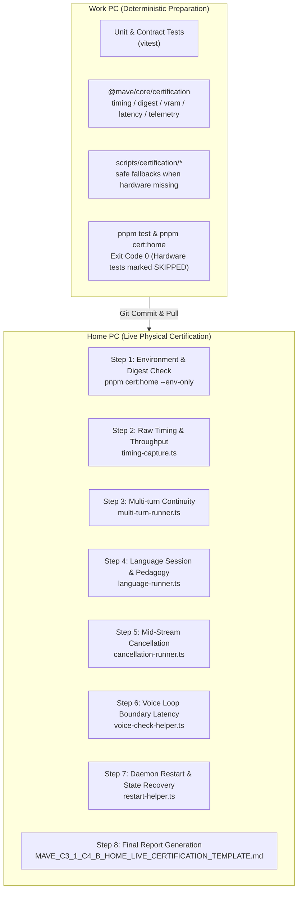

# MAVE C3.1 / C4-B Live Certification Harness Architecture & Execution Guide

> [!IMPORTANT]
> **PURPOSE AND BOUNDARIES**
> This document defines the architecture, evidence criteria, execution order, and operating rules for the **C3.1 (Local Fast Brain Runtime)** and **C4-B (Voice / Language / Conversation)** live hardware certification.
> - **Work PC**: Safe harness preparation, contract hardening, regression testing, and build verification only. Zero hardware assumptions.
> - **Home PC**: Target execution environment with physical GPU (RTX 3060 Ti), local Ollama daemon, exact model digest, and microphone/audio hardware.
> - **Strict Prohibition**: Never simulate, fabricate, or infer empirical hardware metrics. If a test cannot run or fails, record empirical values as-is.

---

## 1. Overview & Architecture

The certification harness bridges the gap between deterministic contract validation (verified on any developer workstation) and live physical certification (executed on the target Home PC). It provides non-destructive, structured telemetry gathering across both the brain inference pipeline and the conversational voice loop.



---

## 2. Automated vs Manual Checks

To balance determinism with real human perception (audio latency, voice naturalness, barge-in smoothness), the certification harness categorizes every requirement into either **Automated (Scripted)** or **Manual (Human Observer)** checks.

### Automated Checks (Run via Scripts)
| Check | Script / Utility | Target Metric / Contract |
|---|---|---|
| **System Info & Environment** | `scripts/certification/runner.ts` | OS, CPU, RAM, Node >=20, pnpm, Git clean HEAD |
| **Model Digest Verification** | `scripts/certification/runner.ts` | `65ec06548149b04c096a120e4a6da9d4017ea809c91734ea5631e89f96ddc57b` |
| **Raw Timing & Discrepancy** | `scripts/certification/timing-capture.ts` | Discrepancy resolution: `eval_count / (eval_duration / 1e9)` vs turn rate |
| **TaskPolicy & BrainRouter** | `scripts/certification/runner.ts` | 5 benchmark routing cases strictly matching expected profile/provider |
| **Multi-Turn Continuity** | `scripts/certification/multi-turn-runner.ts` | Turn 1 favorite lang $\to$ Turn 2 why $\to$ Turn 3 recall without hallucination |
| **Language Pedagogy State** | `scripts/certification/language-runner.ts` | Vocab stage progression (`seen` $\to$ `practiced` $\to$ `reviewed`), roleplay step-out |
| **Pronunciation Honesty** | `scripts/certification/language-runner.ts` | Text-only model never produces fake phoneme/scoring artifacts |
| **Mid-Stream Cancellation** | `scripts/certification/cancellation-runner.ts` | AbortSignal stops generation; no phantom token emission; no retry fallback |
| **VRAM Phase Timeline** | `scripts/certification/runner.ts` | `nvidia-smi` sampling across 7 lifecycle checkpoints |
| **Daemon Restart Recovery** | `scripts/certification/restart-helper.ts` | Leases invalidated; `/api/ps` inspected; clean re-prewarm |

### Manual Verification Checks (Human Observed)
| Check | Procedure | Evaluation Criteria |
|---|---|---|
| **Voice Loop Latency** | Speak query into mic $\to$ record audio playback start | Audible perception of latency (~1–3s target); no awkward dead air |
| **Barge-In Interruption** | Speak while MAVE is speaking TTS audio | TTS immediately stops playing; microphone capture restarts cleanly |
| **Multi-Turn Continuity (Spoken)** | Spoken 3-turn dialog identical to script | Spoken responses naturally preserve context without re-prompting |
| **Language Roleplay (Spoken)** | Converse in German/Thai roleplay $\to$ step out | MAVE answers meta-grammar question in English, then resumes roleplay |
| **Presence Surface Sync** | Observe UI V2 presence indicator during turn | Orb/ring states match: `listening` $\to$ `thinking` $\to$ `speaking` $\to$ `idle` |

---

## 3. Home PC Requirements

The target execution environment for C3.1 / C4-B certification must satisfy the following physical prerequisites:

1. **Operating System**: Windows 11 (win32 x64) or Windows 10 64-bit.
2. **GPU Hardware**:
   - Primary: **NVIDIA GeForce RTX 3060 Ti** (8192 MiB VRAM) or equivalent Ampere/Ada GPU.
   - Driver: Modern NVIDIA Game Ready or Studio Driver supporting CUDA 12+.
   - Tooling: `nvidia-smi` must be accessible on system `PATH` (typically in `C:\Windows\System32` or NVIDIA driver paths).
3. **Local AI Engine**:
   - **Ollama**: Daemon running and reachable at `http://127.0.0.1:11434`.
   - **Target Model**: `qwen2.5:1.5b` pre-pulled.
   - **Expected Digest**: `65ec06548149b04c096a120e4a6da9d4017ea809c91734ea5631e89f96ddc57b`.
   - **Guardrail**: Under no circumstance should `qwen2.5:7b` be routed for `fast_conversation`.
4. **Audio Hardware**:
   - Functional microphone configured as default Windows recording device.
   - Functional speakers/headphones configured as default playback device.
5. **Runtime Dependencies**:
   - Node.js >= 20.x
   - pnpm >= 9.x / 10.x
   - Clean git clone of `feat/pre-m5-intelligence-providers`

---

## 4. Evidence Criteria & Certification Standards

To certify C3.1 and C4-B, the following strict standards apply:

### What Constitutes PASSING Evidence
1. **Digest Verification**: Exact match between daemon model manifest SHA-256 and canonical qualified hash.
2. **Deterministic Routing**: All 5 benchmark prompts route to `fast_conversation` and `ollama_local_brain` without invoking cloud or agent runtimes.
3. **Coding Boundary**: "Explain Array.prototype.flatMap" routes to `model_provider` (`deep_reasoning` or `fast_conversation`), NEVER `agent_work`.
4. **Context Recall**: Multi-turn runner successfully answers "What language did I say I liked?" with "TypeScript".
5. **Zero Phantom Tokens**: Mid-stream cancellation halts event streaming within 500ms; no fallback provider invoked.
6. **No Fake Pronunciation Scores**: Language practice outputs guidance and tips, with exactly `0` fake phoneme confidence scores or acoustic assessments.
7. **Residency Reclaimed**: After 5 minutes idle (or explicit unload command), Ollama VRAM is freed and `/api/ps` reports 0 models loaded.

### What Constitutes FAILURE
1. **Digest Mismatch**: If `qwen2.5:1.5b` has updated or uses a different quant (e.g. q8 or f16), it must be flagged as `MISMATCH` and re-evaluated.
2. **Coding Task Escalation**: Conversational coding being routed to `agent_runtime_provider` is an instant fail.
3. **Paid API Activation**: Any attempt to call Anthropic, OpenAI, or Google cloud endpoints without explicit opt-in is a critical failure.
4. **Bypass of BrainRouter**: Any subsystem directly calling Ollama HTTP client outside `ConversationRuntime` / `BrainRouter`.

---

## 5. What Must NEVER Be Inferred

The engineering team and AI assistants must follow these negative constraints:

> [!CAUTION]
> 1. **DO NOT INFER THROUGHPUT**: Never claim "~189 tok/s" or "~16.9 tok/s" without live measurement. Record the exact `eval_duration` and `eval_count`.
> 2. **DO NOT INFER VRAM USAGE**: Never write "Allocated 4.2 GB VRAM" based on estimations. Query `nvidia-smi` directly.
> 3. **DO NOT INFER LATENCY**: Never invent TTFT or TTFA numbers. Record the precise wall-clock milliseconds from request dispatch to first event.
> 4. **DO NOT INFER ACOUSTIC QUALITY**: Never claim TTS audio sounded "smooth and natural" without human listening.
> 5. **DO NOT INFER BARGE-IN SUCCESS**: Never assert that mic interruption works cleanly without physical voice interruption test.

---

## 6. Exact Home-PC Execution Sequence

When seated at the Home PC, execute the certification in this exact order:

### Phase 1: Environment & Sanity Check
Open PowerShell in `D:\project\MAVE-pre-m5`:
```powershell
# 1. Verify clean worktree on correct branch
git status
git log -1 --oneline

# 2. Check Ollama daemon accessibility
curl.exe http://127.0.0.1:11434/api/tags

# 3. Check GPU status
nvidia-smi

# 4. Run automated test suite
pnpm test
```

### Phase 2: Master Automated Certification Run
Execute the master runner to perform digest check, raw timing capture, routing verification, and VRAM logging:
```powershell
pnpm cert:home
```
*Review the terminal output. Confirm that digest is `MATCH` and routing cases are green.*

### Phase 3: Raw Timing & Discrepancy Resolution
Execute the standalone timing capture to get high-resolution nanosecond counters:
```powershell
pnpm tsx scripts/certification/timing-capture.ts
```
*Copy the calculated `evalTokensPerSec` and `e2eTokensPerSec` into Section 3 of the report template.*

### Phase 4: Multi-Turn & Language Pedagogy Verification
Run the conversational continuity and language runners:
```powershell
# Multi-turn context persistence
pnpm tsx scripts/certification/multi-turn-runner.ts

# Language session, vocabulary progression, and honest pronunciation check
pnpm tsx scripts/certification/language-runner.ts
```

### Phase 5: Mid-Stream Cancellation Check
Verify clean cancellation semantics:
```powershell
pnpm tsx scripts/certification/cancellation-runner.ts
```

### Phase 6: Voice Loop & Audio Latency Measurement
Run the voice loop boundary helper to record wall-clock timings:
```powershell
pnpm tsx scripts/certification/voice-check-helper.ts
```
*Perform physical speaking test: speak prompt $\to$ note start of TTS audio.*

### Phase 7: Daemon Restart & State Recovery
Follow the restart helper instructions to verify graceful restart:
```powershell
pnpm tsx scripts/certification/restart-helper.ts
```

### Phase 8: Report Compilation
Open `docs/architecture/MAVE_C3_1_C4_B_HOME_LIVE_CERTIFICATION_TEMPLATE.md`, copy it to `docs/architecture/MAVE_C3_1_C4_B_HOME_LIVE_CERTIFICATION_REPORT.md`, and replace all `NOT RUN — HOME PC REQUIRED` placeholders with empirical data.

---

## 7. Command Reference Table

| Target | Command | Purpose |
|---|---|---|
| **Work PC** | `pnpm test` | Run unit & contract regression tests (deterministic) |
| **Work PC** | `pnpm --filter @mave/core test` | Run core test suite including certification harness tests |
| **Work PC** | `pnpm cert:home` | Verify harness execution safety when hardware is absent |
| **Work PC** | `pnpm typecheck` | Verify zero TypeScript errors across monorepo |
| **Work PC** | `pnpm build` | Verify build succeeds across all workspace packages |
| **Home PC** | `pnpm cert:home` | Full automated certification suite |
| **Home PC** | `pnpm tsx scripts/certification/timing-capture.ts` | High-precision raw Ollama nanosecond capture |
| **Home PC** | `pnpm tsx scripts/certification/multi-turn-runner.ts` | 3-turn memory continuity verification |
| **Home PC** | `pnpm tsx scripts/certification/language-runner.ts` | Language pedagogy & pronunciation scoring check |
| **Home PC** | `pnpm tsx scripts/certification/cancellation-runner.ts` | AbortSignal mid-stream interruption test |
| **Home PC** | `pnpm tsx scripts/certification/voice-check-helper.ts` | Audio boundary timestamp tracer |
| **Home PC** | `pnpm tsx scripts/certification/restart-helper.ts` | Daemon restart & lease reconciliation guide |
