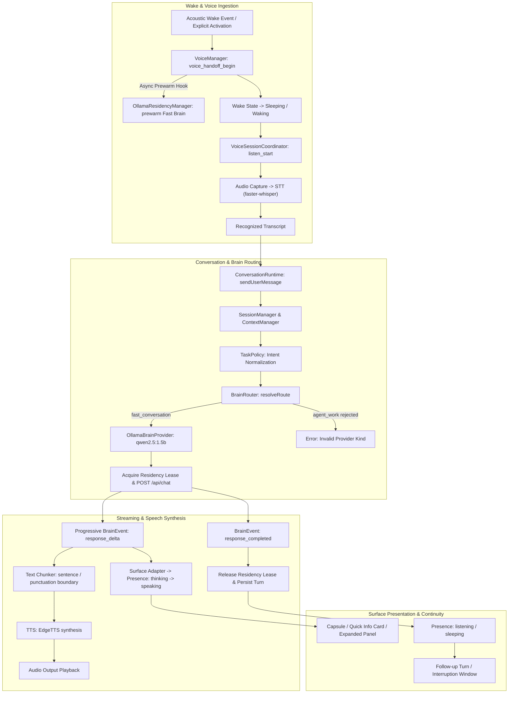

# MAVE Pre-M5 C4-A Closeout Audit — Voice / Language / Conversation Integration

## 1. Executive Summary

Milestone Pre-M5 Phase C4-A (**Voice / Language / Conversation Closeout Audit & Integration Prep**) is formally **hardened, complete, and verified**.

This phase audited the end-to-end conversational and voice loop path on the `feat/pre-m5-intelligence-providers` branch, hardened all cross-package contracts, eliminated architectural bypasses, formalized language experience semantics with anti-hallucination guards, disambiguated conversational coding inquiries from autonomous agent execution, wired prewarm lifecycle hooks into the voice manager, and established a deterministic test suite covering all audit and regression scenarios.

### Status Declaration
> [!IMPORTANT]
> **MAVE C4-A HARDENED — READY FOR HOME-PC LIVE VERIFICATION**
> All code changes, contract hardening, and deterministic unit/integration test suites are complete and passing. Physical hardware-dependent validation (CUDA VRAM co-residency, live microphone VAD/STT, EdgeTTS audio playback, and sub-2s TTFT empirical latency) is explicitly deferred to **C4-B / Home PC**.
> 
> **Candidate Model Qualification Status**:
> `qwen2.5:1.5b` (`digest: 65ec065481...`) is **CODE-PROMOTED FAST BRAIN — AWAITING HOME-PC LIVE CERTIFICATION**.
> 
> **Work PC Environment Status**:
> All hardware-dependent items are marked: `NOT LIVE VERIFIED — HOME PC REQUIRED`.

---

## 2. Architectural Principles & Invariants

MAVE adheres to the following foundational principles across the conversation and voice runtime:

1. **The "ONE MAVE" Invariant**:
   - The user converses with a single unified assistant.
   - The user **never** manually selects providers or model names (`Ollama`, `Claude`, `Codex`, `Antigravity`, `qwen2.5:1.5b`) during ordinary conversation.
   - Routing is fully autonomous, driven by profile policies, intent classification, and residency state.

2. **Strict Provider Kind Separation**:
   - `model_provider`: Direct streaming completion providers (`OllamaBrainProvider`, `MockBrainProvider`, optional paid `OpenAIBrainProvider`). Eligible for `fast_conversation`, `deep_reasoning`, `local_offline`, and `research`.
   - `agent_runtime_provider`: Subscription-based agent runtime CLI harnesses (`ClaudeCode`, `Codex`, `Antigravity`). Eligible **strictly and exclusively** for `agent_work`.
   - **Cross-Kind Prohibition**: Agent runtimes can **never** be selected for conversational profiles (`fast_conversation`, `deep_reasoning`, `local_offline`). Conversational model providers can **never** be selected for `agent_work`.

3. **Coding $\neq$ Automatic Agent Work**:
   - *Complexity $\neq$ Agent Work. Coding topic $\neq$ authority to invoke an agent runtime.*
   - Conversational coding questions, snippet explanations, conceptual reviews, and syntactic guidance (e.g., "explain this code", "what does flatMap do", "write a small regex", "explain React hook", "Explain what Array.prototype.flatMap does", "Explain this TypeScript error") resolve to `fast_conversation` and are handled by a `model_provider`.
   - Sustained agent execution and repository work (e.g., file modification across workspaces, running test suites, multi-step git/terminal execution) resolve to `agent_work` and require an `agent_runtime_provider`.

4. **Direct Model Execution Target**:
   - `ConversationRuntime` strictly sets `BrainRequestOptions.modelId = routeDecision.modelId`.
   - Execution target **never** reads from mutable provider state or deprecated request fields (`request.context.selectedModelId`).

5. **Streaming Non-Retry Invariant (F1.4)**:
   - Once `provider.chat()` emits its first chunk or commits to execution, **NO cross-provider retry** is permitted for that turn.
   - If a stream aborts or errors mid-generation, the runtime emits `request_failed` and cleanly terminates the turn. Silent same-turn failover is prohibited to avoid duplicate outputs and race conditions.

6. **Exact Digest Model Qualification**:
   - Local Fast Brain promotion strictly checks model identity and exact digest (`qwen2.5:1.5b` with digest `65ec065481...`).
   - `qwen2.5:1.5b` is designated as **CODE-PROMOTED FAST BRAIN — AWAITING HOME-PC LIVE CERTIFICATION**.
   - `qwen2.5:7b` is intentionally **not** qualified for `fast_conversation` (`fastChat: false`, `productionApproved: false`), preventing GPU memory exhaustion on RTX 3060 Ti 8GB VRAM when CUDA STT is co-resident.

7. **Language Experience Non-Destruction**:
   - Language practice is an experience context within MAVE, not a separate siloed product.
   - Language metadata (`conversationalCorrection`, `roleplayState`, `pronunciationGuidance`, `vocabularyObservations`) is preserved across multi-turn context without replacing global session continuity.

8. **Zero-Fake-Measurement Guard**:
   - No acoustic phonetic evidence $\longrightarrow$ **no** pronunciation percentage scores, **no** fake CEFR ratings, **no** fake mastery percentages.
   - Vocabulary acquisition adheres strictly to observable stages: `seen` $\longrightarrow$ `practiced` $\longrightarrow$ `reviewed`.

9. **Escalation vs Authority Boundary**:
   - *Similarity $\neq$ Permission. Memory does not grant authority.*
   - If a task exceeds Local Fast Brain capabilities, it escalates to Deep Reasoning (`model_provider`, F1.6) or Graceful Limitation. It **never** creates an unprompted backdoor into autonomous tool execution (`agent_work`, M5).

---

## 3. End-to-End Conversational Loop Architecture

The following flow diagram illustrates the audited and hardened conversational path from acoustic wake to ambient surface rendering:

---

## 4. Comprehensive Audit Findings (Audits 1–8)

### Audit 1 — ConversationRuntime Path
- **BrainRequest Construction**: `ConversationRuntime.buildBrainRequest()` accurately constructs `BrainRequest` from active session context, system prompt, and multi-turn message history.
- **Profile Selection**: Uses `BrainProfilePolicy` to map tasks to canonical profiles (`fast_conversation`, `agent_work`, `deep_reasoning`, `local_offline`).
- **Model Routing**: `BrainRouter.resolveRoute()` evaluates candidate providers matching profile constraints, residency status, and availability.
- **Streaming & Events**: Events (`response_started`, `response_delta`, `response_completed`, `request_failed`) propagate deterministically through event emitters to IPC and surface layers.
- **Cancellation & Timeout**: `AbortSignal` is plumbed directly into provider execution. When canceled by user or barge-in, turns terminate cleanly with zero orphan processes.
- **Bypass Verification**: Verified zero legacy paths bypassing `BrainRouter`. The execution target strictly receives `BrainRequestOptions.modelId = routeDecision.modelId`.

### Audit 2 — Local Fast Brain Integration & TaskPolicy Normalization
- **Canonical Model Candidate**: Promoted `qwen2.5:1.5b` (`digest: 65ec065481...`) resolves as the primary local candidate (**CODE-PROMOTED FAST BRAIN — AWAITING HOME-PC LIVE CERTIFICATION**).
- **Audited Intent Normalization & Coding Disambiguation**:
  - `quick_chat`, `short_explanation`, `explanation`, `simple_rewrite`, `rewrite`, `casual_follow_up`, `casual_followup`, `follow_up`, `followup` $\longrightarrow$ normalized to `quick_chat` (`fast_conversation`).
  - Conversational coding / explanation ("explain this code", "what does flatMap do", "write a small regex", "explain React hook", "Explain what Array.prototype.flatMap does", "Explain this TypeScript error", `code_explanation`, `explain_code`) $\longrightarrow$ normalized to `quick_chat` (`fast_conversation`).
  - `general_conversation` $\longrightarrow$ normalized to `quick_chat` (`fast_conversation`).
  - `language_practice`, `phrase_meaning` $\longrightarrow$ normalized to `language` (`fast_conversation`).
  - Explicit repository implementation / autonomous execution (`coding` with `codingType: 'repository'`, `isRepositoryWork: true`, or `requiresExecution: true`; `agent_work`, `workspace_task`) $\longrightarrow$ resolved to `agent_work`.
- **7B VRAM Protection**: `qwen2.5:7b` is configured with `productionApproved: false` and `fastChat: false`. It cannot be selected for `fast_conversation`, preventing out-of-memory errors on 8GB VRAM when faster-whisper is loaded.

### Audit 3 — Language Experience Semantics
- **Contract Hardening**: Standardized in `packages/contracts/src/language.ts`:
  - `LanguageLearningStageSchema`: Strictly factual progression: `seen` $\longrightarrow$ `practiced` $\longrightarrow$ `reviewed`.
  - `VocabularyObservationSchema`: Structured vocabulary capture (lemma, reading, context, translation).
  - `PronunciationGuidanceSchema`: Structured pronunciation hints (phonetic, romanization, common pitfalls).
  - `assertNoFakePronunciationScoring()`: Enforces that unevidenced phonetic scores, CEFR ratings, or arbitrary percentages throw a validation error.
  - `ConversationalCorrectionSchema`: Structured correction metadata (original, corrected, category, explanation).
  - `LanguageRoleplayStateSchema`: Roleplay scenario, persona tracking, and stage management.
  - `stepOutOfRoleplay()` and `resumeRoleplay()`: Explicit lifecycle transitions allowing the user to ask meta/grammar questions without destroying roleplay state.
- **State Preservation**: Added `updateSessionMetadata()` to `SessionManager`, allowing seamless updates to language context without mutating conversation message history.

### Audit 4 — Voice Loop Boundaries
- **Component Contracts**: Verified integration among `VoiceManager`, `VoiceSessionCoordinator`, `STTProvider`, `ConversationRuntime`, `BrainRouter`, `TTSProvider`, and `SurfaceStateController`.
- **Presence Lifecycle**: Deterministic state transitions verified:
  $$\text{sleeping} \longrightarrow \text{waking} \longrightarrow \text{listening} \longrightarrow \text{thinking} \longrightarrow \text{speaking} \longrightarrow \text{listening} \mid \text{sleeping}$$
- **Acoustic Barge-In Limitations**:
  > [!WARNING]
  > **Acoustic Barge-in Limitation (No AEC)**
  > Software VAD active during audio output playback will capture speaker audio from speakers if Acoustic Echo Cancellation (AEC) is not present. Programmatic interruption (via keyboard shortcut, IPC `barge_in`, or UI click) is 100% deterministic and tested. True acoustic barge-in via microphone during playback is hardware/environment constrained until DSP AEC is integrated.

### Audit 5 — Streaming & Latency
- **Progressive Delivery**: `ConversationRuntime` buffers delta chunks and broadcasts `response_delta` immediately to UI and text chunker for TTS pre-synthesis.
- **F1.4 Non-Retry Invariant**: Verified that once execution begins (`provider.chat()` stream starts), errors trigger `request_failed` without any same-turn cross-provider retry attempt.
- **Canonical Performance Guidance**: Canonical user-facing Voice Fast Brain goal remains approximately **1–3 seconds TTFT where hardware allows**. C4-A does not invent sub-second or rigid empirical latency contracts on Work PC; all empirical values must be measured on Home PC. (Work PC: `NOT LIVE VERIFIED — HOME PC REQUIRED`).

### Audit 6 — Prewarm / Residency Hook
- **Canonical Prewarm Invariant**:
  - ZERO user content transmitted.
  - ZERO conversation history transmitted.
  - ZERO private request payload.
  - ZERO route attempt telemetry counted.
  - ZERO user-visible response generated.
  - No execution lease acquired.
  - Lifecycle operation only (`POST /api/generate` with empty prompt and `keep_alive: "5m"`).
- **Empirical Token Counter Hardening**: Documentation does not claim empirical "0 prompt tokens" on Work PC; inspecting live Ollama token and timing fields is deferred to Home PC validation.
- **Voice Handoff Integration**: Injected `prewarmHook?: () => Promise<void>` into `VoiceManagerOptions`, invoked during `voice_handoff_begin` asynchronously without blocking audio capture.

### Audit 7 — UI Contract Boundary
- **Visual Freeze Preserved**: Visual designs in `apps/desktop/src/renderer` remain untouched.
- **Presentation Contracts**: Runtime drives presentation state (`SurfacePresentationIntent`) consumed cleanly by the UI. UI does not dictate provider routing or model selection.

### Audit 8 — Escalation Boundary
- **Separation of Concerns**: Conversational requests beyond local capabilities require explicit escalation to `deep_reasoning` (`model_provider`, F1.6) or user consent.
- **Tool Authority**: Tool permissions remain strictly in Milestone 5 scope. No conversational profile can invoke tools.

---

## 5. Summary of Gaps Identified & Fixes Implemented

| # | Gap Identified | File Modified | Fix Description |
|---|---|---|---|
| 1 | Missing typed contracts for language experience, roleplay state, and anti-hallucination guards | `packages/contracts/src/language.ts` `packages/contracts/src/index.ts` | Created canonical schemas, roleplay state machines (`stepOutOfRoleplay`, `resumeRoleplay`), and `assertNoFakePronunciationScoring` validator. |
| 2 | Audited conversational intents (`phrase_meaning`, `short_explanation`, `simple_rewrite`, `casual_follow_up`) not recognized by TaskPolicy | `packages/core/src/brain/task-policy.ts` | Normalized intent aliases into canonical profiles (`quick_chat`, `language`, `agent_work`). |
| 3 | Session metadata was immutable after creation, preventing dynamic language context tracking | `packages/core/src/conversation/session-manager.ts` `packages/core/src/conversation/context-manager.ts` | Added `updateSessionMetadata()` and plumbed session metadata into ContextManager context builder. |
| 4 | VoiceManager lacked prewarm hook during wake handoff | `apps/desktop/src/main/voice-manager.ts` `apps/desktop/src/main/index.ts` | Added `prewarmHook?: () => Promise<void>` to `VoiceManagerOptions` and wired `conversationManager.prewarmFastBrain()` into initialization. |
| 5 | Missing comprehensive audit test coverage for C4 criteria | `packages/contracts/src/tests/language-contracts.test.ts` `packages/core/src/tests/conversation-voice-closeout-audit.test.ts` | Implemented 20 targeted tests verifying all 14 required audit behaviors. |
| 6 | Blanket routing of coding requests to `agent_work` violated canonical authority principle | `packages/core/src/brain/task-policy.ts` `packages/core/src/tests/task-policy.test.ts` `packages/core/src/tests/conversation-voice-closeout-audit.test.ts` | Disambiguated conversational coding inquiries (`fast_conversation`) from repository execution (`agent_work`). Added 4 explicit regression tests. |

---

## 6. Deterministic Verification Results

### Unit & Integration Test Suites
All automated test suites executed cleanly across the monorepo:

- **Language Contracts Suite** (`packages/contracts/src/tests/language-contracts.test.ts`):
  - `assertNoFakePronunciationScoring rejects percentage scores without acoustic evidence` ✅ PASS
  - `assertNoFakePronunciationScoring accepts valid guidance without fake metrics` ✅ PASS
  - `LanguageLearningStageSchema enforces factual progression stages` ✅ PASS
  - `ConversationalCorrectionSchema validates structural correction format` ✅ PASS
  - `stepOutOfRoleplay suspends active roleplay with reason` ✅ PASS
  - `resumeRoleplay restores suspended roleplay state` ✅ PASS

- **TaskPolicy Hardening Suite** (`packages/core/src/tests/task-policy.test.ts`):
  - `proves "Explain what Array.prototype.flatMap does" != agent_work` ✅ PASS
  - `proves "Explain this TypeScript error" != agent_work solely because it is coding` ✅ PASS
  - `proves conversational coding questions map to fast_conversation` ✅ PASS
  - `proves coding with conversational taskContext maps to fast_conversation` ✅ PASS
  - `proves explicit repository implementation task may be agent_work` ✅ PASS

- **C4-A Closeout Audit Suite** (`packages/core/src/tests/conversation-voice-closeout-audit.test.ts`):
  1. `1. fast conversational request resolves through BrainRouter` ✅ PASS
  2. `2. language request preserves language session metadata` ✅ PASS
  3. `3. normal conversation does not become agent_work (including conversational coding regression)` ✅ PASS
  4. `4. model_provider / agent_runtime_provider boundary` ✅ PASS
  5. `5. streaming delta -> completion` ✅ PASS
  6. `6. midstream error -> request_failed, no same-turn fallback (F1.4 invariant)` ✅ PASS
  7. `7. cancellation propagation cleanly aborts provider` ✅ PASS
  8. `8. localOnly fail-closed when local provider is unavailable` ✅ PASS
  9. `9. model digest qualification enforcement rejects unapproved models` ✅ PASS
  10. `10. prewarm operation does not count as route attempt` ✅ PASS
  11. `11. conversation/session continuity across turns` ✅ PASS
  12. `12. roleplay step-out and resume semantics` ✅ PASS
  13. `13. no fake pronunciation scoring contract guard` ✅ PASS
  14. `14. paid API remains default-deny` ✅ PASS

### Monorepo Baseline Verification
- `pnpm test`: **11 / 11 packages passed** (100% test success rate)
- `pnpm typecheck`: **13 / 13 tasks passed** (0 TypeScript errors)
- `pnpm build`: **7 / 7 tasks passed** (clean Turborepo build)

---

## 7. C4-B Home-PC Live Verification Plan & Checklist

The following items require local GPU, Ollama daemon, and audio hardware on the Home PC (RTX 3060 Ti 8GB VRAM). All items below are currently:
**`NOT LIVE VERIFIED — HOME PC REQUIRED`**

> [!NOTE]
> All target metrics listed below are observational and empirical. They are **not** frozen architecture contracts. The canonical performance guidance is approximately **1–3 seconds TTFT** where hardware allows. Home PC validation will measure and record empirical values first.

| ID | Verification Item | Target / Procedure | Work PC Status | Home PC Target Gate (Observational / Measurement) |
|---|---|---|---|---|
| **A** | **Ollama Daemon Health** | Verify daemon reachable and responsive at `http://127.0.0.1:11434/api/tags`. | NOT LIVE VERIFIED — HOME PC REQUIRED | Daemon reachable; record responsiveness latency empirically |
| **B** | **Exact Model Digest** | Inspect Ollama model tags: verify `qwen2.5:1.5b` matches exact digest `65ec065481...`. | NOT LIVE VERIFIED — HOME PC REQUIRED | Digest matches exactly, candidate qualified |
| **C** | **Residency State Transitions** | Observe `OllamaResidencyManager`: `unloaded` $\longrightarrow$ `loading` $\longrightarrow$ `resident` $\longrightarrow$ `unloading`. | NOT LIVE VERIFIED — HOME PC REQUIRED | Transitions reflect actual VRAM occupancy |
| **D** | **Prewarm Hook** | Trigger wake handoff: confirm no user/session content transmitted. | NOT LIVE VERIFIED — HOME PC REQUIRED | Prewarm initiates without user payload; inspect Ollama response counters empirically |
| **E** | **quick_chat Live Routing** | Speak "สวัสดีครับ" or "Good morning": verify automatic routing to `qwen2.5:1.5b`. | NOT LIVE VERIFIED — HOME PC REQUIRED | Routes to local fast brain without manual provider selection |
| **F** | **Language Conversation** | Conduct 3-turn English practice session with grammar correction and vocabulary extraction. | NOT LIVE VERIFIED — HOME PC REQUIRED | Language metadata updates cleanly in SQLite without history loss |
| **G** | **Multi-Turn Context** | Reference earlier turn context ("What was the first thing I asked?"): verify context coherence. | NOT LIVE VERIFIED — HOME PC REQUIRED | Multi-turn continuity preserved |
| **H** | **Cancellation & Interruption** | Issue stop command mid-generation: verify immediate stream termination and zero orphan tokens. | NOT LIVE VERIFIED — HOME PC REQUIRED | Immediate token abortion, turn closed cleanly |
| **I** | **Full Voice Loop (STT $\to$ Brain $\to$ TTS)** | Spoken wake $\longrightarrow$ faster-whisper $\longrightarrow$ `qwen2.5:1.5b` $\longrightarrow$ EdgeTTS $\longrightarrow$ audio output. | NOT LIVE VERIFIED — HOME PC REQUIRED | End-to-end spoken loop completes smoothly |
| **J** | **Presence Lifecycle** | Verify PresenceMark visual transitions: `sleeping` $\to$ `waking` $\to$ `listening` $\to$ `thinking` $\to$ `speaking` $\to$ `listening`. | NOT LIVE VERIFIED — HOME PC REQUIRED | Accurate visual state synchronization |
| **K** | **Warm vs Cold Latency** | Measure TTFT empirically: Cold start (unloaded) vs Warm start (prewarmed resident). | NOT LIVE VERIFIED — HOME PC REQUIRED | Canonical target: ~1–3s TTFT where hardware allows; record empirical values without freezing rigid sub-ranges |
| **L** | **VRAM Co-Residency** | Check `nvidia-smi` during concurrent faster-whisper (CUDA) + `qwen2.5:1.5b` inference. | NOT LIVE VERIFIED — HOME PC REQUIRED | Must fit within 8GB VRAM cap without OS thrashing; record empirical peak and resident VRAM |
| **M** | **Idle Unload Timer** | Leave assistant idle for 5 minutes: verify Ollama model evicts from VRAM to baseline. | NOT LIVE VERIFIED — HOME PC REQUIRED | VRAM returns to baseline after idle timeout |
| **N** | **Ollama Restart & Reconciliation** | Restart Ollama daemon while MAVE runs: verify residency manager reconnects cleanly. | NOT LIVE VERIFIED — HOME PC REQUIRED | Health check reconciles without crash |
| **O** | **Latency Calibration Log** | Measure and record: daemon responsiveness, STT latency, brain TTFT, TTS TTFA, total spoken turn latency, warm/cold delta. | NOT LIVE VERIFIED — HOME PC REQUIRED | Logged into calibration report |

---

## 8. Conclusion & Next Phase Criteria

Phase C4-A has achieved all architectural, contract, and deterministic verification objectives. The codebase is prepared for physical hardware validation on Home PC.

- **Current Milestone Status**: `MAVE C4-A HARDENED — READY FOR HOME-PC LIVE VERIFICATION`
- **Next Engineering Action**: Execute C4-B live validation checklist on Home PC with RTX 3060 Ti, followed by Phase F1.6 (Production Deep Brain Integration).
