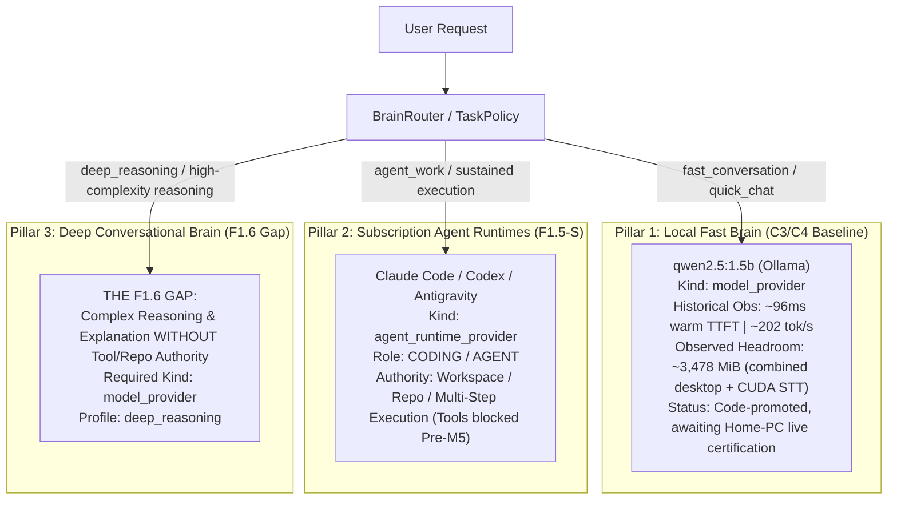
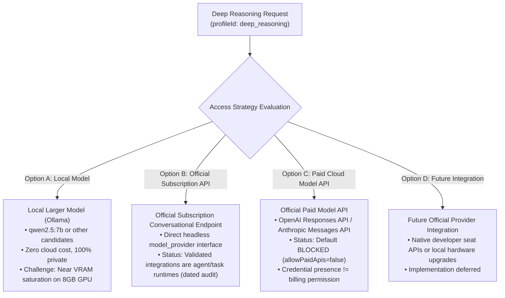
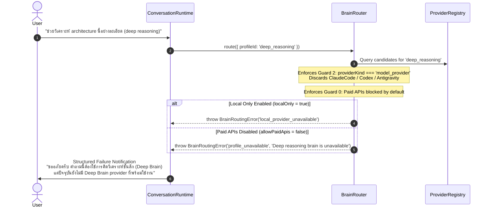
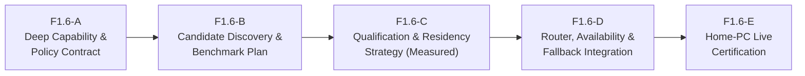

# MAVE F1.6 Deep Brain Architecture Audit & Gap Analysis

> [!IMPORTANT]
> **AUDIT & DESIGN ONLY — ZERO PRODUCTION IMPLEMENTATION**
> This document defines the canonical architecture, gap analysis, and implementation roadmap for **Milestone Pre-M5 Phase F1.6 (Deep Brain Architecture)**.
> - **Status**: AUDIT COMPLETE / IMPLEMENTATION PENDING
> - **Production Provider**: None implemented in this phase.
> - **Runtime & C3/C4 Invariant**: Zero changes to existing runtime code, C3 residency, or C4 voice conversation behaviors.
> - **Paid APIs**: Default OFF (`allowPaidApis: false`).
> - **Authority Boundary**: Subscription agent runtimes (`ClaudeCode`, `Codex`, `Antigravity`) remain strictly `agent_runtime_provider` and must NEVER be relabeled or routed as conversational `model_provider`.

---

## 1. Executive Summary & The Canonical F1.6 Gap

MAVE's core intelligence architecture decouples **Task Classification** from **Runtime Capability**, ensuring that the user experiences ONE cohesive assistant. Under this model, MAVE maintains three distinct intelligence pillars:



### The Current Real Gap
MAVE currently has:
1. **Local Fast Brain (`qwen2.5:1.5b`)**: Code-promoted `model_provider` awaiting Home-PC live certification. In historical C2 evaluation on Home PC hardware, it demonstrated ~96ms warm TTFT and ~202 tok/s server evaluation throughput with approximately 3,478 MiB of observed headroom under a combined desktop + CUDA STT + 1.5B load. However, with only 1.5B parameters, it lacks the cognitive depth required for complex architectural analysis, nuanced logic puzzles, multi-constraint planning, or difficult code explanation.
2. **Subscription Agent Runtimes (`ClaudeCode`, `Codex`, `Antigravity`)**: Powerful multi-model runtimes normalized under F1.5-S. However, their official interfaces and execution sandboxes are structured as **`agent_runtime_provider`** designed for sustained terminal execution, file inspection, and workspace mutation.

**What MAVE lacks is a proven, conversational `model_provider` for `deep_reasoning`:**
- Difficult logical or algorithmic deduction
- Architectural tradeoffs and system design comparisons
- Conversational code explanation and nuanced type-system debugging without repository execution
- Complex multi-step reasoning in bilingual Thai/English
- Long-form analytical synthesis

Currently, if a request requires deep reasoning but grants **zero execution authority**, MAVE cannot route it to the Fast Brain without risking shallow hallucination, and **must not route it to an agent runtime** without violating the provider-kind security boundary. This is the canonical F1.6 gap.

---

## 2. Core Invariants & Architecture Taxonomy

To prevent architectural drift, the following invariants are permanently established:

### Invariant 1: Canonical Provider-Kind Profile Mapping
```text
fast_conversation  ──►  model_provider
deep_reasoning     ──►  model_provider
local_offline      ──►  model_provider
research           ──►  model_provider
agent_work         ──►  agent_runtime_provider
```

### Invariant 2: Agent Runtimes Must Never Masquerade as Model Providers
`ClaudeCodeBrainProvider`, `CodexBrainProvider`, and `AntigravityBrainProvider` are `agent_runtime_provider` implementations.
- They wrap CLI processes with execution sandboxes, tool permissions, and workspace hooks.
- **They must NEVER be relabeled as `model_provider`** merely because the underlying models (Claude 3.7 Sonnet, GPT-5 / o3, Gemini 2.5 Pro) possess strong reasoning capabilities.
- Relabeling them would create an authority breach: conversational queries could trigger accidental terminal commands, filesystem reads, or workspace lock contention.

### Invariant 3: Complexity != Agent Work
A query's intellectual complexity or technical subject matter (e.g., programming languages, algorithms, system architecture) **does not grant authority** to invoke an agent runtime.
- Conversational coding ("Explain how Array.prototype.flatMap works") $\to$ `model_provider`.
- Autonomous execution ("Inspect this repository, run the test suite, and refactor the failing components") $\to$ `agent_runtime_provider`.

---

## 3. Fast Conversation vs Deep Reasoning vs Agent Work Matrix

The following decision matrix governs request classification across all intelligence dimensions:

| Dimension | Fast Conversation (`fast_conversation`) | Deep Reasoning (`deep_reasoning`) | Agent Work (`agent_work`) |
|---|---|---|---|
| **Target Provider Kind** | `model_provider` | `model_provider` | `agent_runtime_provider` |
| **Latency Guidance** | Canonical target: ~1–3s Brain TTFT where hardware allows *(Historical observation: ~96ms warm TTFT)* | **NO CANONICAL TTFT SLO YET** (Measured in F1.6-B) | Longer-running / task-oriented runtime (No conversational TTFT contract) |
| **Requires Sustained Execution?** | NO | NO | YES |
| **Requires Filesystem / Workspace Access?** | NO | NO | YES |
| **Requires Terminal / Shell Execution?** | NO | NO | YES |
| **Requires Repository Mutation?** | NO | NO | YES |
| **Requires Deep Deductive Reasoning?** | Minimal (Heuristic / Short) | YES (Multi-step, structural) | YES (Goal-directed planning) |
| **Tool Authority (CURRENT Pre-M5)** | **ZERO** | **ZERO** | **ZERO** (Tools blocked by current runtime policy) |
| **Tool Authority (FUTURE M5)** | **ZERO** | **ZERO** | Governed by: Tool Request $\to$ Permission (ALLOW / ASK / DENY) $\to$ Executor $\to$ Audit |
| **Primary Modality Focus** | Conversational Voice & Text | In-depth Conversational & Analytical Reasoning | Multi-step Workspace Task Execution |
| **Example Prompts** | "สวัสดีครับ วันนี้มีอะไรแนะนำบ้าง", "What does flatMap do?", "Fix this typo" | "Why can this multi-threaded queue deadlock?", "Compare Postgres vs ScyllaDB for telemetry", "วิเคราะห์ trade-off ของ clean architecture" | "Inspect this repo and run vitest", "Refactor the authentication middleware to use JWT", "Create a new React component" |

> [!NOTE]
> - Current web truth and real-time retrieval belong to **F1.8 (Research / Truth Routing)**, not F1.6.
> - Tool and MCP execution belong to **Milestone 5 (Tools & Permissions)**, not F1.6. Intelligence escalation does not equal tool permission.
> - UI Surface presentation is decoupled from brain profile routing (see Section 8).

---

## 4. Access Strategy Audit for Deep Brain

Four potential access strategies exist for fulfilling the Deep Brain `model_provider` requirement:



### Option A: Local Larger Model (e.g., Ollama `qwen2.5:7b` or Other Candidates)
- **Pros**: 100% private, zero token billing, fully compliant with `localOnly = true`, operates within existing `OllamaBrainProvider`.
- **Hardware Challenge**: On the target 8GB RTX 3060 Ti, historical observation under combined desktop + CUDA STT + `qwen2.5:7b` showed ~8,130 MiB total allocation (~99.2% of 8,192 MiB), representing **near VRAM saturation / unsafe operational headroom** for concurrent execution.

### Option B: Official Subscription Conversational Runtime (Dated Capability Audit)
> [!NOTE]
> **Dated Capability Audit (2026-10-16)**:
> As of the F1.6 architecture audit date (2026-10-16), the official subscription-backed integrations currently validated by MAVE are agent/task runtimes rather than a direct conversational `model_provider` interface suitable for `deep_reasoning`:
> - **Anthropic Claude**: Subscription (Claude Pro/Team) backed by official CLI task runtime (`claude`) $\to$ Normalized in MAVE as `ClaudeCodeBrainProvider` (`agent_runtime_provider`). The official direct REST API (`api.anthropic.com`) is a metered paid API (blocked by default).
> - **OpenAI Codex**: Subscription (ChatGPT Plus/Pro/Team) backed by official CLI task runtime (`codex exec`) $\to$ Normalized in MAVE as `CodexBrainProvider` (`agent_runtime_provider`). The official direct REST API (`api.openai.com`) is a metered paid API (blocked by default).
> - **Google Antigravity**: Subscription (Google One AI Premium / Workspace) backed by official CLI subagent runtime (`agy`) $\to$ Normalized in MAVE as `AntigravityBrainProvider` (`agent_runtime_provider`).
>
> A fresh check of official vendor capabilities must be conducted during F1.6-B prior to implementation. Future availability must not be assumed without evidence.

- **Strict Negative Boundary**: MAVE will NEVER reverse-engineer private web endpoints, steal browser session cookies, replay undocumented internal GraphQL mutations, or scrape logged-in web chat UIs.

### Option C: Official Paid Model API (`OpenAIBrainProvider`, etc.)
- **Pros**: Direct, high-quality, pure `model_provider` interface with multi-model catalog and zero local VRAM overhead.
- **Cons**: Metered per-token cost.
- **Strict Policy Constraint**: Paid APIs remain **BLOCKED BY DEFAULT** (`allowPaidApis: false`). An API key in the environment NEVER grants permission to charge the user. Must be explicitly enabled by user configuration.

### Option D: Future Official Provider Integration
- Any future vendor mechanism that provides authenticated, direct conversational model access under developer subscription seats or enterprise licenses.

---

## 5. Local Hardware Feasibility Assessment (RTX 3060 Ti 8GB)

Empirical data gathered during Milestone Pre-M5 F1.5-C2 benchmarking on the Home PC hardware baseline provides the following measured resource observations:

### Historical Empirical Observations (Home PC: RTX 3060 Ti 8GB)
- **`qwen2.5:1.5b` (Code-Promoted Fast Brain, awaiting Home-PC live certification)**:
  - Model resident: approximately 1,112 MiB
  - Model benchmark peak: approximately 3,284 MiB
  - Model-only measured headroom: approximately 4,908 MiB
  - **Combined desktop + CUDA STT + 1.5B observed headroom**: **approximately 3,478 MiB** (Safe operational margin for concurrent voice conversation).
- **`qwen2.5:7b` (Historical Evaluation Candidate)**:
  - Model resident: approximately 4,528 MiB
  - Model benchmark peak: approximately 6,664 MiB
  - **Combined desktop + CUDA STT + 7B observed total**: **approximately 8,130 MiB** (~99.2% of 8,192 MiB dedicated VRAM).
  - Canonical assessment: **NEAR VRAM SATURATION / UNSAFE OPERATIONAL HEADROOM**.

> [!CAUTION]
> Do NOT derive concurrent VRAM usage by simply summing independent peak values measured at different times.
> Do NOT claim "guaranteed instant CUDA OOM" or ">8GB concurrent peak" unless proven by a single live concurrent measurement.
> C3.1 / C4-B Home PC live certification remains the next authoritative source of current empirical hardware truth.

### Architectural Options for Evaluation in F1.6-B (Unverified Hypotheses)
The following architectural options remain available for evaluation, but must not be frozen with unverified numeric gates or performance thresholds:

1. **Mutually Exclusive STT / Deep Brain Residency**:
   - Time-sliced residency where CUDA STT unloads prior to loading the Deep Brain, and reloads upon return to voice listening.
   - *Consideration*: Must measure turn-transition latency in F1.6-B; if model load times introduce multi-second pauses, it may be restricted to text-first interactions.
2. **CPU / System RAM Offload**:
   - Utilize partial GGUF layer offloading between GPU VRAM and 16GB system RAM via Ollama.
   - *Status*: **UNVERIFIED HYPOTHESIS**. Specific layer split and throughput must be empirically benchmarked in F1.6-B rather than assumed.
3. **Text-Only Deep Mode**:
   - When a deep query is executed from text interaction surfaces, the voice audio capture runtime is dormant and CUDA STT remains unloaded, providing maximum VRAM headroom for the deep model.
4. **Hardware-Specific Profiles & Larger VRAM Hardware**:
   - Differentiate capabilities based on detected physical VRAM (e.g., systems with larger VRAM pools can run larger models concurrently without mutual exclusion).
   - *Status*: Hardware gates must be established from benchmark evidence, not arbitrary thresholds.

---

## 6. Deep Routing Semantics & TaskPolicy

### Deterministic Routing Triggers
A request is classified into `deep_reasoning` based on deterministic evidence categories:
1. **Explicit User Intent**:
   - Thai trigger phrases: `"คิดให้ลึก"`, `"ช่วยวิเคราะห์อย่างละเอียด"`, `"เปรียบเทียบเชิงลึก"`, `"วิเคราะห์ข้อดีข้อเสีย"`
   - English trigger phrases: `"think deeply"`, `"analyze step-by-step"`, `"compare architectures in detail"`, `"deep review"`
2. **Structural Task Context**:
   - `taskContext.planningType === 'conversational'` $\to$ `deep_reasoning`
   - `taskIntent === 'deep_reasoning'`
3. **Complexity Boundary**:
   - Logic puzzles, formal reasoning, structural architectural evaluation without execution authority.

### Negative Invariants
- **No Self-Confidence Gating**: The Local Fast Brain must NOT act as its own routing judge by running a speculative pre-pass. Speculative self-assessment wastes latency and introduces confidence bias.
- **No Arbitrary Heuristics**: No random or weighted coin-toss routing. All routing decisions are 100% deterministic and reproducible.

---

## 7. Graceful Failure & Escalation Semantics

When `TaskPolicy` or the user requests `deep_reasoning`, but no eligible healthy `model_provider` is registered:



### Audited Canonical Error Codes
Auditing `packages/contracts/src/brain.ts` and `packages/core/src/brain/router.ts` (lines 1209–1211) reveals that canonical error codes are already defined and tested:
- **`profile_unavailable`**: Emitted when `profileId === 'deep_reasoning'` has no registered, healthy `model_provider`. Message: `'Deep reasoning brain is unavailable'`.
- **`local_provider_unavailable`**: Emitted when `localOnly === true` is set, and no local deep candidate exists.
- **`provider_unavailable`**: Emitted when all candidates require paid API billing (`allowPaidApis = false`).

**Under no circumstances will `BrainRouter` silently fall back to `agent_work` or invoke an unapproved cloud API.**

---

## 8. Decoupling Brain Profile from Presentation Surface

MAVE strictly separates **Intelligence Routing** from **Presentation Policy**:

```text
┌─────────────────────────────────────────────────────────────┐
│                      MAVE CORE ENGINE                       │
└──────────────┬──────────────────────────────┬───────────────┘
               │                              │
     [INTELLIGENCE LANE]             [PRESENTATION LANE]
               ▼                              ▼
┌──────────────────────────────┐┌──────────────────────────────┐
│         BrainRouter          ││     Presentation Policy      │
│ Decides INTELLIGENCE PATH:   ││ Decides SURFACE PRESENTATION:│
│ • fast_conversation          ││ • Presence                   │
│ • deep_reasoning             ││ • Companion                  │
│ • agent_work                 ││ • Conversation               │
│ • research                   ││ • Workspace                  │
│ • local_offline              ││                              │
└──────────────────────────────┘└──────────────────────────────┘
```

1. **Intelligence Path != UI Surface**:
   - `BrainRouter` decides **which brain provider and model** process the prompt.
   - Presentation Policy decides **which surface** presents the result based on:
     - Answer shape and length (concise vs long-form)
     - Interaction duration
     - Presence of rich or contextual content (code blocks, tables, diagrams)
     - Sustained task activity
     - User interaction mode and manual surface expansion
     - Current environmental focus
2. **Canonical Surface Examples**:
   - A `deep_reasoning` response that is concise may be spoken over voice or presented cleanly in normal **Conversation**.
   - A `fast_conversation` response requiring structured data or code snippets may expand to a richer contextual view.
   - `agent_work` may promote to **Workspace** when multi-file artifacts, terminal output, or sustained task diffs require canvas space—not simply because of provider kind.
3. **Accepted MAVE Surface Terminology**:
   - **Presence**: Ambient status ring / orb visualizer.
   - **Companion**: Lightweight floating quick-access capsule.
   - **Conversation**: Conversational thread and chat surface.
   - **Workspace**: Full interactive canvas for documents, file inspection, and project artifacts.

---

## 9. Privacy, Billing & Security Boundaries

1. **`localOnly` Enforcement (Fail-Closed)**:
   - If `request.localOnly === true` or `overrides.localOnly === true`, the request CANNOT leave the local machine.
   - If no local Deep Brain exists, routing terminates immediately with `local_provider_unavailable`.
2. **Paid API Guardrail**:
   - Metered cloud APIs (OpenAI, Anthropic direct, Google AI Studio) remain default disabled (`allowPaidApis: false`).
   - The presence of `OPENAI_API_KEY` or `ANTHROPIC_API_KEY` in environment variables does NOT constitute billing permission.
3. **Streaming & Non-Retry Invariant (F1.4)**:
   - Pre-execution fallback across healthy providers is permitted before generation.
   - **Once `provider.chat()` emits its first streaming delta, same-request cross-provider retry is forbidden.** Midstream failure aborts the turn with `request_failed`. No secret second brain is ever spawned.
4. **Fast $\to$ Deep Escalation Boundary**:
   - Escalation decisions must occur **before committed generation** begins. A Fast Brain must not emit 20 tokens, decide the problem is too difficult, and silently restart on Deep Brain.

---

## 10. Subscription Runtime Audit: Why Agent Runtimes Cannot Fill the Gap

A rigorous inspection of MAVE's three subscription runtime adapters proves why they remain `agent_runtime_provider`:

| Runtime Adapter | Underlying Engine | Official Transport | Enforced Sandbox & Constraints | Why It Remains `agent_runtime_provider` |
|---|---|---|---|---|
| **`ClaudeCodeBrainProvider`** | Claude 3.7 Sonnet | `claude` CLI headless process | Enforces `--tools ""` and `--safe-mode`. Strips billing env vars. Spawns child process with working directory inspection. | Structured around terminal execution, file inspection, and workspace hooks. Tool disabling is an external CLI flag, not an architectural guarantee of pure model inference. |
| **`CodexBrainProvider`** | OpenAI Codex / o3 | `codex exec` CLI process | Enforces `--sandbox read-only` and `--skip-git-repo-check`. Prompts piped strictly through stdin. Process killed if tool execution attempted. | Tailored for repository exploration and code transformations. CLI execution wrapper is built for code workspace semantics. |
| **`AntigravityBrainProvider`** | Gemini 2.5 Pro / Flash | `agy` CLI subagent process | Uses subagent conversation ID and protocol parsing. Structured for multi-turn task execution. | Operates as an autonomous subagent runner with full agent lifecycle, not a direct model inference endpoint. |

> [!NOTE]
> The primary reason these runtimes remain `agent_runtime_provider` is their **official runtime semantics, CLI execution wrapper architecture, and MAVE provider contract**—not an assumed startup latency number.
> Any process startup timings observed during testing are labeled: `HISTORICAL OBSERVATION — NOT CONTRACT`.

---

## 11. Roadmap Audit: F1.7 Agent Runtime Normalization

### Audit Finding
- `MAVE_ROADMAP.md` line 177 lists: `- **F1.7 Agent Runtime Normalization (ClaudeCode / Antigravity / Codex)**`.
- However, the **F1.5-S track (Phases S1 through S5)** was already executed and completed in full:
  - `F1.5-S1`: Claude Code subscription normalization.
  - `F1.5-S2` & `S2.1`: Runtime model catalog & model role engine.
  - `F1.5-S3` & `S3.1`: Task $\to$ Runtime $\to$ Model routing engine & telemetry.
  - `F1.5-S3.2`: Codex subscription normalization.
  - `F1.5-S3.3`: Tri-runtime live smoke verification.
  - `F1.5-S4` & `S4.1`: Quota-aware fallback & recovery.
  - `F1.5-S5`: Final closeout audit documented in `MAVE_SUBSCRIPTION_INTELLIGENCE_ARCHITECTURE.md`.

### Resolution
**F1.7 was fulfilled by F1.5-S.**
[`docs/architecture/MAVE_ROADMAP.md`](file:///d:/project/MAVE-pre-m5/docs/architecture/MAVE_ROADMAP.md) has been updated to reflect that F1.7 was fulfilled by the completed F1.5-S track, preventing duplicate backlog tracking.

---

## 12. Proposed Implementation Stages for F1.6

When authorized to implement F1.6 in a future phase, work should proceed in the following semantic sequence:



1. **F1.6-A: Deep Capability & Policy Contract**:
   - Formalize `deep_reasoning` request options and TaskPolicy trigger rules.
   - Standardize `profile_unavailable` user-facing messaging across Surface and Voice.
2. **F1.6-B: Candidate Discovery, Official-Access Re-Audit & Benchmark Plan**:
   - Conduct fresh audit of official vendor offerings for direct conversational model access.
   - Discover local candidate models (e.g. `qwen2.5:7b` or other candidates).
   - Design empirical benchmark plan for reasoning quality, Thai bilingual syntax, and TTFT.
3. **F1.6-C: Candidate Qualification & Residency Strategy Based on Measured Evidence**:
   - Empirically measure VRAM and throughput across candidates on Home PC.
   - Determine residency strategy (e.g., text-only mode vs mutual exclusion vs CPU offload) strictly from measured data.
4. **F1.6-D: Router, Availability & Fallback Integration**:
   - Wire `deep_reasoning` profile routing to prioritize qualified deep candidate when healthy.
   - Enforce fail-closed privacy (`localOnly`) and paid API default-deny.
5. **F1.6-E: Home-PC Live Certification**:
   - Perform live Home-PC testing with `nvidia-smi` sampling.
   - Validate zero OOM crashes, zero stream corruption, and exact telemetry.

---

## 13. Test Plan for F1.6 Closeout

Prior to closing F1.6 in the future, the following deterministic tests must pass:

1. **Provider-Kind Boundary Test**:
   - Prove that `route({ profileId: 'deep_reasoning' })` selects ONLY providers where `providerKind === 'model_provider'`.
   - Prove that `ClaudeCodeBrainProvider`, `CodexBrainProvider`, and `AntigravityBrainProvider` are filtered out.
2. **Conversational Coding Isolation**:
   - Prove that "Explain how Array.prototype.flatMap works" routes to `fast_conversation` or `deep_reasoning`, NEVER `agent_work`.
3. **Agent Work Isolation**:
   - Prove that "Inspect repository and run tests" routes strictly to `agent_work`.
4. **Privacy Fail-Closed (`localOnly`)**:
   - When `localOnly = true` and no local Deep Brain is resident/available, router throws `local_provider_unavailable`. No cloud request is attempted.
5. **Paid API Default Deny**:
   - When only paid API providers are registered, router throws `provider_unavailable` citing `allowPaidApis = false`.
6. **No Phantom Escalation During Generation**:
   - Midstream failure of a Fast Brain does not trigger speculative fallback to Deep Brain.
7. **Preferred & Locked Selection Modes**:
   - Verify `AUTO`, `PREFERRED`, and `LOCKED` behave deterministically under `deep_reasoning`.
8. **VRAM Safety Guard**:
   - Unit tests verifying that `OllamaResidencyManager` blocks unsafe concurrent model leases.

---

## 14. Strategic Recommendations

1. **Do Not Rush Local 7B Promotion on 8GB Hardware**:
   - Keep `qwen2.5:1.5b` as the sole code-promoted local model awaiting C3.1/C4-B live certification.
   - Treat local 7B reasoning as an unapproved candidate requiring empirical verification in F1.6-B/C.
2. **Preserve Subscription-First Philosophy**:
   - Continuously monitor official vendor capabilities for official direct conversational model access.
   - Under no circumstance resort to unofficial web scraping or private token reverse-engineering.
3. **Maintain Strict Separation of Concerns**:
   - Brain routing resolves intelligence; presentation policy resolves surface; tool authority is strictly governed by Milestone 5.
