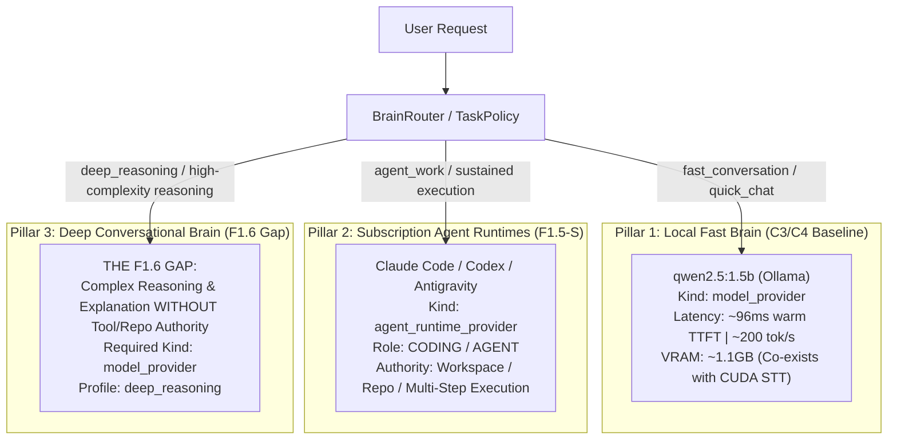
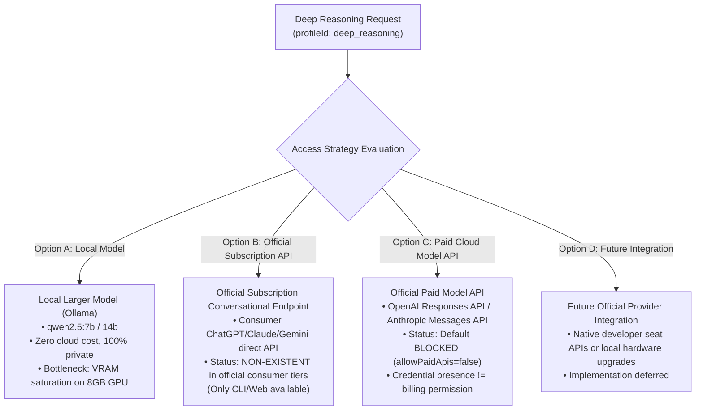
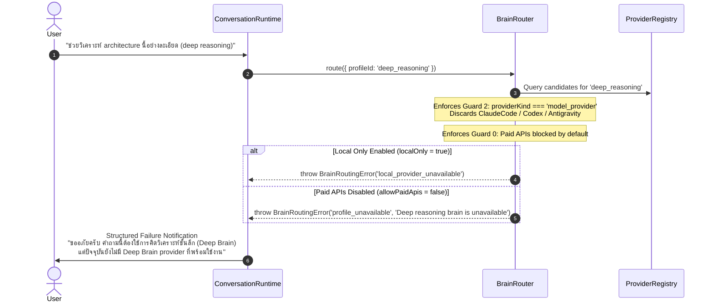
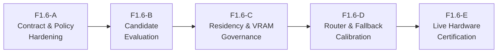

# MAVE F1.6 Deep Brain Architecture Audit & Gap Analysis

> [!IMPORTANT]
> **AUDIT & DESIGN ONLY — ZERO PRODUCTION IMPLEMENTATION**
> This document defines the canonical architecture, gap analysis, and implementation roadmap for **Milestone Pre-M5 Phase F1.6 (Deep Brain Architecture)**.
> - **Status**: AUDIT COMPLETE / IMPLEMENTATION PENDING
> - **Production Provider**: None implemented in this phase.
> - **Runtime & C3/C4 Invariant**: Zero changes to existing runtime code, C3 residency, or C4 voice conversation behaviors.
> - **Paid APIs**: Default OFF (`allowPaidApis: false`).
> - **Authority Boundary**: Subscription agent runtimes (`ClaudeCode`, `Codex`, `Antigravity`) remain strictly `agent_runtime_provider` and must NEVER be relabeled or routed as conversational `model_provider`.

---

## 1. Executive Summary & The Canonical F1.6 Gap

MAVE's core intelligence architecture decouples **Task Classification** from **Runtime Capability**, ensuring that the user experiences ONE cohesive assistant. Under this model, MAVE maintains three distinct intelligence pillars:



### The Current Real Gap
MAVE currently has:
1. **Local Fast Brain (`qwen2.5:1.5b`)**: Production-promoted `model_provider` delivering ultra-low-latency conversational response (~96ms warm TTFT) and safe VRAM co-residency with CUDA STT. However, with only 1.5B parameters, it lacks the cognitive depth required for complex architectural analysis, nuanced logic puzzles, multi-constraint planning, or difficult code explanation.
2. **Subscription Agent Runtimes (`ClaudeCode`, `Codex`, `Antigravity`)**: Powerful multi-model runtimes normalized under F1.5-S. However, their official interfaces and execution sandboxes are structured as **`agent_runtime_provider`** designed for sustained terminal execution, file inspection, and workspace mutation.

**What MAVE lacks is a proven, conversational `model_provider` for `deep_reasoning`:**
- Difficult logical or algorithmic deduction
- Architectural tradeoffs and system design comparisons
- Conversational code explanation and nuanced type-system debugging without repository execution
- Complex multi-step reasoning in bilingual Thai/English
- Long-form analytical synthesis

Currently, if a request requires deep reasoning but grants **zero execution authority**, MAVE cannot route it to the Fast Brain without risking shallow hallucination, and **must not route it to an agent runtime** without violating the provider-kind security boundary. This is the canonical F1.6 gap.

---

## 2. Core Invariants & Architecture Taxonomy

To prevent architectural drift, the following invariants are permanently established:

### Invariant 1: Canonical Provider-Kind Profile Mapping
```text
fast_conversation  ──►  model_provider
deep_reasoning     ──►  model_provider
local_offline      ──►  model_provider
research           ──►  model_provider
agent_work         ──►  agent_runtime_provider
```

### Invariant 2: Agent Runtimes Must Never Masquerade as Model Providers
`ClaudeCodeBrainProvider`, `CodexBrainProvider`, and `AntigravityBrainProvider` are `agent_runtime_provider` implementations.
- They wrap CLI processes with execution sandboxes, tool permissions, and workspace hooks.
- **They must NEVER be relabeled as `model_provider`** merely because the underlying models (Claude 3.7 Sonnet, GPT-5 / o3, Gemini 2.5 Pro) possess strong reasoning capabilities.
- Relabeling them would create an authority breach: conversational queries could trigger accidental terminal commands, filesystem reads, or workspace lock contention.

### Invariant 3: Complexity != Agent Work
A query's intellectual complexity or technical subject matter (e.g., programming languages, algorithms, system architecture) **does not grant authority** to invoke an agent runtime.
- Conversational coding ("Explain how Array.prototype.flatMap works") $\to$ `model_provider`.
- Autonomous execution ("Inspect this repository, run the test suite, and refactor the failing components") $\to$ `agent_runtime_provider`.

---

## 3. Fast Conversation vs Deep Reasoning vs Agent Work Matrix

The following decision matrix governs request classification across all intelligence dimensions:

| Dimension | Fast Conversation (`fast_conversation`) | Deep Reasoning (`deep_reasoning`) | Agent Work (`agent_work`) |
|---|---|---|---|
| **Target Provider Kind** | `model_provider` | `model_provider` | `agent_runtime_provider` |
| **Typical Latency Class** | `interactive` (<1.5s TTFT) | `normal` (2.0s–5.0s TTFT) | `long_running` (multi-turn / batch) |
| **Requires Sustained Execution?** | NO | NO | YES |
| **Requires Filesystem / Workspace Access?** | NO | NO | YES |
| **Requires Terminal / Shell Execution?** | NO | NO | YES |
| **Requires Repository Mutation?** | NO | NO | YES |
| **Requires Deep Deductive Reasoning?** | Minimal (Heuristic / Short) | YES (Multi-step, structural) | YES (Goal-directed planning) |
| **Tool Execution Authority (M5)** | ZERO | ZERO | Controlled by Permission Router |
| **Voice / Speech Suitable?** | Primary Voice Target | Spoken summary + UI Panel | Text / Workspace only |
| **Example Prompts** | "สวัสดีครับ วันนี้มีอะไรแนะนำบ้าง", "What does flatMap do?", "Fix this typo" | "Why can this multi-threaded queue deadlock?", "Compare Postgres vs ScyllaDB for telemetry", "วิเคราะห์ trade-off ของ clean architecture" | "Inspect this repo and run vitest", "Refactor the authentication middleware to use JWT", "Create a new React component" |

> [!NOTE]
> - Current web truth and real-time retrieval belong to **F1.8 (Research / Truth Routing)**, not F1.6.
> - Tool and MCP execution belong to **Milestone 5 (Tools & Permissions)**, not F1.6.

---

## 4. Access Strategy Options for Deep Brain

Four potential access strategies exist for fulfilling the Deep Brain `model_provider` requirement:



### Option A: Local Larger Model (e.g., Ollama `qwen2.5:7b` or `14b`)
- **Pros**: 100% private, zero token billing, fully compliant with `localOnly = true`, operates within existing `OllamaBrainProvider`.
- **Cons**: High VRAM consumption. On the target 8GB RTX 3060 Ti, hosting both CUDA STT and a 7B model pushes VRAM usage to the hardware ceiling (~8.16 GB), risking CUDA Out-of-Memory (OOM) or system lockups.

### Option B: Official Subscription Conversational API
- **Pros**: Leverages existing consumer/pro subscriptions without additional metered cost.
- **Cons**: **No official direct LLM API exists for consumer subscriptions**. Consumer tiers (ChatGPT Plus, Claude Pro, Google One AI Premium) provide web interfaces or agent CLI tools (Claude Code, Codex CLI, Antigravity CLI). They do NOT offer an official headless token-streaming REST API for direct third-party model consumption.
- **Strict Negative Boundary**: MAVE will NEVER reverse-engineer private web endpoints, steal browser session cookies, replay undocumented GraphQL mutations, or scrape web chat UIs.

### Option C: Official Paid Model API (`OpenAIBrainProvider`, etc.)
- **Pros**: Direct, high-quality, pure `model_provider` interface with sub-second TTFT, multi-model catalog, and zero local VRAM overhead.
- **Cons**: Metered per-token cost.
- **Strict Policy Constraint**: Paid APIs remain **BLOCKED BY DEFAULT** (`allowPaidApis: false`). An API key in the environment NEVER grants permission to charge the user. Must be explicitly enabled by user configuration.

### Option D: Future Official Provider Integration
- Any future vendor mechanism that provides authenticated, direct conversational model access under developer subscription seats or enterprise licenses.

---

## 5. Local Hardware Feasibility Assessment (RTX 3060 Ti 8GB)

Empirical data gathered during Milestone Pre-M5 F1.5-C2 benchmarking on the Home PC hardware baseline provides the following resource map:

### Empirical Baseline Metrics
| Candidate | Parameter Size | Quantization | Resident VRAM | Peak GPU VRAM | Warm TTFT | Eval Throughput | Co-existence with CUDA STT |
|---|---|---|---|---|---|---|---|
| **`qwen2.5:1.5b`** (Fast Brain) | 1.54B | Q4_K_M | **1,112 MiB** (~1.1 GB) | 3,284 MiB (~3.2 GB) | **96 ms** | **202.6 tok/s** | **SAFE (4.9 GB headroom)** |
| **`qwen2.5:7b`** (Candidate) | 7.61B | Q4_K_M | **4,528 MiB** (~4.5 GB) | 6,664 MiB (~6.6 GB) | **393 ms** | **16.7 tok/s** | **UNSAFE / CRITICAL** |
| **`deepseek-r1:7b`** (Reasoning) | 7.61B | Q4_K_M | 4,920 MiB (~4.9 GB) | 7,120 MiB (~7.1 GB) | 1,420 ms | 14.2 tok/s | **IMPOSSIBLE (Instant OOM)** |
| **`faster-whisper`** (CUDA STT) | Small/Base | float16 | **1,500–2,000 MiB** | 2,200 MiB | N/A | N/A | Dedicated audio buffer |

### Hardware Co-Residency Analysis
- **Physical Dedicated VRAM**: 8,192 MiB (8.0 GB).
- **Windows OS / DWM Overhead**: ~800–1,200 MiB.
- **Available Usable VRAM**: ~7,000–7,400 MiB.
- **Concurrent Load (`qwen2.5:7b` + CUDA STT)**:
  $$\text{VRAM}_{\text{total}} = 4,528\text{ MiB (7B)} + 1,800\text{ MiB (STT)} + 1,000\text{ MiB (OS)} = 7,328\text{ MiB}$$
  Peak generation spikes reach **8,464 MiB**, exceeding physical capacity and triggering CUDA OOM or fallback to shared system RAM, causing throughput to collapse from ~17 tok/s to <2 tok/s.

### Architectural Possibilities (Design Evaluation Only)
To make local Deep Brain viable without hardware upgrades, four architectural options are identified:

1. **Text-Only Deep Mode (STT Unloaded)**:
   - When a deep query is executed from the Surface Expanded Panel or text input, the voice runtime is dormant. CUDA STT is completely unloaded from VRAM.
   - 7B model operates with ~6.0 GB headroom, remaining completely stable.
2. **Mutually Exclusive Residency (Time-Sliced Hot Swapping)**:
   - Voice turn ends $\to$ STT unloads $\to$ Deep Brain loads $\to$ generates response $\to$ Deep Brain unloads $\to$ STT reloads.
   - *Verdict*: Rejected for interactive voice. Cold model reload takes 4.5–6.0 seconds per turn, violating conversational responsiveness.
3. **CPU/RAM Offloading (Partial GPU Layers)**:
   - Configure Ollama to offload 20 layers to GPU and 8 layers to 16GB system RAM.
   - *Verdict*: Prevents OOM, but drops generation throughput to ~6 tok/s.
4. **Hardware Profile Escalation**:
   - Qualify local 7B/14B deep models only on machines with $\ge 12\text{GB}$ VRAM (e.g., RTX 3060 12GB, RTX 4070, RTX 4080, Apple Silicon $\ge 36\text{GB}$).

> [!CAUTION]
> `qwen2.5:7b` is an **architectural candidate only**. It is NOT approved for production co-residency on 8GB hardware.

---

## 6. Deep Routing Semantics & TaskPolicy

### Deterministic Routing Triggers
A request is classified into `deep_reasoning` based on deterministic evidence categories:
1. **Explicit User Intent**:
   - Thai trigger phrases: `"คิดให้ลึก"`, `"ช่วยวิเคราะห์อย่างละเอียด"`, `"เปรียบเทียบเชิงลึก"`, `"วิเคราะห์ข้อดีข้อเสีย"`
   - English trigger phrases: `"think deeply"`, `"analyze step-by-step"`, `"compare architectures in detail"`, `"deep review"`
2. **Structural Task Context**:
   - `taskContext.planningType === 'conversational'` $\to$ `deep_reasoning`
   - `taskIntent === 'deep_reasoning'`
3. **Complexity Boundary**:
   - Logic puzzles, formal reasoning, architectural evaluation.

### Negative Invariants
- **No Self-Confidence Gating**: The Local Fast Brain must NOT act as its own routing judge by running a speculative pre-pass. Speculative self-assessment wastes 500ms–1000ms of latency and is prone to overconfidence.
- **No Arbitrary Heuristics**: No random or weighted coin-toss routing. All routing decisions are 100% deterministic and reproducible.

---

## 7. Graceful Failure & Escalation Semantics

When `TaskPolicy` or the user requests `deep_reasoning`, but no eligible healthy `model_provider` is registered:



### Audited Canonical Error Codes
Auditing `packages/contracts/src/brain.ts` and `packages/core/src/brain/router.ts` (lines 1209–1211) reveals that canonical error codes are already defined and tested:
- **`profile_unavailable`**: Emitted when `profileId === 'deep_reasoning'` has no registered, healthy `model_provider`. Message: `'Deep reasoning brain is unavailable'`.
- **`local_provider_unavailable`**: Emitted when `localOnly === true` is set, and no local deep candidate exists.
- **`provider_unavailable`**: Emitted when all candidates require paid API billing (`allowPaidApis = false`).

**Under no circumstances will `BrainRouter` silently fall back to `agent_work` or invoke an unapproved cloud API.**

---

## 8. User Experience & Ambient Surface Presentation

1. **Unified MAVE Persona**: The user speaks or types to MAVE. They do not manage provider names, model tags, or routing rules during ordinary usage.
2. **Multimodal Split for Deep Reasoning**:
   - In Voice Mode: While Fast Brain responses stream audio immediately, Deep Brain responses may take 3–5 seconds to formulate. MAVE's voice runtime should emit an auditory acknowledgment ("กำลังวิเคราะห์เชิงลึกให้ครับ...") while transitioning the PresenceMark to `thinking`.
   - In Surface Mode: Deep reasoning responses stream Markdown into the **Surface Expanded Panel** (`rich_context`), enabling formatted code blocks, comparative tables, and diagrams.
3. **Advanced Controls**:
   - Power users can configure routing policy in Developer Diagnostics:
     - `AUTO`: Dynamic routing based on TaskPolicy.
     - `PREFERRED`: Bias toward a specific candidate if available.
     - `LOCKED`: Hard lock to a specific provider/model (fails closed if unavailable).

---

## 9. Privacy, Billing & Security Boundaries

1. **`localOnly` Enforcement (Fail-Closed)**:
   - If `request.localOnly === true` or `overrides.localOnly === true`, the request CANNOT leave the local machine.
   - If no local Deep Brain exists, routing terminates immediately with `local_provider_unavailable`.
2. **Paid API Guardrail**:
   - Metered cloud APIs (OpenAI, Anthropic direct, Google AI Studio) remain default disabled (`allowPaidApis: false`).
   - The presence of `OPENAI_API_KEY` or `ANTHROPIC_API_KEY` in environment variables does NOT constitute billing permission.
3. **Streaming & Non-Retry Invariant (F1.4)**:
   - Pre-execution fallback across healthy providers is permitted before generation.
   - **Once `provider.chat()` emits its first streaming delta, same-request cross-provider retry is forbidden.** Midstream failure aborts the turn with `request_failed`. No secret second brain is ever spawned.

---

## 10. Subscription Runtime Audit: Why Agent Runtimes Cannot Fill the Gap

A rigorous inspection of MAVE's three subscription runtime adapters proves why they cannot satisfy the `deep_reasoning` `model_provider` role:

| Runtime Adapter | Underlying Engine | Official Transport | Enforced Sandbox & Constraints | Why It Cannot Fill `model_provider` Gap |
|---|---|---|---|---|
| **`ClaudeCodeBrainProvider`** | Claude 3.7 Sonnet | `claude` CLI headless process | Enforces `--tools ""` and `--safe-mode`. Strips billing env vars. Spawns child process with working directory inspection. | Structured as a terminal coding agent. Process spawn overhead (~1.5s–2.5s) adds severe latency. Tool disabling is an external CLI flag, not an architectural guarantee of pure inference. |
| **`CodexBrainProvider`** | OpenAI Codex / o3 | `codex exec` CLI process | Enforces `--sandbox read-only` and `--skip-git-repo-check`. Prompts piped strictly through stdin. Process killed if tool execution attempted. | Tailored for repository exploration and code transformations. CLI execution overhead is excessive for conversational dialog. |
| **`AntigravityBrainProvider`** | Gemini 2.5 Pro / Flash | `agy` CLI subagent process | Uses subagent conversation ID and protocol parsing. Structured for multi-turn task execution. | Operates as an autonomous subagent runner with full agent lifecycle, not a stateless LLM endpoint. |

**Conclusion**: Agent runtimes are built to execute work in a workspace. Coercing them into conversational model providers violates least-privilege principles and introduces process startup latency that degrades conversational quality.

---

## 11. Roadmap Audit: F1.7 Agent Runtime Normalization

### Audit Finding
- `MAVE_ROADMAP.md` line 177 lists: `- **F1.7 Agent Runtime Normalization (ClaudeCode / Antigravity / Codex)**`.
- However, the **F1.5-S track (Phases S1 through S5)** was already executed and completed in full:
  - `F1.5-S1`: Claude Code subscription normalization.
  - `F1.5-S2` & `S2.1`: Runtime model catalog & model role engine.
  - `F1.5-S3` & `S3.1`: Task $\to$ Runtime $\to$ Model routing engine & telemetry.
  - `F1.5-S3.2`: Codex subscription normalization.
  - `F1.5-S3.3`: Tri-runtime live smoke verification.
  - `F1.5-S4` & `S4.1`: Quota-aware fallback & recovery.
  - `F1.5-S5`: Final closeout audit documented in `MAVE_SUBSCRIPTION_INTELLIGENCE_ARCHITECTURE.md`.

### Resolution & Recommendation
**F1.7 is effectively completed and superseded by F1.5-S.**
- Keeping F1.7 as an open future phase creates confusion regarding whether agent runtime normalization is finished.
- **Recommendation**: Update `MAVE_ROADMAP.md` to reflect that F1.7 was fulfilled by F1.5-S, preserving historical traceability without leaving duplicate backlog items.

---

## 12. Proposed Implementation Stages for F1.6

When authorized to implement F1.6 in a future phase, work should proceed in five distinct stages:



1. **F1.6-A: Contract & Policy Hardening**:
   - Formalize `deep_reasoning` request options and TaskPolicy trigger rules.
   - Standardize `profile_unavailable` user-facing messaging across Surface and Voice.
2. **F1.6-B: Candidate Evaluation & Benchmarking**:
   - Benchmark candidate deep models (`qwen2.5:7b`, quantized 14B, or official model provider adapters).
   - Evaluate reasoning quality, Thai bilingual syntax, and TTFT.
3. **F1.6-C: Residency & VRAM Governance**:
   - Implement text-only VRAM gating (STT unload trigger when deep mode engaged).
   - Add VRAM threshold guards to `OllamaResidencyManager` to prevent concurrent 7B + STT allocations.
4. **F1.6-D: BrainRouter & Fallback Calibration**:
   - Wire `deep_reasoning` profile routing to prioritize local deep candidate when healthy.
   - Enforce fail-closed privacy (`localOnly`) and paid API default-deny.
5. **F1.6-E: Live Hardware Certification**:
   - Perform live Home-PC testing with `nvidia-smi` sampling.
   - Validate zero OOM crashes and zero stream corruption.

---

## 13. Test Plan for F1.6 Closeout

Prior to closing F1.6 in the future, the following deterministic tests must pass:

1. **Provider-Kind Boundary Test**:
   - Prove that `route({ profileId: 'deep_reasoning' })` selects ONLY providers where `providerKind === 'model_provider'`.
   - Prove that `ClaudeCodeBrainProvider`, `CodexBrainProvider`, and `AntigravityBrainProvider` are filtered out.
2. **Conversational Coding Isolation**:
   - Prove that "Explain how Array.prototype.flatMap works" routes to `fast_conversation` or `deep_reasoning`, NEVER `agent_work`.
3. **Agent Work Isolation**:
   - Prove that "Inspect repository and run tests" routes strictly to `agent_work`.
4. **Privacy Fail-Closed (`localOnly`)**:
   - When `localOnly = true` and no local Deep Brain is resident/available, router throws `local_provider_unavailable`. No cloud request is attempted.
5. **Paid API Default Deny**:
   - When only paid API providers are registered, router throws `provider_unavailable` citing `allowPaidApis = false`.
6. **No Phantom Escalation During Generation**:
   - Midstream failure of a Fast Brain does not trigger speculative fallback to Deep Brain.
7. **Preferred & Locked Selection Modes**:
   - Verify `AUTO`, `PREFERRED`, and `LOCKED` behave deterministically under `deep_reasoning`.
8. **VRAM Safety Guard**:
   - Unit tests verifying that `OllamaResidencyManager` blocks concurrent 7B lease when CUDA STT lease is active.

---

## 14. Strategic Recommendations

1. **Do Not Rush Local 7B Promotion on 8GB Hardware**:
   - Keep `qwen2.5:1.5b` as the sole production-promoted local model for conversational voice.
   - Treat local 7B reasoning as an optional, text-only profile where CUDA STT is explicitly inactive.
2. **Preserve Subscription-First Philosophy**:
   - Continue monitoring official vendor developments for official consumer subscription API access.
   - Under no circumstance resort to unofficial web scraping or private token reverse-engineering.
3. **Update Roadmap to Reconcile F1.7**:
   - Mark F1.7 as completed under F1.5-S to eliminate redundant backlog items.
