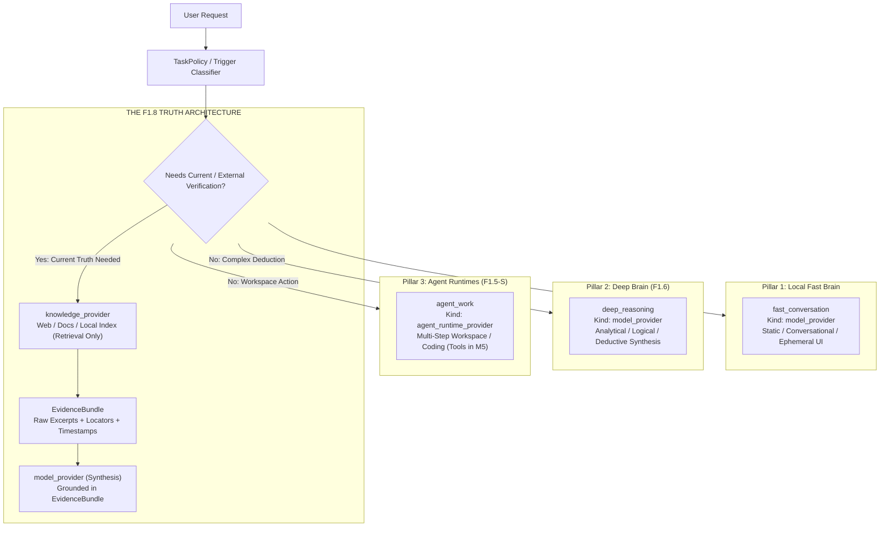
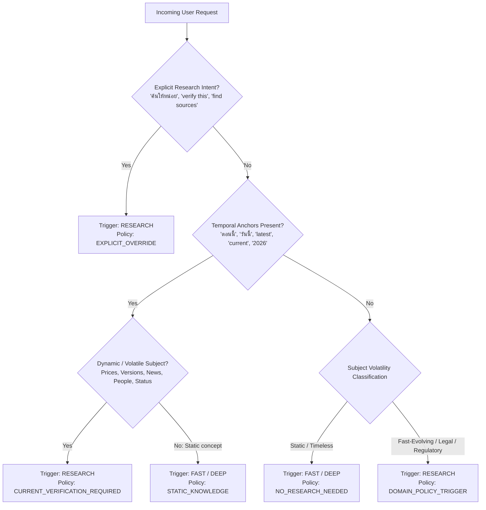
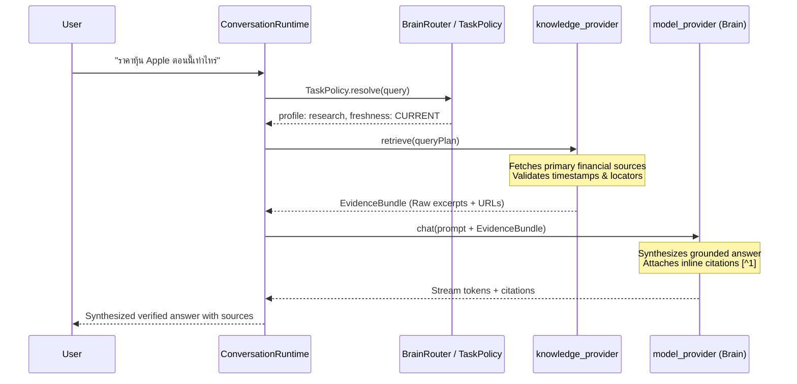
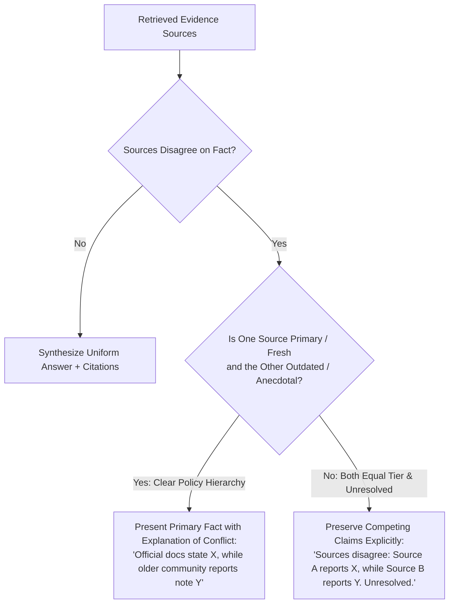
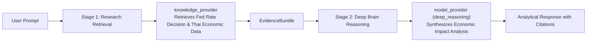
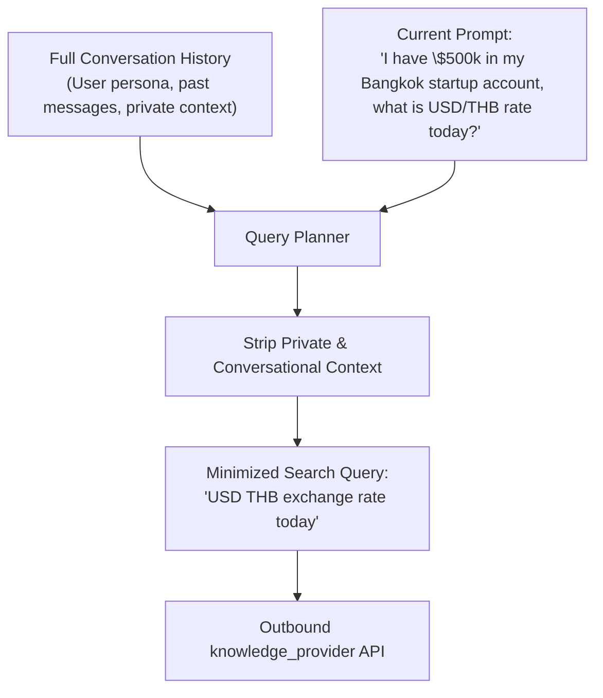
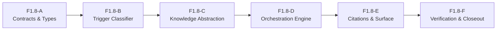

# MAVE F1.8 Research / Truth Architecture Audit & Specification

> [!IMPORTANT]
> **AUDIT & DESIGN ONLY — ZERO PRODUCTION IMPLEMENTATION**
> This specification defines the canonical architecture, contract design, and implementation roadmap for **Milestone Pre-M5 Phase F1.8 (Research / Truth Architecture)**.
> - **Status:** AUDIT COMPLETE / ARCHITECTURE SPECIFICATION READY
> - **Production Providers:** None implemented in this phase.
> - **Web Search Execution:** Zero active web scrapers or network search callers implemented.
> - **Tool / MCP Authority:** Zero shell, filesystem mutation, or agent execution authority granted.
> - **Runtime & C3/C4 Invariant:** Zero modifications to existing C3 residency, C4 voice orchestration, or F1.6 Deep Brain contracts.
> - **Frozen RouteTelemetry:** The canonical 8 fields of `RouteTelemetry` remain 100% unchanged.
> - **Paid APIs:** Default OFF (`allowPaidApis: false`).
> - **UI / Visual Assets:** Zero modifications to UI V2, `docs/pic/*`, or `docs/uiref/*`.

---

## 1. Executive Summary & The Current Research / Truth Gap

MAVE is a personal desktop intelligence orchestrator designed to deliver high-quality, truthful, and private assistance across voice and visual ambient surfaces.

Under MAVE's established three-pillar intelligence architecture:
1. **Local Fast Brain** (`qwen2.5:1.5b` via Ollama) provides low-latency conversational and voice dialogue (~96ms warm TTFT in historical C2 evaluation).
2. **Deep Brain** (`deep_reasoning` profile under F1.6) provides analytical, architectural, and complex reasoning without tool authority.
3. **Subscription Agent Runtimes** (`Claude Code`, `Codex`, `Antigravity` under F1.5-S) provide multi-step workspace task and repository execution.



### The Current Architectural Gap

Auditing the repository reveals a critical structural void:
1. **Model Parametric Memory Masquerading as Fact:** When a user asks about current facts (e.g., *"ข่าววันนี้"*, *"ราคาหุ้นตอนนี้"*, *"OpenAI มี model อะไรล่าสุด"*, *"ใครเป็น CEO ของ Twitter/X ตอนนี้"*), MAVE currently routes the query to `fast_conversation` or `deep_reasoning`. The underlying model responds purely from its pre-training cutoff date, confidently asserting outdated or hallucinated states as current reality.
2. **Missing Research Profile Implementation:** Although `research` is defined in `BrainProfileIdSchema` and `DEFAULT_BRAIN_PROFILES`, routing a request with `profileId: 'research'` immediately fails because it requires `webResearch: true`, which no registered direct model provider supports, and no retrieval orchestration exists.
3. **No Representation of Truth, Freshness, or Evidence:** The system currently possesses no typed contracts to represent:
   - Retrieved evidence items versus model-generated summaries.
   - Publication and retrieval timestamps.
   - Qualitative source authority (primary documentation vs community hearsay).
   - Claim-to-citation linkages.
   - Contradiction or lack-of-evidence states.
4. **The False Equivalence Risk:** There is an acute danger of conflating research with agent work (granting terminal/filesystem authority to fetch facts) or naively adding an unconstrained web search tool.

**The mission of F1.8 is NOT simply "add web search."**
The mission is to build MAVE's **Canonical Truth Architecture**: MAVE knows deterministically when external verification is required, retrieves evidence through a strictly governed, read-only research pipeline, models source trust and freshness explicitly, synthesizes answers via conversational `model_provider`, attaches verifiable citations, and refuses to present stale parametric memory as current truth.

---

## 2. Core Concept Boundaries: Fast Conversation vs Deep Reasoning vs Research vs Agent Work vs Tools

To ensure system safety and prevent architectural contamination, MAVE enforces five non-overlapping operational domains:

```text
┌────────────────────────────────────────────────────────────────────────────────────────┐
│                                MAVE INTELLIGENCE DOMAINS                               │
├───────────────────────┬────────────────────────┬───────────────────────────────────────┤
│ Domain                │ Provider Kind          │ Authority & Execution Scope           │
├───────────────────────┼────────────────────────┼───────────────────────────────────────┤
│ FAST CONVERSATION     │ model_provider         │ Pure conversational text; interactive │
│ DEEP REASONING        │ model_provider         │ Deductive analysis; zero tools        │
│ RESEARCH (F1.8)       │ knowledge_provider     │ Read-only retrieval -> EvidenceBundle │
│                       │ + model_provider       │ -> conversational synthesis; NO tools │
│ AGENT WORK (F1.5-S)   │ agent_runtime_provider │ Sustained workspace/coding workflow   │
│ TOOLS (Future M5)     │ M5 Permission Gate     │ ALLOW / ASK / DENY host execution     │
└───────────────────────┴────────────────────────┴───────────────────────────────────────┘
```

### Decision & Authority Matrix

| Dimension | Fast Conversation (`fast_conversation`) | Deep Reasoning (`deep_reasoning`) | Research (`research`) | Agent Work (`agent_work`) | Future M5 Tools |
| :--- | :--- | :--- | :--- | :--- | :--- |
| **Provider Kind** | `model_provider` | `model_provider` | `knowledge_provider` (fetch) + `model_provider` (synth) | `agent_runtime_provider` | Tool Executor via Permission Gate |
| **Primary Goal** | Sub-second voice/text conversation, quick Q&A | Complex logic, architecture trade-offs, code reviews | Grounded, current, externally verified truth | Multi-step workspace implementation | Host state inspection or mutation |
| **External Network Retrieval?** | **NO** | **NO** | **YES** (Read-only via `knowledge_provider`) | **NO** (CLI sandboxed) | Governed per tool |
| **Filesystem / Shell Mutation?** | **ZERO** | **ZERO** | **ZERO** | **ZERO** (Pre-M5 frozen) | Governed: `ALLOW`/`ASK`/`DENY` |
| **Ephemeral Truth Requirement** | Static / General knowledge | Static deductive reasoning | **MANDATORY** (`CURRENT` / `BREAKING`) | Project-local context | Local system context |
| **Citations Required?** | No | Optional / Internal | **MANDATORY** (`SurfaceSourceBlock`) | Workspace file references | Audit logs |
| **Latency Expectation** | Interactive (~1–3s Brain TTFT) | Normal / Analytical (5–30s) | Normal (Retrieval + Synthesis 3–10s) | Long-running (Minutes) | Task dependent |

### Immutable Boundary Invariants
1. **Research != Agent Work:** Research is strictly read-only information gathering and grounding. A request for current facts does NOT grant repository mutation, terminal access, or workspace editing.
2. **Research != Tool Authority:** Querying an external search API or document index does NOT invoke the M5 tool executor. It is handled by an isolated, read-only `knowledge_provider`.
3. **Research != Unrestricted Browsing:** MAVE does not spawn automated browser sessions with cookies, logins, or arbitrary click-through scripts to answer a research request.
4. **Knowledge Provider Never Final Generator:** A `knowledge_provider` collects and returns structured evidence; it NEVER streams conversational tokens directly to the user.

---

## 3. Deterministic Research Trigger Policy

MAVE rejects brittle, hardcoded keyword lists in favor of **Semantic Policy Categories** combined with **Deterministic Temporal Anchors**.



### Semantic Policy Categories

#### Category A: Deterministic Research Required (External Verification Mandatory)
Requests matching these semantic boundaries **must not** be answered from model parametric memory alone:
1. **Real-time Ephemeral State:** Stock prices, currency exchange rates, cryptocurrency valuations, weather conditions, active transit/flight statuses, server uptime.
   *Examples:* *"ราคาหุ้น AAPL ตอนนี้"*, *"อัตราแลกเปลี่ยนเยนวันนี้"*, *"สภาพอากาศเชียงใหม่บ่ายนี้"*.
2. **Breaking / Public Events:** Current news, elections, political developments, emergency alerts, ongoing sports matches.
   *Examples:* *"ข่าววันนี้มีอะไรเด่น"*, *"ผลบอลเมื่อคืน"*, *"สรุปสถานการณ์น้ำท่วมล่าสุด"*.
3. **Current Leadership & Entity Metadata:** Current corporate executives, cabinet members, organizational rosters, active status of business establishments.
   *Examples:* *"ใครเป็น CEO ของ OpenAI ตอนนี้"*, *"นายกคนปัจจุบันคือใคร"*, *"ร้านคาเฟ่นี้ยังเปิดอยู่ไหม"*.
4. **Software Releases & Product Specifications:** Latest versions, patch notes, hardware release dates, deprecation announcements.
   *Examples:* *"Next.js เวอร์ชันล่าสุดคืออะไร"*, *"สเปกของ iPhone 18 Pro"*, *"OpenAI มี model อะไรให้ใช้บ้างตอนนี้"*.
5. **Active Laws, Regulations, and Tax Codes:** Current tax brackets, active ministerial regulations, newly enforced travel visas.
   *Examples:* *"เกณฑ์ภาษีเงินได้ปีนี้"*, *"กฎหมาย PDPA อัปเดตล่าสุด"*.
6. **Explicit User Mandate:** The user explicitly requests search, source finding, or verification.
   *Examples:* *"ค้นหาข้อมูลให้หน่อย"*, *"เช็กข้อมูลล่าสุด"*, *"verify this claim"*, *"find primary sources for this"*.

#### Category B: Research Prohibited / Not Required (Conversational & Deductive Fast Paths)
Requests matching these categories **must not** trigger external research, avoiding unnecessary latency, token waste, and privacy exposure:
1. **Timeless & Conceptual Explanations:** Core computer science, mathematics, natural laws, philosophy.
   *Examples:* *"Explain recursion"*, *"How does a red-black tree work?"*, *"กฎข้อที่สามของนิวตันคืออะไร"*.
2. **Language Learning & Translation:** Vocabulary definitions, grammatical reviews, conversational drills, natural translation.
   *Examples:* *"แปลประโยคนี้เป็นภาษาญี่ปุ่น"*, *"Explain the difference between 'affect' and 'effect'"*, *"สอนสนทนาสั่งอาหารภาษาอังกฤษ"*.
3. **Reasoning Over User-Supplied Context:** In-session summarization, text extraction, rewriting, proofreading.
   *Examples:* *"Summarize the email pasted above"*, *"Extract key bullet points from this text"*, *"ตรวจแกรมม่าข้อความนี้"*.
4. **Creative Ideation & Brainstorming:** Game mechanics, fictional storytelling, poetry, roleplaying.
   *Examples:* *"Brainstorm mechanics for a turn-based space RPG"*, *"แต่งกลอนเกี่ยวกับกาแฟยามเช้า"*.
5. **Pure Conversational Interaction:** Greetings, check-ins, mood adjustments, personal rapport.
   *Examples:* *"สวัสดีตอนเช้า"*, *"เหนื่อยจังวันนี้ คุยเป็นเพื่อนหน่อย"*.

---

## 4. Canonical Truth & Freshness Model

Truth in MAVE is not a floating-point "universal confidence score" (e.g. `confidence: 0.87`), which is mathematically ungrounded and provides false assurance. Instead, truth is represented through **Qualitative Freshness Classes** and **Epistemic Verification States**.

### Qualitative Freshness Classes

```ts
export type FreshnessClass =
  | 'STATIC'         // Concepts invariant over years/decades (algorithms, grammar, history)
  | 'SLOW_CHANGING'  // Invariant over months/years (official specifications, architecture docs)
  | 'CURRENT'        // Invariant over days/weeks (software versions, leadership, schedules)
  | 'BREAKING';      // Invariant over minutes/hours (live news, market prices, active incidents)
```

### Epistemic Verification States

```ts
export type EpistemicVerificationState =
  | 'VERIFIED_EXTERNAL'       // Supported directly by qualified external evidence retrieved in-flight
  | 'UNVERIFIED_MODEL_MEMORY'  // Synthesized purely from model pre-training weights (must carry caveats for non-STATIC)
  | 'CONTRADICTORY_EVIDENCE'  // Multiple qualified sources disagree; uncertainty preserved
  | 'UNVERIFIABLE_FAILED'     // Research was required but retrieval failed; model memory refused as truth
  | 'LOCAL_CONTEXT_GROUNDED'; // Supported by local project files or user notes (not internet truth)
```

### The Cardinal Freshness Invariant
> [!CRITICAL]
> **A model's parametric training knowledge must NEVER satisfy a `CURRENT` or `BREAKING` freshness requirement without external, verified retrieval.**
> If external retrieval is unavailable or fails, MAVE must explicitly report inability to verify rather than silently emitting stale parametric guesses.

---

## 5. Knowledge Provider Architecture & Reconciliation

### Reconciling Provider Taxonomy
In `packages/contracts/src/brain.ts`, `ProviderKindSchema` is defined as:
```ts
export const ProviderKindSchema = z.enum([
  'model_provider',
  'agent_runtime_provider',
  'knowledge_provider'
]);
```
`BrainRouter.ts` already codifies the guard at line 761:
```ts
// Guard 1: Knowledge provider must never be final brain route
if (providerKind === 'knowledge_provider') {
  continue;
}
```

### Defining the `knowledge_provider`
A `knowledge_provider` is an external or local retrieval engine that accepts structured retrieval queries and returns a typed `EvidenceBundle`.
- **It is NOT a conversational agent.**
- **It NEVER generates dialogue.**
- **It NEVER interacts with the user directly.**



### Single vs Multi-Provider Orchestration
The research subsystem must support **provider fan-out and multi-source synthesis**:
1. **Query Planning:** Deconstruct user prompt into 1–3 targeted search queries.
2. **Parallel Retrieval:** Query multiple specialized knowledge providers simultaneously (e.g., an Official Documentation Provider + a General Web Provider).
3. **Deduplication & Union:** Filter overlapping URLs and merge excerpts into a single cohesive `EvidenceBundle`.
4. **Synthesis Pass:** Deliver the unified bundle to the designated `model_provider`.

---

## 6. Evidence Bundle & Source Contracts

To avoid duplicating existing UI contracts while providing complete backend truth metadata, the F1.8 architecture decouples **Raw Retrieval Evidence** from **Surface Presentation Blocks**.

### Existing Contract Reusability Analysis
1. `SurfaceSourceBlock` (`packages/contracts/src/surface.ts`):
   ```ts
   export const SurfaceSourceBlockSchema = z.object({
     id: z.string().min(1),
     type: z.literal('source'),
     title: z.string().min(1),
     url: z.string().url().optional(),
     snippet: z.string().optional(),
     domain: z.string().optional()
   });
   ```
   *Verdict:* Perfect for UI surface rendering. Already supported in `MaveCompactResponse` and `MaveExpandedPanel`.
2. `open_source` Surface Action (`packages/contracts/src/surface.ts`):
   ```ts
   z.object({
     type: z.literal('open_source'),
     origin: SurfaceActionOriginSchema.default('user'),
     sourceId: z.string().max(256).optional(),
     url: z.string().max(2048).optional()
   })
   ```
   *Verdict:* User interaction already wired to inspect sources.

### Proposed Canonical Research Contracts (for future F1.8-A)

```ts
import { z } from 'zod';

export const SourceQualityClassSchema = z.enum([
  'OFFICIAL_PRIMARY',      // 1st party vendor docs, official press releases, government records
  'AUTHORITATIVE_SECONDARY',// Recognized news agencies (Reuters, AP), peer-reviewed journals
  'REPUTABLE_REPORTING',   // Reputable tech publications, verified industry blogs
  'COMMUNITY_ANECDOTAL',   // Forums, Reddit, StackOverflow, GitHub issues (troubleshooting only)
  'UNKNOWN'                // Scraped content farms, unverified domains
]);
export type SourceQualityClass = z.infer<typeof SourceQualityClassSchema>;

export const ResearchEvidenceItemSchema = z.object({
  id: z.string().min(1),                       // e.g. "ev-01"
  sourceId: z.string().min(1),                 // stable source ID
  sourceType: z.enum(['web', 'official_docs', 'local_index', 'structured_api']),
  title: z.string().min(1),
  locator: z.string().min(1),                  // Canonical URL or local path
  domain: z.string().optional(),
  publishedAt: z.number().nonnegative().optional(), // Epoch ms
  retrievedAt: z.number().nonnegative(),       // Epoch ms
  rawExcerpt: z.string().min(1),               // VERBATIM source text — NEVER model-generated
  excerptSummary: z.string().optional(),       // Optional model pre-summary, strictly labeled
  qualityClass: SourceQualityClassSchema,
  freshnessClass: z.enum(['STATIC', 'SLOW_CHANGING', 'CURRENT', 'BREAKING']),
  metadata: z.record(z.unknown()).optional()
});
export type ResearchEvidenceItem = z.infer<typeof ResearchEvidenceItemSchema>;

export const EvidenceBundleSchema = z.object({
  bundleId: z.string().min(1),
  query: z.string().min(1),
  plannedQueries: z.array(z.string()).default([]),
  items: z.array(ResearchEvidenceItemSchema),
  retrievedAt: z.number().nonnegative(),
  providerId: z.string().min(1),
  completeness: z.enum(['complete', 'partial', 'empty', 'failed']),
  contradictionsDetected: z.boolean().default(false)
});
export type EvidenceBundle = z.infer<typeof EvidenceBundleSchema>;
```

### Cardinal Principle: Separation of Raw Retrieval vs Model Summary
> [!IMPORTANT]
> A model-generated summary must **NEVER masquerade as source text**.
> `rawExcerpt` contains only untouched, verbatim text returned by the knowledge provider. If a provider generates a syntactic summary, it must be isolated in `excerptSummary`. The synthesizing `model_provider` must be instructed that only `rawExcerpt` constitutes ground empirical evidence.

---

## 7. Source Quality Policy & Trust Classification

MAVE rejects a single flat trust score. Source trust is **contextual and domain-dependent**.

### Domain-to-Quality Matching Policy

| Inquiry Domain | Minimum Acceptable Source Quality | Preferred Source Tier | Community Sources Permitted? |
| :--- | :--- | :--- | :--- |
| **API & Library Documentation** | `OFFICIAL_PRIMARY` | Official vendor docs / package manifests | Only for bug workarounds (must be labeled) |
| **Breaking News & World Events** | `AUTHORITATIVE_SECONDARY` | Major wire services + primary statements | Strictly prohibited for factual claims |
| **Corporate Leadership & Financials** | `OFFICIAL_PRIMARY` | SEC filings, investor relations, official press | Strictly prohibited |
| **System Debugging & Errors** | `COMMUNITY_ANECDOTAL` | GitHub issues, StackOverflow, vendor forums | **YES** (Identified explicitly as community advice) |
| **Medical / Legal / Tax High-Stakes** | `OFFICIAL_PRIMARY` | Government health agencies, statutory codes | **STRICTLY PROHIBITED** (Fail closed if absent) |

---

## 8. Freshness Semantics & Temporal Reasoning

MAVE models temporal decay explicitly based on the query's domain:

```text
┌────────────────────────────────────────────────────────────────────────────────────────┐
│                              TEMPORAL FRESHNESS HORIZONS                               │
├───────────────────┬───────────────────────────┬────────────────────────────────────────┤
│ Freshness Class   │ Validity Half-Life        │ Required Action When Stale             │
├───────────────────┼───────────────────────────┼────────────────────────────────────────┤
│ BREAKING          │ 15 minutes – 2 hours      │ Force re-fetch; warn if > 2h old       │
│ CURRENT           │ 24 hours – 7 days         │ Fetch fresh evidence; reject > 30d old │
│ SLOW_CHANGING     │ 3 months – 1 year         │ Allow cached index if verified         │
│ STATIC            │ Indefinite (Years)        │ Local fast brain / memory allowed      │
└───────────────────┴───────────────────────────┴────────────────────────────────────────┘
```

### Temporal Reasoning Rules
1. **Timestamp Comparison:** If a query seeks "current version" and the most recent retrieved document is dated 18 months prior, MAVE flags the evidence as potentially stale:
   *"Based on the latest documentation found (dated March 2025), version 4.2 was released. However, more recent updates may exist."*
2. **Current Date Grounding:** The orchestrator injects an immutable system header into the prompt: `Current UTC Time: {ISO_8601_TIMESTAMP}`. The synthesizing model is instructed to measure all dates against this anchor and never assume its training cutoff is the current year.

---

## 9. Contradiction Handling & Epistemic Honesty

When multiple retrieved sources report conflicting facts, MAVE must **never silently pick a winner** or generate an ungrounded hallucination of certainty.



### Core Contradiction Rules
- **Teacher Output is Not Truth:** An LLM evaluating two sources cannot declare one true merely because "it sounds more plausible."
- **Model Consensus is Not Evidence:** If three community blog posts copy the same erroneous rumor from each other, they do not outrank a single official primary changelog.
- **Explicit Uncertainty:** When sources of equal quality directly contradict each other and cannot be reconciled temporally, MAVE explicitly informs the user that sources diverge, citing both.

---

## 10. No-Source / Failed-Research Behavior

When research is required but retrieval fails, MAVE adheres to a **Fail-Closed Truth Policy**.

```text
┌────────────────────────────────────────────────────────────────────────────────────────┐
│                             FAILED RESEARCH REASON TAXONOMY                            │
├───────────────────────────────────┬────────────────────────────────────────────────────┤
│ Failure Code                      │ User Explanation & Runtime Behavior                │
├───────────────────────────────────┼────────────────────────────────────────────────────┤
│ research_no_provider              │ "No research provider configured; cannot verify."  │
│ research_network_unavailable      │ "Network unavailable; external check impossible."  │
│ research_local_only_violation     │ "Local-only privacy active; cloud search blocked." │
│ research_evidence_insufficient    │ "Search completed, but trustworthy sources lacked."│
│ research_source_conflict          │ "Retrieved sources contradict; cannot confirm."    │
└───────────────────────────────────┴────────────────────────────────────────────────────┘
```

### Safe Response Pattern
When retrieval fails for a `CURRENT` inquiry, MAVE's synthesizing prompt instructs the model:
> *"External verification for this query failed due to {REASON}. You are FORBIDDEN from presenting your pre-training knowledge as current fact. State clearly that you cannot verify the current status, and if you offer historical context, caveat it explicitly with your knowledge cutoff date."*

---

## 11. Composition: Research + Deep Reasoning

A complex analytical inquiry may require both **current evidence** and **deep analytical reasoning**.
*Example:* *"วิเคราะห์ว่าการปรับขึ้นอัตราดอกเบี้ยของ Fed เมื่อวานนี้จะกระทบต่ออัตราแลกเปลี่ยนเงินบาทและหุ้นส่งออกไทยอย่างไร"*



### Architectural Integrity
- Stage 1 is executed by a `knowledge_provider` (read-only retrieval).
- Stage 2 is executed by a `model_provider` under the `deep_reasoning` profile.
- **Provider-Kind Invariant Preserved:** This request does **NOT** escalate to `agent_work`. Reasoning over economic data does not require shell commands or workspace mutation.

---

## 12. Privacy & `localOnly` Fail-Closed Boundaries

MAVE guarantees strict local privacy through `resolveEffectiveLocalOnly(request)`.

### Strict `localOnly = true` Enforcement
When `localOnly: true` is active:
1. **Network Search Prohibited:** All outbound HTTP requests, web scraping, and third-party search APIs are immediately blocked.
2. **Fail-Closed on Cloud Retrieval:** If the request requires internet search, the research orchestrator aborts with `research_local_only_violation`.
3. **Local Knowledge Sources Permitted:** Local document stores, SQLite notes, and local vector indexes are fully permitted to supply evidence.
4. **Honest Labeling:** Evidence from local files must be labeled as `Local Knowledge Base (File: notes.md, Dated: 2026-02-15)` and never falsely presented as "Verified Internet Truth."

---

## 13. Privacy & Query Minimization

External web searches inherently leak user intent to third-party endpoints. The research architecture mitigates this via **Strict Query Minimization**:



### Privacy Protections
- **No Conversation Dumping:** Conversation turns and session histories are **never** forwarded to search APIs.
- **Secret Redaction:** Regex-based sanitization strips potential API keys, passwords, bearer tokens, and private IP addresses prior to query emission.
- **Provider Privacy Metadata:** Search providers are audited and classified into `standard_cloud`, `private_cloud`, or `local_only`.

---

## 14. Citation Semantics & Surface Provenance

### What a Citation Proves
A citation is **not** an arbitrary link dump of pages crawled during retrieval.
A citation explicitly certifies:
> **"This specific claim in the response is directly supported by the excerpt at this locator."**

```text
┌────────────────────────────────────────────────────────────────────────────────────────┐
│                               RESPONSE & CITATION LINKAGE                              │
├────────────────────────────────────────────────────────────────────────────────────────┤
│                                                                                        │
│ Assistant Text:                                                                        │
│ "OpenAI announced GPT-5 on August 15, 2026 [^1], introducing native real-time voice   │
│ with under 100ms latency [^2]."                                                        │
│                                                                                        │
│ Citations Map:                                                                         │
│ [^1] -> EvidenceItem(id: "ev-01", title: "OpenAI Press Release", url: "https://...")   │
│ [^2] -> EvidenceItem(id: "ev-02", title: "GPT-5 System Card", url: "https://...")      │
│                                                                                        │
│ Surface Projection:                                                                    │
│ Rendered via SurfaceSourceBlock into MaveCompactResponse or MaveExpandedPanel.         │
│ Clicking pill fires SurfaceAction: open_source(sourceId: "ev-01").                     │
└────────────────────────────────────────────────────────────────────────────────────────┘
```

---

## 15. Memory vs Knowledge vs Research vs Truth Boundary

```text
┌────────────────────────────────────────────────────────────────────────────────────────┐
│                              THE FOUR COGNITIVE BOUNDARIES                             │
├───────────────┬────────────────────────────┬───────────────────────────────────────────┤
│ Concept       │ Primary Function           │ Epistemic Authority                       │
├───────────────┼────────────────────────────┼───────────────────────────────────────────┤
│ MEMORY        │ User & Context Continuity  │ Subjective context; NOT current truth     │
│ KNOWLEDGE     │ Stored & Indexed Documents │ Bounded historical validity               │
│ RESEARCH      │ Dynamic External Retrieval │ Active verification process               │
│ TRUTH         │ Evidence-Backed Claim State│ Grounded assertion supported by evidence  │
└───────────────┴────────────────────────────┴───────────────────────────────────────────┘
```

### The Invalidation of Stale Memory
> [!WARNING]
> **Similarity != Permission. Similarity != Truth.**
> A high vector similarity match between a new question and an old memory record does **not** make that memory factual today. An archived memory from 2024 stating *"The current LTS version of Node.js is 20"* must never satisfy a 2026 inquiry requiring `CURRENT` freshness.

---

## 16. Future Knowledge Trust Lifecycle Reconciliation

Reconciling with `docs/architecture/MAVE_INTELLIGENCE_ESCALATION_AND_TRUST.md`:
```text
NEW ──► OBSERVED ──► VERIFIED ──► TRUSTED ──► STALE ──► REJECTED
```

### Trust Derivation Rules
1. **Teacher Output is Not Ground Truth:** A distilled output from an agent or LLM teacher is classified as `OBSERVED`, never immediately `TRUSTED`.
2. **Empirical Verification Required:** Transition to `VERIFIED` requires external corroboration:
   - Primary documentation corroboration.
   - Successful automated test execution (exit code zero).
   - Explicit user verification.
3. **Decay to Stale:** All `TRUSTED` knowledge records decay to `STALE` once their domain half-life TTL expires, requiring positive re-verification.

---

## 17. Retrieval Provider Classes (Future Architecture Options)

MAVE's research architecture will interface with four pluggable provider categories:

```text
┌────────────────────────────────────────────────────────────────────────────────────────┐
│                               KNOWLEDGE PROVIDER CLASSES                               │
├───────────────────────────────────┬────────────────────────────────────────────────────┤
│ Provider Class                    │ Typical Sources & Scope                            │
├───────────────────────────────────┼────────────────────────────────────────────────────┤
│ WebSearchKnowledgeProvider        │ Google Search API, Brave Search, Bing Web Search   │
│ DocumentationKnowledgeProvider    │ MDN Web Docs, DevDocs, PyPI, npmjs registry APIs    │
│ LocalIndexedKnowledgeProvider     │ Local SQLite vector store, Markdown notes index    │
│ StructuredApiKnowledgeProvider    │ OpenWeatherMap, CoinGecko, Yahoo Finance API       │
└───────────────────────────────────┴────────────────────────────────────────────────────┘
```

*Vendor Neutrality:* No specific vendor is mandated in this phase. Reverse-engineered scrapers or private headless browsers are strictly rejected.

---

## 18. Paid & Subscription Access Governance

### Separate Billing Semantics
Access to external search APIs or structured data providers involves metered API billing distinct from LLM token usage.

### Default Deny Invariant
- **`allowPaidApis: false` Remains Default:** Even if API keys for a metered search service are configured in the environment, MAVE will refuse to route queries through paid research APIs unless `allowPaidApis: true` is explicitly enabled by the user.
- **Brain Subscription Decoupling:** Having a ChatGPT Plus, Claude Pro, or GitHub Copilot subscription does **not** grant access to paid third-party search APIs.

---

## 19. Telemetry Separation Architecture

### The Frozen RouteTelemetry Invariant
> [!CRITICAL]
> **`RouteTelemetry` is frozen and must NOT be modified.**
> Its canonical 8 fields remain exactly:
> 1. `selectedProviderId`
> 2. `selectedModelId`
> 3. `profileId`
> 4. `routeReason`
> 5. `fallbackUsed`
> 6. `attemptedProviderIds`
> 7. `attemptedModelIds`
> 8. `routeAttempts`

### Separate Research Telemetry Contract (for future F1.8-A)

```ts
export const ResearchTelemetrySchema = z.object({
  requestId: z.string().min(1),
  researchTriggered: z.boolean(),
  triggerReason: z.enum([
    'explicit_user_request',
    'temporal_anchor_current',
    'temporal_anchor_breaking',
    'domain_policy_mandate',
    'bypassed_static_concept'
  ]),
  freshnessClass: z.enum(['STATIC', 'SLOW_CHANGING', 'CURRENT', 'BREAKING']),
  knowledgeProviderId: z.string().optional(),
  queryCount: z.number().int().nonnegative().default(0),
  sourceCount: z.number().int().nonnegative().default(0),
  retrievalDurationMs: z.number().nonnegative().default(0),
  evidenceOutcome: z.enum([
    'verified',
    'unverified_fallback',
    'contradictory',
    'failed_no_evidence',
    'blocked_local_only'
  ]),
  paidApiIncurred: z.boolean().default(false)
});
export type ResearchTelemetry = z.infer<typeof ResearchTelemetrySchema>;
```

`ResearchTelemetry` is tracked independently in diagnostics and does not contaminate brain routing telemetry.

---

## 20. Presentation Boundary & Surface Decoupling

Research results must not be tightly coupled to a single desktop window or renderer. MAVE projects research outputs across three existing surfaces:

```text
┌────────────────────────────────────────────────────────────────────────────────────────┐
│                              SURFACE PRESENTATION ADAPTATION                           │
├───────────────────────┬────────────────────────────────────────────────────────────────┤
│ UI Surface            │ Research Presentation Rendering                                │
├───────────────────────┼────────────────────────────────────────────────────────────────┤
│ MaveCapsule           │ Voice brief + presence mark + "1 source verified" indicator   │
│ MaveCompactResponse   │ 2-sentence voice summary + 1-2 interactive source pill buttons │
│ MaveExpandedPanel     │ Full markdown synthesis + structured SurfaceSourceBlock list   │
│ Developer Chat        │ Complete transcript + debug audit log + raw evidence excerpts  │
└───────────────────────┴────────────────────────────────────────────────────────────────┘
```

All interactions use existing `SurfaceSourceBlock` contracts without requiring UI V2 modifications.

---

## 21. Security & Milestone 5 Boundary

Research is **read-only information retrieval**. It is fundamentally distinct from Milestone 5 tool execution.

```text
┌────────────────────────────────────────────────────────────────────────────────────────┐
│                              RESEARCH VS M5 TOOL BOUNDARY                              │
├───────────────────────────────────┬────────────────────────────────────────────────────┤
│ Research Retrieval (Pre-M5 F1.8)  │ M5 Tool Execution Gate (Future M5)                 │
├───────────────────────────────────┼────────────────────────────────────────────────────┤
│ Read-only search API / doc fetch  │ Shell, filesystem, terminal, app control, git write│
│ No host mutation                  │ High risk of side effects                          │
│ Deterministic data pipeline       │ Policy evaluation: ALLOW / ASK / DENY              │
│ Zero process spawning             │ Process execution with stdout/stderr capture       │
│ No permission dialog required     │ Interactive user confirmation on mutation          │
└───────────────────────────────────┴────────────────────────────────────────────────────┘
```

---

## 22. Staged F1.8 Implementation Roadmap

The implementation of F1.8 is partitioned into six sequential phases to guarantee zero regression on existing runtime code:



### Phase Details

#### F1.8-A: Contracts & Types Definition
- Add `ResearchEvidenceItem`, `EvidenceBundle`, `FreshnessClass`, `SourceQualityClass`, and `ResearchTelemetry` schemas to `packages/contracts/src/brain.ts` or dedicated `packages/contracts/src/research.ts`.
- Add canonical research error codes (`research_provider_unavailable`, `research_evidence_insufficient`, `research_local_only_violation`).
- Preserve frozen `RouteTelemetry` intact.

#### F1.8-B: Research Policy & Deterministic Trigger Classification
- Extend `packages/core/src/brain/task-policy.ts` with semantic trigger evaluation.
- Classify inquiries into `STATIC`, `SLOW_CHANGING`, `CURRENT`, `BREAKING`.
- Unit test trigger classification across Thai and English benchmark queries.

#### F1.8-C: Knowledge Provider Abstraction & Registry
- Create `KnowledgeProvider` and `KnowledgeProviderRegistry` in `packages/core`.
- Implement `MockKnowledgeProvider` for deterministic testing.
- Enforce the guard ensuring `knowledge_provider` cannot be selected as conversational brain route.

#### F1.8-D: Research Orchestrator & Evidence-Grounded Synthesis
- Build `ResearchOrchestrator` in `packages/core/src/conversation`.
- Sequence: `TaskPolicy Trigger -> Query Planning -> KnowledgeProvider.retrieve() -> EvidenceBundle -> BrainRouter(model_provider) -> provider.chat()`.
- Ground prompts with evidence and instruct models to cite `[^n]`.

#### F1.8-E: Citation Normalization & Surface Integration
- Parse inline citations in `ConversationRuntime` and map to `SurfaceSourceBlock`.
- Connect `open_source` actions in `SurfaceView` and `DeveloperChat`.
- Verify fail-closed behavior for unverified claims.

#### F1.8-F: Verification, Harness & Phase Closeout
- Execute end-to-end integration tests using mock search fixtures.
- Verify `localOnly: true` strictly blocks network queries.
- Verify paid search API default deny behavior (`allowPaidApis: false`).
- Document F1.8 closeout report.

---

## 23. Comprehensive Future Test Plan

The future test suite for F1.8 must cover the following 14 test scenarios:

| Test ID | Test Scenario | Expected Outcome |
| :--- | :--- | :--- |
| **TEST-F1.8-01** | Current fact query (e.g., *"ข่าววันนี้"*, *"ราคาหุ้น Apple ตอนนี้"*) | Deterministically classified as requiring research (`freshness: CURRENT`); triggers `knowledge_provider` retrieval. |
| **TEST-F1.8-02** | Static conceptual query (e.g., *"Explain recursion"*, *"แปลคำนี้"*) | Classified as `STATIC`; research bypassed; routes to fast conversation. |
| **TEST-F1.8-03** | Explicit verification mandate (e.g., *"ค้นให้หน่อย"*, *"verify this"*) | Triggers research regardless of subject matter. |
| **TEST-F1.8-04** | Research query under no circumstances becomes `agent_work` | Verified: `providerKind !== 'agent_runtime_provider'`. |
| **TEST-F1.8-05** | Knowledge provider guard enforcement | `knowledge_provider` is never returned as final conversational route. |
| **TEST-F1.8-06** | `localOnly: true` privacy restriction | Fail-closed: external retrieval blocked; error `research_local_only_violation` emitted. |
| **TEST-F1.8-07** | Retrieval failure handling | When search fails, model refuses to present stale memory as current fact; caveats clearly emitted. |
| **TEST-F1.8-08** | Citation provenance integrity | All `SurfaceSourceBlock` entries link to real evidence items in `EvidenceBundle`; zero phantom citations. |
| **TEST-F1.8-09** | Conflicting source preservation | When sources diverge, response explicitly notes contradiction rather than fabricating false consensus. |
| **TEST-F1.8-10** | Stale evidence rejection | Evidence older than domain freshness horizon is rejected for `CURRENT` / `BREAKING` requests. |
| **TEST-F1.8-11** | Paid API default deny | Paid search endpoints fail closed when `allowPaidApis: false`. |
| **TEST-F1.8-12** | Frozen `RouteTelemetry` verification | The 8 canonical fields of `RouteTelemetry` remain identical before and after research turns. |
| **TEST-F1.8-13** | Separate research telemetry verification | `ResearchTelemetry` correctly captures query count, source count, and retrieval latency independently. |
| **TEST-F1.8-14** | Midstream F1.4 generation invariant | Streaming `response_delta` tokens and cancellation semantics remain fully operational during grounded synthesis. |

---

## 24. Repository Audit & Reusability Matrix

| Component | Repository Location | Current Status | Reusability in F1.8 |
| :--- | :--- | :--- | :--- |
| **`ProviderKindSchema`** | `packages/contracts/src/brain.ts` | Contains `knowledge_provider` | Fully reused; no contract modification needed. |
| **`BrainProfileIdSchema`** | `packages/contracts/src/brain.ts` | Contains `research` | Fully reused. |
| **`RouteTelemetrySchema`** | `packages/contracts/src/brain.ts` | 8 frozen fields | **FROZEN.** Keep separate from research telemetry. |
| **`SurfaceSourceBlockSchema`**| `packages/contracts/src/surface.ts` | Existing block for sources | Fully reused for surface UI citation display. |
| **`open_source` action** | `packages/contracts/src/surface.ts` | Existing surface action | Fully reused for user click interactions. |
| **`TaskPolicy`** | `packages/core/src/brain/task-policy.ts` | Maps `research` to profile | Extended in F1.8-B with semantic trigger classifier. |
| **`BrainRouter` guard** | `packages/core/src/brain/router.ts` | Blocks `knowledge_provider` | Fully operational (line 761). Must remain inviolate. |
| **`resolveEffectiveLocalOnly`**| `packages/contracts/src/brain.ts` | Fail-closed privacy logic | Reused directly to block network search. |

---

## 25. Blockers, Recommendations & Non-Goals

### Non-Goals (Strictly Prohibited in F1.8)
- **NO web scraping scripts or headless browser automation.**
- **NO tool or terminal execution authority.**
- **NO modification to C3 residency or C4 voice conversation code.**
- **NO modification to frozen `RouteTelemetry` fields.**
- **NO enabling paid search APIs by default.**

### Strategic Recommendations
1. **Execute Home-PC Live Certification for C3/C4 first:** Ensure Local Fast Brain is certified on hardware before activating F1.8 live providers.
2. **Implement F1.8-A and F1.8-B in simulation first:** Build contracts, test policies, and verify mock knowledge providers prior to connecting live web search APIs.
3. **Keep Knowledge Providers decoupled from UI:** Ensure retrieval returns pure data bundles; UI formatting remains strictly within existing `SurfaceSourceBlock` boundaries.
