# MAVE F1.9 Diagnostics & Reliability Architecture Audit

> [!IMPORTANT]
> **AUDIT & ARCHITECTURE DESIGN ONLY — ZERO PRODUCTION CODE IMPLEMENTATION**
> This document defines the canonical diagnostics, observability, and reliability architecture for **Milestone Pre-M5 Phase F1.9 (Diagnostics / Reliability Architecture)**.
> - **Status**: AUDIT COMPLETE / ARCHITECTURE SPECIFICATION READY
> - **Production Diagnostics Code**: None implemented in this phase.
> - **Runtime & Invariants**: Zero modifications to C3/C4 runtime behavior, certification harness, F1.6 frozen architecture, F1.8 frozen architecture, or UI V2.
> - **RouteTelemetry Invariant**: Frozen strictly to the 8 canonical fields.
> - **Paid APIs**: Default OFF (`allowPaidApis: false`).
> - **Authority Boundary**: Observability != Authority. Diagnostics observes system state, but gains zero authority to mutate files, execute commands, restart services, or spend API credits.

---

## 1. Executive Summary & The Canonical F1.9 Gap

MAVE’s Pre-M5 intelligence architecture coordinates a sophisticated multi-component topology: local conversational Fast Brain (`qwen2.5:1.5b`), subscription agent runtimes (`Claude Code`, `Codex`, `Antigravity`), knowledge and research engines (F1.8), and a real-time local voice pipeline (openWakeWord, Faster-Whisper, Edge-TTS, and native audio I/O).

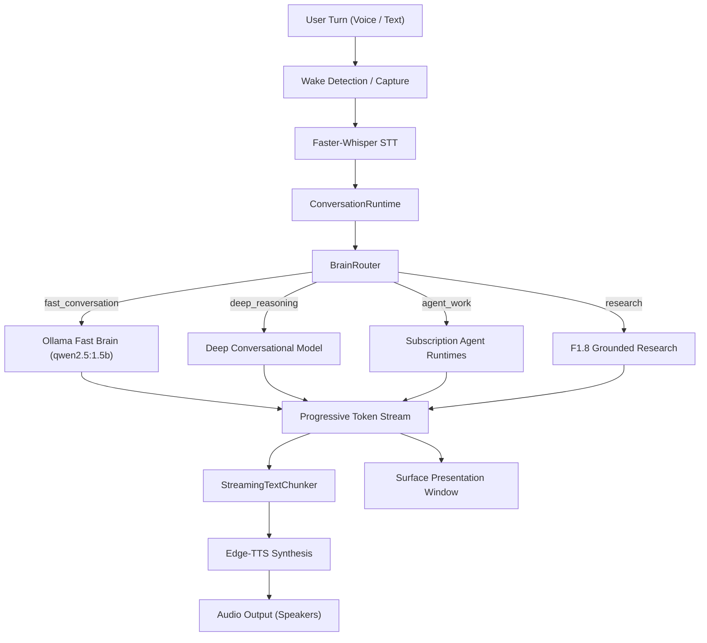

### The Current Real Gap: Why Failures Are Opaque
Currently, when MAVE feels slow, fails, falls back, cannot hear, cannot speak, cannot load a model, loses Ollama, hits quota, or enters degraded mode:
1. **Logs are fragmented**: Runtime outputs are dispersed across Pino console loggers, Python child process stderr pipes, Electron IPC channels, and internal SQLite tables.
2. **Causality is disconnected**: There is no unified correlation token tying an audio wake event through STT transcription, conversation turn creation, routing decision, provider cold-load, token generation, speech synthesis chunking, and surface rendering.
3. **Failures require guessing**: When a turn fails or latency spikes, the developer or user cannot immediately tell:
   - **WHAT failed** (e.g. STT audio pump vs. Ollama residency load vs. token generation timeout vs. speaker playback).
   - **WHERE it failed** (which process, thread, or network boundary).
   - **WHY it failed** (daemon crash vs. quota exhaustion vs. localOnly privacy constraint vs. OS audio buffer overflow).
   - **WHAT MAVE did about it** (did it fall back? did it degrade to text? did it fail closed?).
   - **WHETHER user data or authority was involved** (did it leak prompt text? did it attempt an unauthorized command?).
   - **WHAT can recover automatically** vs. **WHAT requires user action** (e.g. transient network timeout vs. expired OAuth token vs. missing local model).

### The Purpose of F1.9
**The purpose of F1.9 is NOT to create a generic, noisy logging system.**
**The purpose is to make failures explainable without guessing.**

---

## 2. Core Reliability Principle: Observability != Authority

The canonical foundational principle governing all diagnostics in MAVE is:

$$\text{OBSERVABILITY} \neq \text{AUTHORITY}$$

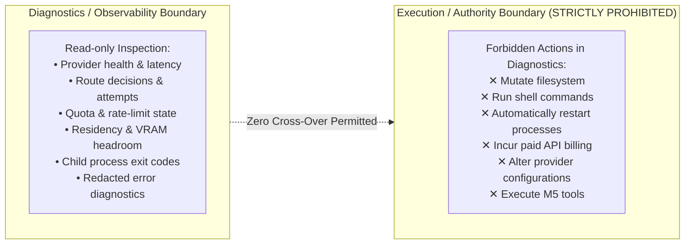

### Permitted Observability Actions
Diagnostics may observe, record, sample, and correlate:
- Provider connection state and ping latency.
- Route decisions, skipped candidates, and fallback occurrences.
- Execution latency across every pipeline stage.
- Canonical error codes and granular diagnostic reasons.
- Local model residency, VRAM allocation, and keepAlive state.
- Provider and model availability.
- CLI executable presence and version strings.
- Quota state and rate-limit reset windows.
- Audio buffer levels and speech timing markers.

### Strictly Forbidden Diagnostic Authority
Diagnostics must **NEVER** gain authority or code permission to:
- Mutate local files or project directories.
- Invoke operating system shell commands or background scripts.
- Automatically restart system services, Docker containers, or child runtimes.
- Spend paid API credits or enable metered billing endpoints.
- Change provider configuration options or weaken privacy constraints.
- Execute M5 workspace tools or agent commands.

Any automated repair, service supervision, or remediation action—if ever implemented in future milestones—requires an explicit, dedicated architecture boundary completely isolated from diagnostics.

---

## 3. Existing Observability Inventory & Telemetry Boundaries

An audit of existing contracts, core packages, provider adapters, desktop main processes, and certification harnesses reveals significant existing observability primitives that must be unified rather than duplicated:

### Existing Observability Artifacts

| Layer / Subsystem | Repository Location | Existing Primitives | Observability Role | Gaps / Limitations |
| :--- | :--- | :--- | :--- | :--- |
| **Routing Telemetry** | `packages/contracts/src/brain.ts` | `RouteTelemetry` | Captures the 8 canonical fields of router selection and fallback attempts. | Frozen; cannot hold latency, errors, or diagnostic IDs. |
| **Brain Telemetry** | `packages/contracts/src/brain.ts` | `BrainTelemetry`, `GenerationTiming`, `GenerationUsage` | Captures generation token counts and durations (prompt eval, eval, TTFT). | Emitted only on successful completion; lost on midstream errors. |
| **Provider Health** | `packages/contracts/src/brain.ts` | `CANONICAL_PROVIDER_HEALTH_STATUSES`, `ProviderHealth` | 8 statuses: `healthy`, `degraded`, `unhealthy`, `unconfigured`, `quota_limited`, `rate_limited`, `auth_error`, `unavailable`. | Conflates operational health with quota, auth, and configuration. |
| **Error Taxonomy** | `packages/contracts/src/brain.ts` | `CANONICAL_BRAIN_ERROR_CODES`, `BrainError` | 17 canonical `lower_snake_case` error codes. | Lacks secondary diagnostic failure reasons and sanitized raw causes. |
| **Session & Turns** | `packages/contracts/src/session.ts` | `Session`, `ConversationTurn`, `StreamingChunk` | `sessionId`, `turnId`, `requestId`, turn lifecycle status. | Disconnected from voice session IDs and hardware wake events. |
| **Voice Runtime** | `packages/contracts/src/voice.ts` | `VoiceSession`, `VoiceRuntimeEvent` (14 variants), `VoiceLatencyDiagnostics`, `VoiceDiagnosticState`, `VoiceStatusSnapshot` | Comprehensive timestamps (`wakeDetectedAt`, `brainFirstTokenAt`, etc.) and macro states. | Stored ephemerally on `VoiceSessionCoordinator`; not linked to text turns or router telemetry. |
| **Audio & Speech** | `packages/contracts/src/audio.ts`, `stt.ts`, `tts.ts` | `AudioLevel`, `TranscriptEvent`, `SpeechEvent`, `STTError`, `TTSError` | Stage events for STT and TTS processes; RMS audio level telemetry. | Independent request IDs generated per STT/TTS call; no root trace. |
| **Surface State** | `packages/contracts/src/surface.ts`, `packages/core/src/surface/` | `SurfaceSnapshot`, `SurfacePriority`, `SurfaceMode`, `SurfaceActivity` | Presentation mode, visibility, priority arbitration, focus preservation. | Presentation only; does not log diagnostic failure causes. |
| **Quota Tracking** | `packages/core/src/brain/quota/` | `RuntimeQuotaStore`, `RuntimeQuotaState`, `RuntimeQuotaStatus`, `RuntimeQuotaScope` | In-memory quota store tracking `runtime`, `model`, `unknown` scopes and reset timestamps. | Internal to core; not exposed via IPC or diagnostic snapshots. |
| **Local Residency** | `packages/providers/src/brain/residency.ts` | `OllamaResidencyManager`, `ModelResidencyStatus`, `LocalModelResidencyState` | Tracks `unloaded`, `loading`, `warm`, `in_use`, `unloading`, `unavailable`, active leases, `/api/ps` reconciliation. | Telemetry is internal; missing structured event emission on lease transitions. |
| **Subscription CLI** | `packages/providers/src/brain/claude.ts`, `codex.ts`, `antigravity.ts` | Health probes (`--version`), OAuth config presence checks (`~/.claude.json`), error parsing. | CLI-based health checks; stderr streaming. | Errors parsed ad-hoc; no structured correlation to incoming turns. |
| **System & Cert** | `packages/core/src/certification/` | `LatencyBenchmarkRecorder`, `TurnLatencySample`, `OllamaTimingMetrics`, `GpuSampleResult`, `ResidencyCheckpoint` | C3.1 / C4-B live empirical benchmark tooling; accurate ns-to-sec math; VRAM sampling. | Test harness only; not accessible to production runtime diagnostics. |
| **Logging** | `packages/shared/src/logger.ts` | Pino root logger with redaction (`apiKey`, `token`, `secret`, `authorization`, etc.) | High-performance JSON logging with credential redaction. | Output to stdout/stderr; no rotation, bounded file storage, or trace correlation. |

---

## 4. Frozen RouteTelemetry Invariant

The 8 canonical fields of `RouteTelemetry` are permanently frozen:

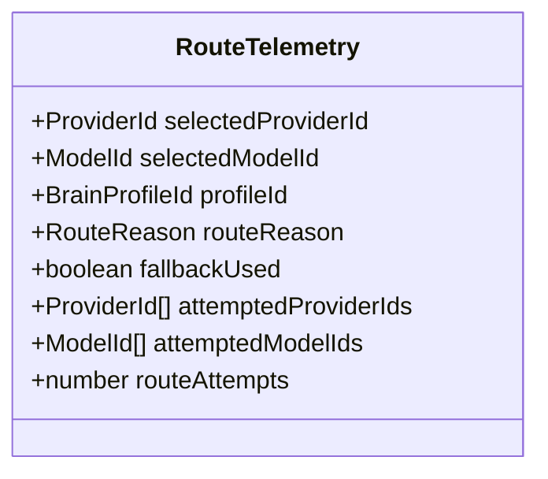

```ts
export const RouteTelemetrySchema = z.object({
  selectedProviderId: ProviderIdSchema,
  selectedModelId: ModelIdSchema.optional(),
  profileId: BrainProfileIdSchema.optional(),
  routeReason: RouteReasonSchema.or(z.string()).optional(),
  fallbackUsed: z.boolean().default(false),
  attemptedProviderIds: z.array(ProviderIdSchema).default([]),
  attemptedModelIds: z.array(ModelIdSchema).default([]),
  routeAttempts: z.number().int().nonnegative().default(1)
});
```

### Telemetry Boundary Enforcements
To preserve contract compatibility and prevent architectural bloat:
1. **DO NOT ADD** latency (`routingTimeMs`, `ttftMs`), quota flags, error objects, health status, research fields, audio metrics, or diagnostic trace IDs to `RouteTelemetry`.
2. **Research Telemetry Ownership**: Grounded research attributes belong strictly to `ResearchTelemetry` under F1.8. F1.9 does NOT define, extend, or freeze its field set here.
3. **Diagnostic Telemetry Remains Independent**: End-to-end turn correlation, stage timings, component error forensics, and quota observations belong to F1.9 `DiagnosticTelemetry`.

```text
┌────────────────────────────────────────────────────────────────────────┐
│                        TELEMETRY DOMAIN BOUNDARIES                     │
├──────────────────────┬──────────────────────┬──────────────────────────┤
│ RouteTelemetry       │ ResearchTelemetry    │ DiagnosticTelemetry      │
│ (Pre-M5 Frozen)      │ (F1.8 Owned - Future)│ (F1.9 Proposed - Future) │
├──────────────────────┼──────────────────────┼──────────────────────────┤
│ selectedProviderId   │ Owned by F1.8;       │ traceId / requestId      │
│ selectedModelId      │ F1.9 does NOT define │ correlation details      │
│ profileId            │ or freeze research   │ latencyBreakdown         │
│ routeReason          │ schema fields here.  │ canonicalErrorCode       │
│ fallbackUsed         │ Correlated via ID    │ diagnosticReason         │
│ attemptedProviderIds │ once F1.8-A types    │ sanitizedRawCause        │
│ attemptedModelIds    │ are finalized.       │ providerQuotaState       │
│ routeAttempts        │                      │                          │
└──────────────────────┴──────────────────────┴──────────────────────────┘
```

---

## 5. Trace & Correlation Architecture

MAVE requires a lightweight, unified correlation model to track a user turn from initial microphone activation through presentation, without inventing redundant identifiers.

### Identifier Audit & Mapping
The repository currently maintains three stable primary identifiers:
- `sessionId`: The persistent conversation session ID (`packages/contracts/src/session.ts`) or voice session ID (`packages/contracts/src/voice.ts`).
- `turnId`: The persistent conversation turn ID (user or assistant) in `ConversationStore`.
- `requestId`: The execution turn ID generated per brain, STT, or TTS invocation.

### Minimum Correlation Model & Status
- **Core Architectural Requirement**: **One user turn must be end-to-end correlatable** across all subsystem boundaries:
  $$\text{activation} \longrightarrow \text{audio capture} \longrightarrow \text{STT} \longrightarrow \text{ConversationRuntime} \longrightarrow \text{BrainRouter} \longrightarrow \text{provider} \longrightarrow \text{stream} \longrightarrow \text{TTS} \longrightarrow \text{presentation}$$
- **Status of `traceId`**: **PROPOSED IF EXISTING IDENTIFIERS ARE INSUFFICIENT**.
  - Milestone F1.9-A must determine whether `requestId` alone can serve as the canonical root correlation ID across the entire turn lifecycle, or if a dedicated `traceId` is strictly necessary to bridge voice fan-out (where a single voice session fans out into child operations: `sttRequestId`, `brainRequestId`, `ttsRequestId`).
  - Do **NOT** create duplicate identifiers without architectural necessity.
- **Span Decomposition (`spanId`)**: Identifies the active component boundary (`wake`, `capture`, `stt`, `routing`, `inference`, `tts`, `playback`, `surface`).

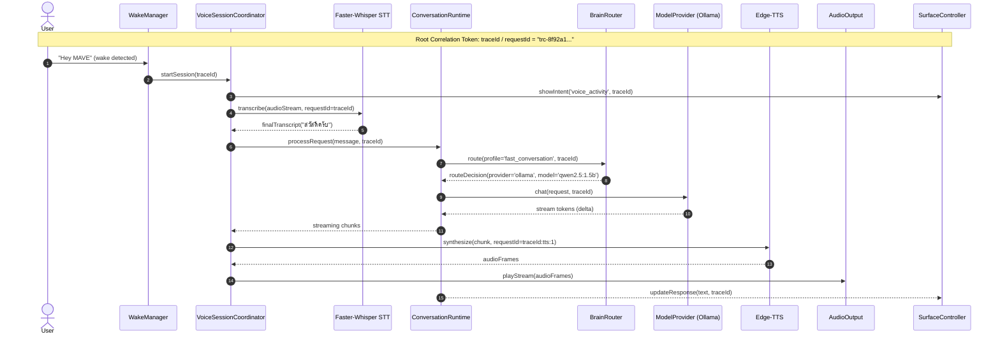

---

## 6. Typed Conceptual Diagnostic Event Model

Diagnostics must be structured, typed, and serializable across Electron IPC, avoiding free-form string pollution.

### Conceptual Schema Definition

```ts
export type DiagnosticSeverity = 'debug' | 'info' | 'warn' | 'error' | 'fatal';

export type DiagnosticComponent =
  | 'WAKE'
  | 'AUDIO_CAPTURE'
  | 'STT'
  | 'CONVERSATION_RUNTIME'
  | 'BRAIN_ROUTER'
  | 'MODEL_PROVIDER'
  | 'AGENT_RUNTIME_PROVIDER'
  | 'KNOWLEDGE_RESEARCH'
  | 'RESIDENCY'
  | 'TTS'
  | 'AUDIO_OUTPUT'
  | 'PRESENTATION';

export type DiagnosticPhase =
  | 'START'
  | 'READY'
  | 'PROGRESS'
  | 'SUCCESS'
  | 'FAILURE'
  | 'CANCELLED'
  | 'DEGRADED';

export interface DiagnosticEvent {
  readonly eventId: string;              // UUID v4
  readonly timestamp: number;            // Epoch milliseconds
  readonly traceId: string;              // Root turn trace token
  readonly requestId?: string;           // Execution request token
  readonly sessionId?: string;           // Conversation session ID
  readonly turnId?: string;              // Conversation turn ID
  readonly component: DiagnosticComponent;
  readonly phase: DiagnosticPhase;
  readonly severity: DiagnosticSeverity;
  readonly durationMs?: number;          // Elapsed phase duration
  readonly providerId?: string;          // Target provider (e.g. 'ollama', 'claude-code')
  readonly modelId?: string;             // Target model descriptor
  readonly errorCode?: string;           // Canonical Brain/STT/TTS error code (lower_snake_case)
  readonly diagnosticReason?: string;    // Granular failure cause (lower_snake_case)
  readonly metadata?: Record<string, string | number | boolean | null>; // Redacted structured context
}
```

---

## 7. Component Boundaries & Lifecycle States

Diagnostics treats each subsystem as a bounded state machine. Lifecycle states are defined conceptually across all components, but semantics are strictly tailored to component capabilities:

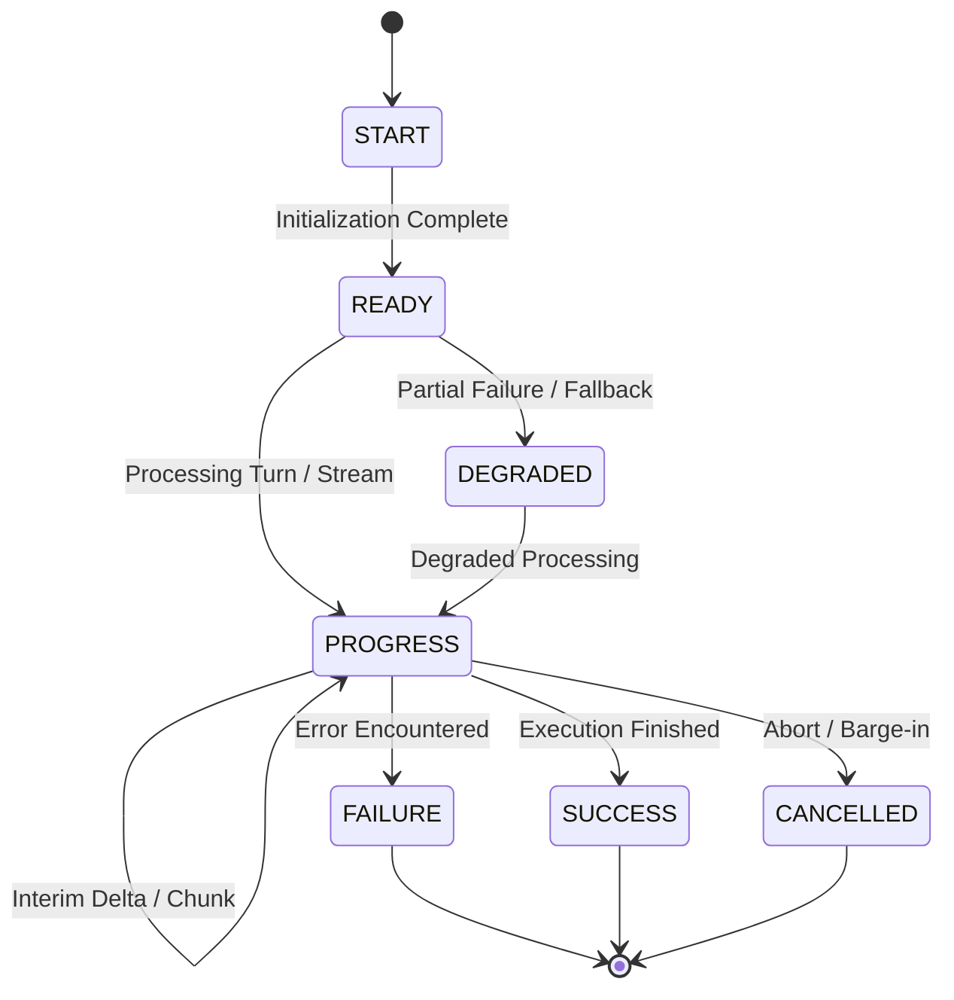

### Component State Semantics

| Component | `START` Semantics | `PROGRESS` Semantics | `SUCCESS` Semantics | `FAILURE` Semantics | `DEGRADED` Semantics |
| :--- | :--- | :--- | :--- | :--- | :--- |
| **WAKE** | Audio device open & supervisory thread starting. | Audio frame scoring (RMS / neural score updates). | Wake word detected exceeding threshold. | Mic disconnected, model load failure. | Sensitivity reduced due to background noise. |
| **AUDIO_CAPTURE** | Buffer allocation, ring buffer initialized. | Streaming PCM frames into STT pump. | Utterance completed cleanly upon silence. | Buffer overrun, audio hardware drop. | Dropped audio frames detected. |
| **STT** | Python process spawned / ready packet received. | Interim partial transcripts emitted. | Final transcript verified and emitted. | STT worker crash, timeout, invalid audio. | Fallback to secondary STT or text-only prompt. |
| **CONVERSATION_RUNTIME** | Turn record created in SQLite / memory. | Processing route, context, and stream deltas. | Assistant turn persisted cleanly. | Unhandled exception, persistence failure. | Non-fatal storage failure; continuing in memory. |
| **BRAIN_ROUTER** | Candidate policy evaluation begins. | Probing fallback candidates. | Eligible provider & model selected. | No usable provider (all failed / blocked). | Primary skipped; fallback candidate selected. |
| **MODEL_PROVIDER** | HTTP stream / CLI process connection initialized. | Streaming token deltas (`response_delta`). | Generation completed; usage recorded. | Daemon unreachable, context overflow. | Context window truncated to fit limits. |
| **AGENT_RUNTIME_PROVIDER** | CLI spawned with safe environment. | Stream JSON events received from CLI. | Execution completed with zero tool violations. | Process exit non-zero, OAuth expired. | Rate limit approaching; token throttled. |
| **KNOWLEDGE_RESEARCH** | Trigger classified (`CURRENT` / `BREAKING`). | Evidence retrieval & verification. | Evidence bundle synthesized with citations. | Retrieval timeout, zero evidence. | Temporal synthesis without external sources. |
| **RESIDENCY** | Model load requested (`POST /api/generate`). | Model weights transferring to VRAM. | Model resident in VRAM (`warm` / `in_use`). | OOM, digest mismatch, Ollama crash. | Model resident in system RAM instead of GPU VRAM. |
| **TTS** | Speech synthesis request initiated. | Streaming synthesized PCM audio frames. | All text chunks synthesized. | Network disconnect, voice unavailable. | Text displayed on surface without voice. |
| **AUDIO_OUTPUT** | Speaker device buffer opened. | Playing PCM chunks to hardware speakers. | Playback completed to final sample. | Speaker device error, buffer underrun. | Audio output muted / volume clamped. |
| **PRESENTATION** | Surface mode transition requested. | Capsule / panel expanding; text streaming. | View rendered and collapsed cleanly. | Window creation failure, render crash. | Fallback from Level 3 Panel to Level 1 Capsule. |

---

## 8. Health vs. Availability vs. Quota vs. Auth vs. Billing

A core architectural contribution of F1.9 is the rigorous separation of operational, entitlement, and permission semantics. These concepts are frequently conflated into a single `health` status, creating opaque routing bugs.

### Existing Contract Compatibility
> [!IMPORTANT]
> **EXISTING PROVIDER HEALTH CONTRACTS REMAIN AUTHORITATIVE**
> - The existing canonical `ProviderHealth` contract in `packages/contracts/src/brain.ts` (`CANONICAL_PROVIDER_HEALTH_STATUSES`: `healthy`, `degraded`, `unhealthy`, `unconfigured`, `quota_limited`, `rate_limited`, `auth_error`, `unavailable`) remains authoritative.
> - The multi-dimensional model below represents **SEMANTIC NORMALIZATION / FUTURE CONTRACT HARDENING** recommended for future phases.
> - F1.9 does **NOT** silently replace or mutate existing `ProviderHealth` enums in this audit. Full backward compatibility is strictly maintained.

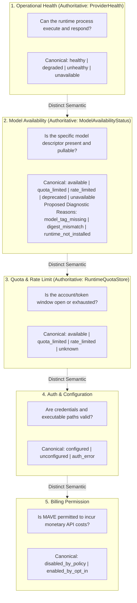

### Orthogonal Reliability Dimensions

1. **Operational Health**:
   - Reflects technical reachability and process responsiveness.
   - Dispatched via zero-cost pings (e.g. `GET /api/version` for Ollama, `claude --version` for Claude Code).
   - *Example*: Ollama daemon running on `127.0.0.1:11434` is **`healthy`**.
2. **Model Availability**:
   - Reflects whether a concrete model is installed, loaded, or discoverable.
   - Authoritative contract: `ModelAvailabilityStatusSchema` in `packages/contracts/src/brain.ts` (`available`, `quota_limited`, `rate_limited`, `deprecated`, `unavailable`).
   - **Do NOT introduce new canonical ModelAvailability values merely for diagnostics.**
   - Concepts such as `model_tag_missing`, `digest_mismatch`, and `runtime_not_installed` are **diagnostic failure reasons** attached to `unavailable`, NOT replacement availability enums.
   - *Example Conceptually*:
     $$\text{modelAvailability} = \text{'unavailable'}, \quad \text{diagnosticReason} = \text{'model_tag_missing'}$$
     $$\text{modelAvailability} = \text{'unavailable'}, \quad \text{diagnosticReason} = \text{'digest_mismatch'}$$
   - Exact diagnostic reason identifiers remain proposed until F1.9-A contract work.
   - **Clear Boundary**: CANONICAL CONTRACT STATE (`unavailable`) vs. PROPOSED DIAGNOSTIC DETAIL (`model_tag_missing`).
3. **Quota & Rate Limit**:
   - Reflects account entitlement windows and concurrency limits.
   - Provider-specific; tracked in `RuntimeQuotaStore` with scope (`runtime` vs. `model` vs. `unknown`).
   - *Example*: Claude Code CLI is `healthy` and `configured`, but Anthropic returns a 5-hour rate limit $\to$ Provider is **`healthy`**, but Quota is **`quota_limited`**.
4. **Auth & Configuration**:
   - Reflects local credentials, config files, and binary installation paths.
   - *Example*: OpenAI API provider is reachable over HTTPS, but no API key exists $\to$ Provider is **`unconfigured`**.
5. **Billing Permission**:
   - Reflects user policy authorization to spend metered API funds (`allowPaidApis`).
   - Hard Invariant: **Credential presence != Billing permission**.
   - *Example*: An OpenAI API key is present in environment variables, but `allowPaidApis: false` $\to$ Blocked by policy, NOT provider outage.

---

## 9. Provider Diagnostics: Model Provider vs. Agent Runtime Provider

MAVE cleanly separates direct LLM endpoints (`model_provider`) from tool-bearing execution sandboxes (`agent_runtime_provider`). Diagnostics must observe these differences without breaking boundaries.

```text
┌───────────────────────────────────────┬────────────────────────────────────────┐
│ MODEL PROVIDER                        │ AGENT RUNTIME PROVIDER                 │
│ (Ollama, OpenAI API, Mock)            │ (Claude Code, Codex, Antigravity)      │
├───────────────────────────────────────┼────────────────────────────────────────┤
│ Kind: model_provider                  │ Kind: agent_runtime_provider           │
│ Direct conversational LLM stream      │ Multi-step agent execution process     │
│ Observables:                          │ Observables:                           │
│ • HTTP transport latency              │ • Child process PID & lifecycle state  │
│ • Catalog snapshot & model presence   │ • CLI executable version               │
│ • Prompt eval & eval token throughput │ • OAuth config status in user profile  │
│ • VRAM residency & keepAlive state    │ • Safe sandbox environment flags       │
│ • TTFT & total generation duration    │ • Rate limit & quota reset markers     │
│ Authority: ZERO tool execution        │ Authority: Tools BLOCKED in Pre-M5     │
└───────────────────────────────────────┴────────────────────────────────────────┘
```

### Observable Provider Diagnostic Profile

```ts
export interface ProviderDiagnosticSnapshot {
  readonly providerId: string;
  readonly providerKind: 'model_provider' | 'agent_runtime_provider' | 'knowledge_provider';
  readonly accessPath: 'official_api' | 'official_cli' | 'local_runtime';
  readonly accessClass: 'subscription' | 'local' | 'paid_api';
  readonly operationalHealth: 'healthy' | 'degraded' | 'unhealthy' | 'unavailable';
  readonly authStatus: 'configured' | 'unconfigured' | 'auth_error' | 'not_required';
  readonly billingPermission: 'disabled' | 'enabled';
  readonly runtimeVersion?: string;
  readonly executablePath?: string;
  readonly lastCheckedAt: number;
  readonly lastSuccessAt?: number;
  readonly lastFailureAt?: number;
  readonly lastFailureReason?: string;
  readonly quotaState: {
    readonly status: 'available' | 'quota_limited' | 'rate_limited' | 'unknown';
    readonly scope?: 'runtime' | 'model' | 'unknown';
    readonly resetAt?: number;
  };
  readonly activeModel?: {
    readonly modelId: string;
    readonly availability: 'available' | 'quota_limited' | 'rate_limited' | 'deprecated' | 'unavailable';
    readonly diagnosticReason?: string; // Proposed: e.g. 'model_tag_missing', 'digest_mismatch'
    readonly isResident?: boolean;
  };
}
```

---

## 10. Local Fast Brain / Ollama Diagnostics

The local Fast Brain (`qwen2.5:1.5b` hosted via Ollama) requires specialized diagnostic monitoring to ensure sub-second conversational responsiveness without compromising stability.

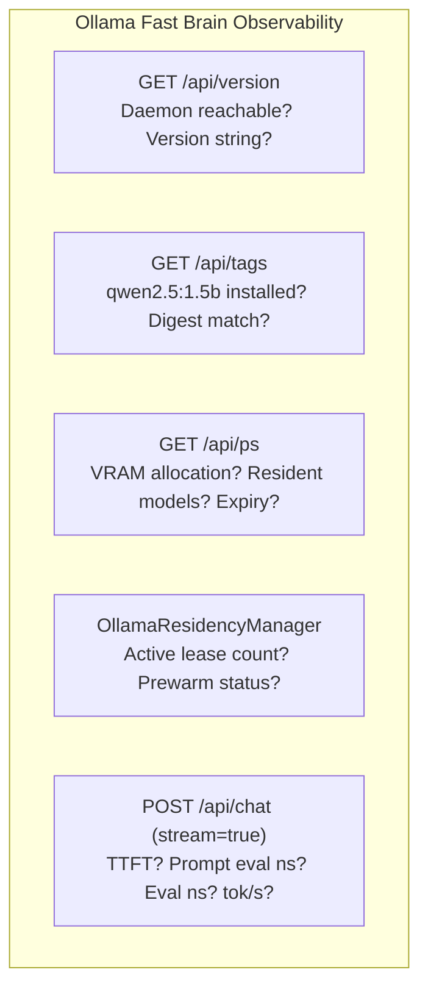

### Canonical Local Brain Diagnostics

1. **Daemon Presence & Version**:
   - Dispatches `GET /api/version` with loopback enforcement (`127.0.0.1` / `localhost`).
   - Verifies daemon responsiveness without touching model weights.
2. **Model Digest Verification**:
   - Inspects `GET /api/tags` and checks digest against expected SHA256 (`65ec0654...` for `qwen2.5:1.5b`).
   - Distinguishes `MATCH`, `MISMATCH`, and `MODEL_NOT_FOUND`.
3. **Residency & Lease Tracking**:
   - Monitors `OllamaResidencyManager` states: `unloaded`, `loading`, `warm`, `in_use`, `unloading`, `unavailable`.
   - Tracks active lease counts to guarantee model is never unloaded while an active streaming turn holds a reference.
   - Reconciles against official `GET /api/ps` (inspecting `size_vram` and `expires_at`).
4. **Accurate Generation Timing (Nanosecond to Second Conversion)**:
   - Ollama emits raw durations in integer nanoseconds:
     $$\text{PromptEvalTokensPerSec} = \frac{\text{prompt\_eval\_count}}{\text{prompt\_eval\_duration} / 10^9}$$
     $$\text{EvalTokensPerSec} = \frac{\text{eval\_count}}{\text{eval\_duration} / 10^9}$$
   - Preserves both raw nanoseconds and normalized floating-point seconds.
5. **Empirical Truth vs. SLO Distinction**:
   - Live certification (C3.1 / C4-B) on Home PC hardware is the **sole empirical source of truth**.
   - Historical observations (~96ms warm TTFT, ~202 tok/s, ~3,478 MiB headroom) must remain strictly classified as:
     $$\text{HISTORICAL OBSERVATION} \quad \neq \quad \text{LIVE CERTIFICATION} \quad \neq \quad \text{SLO}$$
   - Current authoritative hardware truth remains pending C3.1/C4-B Home PC live verification.
   - Diagnostics records actual live performance as-is, without imposing synthetic thresholds or treating historical benchmarks as failure limits.

---

## 11. Voice Pipeline Diagnostics & Audio Stage Timing

The voice loop represents the most timing-critical pathway in MAVE. Diagnostics must capture distinct stage timestamps and resolve ambiguous metrics.

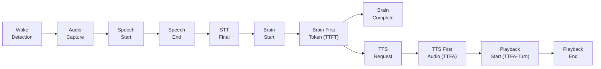

### Critical Metric Distinction: Brain TTFT vs. Time-to-First-Audible-Response

$$\text{Brain TTFT} = T_{\text{BrainFirstToken}} - T_{\text{BrainStart}}$$

$$\text{TTS TTFA} = T_{\text{TTSFirstAudio}} - T_{\text{TTSRequested}}$$

$$\text{Time-to-First-Audible-Response} = T_{\text{PlaybackStart}} - T_{\text{SpeechEnd}}$$

> [!IMPORTANT]
> **NEVER MERGE BRAIN TTFT AND AUDIBLE PLAYBACK LATENCY**
> - **Brain TTFT** measures LLM neural generation latency.
> - **Time-to-First-Audible-Response** measures end-to-end user-perceived turnaround, including STT finalization, router dispatch, brain TTFT, text chunking, TTS synthesis, and OS audio buffer pre-roll.
> Conflating these two metrics obscures whether slowness is caused by the LLM or audio hardware pipelines.

### Stage Latency Breakdown Table

| Stage | Start Timestamp Marker | End Timestamp Marker | Latency Measurement | Typical Target / Range |
| :--- | :--- | :--- | :--- | :--- |
| **Wake Handoff** | `wakeDetectedAt` | `voiceCaptureStartedAt` | `wakeToCaptureMs` | $\le 50\text{ ms}$ |
| **Speech Duration** | `speechStartedAt` | `speechEndedAt` | Utterance duration | Natural human speech |
| **STT Finalization** | `speechEndedAt` | `sttFinalAt` | `speechEndToSttMs` | $\le 300\text{--}600\text{ ms}$ |
| **Router Dispatch** | `sttFinalAt` | `brainStartedAt` | Routing evaluation | $\le 10\text{--}20\text{ ms}$ |
| **Brain First Token** | `brainStartedAt` | `brainFirstTokenAt` | `brainTtftMs` | $\sim 1\text{--}3\text{ s}$ (Warm fast: $<500\text{ ms}$) |
| **TTS Synthesis TTFA**| `ttsRequestedAt` | `ttsFirstAudioAt` | `ttsTtfaMs` | $\le 200\text{--}400\text{ ms}$ |
| **Playback Buffer** | `ttsFirstAudioAt` | `playbackStartedAt` | Audio output pre-roll | $\le 50\text{--}100\text{ ms}$ |
| **Audible Turnaround**| `speechEndedAt` | `playbackStartedAt` | `speechEndToSpokenResponseMs` | End-to-end turnaround |
| **Turn Duration** | `speechStartedAt` | `playbackCompletedAt` | `turnDurationMs` | Total voice exchange |

### Explicit Limitation: Acoustic Barge-In Without DSP AEC
- **Hardware Limitation**: MAVE operates on standard consumer PC hardware without a dedicated Digital Signal Processing (DSP) hardware Acoustic Echo Cancellation (AEC) pipeline.
- When speakers play voice output, the microphone picks up the speaker sound. Without AEC, this can falsely trigger wake word detection or inject feedback into STT.
- **Diagnostics Architectural Boundary**: Diagnostics records audio levels, playback state, and user-initiated barge-in abort events. **Diagnostics cannot and does not claim to solve acoustic echo cancellation.**

---

## 12. Latency Span Model: Explaining "Why Did MAVE Feel Slow?"

When a user perceives MAVE as sluggish, a single aggregate "response time" is useless for root-cause analysis. The latency span model decomposes every turn into discrete, non-overlapping spans:

```mermaid
gantt
    title Turn Latency Decomposition Span Model
    dateFormat X
    axisFormat %s s

    section User Speech
    Audio Utterance        : 0, 1500
    section Speech Processing
    STT Transcription     : 1500, 1900
    section Routing & Core
    Brain Router Dispatch  : 1900, 1920
    section Model Inference
    Local Brain TTFT       : 1920, 2420
    Token Generation Stream: 2420, 3600
    section Synthesis & Audio
    Streaming Text Chunker : 2420, 2520
    TTS First Frame Synthes: 2520, 2800
    Audio Playback to Ear  : 2800, 4200
```

### Explaining Latency Spikes Without Guessing

| Symptom Observed | Bottleneck Span Identified | Root Cause Identified by Diagnostics |
| :--- | :--- | :--- |
| "MAVE took 8 seconds to answer" | `coldLoadLatencyMs = 6200ms` | Local model was unloaded from VRAM; Ollama executed a cold model load. |
| "Voice paused awkwardly after I finished speaking" | `speechEndToSttMs = 2100ms` | STT worker process was queued or VAD silence threshold waited too long. |
| "MAVE started typing instantly, but didn't speak" | `ttsTtfaMs = 2800ms` | Edge-TTS connection delayed or Text Chunker waited for a complete sentence boundary. |
| "MAVE paused before choosing a brain" | `routingLatencyMs = 1500ms` | Model catalog retrieval timed out on an unreachable provider during fallback probe. |
| "MAVE sound chopped / stuttered" | `playbackBufferUnderrun = true` | Speaker output buffer starved due to high CPU load during token generation. |

---

## 13. Error Architecture & Canonical Error Taxonomy

Diagnostics preserves MAVE's normalized, lower-snake-case canonical error architecture while attaching structured diagnostic reasons and sanitized internal causes.

### Three-Tier Error Forensic Model

```text
┌────────────────────────────────────────────────────────────────────────┐
│ 1. Canonical Error Code (Public Contract)                              │
│    e.g. 'local_provider_unavailable'                                   │
├────────────────────────────────────────────────────────────────────────┤
│ 2. Diagnostic Failure Reason (Granular Subsystem Cause - Proposed)     │
│    e.g. 'fast_brain_unavailable'                                       │
├────────────────────────────────────────────────────────────────────────┤
│ 3. Sanitized Internal Cause (Redacted OS / Network Diagnostic)         │
│    e.g. 'connect ECONNREFUSED 127.0.0.1:11434'                         │
└────────────────────────────────────────────────────────────────────────┘
```

### Canonical BrainError Architecture Rules
1. **Canonical Error Authority**: Only values actually present in `CANONICAL_BRAIN_ERROR_CODES` (`packages/contracts/src/brain.ts`) may be designated as canonical BrainError codes.
2. **Three-Tier Architecture**:
   $$\text{Canonical BrainError} \quad + \quad \text{DiagnosticFailureReason} \quad + \quad \text{Sanitized Raw Cause}$$
   - *Canonical Contract Code*: `local_provider_unavailable`
   - *Proposed Diagnostic Reason*: `fast_brain_unavailable`
   - *Sanitized Internal Cause*: `connection refused 127.0.0.1:11434`
3. **Proposed Status**: Exact diagnostic reason identifiers (e.g. `fast_brain_unavailable`, `ollama_daemon_unreachable`, `model_tag_missing`) remain **PROPOSED** until F1.9-A contract finalization.

### Canonical Error Taxonomy Mapping

```ts
export const CANONICAL_BRAIN_ERROR_CODES = [
  'provider_unavailable',
  'provider_timeout',
  'provider_auth',
  'provider_limit',
  'provider_invalid_response',
  'cancelled',
  'runtime_error',
  'fast_brain_unavailable',
  'profile_unavailable',
  'model_unavailable',
  'provider_unconfigured',
  'quota_limited',
  'rate_limited',
  'auth_required',
  'local_provider_unavailable',
  'routing_timeout',
  'generation_cancelled'
] as const;
```

| Canonical Error Code | Example Diagnostic Reasons (Non-Canonical Proposals) | Sanitized Example Cause |
| :--- | :--- | :--- |
| `provider_unavailable` | `ollama_daemon_unreachable`, `connection_refused` | `fetch failed: connect ECONNREFUSED 127.0.0.1:11434` |
| `local_provider_unavailable`| `fast_brain_unavailable`, `residency_load_failed` | `Failed to allocate 1.5B weights in VRAM: CUDA OOM` |
| `provider_timeout` | `ttft_timeout_exceeded`, `stream_stall` | `Request exceeded timeout of 30000ms` |
| `provider_auth` | `oauth_token_expired`, `invalid_api_key` | `Claude Code OAuth session expired; re-auth required` |
| `quota_limited` | `subscription_tier_limit`, `daily_cap_reached` | `Rate limit exceeded: 5-hour rolling limit reached` |
| `model_unavailable` | `model_tag_missing`, `digest_mismatch` | `Model 'qwen2.5:1.5b' not found in local Ollama catalog` |
| `routing_timeout` | `candidate_probe_timeout` | `Probing candidate 'ollama' timed out after 3000ms` |
| `cancelled` | `user_barge_in`, `ipc_cancel_command` | `User interrupted voice turn during speech synthesis` |

---

## 14. User-Facing vs. Developer-Facing Diagnostics

Diagnostics strictly bifurcates state presentation into **User-Safe Status** and **Developer Forensics**.

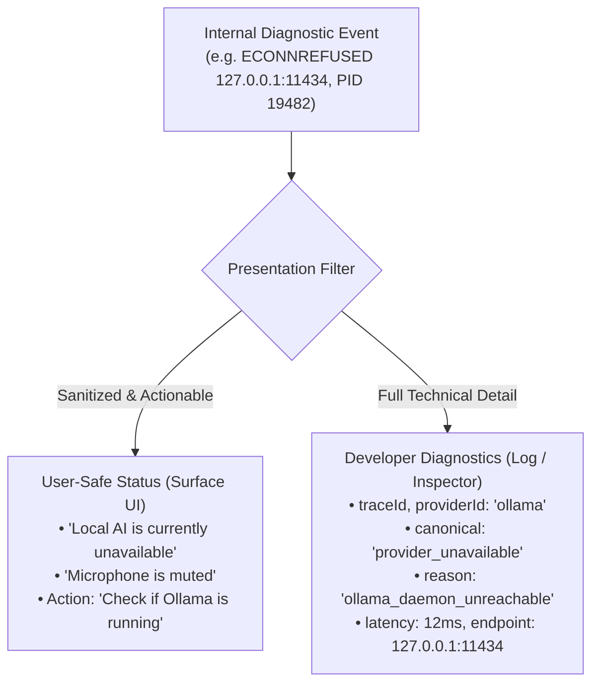

### Safety & Privacy Boundaries

| Information Attribute | User-Safe Status | Developer Diagnostics | Diagnostic Export / Bundle |
| :--- | :--- | :--- | :--- |
| **High-level Status** | YES ("Voice unavailable") | YES (`state: 'error'`) | YES |
| **Recommended Action** | YES ("Check microphone cable") | YES ("Restart audio driver")| YES |
| **Provider ID & Model** | Friendly ("Local Brain") | Full (`ollama / qwen2.5:1.5b`)| Full |
| **Latency Breakdown** | Simple ("Took 1.2s") | Millisecond stage breakdown | Aggregated medians |
| **Error Code** | Friendly message | Canonical + diagnostic reason| Canonical + diagnostic reason |
| **API Keys / Secrets** | **NEVER** | **NEVER (REDACTED)** | **NEVER (REDACTED)** |
| **Full Prompt Text** | Optional in chat history | **NEVER (Length/tokens only)**| **NEVER** |
| **File System Paths** | **NEVER** | Redacted (`<path>`) | Redacted (`<path>`) |

---

## 15. Log Privacy & Invariant Redaction

Diagnostics must be privacy-preserving by default, adhering to strict invariants:

### Mandatory Redaction Rules
1. **Secrets & Tokens**: All strings matching API key patterns, bearer tokens, passwords, cookies, or OAuth secrets must be censored to `[REDACTED]`.
2. **Prompts & Completions**: Complete user queries and assistant markdown completions must **NOT** be stored in diagnostic event logs. Only character counts, token estimates, language hints, and prompt IDs are recorded.
3. **Paths & File Names**: Arbitrary host filesystem paths (e.g. `C:\Users\Username\...`) must be sanitized to generic `<path>` markers to prevent leaking user directory structures.
4. **Binary Audio Streams**: Raw PCM byte buffers and audio frames are strictly prohibited from diagnostic persistence. Only normalized RMS levels ($0.0 \text{ to } 1.0$) and frame sequence counts are permitted.

```ts
export const DEFAULT_DIAGNOSTIC_REDACTION_PATHS = [
  'apiKey',
  'key',
  'secret',
  'token',
  'authorization',
  'headers.authorization',
  'headers.Authorization',
  'clientSecret',
  'OPENAI_API_KEY',
  'PICOVOICE_ACCESS_KEY',
  '*.apiKey',
  '*.secret',
  '*.token'
] as const;
```

---

## 16. Retention & Bounded Diagnostic Storage

To prevent unbounded local storage growth and desktop disk exhaustion, diagnostics enforces three bounded storage categories:

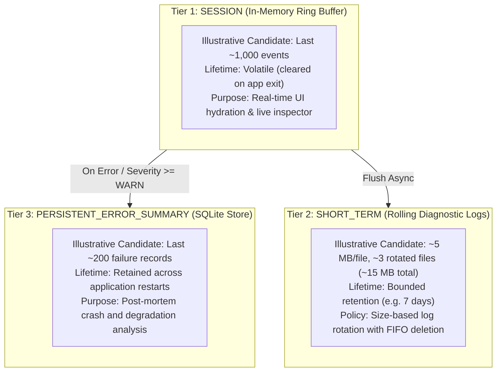

> [!IMPORTANT]
> **RETENTION VALUES ARE NOT ARCHITECTURAL CONSTANTS**
> Specific numerical thresholds (e.g., 1,000 events, 5 MB file limit, 3 rolling files, 15 MB total disk budget, 200 crash records) are **ILLUSTRATIVE CANDIDATE DEFAULTS — NOT CANONICAL — TO BE VALIDATED DURING F1.9 IMPLEMENTATION**.
>
> The non-negotiable architectural invariant is:
> $$\text{Diagnostic Storage MUST Be Strictly Bounded}$$
>
> Live production parameters will be tuned during implementation based on:
> - Average serialized event size and burst volume
> - Event write frequency during active voice turns
> - Desktop disk footprint and flash endurance impact
> - SQLite database compaction and vacuum strategy
> - User support diagnostics requirements
> - User privacy policy and local retention preferences

---

## 17. Crash, Interruption & Restart Recovery

MAVE must gracefully handle process interruption, daemon crashes, and child process exits without entering an unrecoverable hung state.

### Failure Classification & Recovery Matrix

| Disruption Scenario | Failure Classification | Diagnostic Evidence Captured | System Action Taken | Recovery Guidance |
| :--- | :--- | :--- | :--- | :--- |
| **Ollama Daemon Disappears** | `recoverable` | `fetch failed: ECONNREFUSED`; health probes fail. | Abort active local brain turn; mark Ollama `unavailable`. | User restarts Ollama; next health probe restores `healthy`. |
| **Ollama Daemon Reappears** | `recoverable` | Health probe succeeds (`GET /api/version` HTTP 200). | Ollama restored to candidate pool; catalog refreshed. | Automatic recovery on next turn. |
| **Faster-Whisper STT Crashes** | `recoverable` | Child process exit event with exit code or signal. | Cancel active voice session; emit `voice_session_failed`. | Supervisor restarts child on next voice wake turn. |
| **Edge-TTS Network Fails** | `transient` | Web socket / HTTP timeout during chunk synthesis. | Degrade turn to text-only output on surface panel. | Spoken response omitted; text response preserved. |
| **Agent CLI Exits (Claude/Codex)**| `user-action-required` | CLI exit code non-zero; stderr captured. | Mark assistant turn `failed`; record error reason. | User fixes command or refreshes CLI authentication. |
| **CLI Auth Expired** | `reauth-required` | Stderr contains OAuth expired or 401 Unauthorized. | Provider marked `auth_error`; excluded from routing. | User runs `claude login` or `codex login`. |
| **Electron Renderer Reloads** | `transient` | IPC channel disconnect / reconnect event. | Main process preserves conversation session state. | Renderer requests `mave:get-status` and rehydrates. |
| **Main Process Restarts** | `permanent-for-session`| Stored session state in SQLite loaded on startup. | Previous active turns marked `failed` if incomplete. | Fresh session or reloaded session ready for turn. |

---

## 18. Degraded Mode Architecture

A foundational reliability principle in MAVE is:
**Degraded mode preserves available functionality rather than declaring the entire system dead.**

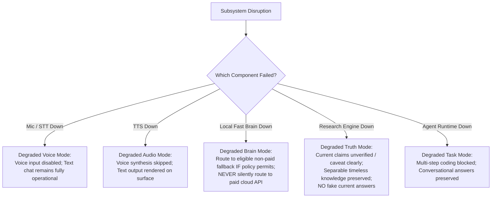

### Inviolable Degraded Mode Invariants
1. **Never Silently Cross Privacy Boundaries**: If local Fast Brain fails while `localOnly: true`, MAVE **MUST NOT** route to a cloud provider. It must fail closed and report `local_provider_unavailable`.
2. **Never Silently Cross Billing Boundaries**: If local Fast Brain or subscription agent runtimes are unavailable, MAVE **MUST NOT** silently fall back to metered paid APIs (e.g. OpenAI API) unless the user explicitly authorized `allowPaidApis: true`.
3. **Preserve User Interaction**: If voice hardware fails, the surface must immediately offer text input rather than closing the window.
4. **Canonical F1.8 Degraded Truth Invariant**: If research is **REQUIRED** for a `CURRENT` or `BREAKING` claim and external retrieval is unavailable:
   - MAVE **MUST NOT** present model memory as verified current truth.
   - Required system behavior:
     $$\text{research-required claim} + \text{research unavailable} \implies \text{verification unavailable} \implies \text{fail honestly / caveat clearly} \implies \text{NO fake current answer}$$
   - If a request contains separable timeless content, MAVE may still answer the timeless portion while explicitly disclaiming the unverified current fact.
   - *Example*: For *"Explain what P/E means and tell me Apple's current P/E"*:
     - Conceptual definition of P/E $\to$ answered accurately from model memory.
     - Apple's current P/E $\to$ explicitly stated as unverified because live retrieval is unavailable.
   - MAVE must **NEVER** silently downgrade current factual queries into ungrounded model-memory approximations.

---

## 19. Fallback Observability & The F1.4 Midstream Invariant

MAVE's routing engine enforces the frozen F1.4 midstream execution invariant. Diagnostics must accurately reflect the distinction between pre-execution candidate evaluation and post-execution failure:

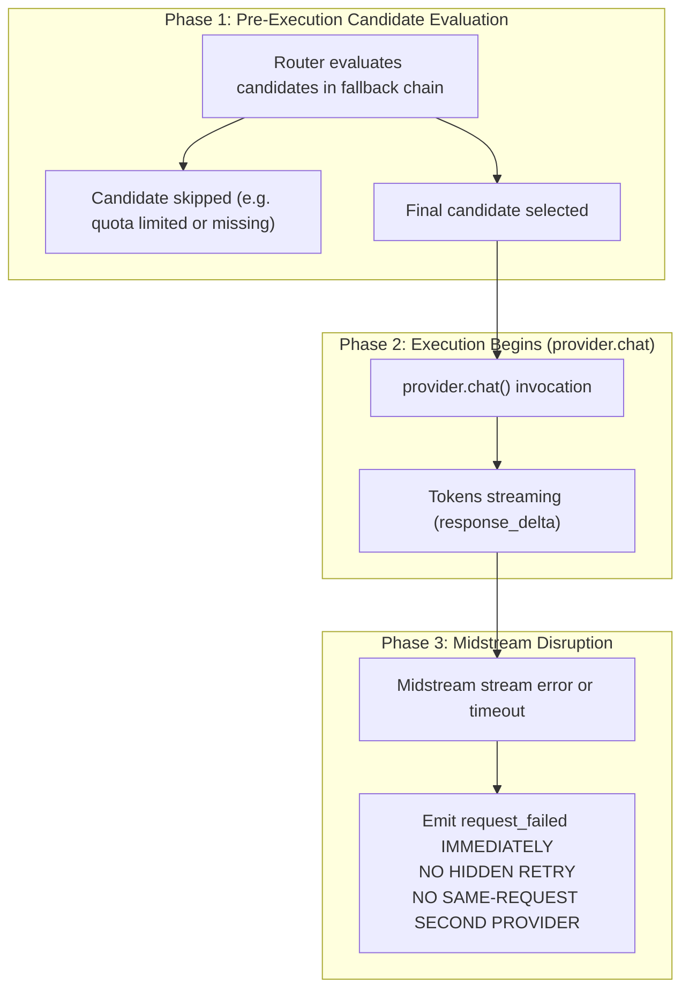

### Invariant Rules Captured by Diagnostics
- **Candidate Evaluated != Execution Attempt**: Evaluating a candidate during routing and skipping it (e.g. because it is offline or quota-limited) is **NOT** an execution attempt. It does not increment `routeAttempts`.
- **Zero Midstream Retries**: Once `provider.chat()` begins emitting tokens, **NO hidden fallback is permitted**. If the connection drops or times out midstream, the turn fails with `request_failed`. Diagnostics must explicitly record that execution began and failed, rather than masking the error behind an automatic restart.
- **RouteTelemetry Frozen**: `RouteTelemetry` records `selectedProviderId`, `selectedModelId`, `fallbackUsed`, `attemptedProviderIds`, and `routeAttempts` (the 8 frozen fields). Granular skip reasons and probe durations are captured in separate `BrainRoutingDiagnostics`.

---

## 20. Cancellation Observability

Cancellation must be explicitly distinguished from technical failure:

```text
┌────────────────────────────────────────────────────────────────────────┐
│                        CANCELLATION TAXONOMY                           │
├──────────────────────┬──────────────────────┬──────────────────────────┤
│ Cancellation Type    │ Trigger Mechanism    │ Diagnostic Result        │
├──────────────────────┼──────────────────────┼──────────────────────────┤
│ User Barge-In        │ User spoke while     │ status: 'cancelled'      │
│                      │ MAVE was speaking    │ reason: 'user_barge_in'  │
├──────────────────────┼──────────────────────┼──────────────────────────┤
│ User Sleep Request   │ Voice 'sleep' or     │ status: 'cancelled'      │
│                      │ tray 'return-to-sleep'│ reason: 'user_sleep'    │
├──────────────────────┼──────────────────────┼──────────────────────────┤
│ UI Cancel Action     │ Stop button clicked  │ status: 'cancelled'      │
│                      │ in Surface Panel     │ reason: 'user_ui_cancel' │
├──────────────────────┼──────────────────────┼──────────────────────────┤
│ Turn Timeout         │ Request exceeded     │ status: 'failure'        │
│                      │ effective timeoutMs  │ code: 'provider_timeout' │
├──────────────────────┼──────────────────────┼──────────────────────────┤
│ Application Shutdown │ App closing / quit   │ status: 'cancelled'      │
│                      │ event received       │ reason: 'app_shutdown'   │
└──────────────────────┴──────────────────────┴──────────────────────────┘
```

### Invariants for Cancellation
1. **Cancellation is NOT Failure**: A user-initiated barge-in or cancel action must **NEVER** increment error counters, trigger error toasts, or register as `request_failed`.
2. **Orphan Generation Prevention**: When cancellation occurs, the `AbortController` signal must promptly propagate to the provider (aborting the HTTP stream or killing the spawned CLI process) to halt unneeded token generation and save hardware resources.

---

## 21. Reliability & Recovery Policies

Failures must be categorized by actionable recovery policies:

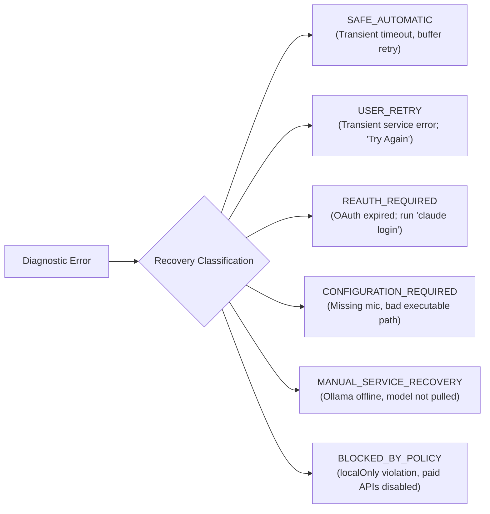

| Recovery Class | Description | System Reaction | User Action Required |
| :--- | :--- | :--- | :--- |
| `SAFE_AUTOMATIC` | Transient glitch before execution begins. | Pre-execution retry with backoff. | None. |
| `USER_RETRY` | Upstream generation interrupted midstream. | Mark turn failed; display "Try Again" button. | User clicks retry button. |
| `REAUTH_REQUIRED` | CLI subscription authentication expired. | Mark provider unconfigured / auth error. | User opens terminal and re-authenticates. |
| `CONFIGURATION_REQUIRED` | Selected mic unplugged; executable path missing.| Highlight configuration issue in UI. | User selects new device or path in settings. |
| `MANUAL_SERVICE_RECOVERY`| Local daemon stopped or model missing. | Report daemon / model status on surface. | User launches Ollama or runs `ollama pull`. |
| `BLOCKED_BY_POLICY` | Operation prohibited by privacy or billing policy.| Fail closed with clear explanation. | User adjusts request or enables opt-in setting. |

---

## 22. Quota & Rate Limit Diagnostics

Subscription runtimes (Claude Code, ChatGPT Codex, Google Antigravity) employ distinct, proprietary quota and rate-limiting structures. MAVE must not fabricate a fake universal quota abstraction.

### Principles for Quota Observability
1. **Preserve Concrete Provider Facts**: Store rate-limit headers and error messages as received (e.g. Anthropic's rolling 5-hour limit vs. OpenAI's daily token cap).
2. **Scope Matters**: Distinguish between:
   - `runtime`: Entire CLI / account is rate-limited (e.g. account tier cap).
   - `model`: Specific model is rate-limited, but secondary models in the same provider remain available.
   - `unknown`: Rate limit signal received without clear scope.
3. **UNKNOWN is a First-Class State**: If a provider does not expose remaining quota, the diagnostic status must be `unknown`. **MAVE must never guess or calculate synthetic remaining percentages.**
4. **Expiry & Invalidation**: Quota blocks expire automatically when `now >= resetAt`, transitioning back to `unknown`.

---

## 23. Billing & Paid API Diagnostics

MAVE maintains a strict policy regarding paid, metered APIs:
**Paid APIs remain default OFF (`allowPaidApis: false`).**

### Four-Tier Billing Separation Principle
To prevent false monetary claims or unauthorized spending, diagnostics enforces a strict 4-tier separation:

$$\text{Paid Access Class} \quad \neq \quad \text{Billing Permission} \quad \neq \quad \text{Provider Invocation} \quad \neq \quad \text{Confirmed Billing Evidence}$$

1. **Paid Access Class**: Architectural category of the provider:
   - `subscription`: Flat-rate subscription runtimes (Claude Code, ChatGPT Codex, Google Antigravity).
   - `local`: 100% on-device inference, zero marginal cost (Ollama, Faster-Whisper).
   - `paid_api`: Pay-per-token metered billing endpoints (e.g. OpenAI API, Anthropic API direct).
2. **Billing Permission**: User opt-in policy flag (`allowPaidApis: true`):
   - Credential presence (such as an `OPENAI_API_KEY` in environment variables) does **NOT** grant billing permission.
   - Routing to a paid API requires explicit, intentional user opt-in.
3. **Provider Invocation**: Dispatch of a network or process turn to an external endpoint:
   - **Invocation is strictly NOT proof of monetary cost or billing event.**
   - An endpoint might return 401, fail before token generation, or return cached/free-tier responses.
4. **Confirmed Billing Evidence**: Concrete, verified usage tokens returned by the upstream provider:
   - Diagnostics must never claim a financial charge occurred unless verified usage tokens and rate metadata are returned.
   - The indicator `paidApiIncurred` is an operational signal, **NOT proof of financial billing or finalized charge**.

---

## 24. Subscription Agent Runtime Diagnostics

Agent runtimes (`ClaudeCodeBrainProvider`, `CodexBrainProvider`, `AntigravityBrainProvider`) wrap official CLIs. Diagnostics must observe their execution without expanding authority:

```text
┌────────────────────────────────────────────────────────────────────────┐
│ SUBSCRIPTION AGENT RUNTIME OBSERVABLES                                 │
├──────────────────────┬─────────────────────────────────────────────────┤
│ Executable Found     │ Verified via `which` / `where` and `--version`   │
├──────────────────────┼─────────────────────────────────────────────────┤
│ Auth State           │ Detected via config presence (~/.claude.json)   │
├──────────────────────┼─────────────────────────────────────────────────┤
│ Safe Sandbox Flags   │ Verified: `--dangerously-skip-permissions` ABSENT│
├──────────────────────┼─────────────────────────────────────────────────┤
│ Tool Execution       │ Verified: `--tools ""` and `--safe-mode` ENFORCED│
├──────────────────────┼─────────────────────────────────────────────────┤
│ Child Process PID    │ Tracked in activeProcesses Map                  │
├──────────────────────┼─────────────────────────────────────────────────┤
│ Rate-Limit Signal    │ Parsed from stream-json events                  │
├──────────────────────┼─────────────────────────────────────────────────┤
│ Exit Termination     │ Exit code, signal (SIGINT/SIGTERM), duration ms │
└──────────────────────┴─────────────────────────────────────────────────┘
```

> [!CAUTION]
> **DIAGNOSTIC TOOL AUTHORITY STRICTLY PROHIBITED**
> In Pre-M5, subscription agent runtimes operate with tools strictly blocked (`toolUse: false`). Diagnostic probes must never attempt to invoke or test tool execution mechanisms.

---

## 25. Research Telemetry Compatibility (F1.8 Alignment)

Phase F1.8 established the architecture for grounded research and web truth. F1.9 maintains strict compatibility with F1.8 without duplicating or modifying its telemetry:

### Boundary Separation & Invariants
- **F1.8 Owns `ResearchTelemetry` Exclusively**:
  - Authoritative fields: `requestId`, `researchTriggered`, `triggerReason`, `freshnessClass`, `sourceQuality`, `queryCount`, `sourceCount`, `retrievalLatencyMs`, `paidApiIncurred`.
  - **F1.9 DOES NOT ADD FIELDS TO `ResearchTelemetry`**: Diagnostics must not inject trace IDs, hardware stats, or routing metadata into F1.8 structures.
  - **Do NOT Freeze `paidApiIncurred` as Billing Proof**: In F1.8, `paidApiIncurred` is an operational boolean signal indicating that a paid retrieval service endpoint was queried, **NOT proof of a finalized financial charge or billing settlement**.
- **F1.9 Owns `DiagnosticTelemetry`**:
  - `traceId`, `component`, `phase`, `severity`, `durationMs`, `errorCode`, `diagnosticReason`.
- **Decoupled Correlation**: Diagnostics references research operations via the shared correlation identifier (`requestId` / `traceId`), recording high-level `KNOWLEDGE_RESEARCH` phase events without absorbing search queries, URL links, or citation bundles into the diagnostic log.
- **Frozen Documents**: No F1.8 documents or specifications are modified on this branch.

---

## 26. UI & Presentation Diagnostics Boundary

Diagnostics architecture provides the runtime state that presentation surfaces consume, but **does NOT prescribe UI design or layout**:

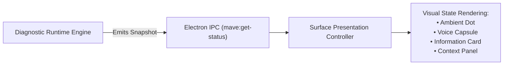

### Presentation Diagnostic Indicators
Diagnostics exposes high-level, user-safe states:
- `reconnecting`: Network or daemon connection dropped; retrying.
- `voice_unavailable`: Microphone detached or audio subsystem error.
- `local_brain_unavailable`: Ollama stopped or model missing.
- `research_unavailable`: External retrieval unavailable; current claims unverified / failing honestly with explicit caveat; separable timeless concepts preserved.
- `auth_required`: Subscription login required.

Window geometry, animations, colors, and layout remain strictly governed by `packages/contracts/src/surface.ts` and UI V2.

---

## 27. Conceptual Diagnostic Snapshot: "Is MAVE Healthy Right Now?"

A unified runtime diagnostic snapshot answers the question: **"Is MAVE healthy right now?"** across all subsystems:

> [!NOTE]
> **ILLUSTRATIVE CONCEPTUAL PRESENTATION MODEL — NOT FROZEN CANONICAL ENUM**
> `SubsystemHealthStatus` (`AVAILABLE`, `DEGRADED`, `UNAVAILABLE`, `UNCONFIGURED`, `UNKNOWN`) is presented here strictly as an **illustrative conceptual presentation/status model** for aggregated UI reflection.
> It is **NOT** a frozen canonical contract enum. In Phase F1.9-A, this conceptual status model will be audited and reconciled against existing canonical contracts (`CANONICAL_PROVIDER_HEALTH_STATUSES`, `ModelAvailabilityStatus`, etc.) to prevent redundant or conflicting canonical enums.

```ts
export type SubsystemHealthStatus =
  | 'AVAILABLE'
  | 'DEGRADED'
  | 'UNAVAILABLE'
  | 'UNCONFIGURED'
  | 'UNKNOWN';

export interface MaveDiagnosticSnapshot {
  readonly timestamp: number;
  readonly overallStatus: SubsystemHealthStatus;
  readonly coreRuntime: {
    readonly status: SubsystemHealthStatus;
    readonly activeSessions: number;
    readonly activeTurns: number;
  };
  readonly voice: {
    readonly status: SubsystemHealthStatus;
    readonly micOwnership: 'wake' | 'voice' | 'none';
    readonly wakeEngine: { provider: string; listening: boolean };
    readonly stt: { provider: string; status: string };
    readonly tts: { provider: string; status: string };
    readonly lastLatency?: VoiceLatencyDiagnostics;
  };
  readonly fastBrain: {
    readonly status: SubsystemHealthStatus;
    readonly providerId: string;
    readonly modelId: string;
    readonly residencyState: LocalModelResidencyState;
    readonly vramUsageBytes?: number;
  };
  readonly deepBrain: {
    readonly status: SubsystemHealthStatus;
    readonly configuredProviderId?: string;
  };
  readonly agentRuntimes: Record<string, {
    readonly status: SubsystemHealthStatus;
    readonly version?: string;
    readonly authStatus: string;
    readonly quotaStatus: string;
  }>;
  readonly research: {
    readonly status: SubsystemHealthStatus;
  };
  readonly system: {
    readonly platform: string;
    readonly nodeVersion: string;
    readonly memoryFreeGiB: number;
    readonly gpuAvailable: boolean;
  };
}
```

---

## 28. Support Bundle & Privacy-Safe Export

To facilitate debugging without exposing private user data, future implementations may support an explicit, user-triggered diagnostic export:

```text
┌────────────────────────────────────────────────────────────────────────┐
│                   PRIVACY-SAFE SUPPORT EXPORT BUNDLE                   │
├────────────────────────────────────────────────────────────────────────┤
│ INCLUDED (Safe Forensics):                                             │
│ • System environment: OS, platform, CPU cores, Node/Electron versions  │
│ • Component runtime versions (Ollama v0.5.x, Claude Code v1.x)         │
│ • Diagnostic snapshots (current status of all subsystems)              │
│ • Aggregated latency summaries (STT, Brain TTFT, TTS TTFA medians)     │
│ • Recent error codes and diagnostic reasons (last 200 events)          │
│ • Quota state and provider health history                              │
├────────────────────────────────────────────────────────────────────────┤
│ EXCLUDED (Strictly Prohibited):                                        │
│ ✕ API keys, OAuth tokens, auth headers, passwords, cookies             │
│ ✕ Conversation transcripts and raw user prompts                        │
│ ✕ Assistant markdown completion text                                   │
│ ✕ Local project paths, filenames, or workspace contents                │
│ ✕ Audio recordings, PCM frames, or spectrograms                        │
└────────────────────────────────────────────────────────────────────────┘
```

> [!IMPORTANT]
> **EXPLICIT USER ACTION ONLY**
> A support export must **NEVER** be dispatched automatically to an external server. Generating an export bundle must require an explicit user click in settings, saving the bundle locally as an inspectable JSON/ZIP archive.

---

## 29. Startup Self-Check & The C3.1 Prewarm Invariant

A lightweight diagnostic presence check must execute during application boot to verify system readiness.

> [!CAUTION]
> **STARTUP SELF-CHECK MUST NOT PREWARM FAST BRAIN**
> A critical invariant established in Milestone Pre-M5 F1.5-C3.1 states:
> **Launching MAVE alone does NOT load `qwen2.5:1.5b` into VRAM.**
>
> The startup self-check is strictly observational:
> - It dispatches `GET /api/version` to verify Ollama daemon responsiveness.
> - It dispatches `GET /api/tags` to check model existence.
> - **It MUST NOT dispatch `prewarm()`, inference requests, or model allocations.**
> Loading the model into VRAM occurs only when an active voice/chat session is initiated.

---

## 30. Comprehensive Reliability Test Plan

Future phases must implement the following automated test matrix before production promotion:

| Test ID | Target Invariant | Verification Method |
| :--- | :--- | :--- |
| **TEST-F1.9-01** | `RouteTelemetry` Exact 8 Fields | Assert that `RouteTelemetrySchema` keys exactly equal the 8 canonical fields; reject additions. |
| **TEST-F1.9-02** | End-to-End Trace Correlation | Trace a synthetic voice turn from wake to playback; assert all diagnostic events share the same correlation token (`requestId` / `traceId`). |
| **TEST-F1.9-03** | Health != Quota Separation | Simulate a healthy provider with an active rate limit; verify operational health is `healthy` while quota is `quota_limited`. |
| **TEST-F1.9-04** | Model Availability != Provider Health | Stop/remove model tag in Ollama; verify provider health remains `healthy` while canonical model availability is `unavailable` with proposed diagnosticReason `model_tag_missing`. |
| **TEST-F1.9-05** | Paid API Credential != Permission | Inject `OPENAI_API_KEY` with `allowPaidApis: false`; verify router rejects OpenAI and records policy block. |
| **TEST-F1.9-06** | Canonical Error + Diagnostic Reason | Simulate Fast Brain failure; assert canonical code is `local_provider_unavailable` (from `CANONICAL_BRAIN_ERROR_CODES`) and diagnostic reason is proposed `fast_brain_unavailable` or `ollama_daemon_unreachable`. |
| **TEST-F1.9-07** | Startup Self-Check Zero VRAM Load | Run startup self-check; inspect `OllamaResidencyManager` and assert state is `unloaded` and VRAM allocation is 0. |
| **TEST-F1.9-08** | Ollama Daemon Disappearance Detection | Terminate Ollama mock mid-turn; verify health transition to `unavailable` and active turn termination. |
| **TEST-F1.9-09** | Residency Stale State Reconciliation | Simulate out-of-sync `/api/ps` response; verify residency manager reconciles leases and states accurately. |
| **TEST-F1.9-10** | Voice STT Failure Degrades to Text | Mock STT process crash; assert voice session terminates cleanly and text conversation interface remains operational. |
| **TEST-F1.9-11** | TTS Failure Degrades to Surface Display | Mock TTS network failure; verify text is displayed on the surface panel without audio playback error. |
| **TEST-F1.9-12** | LocalOnly Policy Fail-Closed | Set `localOnly: true` with offline local provider; verify system fails closed rather than attempting cloud routing. |
| **TEST-F1.9-13** | Pre-Execution Skip != Execution Attempt | Evaluate a chain with 2 skipped providers; verify `attemptedProviderIds` has 1 entry and `routeAttempts === 1`. |
| **TEST-F1.9-14** | Midstream Failure No Hidden Retry | Induce stream error mid-generation; verify `request_failed` is emitted immediately with zero secondary provider retry. |
| **TEST-F1.9-15** | Cancellation != Request Failed | Abort active turn via `AbortSignal`; verify emitted event is `request_cancelled`, turn status is `cancelled`, error is null. |
| **TEST-F1.9-16** | Secret Redaction Invariant | Log payload containing `apiKey`, `token`, and `authorization`; assert all instances are replaced with `[REDACTED]`. |
| **TEST-F1.9-17** | Diagnostic Retention Boundedness | Push event burst exceeding capacity into the buffer; assert storage remains strictly bounded within candidate illustrative defaults without memory or disk exhaustion. |
| **TEST-F1.9-18** | Agent Runtime Unknown Quota Handling | Query Claude Code without rate headers; verify quota status is reported as `unknown` rather than fabricated. |
| **TEST-F1.9-19** | Research Telemetry Decoupling | Trigger a research-grounded turn; verify F1.8-owned `ResearchTelemetry` captures search stats without schema modifications while `RouteTelemetry` remains strictly the 8 frozen fields. |
| **TEST-F1.9-20** | Zero Diagnostic Tool Authority | Inspect diagnostic event handlers and probes; assert zero capability to invoke shell commands or mutate files. |

---

## 31. Implementation Phase Plan (F1.9 Stages)

> [!IMPORTANT]
> **ARCHITECTURE AUDIT ONLY — PRODUCTION IMPLEMENTATION: NOT STARTED**
> Milestone Pre-M5 F1.9 is strictly an architectural and reliability audit. No production diagnostics implementation code has been written or deployed on this branch. Concrete schema implementations, typed events, and subsystem instrumentation will commence in Phase F1.9-A.

To safely implement diagnostics and reliability without causing runtime regressions, the following staged plan is proposed:

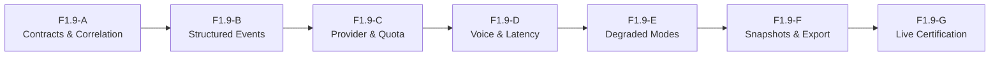

### Stage Breakdown

#### F1.9-A: Diagnostic Contracts & Correlation Model
- Define typed diagnostic event contracts (`DiagnosticEvent`, `DiagnosticComponent`, `DiagnosticPhase`).
- Formalize root `traceId` correlation across conversation and voice sessions.
- Establish `SubsystemHealthStatus` and `ProviderDiagnosticSnapshot` schemas.
- Preserve frozen `RouteTelemetry` intact (8 fields).

#### F1.9-B: Structured Event Instrumentation & Correlation Pipeline
- Instrument `ConversationRuntime`, `BrainRouter`, and `VoiceSessionCoordinator` with trace propagation.
- Implement in-memory FIFO diagnostic event buffer (`SESSION` tier).
- Wire Pino log output with structured trace metadata and redaction.

#### F1.9-C: Provider, Health, Quota & Residency Diagnostics
- Refactor provider health probes to separate operational health from model availability.
- Expose `RuntimeQuotaStore` observations via typed diagnostic channels.
- Instrument `OllamaResidencyManager` with lease lifecycle events.
- Audit subscription CLI error classifications (Claude, Codex, Antigravity).

#### F1.9-D: Voice Pipeline & Latency Diagnostics
- Formalize stage timestamp collection across the voice coordinator.
- Explicitly differentiate Brain TTFT from Time-to-First-Audible-Response.
- Expose latency breakdown spans over Electron IPC.

#### F1.9-E: Degraded-Mode Arbitration & Recovery Policy
- Formalize fallback to text-only mode upon audio/STT/TTS disruption.
- Implement explicit policy fail-closed checks (`localOnly`, `allowPaidApis`).
- Codify error recovery classifications (`USER_RETRY`, `REAUTH_REQUIRED`, etc.).

#### F1.9-F: Diagnostic Snapshot, Privacy Redaction & Support Export
- Implement `MaveDiagnosticSnapshot` aggregator in the desktop main process.
- Implement privacy-safe support bundle export generator (JSON/ZIP).
- Enforce strict redaction of tokens, secrets, and local file paths.

#### F1.9-G: Live Reliability Certification & Edge-Case Verification
- Execute automated reliability test suite (`TEST-F1.9-01` through `TEST-F1.9-20`).
- Validate behavior during simulated daemon crashes, rate limits, and network disconnections.
- Verify zero VRAM allocation during application startup self-check.

---

## 32. Relationship to Milestone Pre-M5 F1.10 (Intelligence Closeout)

The boundary between F1.9 and F1.10 is clean and deliberate:

```text
┌────────────────────────────────────────────────────────────────────────┐
│ PRE-M5 INTELLIGENCE MILESTONE ARCHITECTURE                             │
├───────────────────────────────────┬────────────────────────────────────┤
│ Phase F1.9: Diagnostics &         │ Phase F1.10: Intelligence          │
│ Reliability Architecture          │ Closeout & Synthesis               │
├───────────────────────────────────┼────────────────────────────────────┤
│ • Designs observability models    │ • Synthesizes live empirical proof │
│ • Establishes correlation trace   │ • Reviews C3/C4 certification data │
│ • Disentangles health vs quota    │ • Certifies F1.6 Deep Brain spec   │
│ • Decomposes latency bottlenecks  │ • Certifies F1.8 Research spec     │
│ • Enforces degraded modes         │ • Certifies F1.9 Reliability spec  │
│ • Protects privacy & redaction    │ • Closes out Pre-M5 foundation     │
│ • Architecture & design only      │ • Gateway to Milestone M5          │
└───────────────────────────────────┴────────────────────────────────────┘
```

F1.9 builds the observability mechanisms required to explain system behavior. F1.10 will utilize the accumulated evidence from C3/C4, F1.6, F1.8, and F1.9 to certify that MAVE's Pre-M5 intelligence architecture is fully verified, stable, and ready for M5 tool and agent execution authority.

---

## 33. Blockers, Risks & Recommendations

### Identified Architectural Risks
1. **Accidental Authority Leakage**: Any diagnostic tool equipped with automated remediation (e.g., auto-restarting a failed CLI or running a cleanup script) violates the core invariant. Remediation must remain decoupled from diagnostics.
2. **Log Bloat & Performance Degradation**: Emitting granular events on every audio buffer or token delta could introduce GC pauses or CPU contention. Streaming deltas must be throttled or tracked via counters rather than discrete disk writes.
3. **Hardware AEC Confusion**: Users or developers may mistake acoustic barge-in feedback for an STT or wake word failure. Diagnostics must explicitly flag that lack of AEC is a known hardware constraint.

### Recommendations for Future Implementation
- Keep diagnostic event queues strictly non-blocking.
- Maintain `RouteTelemetry` as an immutable 8-field struct.
- Use `pino` structured formatting with built-in path redaction.
- Require explicit user confirmation before exporting any support bundle.

---

## 34. Architecture Sign-Off & Verification

```text
================================================================================
MAVE PRE-M5 F1.9 DIAGNOSTICS & RELIABILITY ARCHITECTURE AUDIT HARDENED
Status: AUDIT HARDENED / READY FOR F1.9-A CONTRACT DEFINITION
Architecture Version: Canonical F1.9
Approved Boundary: OBSERVABILITY != AUTHORITY
================================================================================
```
