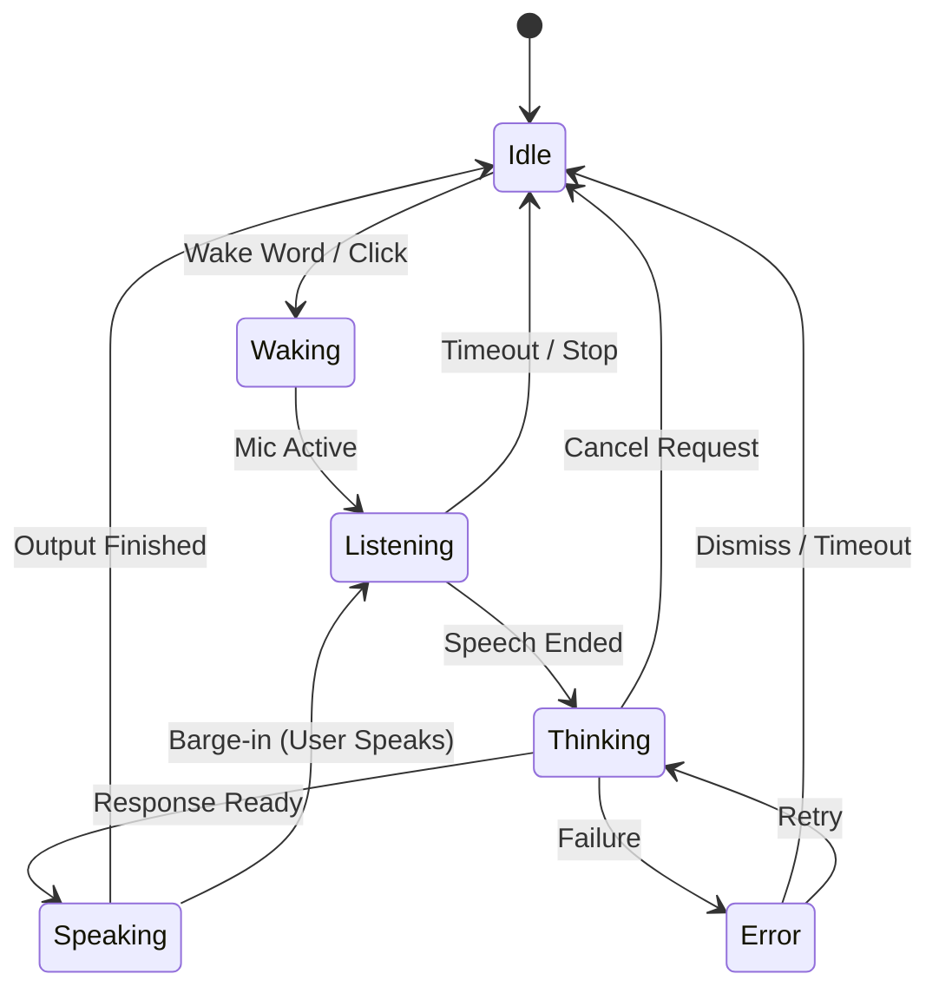
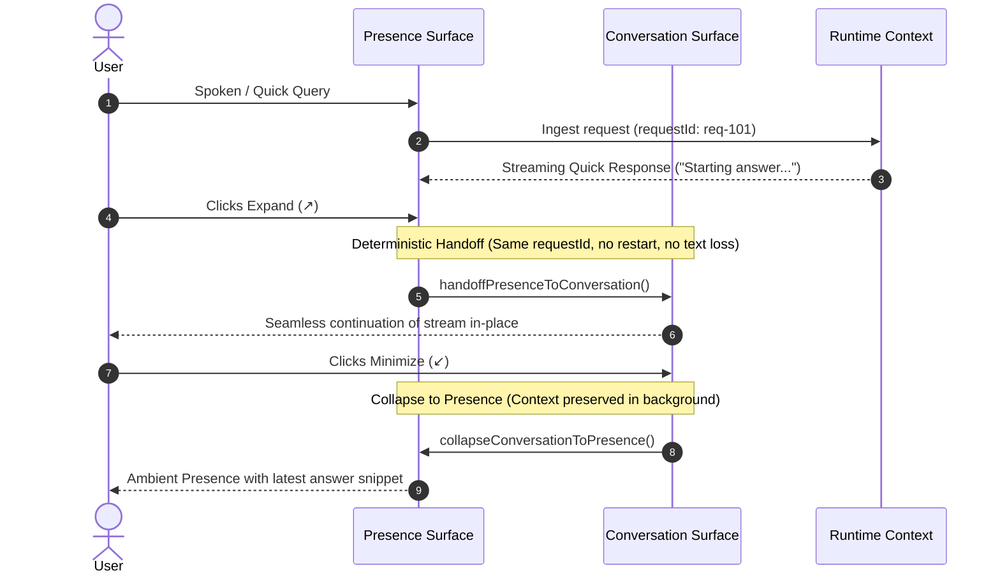

# MAVE UI Surface Architecture

## Status

**Canonical UI / Surface Direction — Design Architecture**

This document defines how MAVE appears, expands, and presents information across ambient presence, conversation, rich results, workspaces, and system management.

The central product rule is:

> **MAVE is one assistant whose surface changes with context — not a collection of separate AI apps.**

UI implementation must preserve this identity even when MAVE is handling language learning, research, projects, tools, media, memory, or agent work.

---

## Purpose

MAVE UI คือ visual interface ของ conversation, voice, translation, tools, agents, tasks, sources, media, memory และ learning

Floating UI เป็นองค์ประกอบสำคัญของ product identity

The UI should feel like MAVE is quietly present with the user and only takes more screen space when the information or task genuinely requires it.

### Primary UX Principle

> **Information appears only when it becomes useful.**

The user should not have to open a large dashboard for ordinary conversation.

The surface should grow progressively:

```text
Presence
   ↓
Conversation
   ↓
Rich Context
   ↓
Workspace
```

MAVE should collapse back down when that complexity is no longer needed.

---

# 1. Canonical Surface Hierarchy

MAVE uses three primary interaction levels plus one secondary system-management surface.

```text
1. Presence Surface
2. Conversation Surface
3. Workspace Surface
4. System / Full App (secondary management surface)
```

This replaces the mental model of multiple separate applications such as a Language App, Research App, Project App, or Agent App.

Instead:

```text
                        MAVE
                         │
              ┌──────────┴──────────┐
              │                     │
          PRESENCE              CONVERSATION
              │                     │
         Listening              Rich Results
         Thinking                    │
         Speaking                Workspace
                                  ┌───┼────┐
                               Language Project Agent
```

The same MAVE identity remains visible throughout the hierarchy.

---

# 2. Presence Surface

The Presence Surface is MAVE's default visual form and should be the surface users see most often.

It replaces the idea that MAVE must always look like a traditional app window.

### Goals

- อยู่บนจอโดยรบกวนน้อย
- zero or near-zero visual clutter while idle
- show only the current MAVE state
- expand naturally when the user starts interacting
- support wake, voice, quick response, and collapse

### Canonical Forms

#### Idle / Sleeping

```text
╭────────────╮
│    MAVE    │
╰────────────╯
```

When nothing is happening, controls should disappear.

The surface should communicate presence, not demand attention.

#### Listening

```text
╭──────────────────────────────╮
│ MAVE │ waveform │ Listening… │
╰──────────────────────────────╯
```

Only controls relevant to active listening may appear.

#### Thinking

Use a compact state indicator unless richer information is actually available.

```text
MAVE • Thinking…
```

Do not fabricate detailed progress steps.

#### Speaking

```text
╭────────────────────────────────────╮
│ MAVE │ waveform │ Speaking │ controls │
╰────────────────────────────────────╯
```

A compact answer bubble may appear above when visual text is useful.

### Presence States

Canonical high-level states:

- sleeping
- waking
- listening
- transcribing
- thinking
- retrieving
- waiting_for_approval
- speaking
- task_running
- completed
- error
- offline

Exact runtime mapping may remain implementation-specific, but the UI must only expose states backed by observable runtime behavior.

---

## 2.1 Presence Surface Interaction Contract (U1 Lock)

> [!IMPORTANT]
> **Prototype Values Disclaimer**
> All numeric values (dimensions such as 38px height, color hex codes `#38bdf8`, glow radii, animation durations) implemented in U0/U1 are **developer prototype / lab values only** and must not be treated as a frozen production specification. Final design tokens and palettes will be calibrated during the dedicated UI Redesign pass.

The Presence Surface is MAVE's primary structural interaction identity. It is not a mini-dashboard: it contains no provider selectors, mode pickers, tool buttons, memory panels, or persistent settings. Its singular purpose is **identity, state feedback, voice interaction, and natural entry into Conversation**.

### 1. Canonical State Lifecycle & Visual Structure



| State | Canonical Capsule Structure | Contextual Controls | Visual Energy / Glow |
| :--- | :--- | :--- | :--- |
| **IDLE** | `[ • MAVE ]` or `[ MAVE ]` | Expand (`↗`) on hover/focus | **Strict zero glow**; resting calm |
| **WAKING** | `[ • MAVE \| Waking… ]` | None (rapid transition) | Soft border ignition pulse ("I heard you") |
| **LISTENING** | `[ • MAVE \| reactive waveform \| Listening… ]` | Stop Listening (`⏹`) | Cyan active glow, audio-reactive RMS bars |
| **THINKING** | `[ • MAVE \| restrained arc \| Thinking… ]` | Cancel Request (`✕`) | Purple restrained glow; gentle cognitive arc |
| **SPEAKING** | `[ • MAVE \| voice wave \| Speaking… ]` | Stop Speaking (`⏹`) | Purple output wave; quick response bubble above |
| **ERROR** | `[ • MAVE \| alert dot \| Offline / Unavailable ]` | Retry (`↻`) or Dismiss (`✕`) | Restrained red/amber accent; **no screaming red flood** |

### 2. Idle State Minimality
- In normal user-facing idle mode, the wordmark **MAVE** and the subtle Presence Mark are sufficient.
- The UI **must not** render status labels like `"IDLE"`, persistent animated waveform bars, large Orbs, or multiple buttons while resting.
- Hover or keyboard focus contextually surfaces the Expand (`↗`) action.

### 3. Wordmark vs Presence Mark
- **Wordmark (`MAVE`)**: Primary product identity. Emphasized in resting idle state.
- **Presence Mark (`AdaptivePresenceMark`)**: Visual state and cognitive activity indicator. Activates dynamically during waking, listening, thinking, and speaking.
- **Scale Hierarchy**: As content density increases (from Presence $\to$ Conversation $\to$ Workspace), the Presence Mark scales down from `hero` ($64\text{px}$) to `compact` ($28\text{px}$) to `status` ($18\text{px}$).

### 4. Audio RMS Normalization vs Temporal Display Smoothing
Raw microphone RMS is processed through two distinct stages:
1. **Amplitude Normalization & Perceptual Mapping (`normalizeAudioRms`)**:
   - **Noise Floor Gate**: Levels below $0.03$ are clamped to $0.0$ to guarantee calm stillness during ambient room silence.
   - **Perceptual Power Curve**: Speech levels ($0.05 - 0.45$) are normalized via $\text{RMS}^{0.75}$ to elevate natural conversational speech into visible dynamics.
   - **Ceiling Clamping**: Levels exceeding $1.0$ are strictly clamped to avoid SVG or layout blowout.
2. **Temporal Display Smoothing (`applyTemporalSmoothing`)**:
   - **Asymmetric Attack / Release**: Attack coefficient ($\alpha = 0.55$) responds rapidly to spoken onset, while release coefficient ($\alpha = 0.18$) decays gently, smoothing micro-jitter between syllables.
   - **No Fake Precision**: Waveform is conversational voice activity visualization, not calibrated laboratory audio metering.

### 5. Restrained Thinking Invariant
- **Thinking animation $\neq$ progress claim**: Thinking state represents cognitive processing; it must **never** fabricate fictional progress substeps ("Analyzing cultural context...", "Synthesizing answer...").
- Animations remain restrained (slow $3.5\text{s}$ subtle arc sweep, low visual noise) to avoid game-like or sci-fi "loading spinner" fatigue.

### 6. Barge-in Visual Semantics
- When the user interrupts MAVE while speaking:
  $$\text{Speaking} \xrightarrow{\text{Interruption Detected}} \text{Voice Output Terminates Visually} \xrightarrow{\text{Immediate}} \text{Listening State Active}$$
- Transition latency must feel immediate and responsive without animation locks.

### 7. Office Mode (Silent Presence)
- Designed for quiet workplace environments where audio TTS playback is disabled.
- Surface displays an ultra-subtle mute micro-indicator (`🔇`) in resting Idle, preserving minimal MAVE presence without heavy persistent text badges.
- Speech output is suppressed; state renders as `Silent Output…` and routes directly to the Quick Response bubble.

### 8. Visual Need Expansion Principle & Quick Response Privacy

> [!IMPORTANT]
> **Canonical Invariants**
> - **Conversation Context $\neq$ Surface Level**: Multi-turn dialogue history is runtime/context state and does **NOT** force visual expansion. MAVE can sustain long voice conversations entirely within the ambient Presence surface.
> - **Visual Need Drives Expansion**: Expansion from Presence $\to$ Conversation occurs **only** when there is a genuine visual interaction need.
> - **Source Provenance $\neq$ Runtime Provider**: Content citations (YouTube, Documentation, Wikipedia) may render when answers depend on external sources. Intelligence execution substrate (Ollama, Claude, Codex, Antigravity, OpenAI, model IDs) must **never** leak into normal conversational UI metadata.

```text
Evaluate Expansion Eligibility:
  ├─ Explicit user request (user clicks ↗ Expand)                 → EXPAND to Conversation
  ├─ Contains interactive decision (M5 Approval request)          → EXPAND to Conversation
  ├─ Structured visual content (table / comparison grid)          → EXPAND to Conversation
  ├─ Contains rich cards (sources, video, tasks, diffs, approvals) → EXPAND to Conversation
  ├─ Code requiring inspection / copying / editing                → EXPAND to Conversation
  ├─ Multi-line code block (> 3 lines defensive heuristic)        → EXPAND to Conversation
  ├─ Exceeds single quick-response capacity (> 240 chars)          → EXPAND to Conversation
  └─ Single compact confirmation / translation / spoken answer     → FIT in Quick Response Bubble
     (even when part of an ongoing multi-turn dialogue!)
```

### 9. Contextual Control Disclosure & Unambiguous Semantics

| Control Action | State Active | Aria Label | Visual Icon | Purpose |
| :--- | :--- | :--- | :---: | :--- |
| `wake` | Idle | "Manual activation" | `•` | Manually activates listening mode (distinct from voice wake) |
| `stop-listening` | Listening | "Stop listening" | `⏹` | Stops mic capture and returns to idle / submits |
| `cancel-thinking`| Thinking | "Cancel thinking" | `✕` | Cancels active in-flight request |
| `stop-speaking` | Speaking | "Stop speaking" | `⏹` | Stops voice playback (user interruption / barge-in) |
| `retry` | Error | "Retry request" | `↻` | Retries previous failed operation |
| `dismiss` | Error | "Dismiss error" | `✕` | Dismisses error banner and resets to idle |
| `expand` | Contextual | "Expand to Conversation" | `↗` | Transitions surface to Level 2 Conversation |

---

# 3. Presence Mark / Orb

The MAVE Orb is a **Presence Mark**, not the main content area.

It should communicate identity and activity, but must not compete with information.

### Adaptive Scale Rule

```text
Idle / Home       → large / expressive
Listening         → active
Compact Chat      → small
Workspace         → icon-scale
Background Task   → status indicator
```

As information density increases, the Orb should become smaller.

### Orb Responsibilities

The Orb may express:

- wake / availability
- listening activity
- thinking / processing activity
- speaking activity
- background task status
- completion / attention state

The Orb should never consume large permanent space simply for decoration when the user needs to read or work.

---

# 4. Conversation Surface

The Conversation Surface is the primary daily-use visual interface.

It can appear as a floating compact panel, side panel, or expandable contextual surface depending on content.

### Responsibilities

- always-on-top when appropriate
- draggable / resizable where appropriate
- keyboard focus
- text input
- voice transcript
- streaming response
- lightweight history
- response cards
- source/media previews
- task status
- expand / collapse

### Core Principle

> **Conversation first, app second.**

The user should be able to continue working in another application while MAVE shows the answer next to the current context.

Example:

```text
Desktop / Current App

                         ┌──────────────────┐
                         │ MAVE • Chat      │
                         │                  │
                         │ Answer           │
                         │ [Video Card]     │
                         │ [Source Card]    │
                         │ Summary          │
                         │                  │
                         │ Ask MAVE...      │
                         └──────────────────┘
```

This is preferred over forcing the user into a full-screen dashboard for ordinary information lookup.

---

## Conversation Surface Interaction Contract

> [!IMPORTANT]
> **Seven Canonical Architectural Invariants**
> 1. **Surface State $\neq$ Conversation Context**: Collapsing Conversation into Presence or minimizing the surface does NOT cancel active generation, clear session state, or wipe dialogue history. Surface level is purely a viewport representation.
> 2. **Visible Timeline $\neq$ Runtime Context**: MAVE surfaces only recent relevant turns by default to prevent cognitive and layout overload. Large context windows in memory do not imply an infinite scrolling wall of text. Older turns are loaded on-demand via `Load earlier conversation`.
> 3. **Long Content $\neq$ Workspace**: Long text, articles, or detailed explanations scroll smoothly inside the Conversation surface. Text length alone never triggers a Workspace escalation.
> 4. **Visual Need drives Presence $\to$ Conversation**: Transitions from Presence to Conversation are triggered by the need to inspect rich cards, source citations, code blocks, structured tables, or interactive decisions.
> 5. **Interaction Complexity drives Conversation $\to$ Workspace**: Transitions to Workspace are reserved strictly for sustained multi-step agent workflows, multi-file diffs/editing, persistent project artifacts, and continuous task monitoring.
> 6. **Content Provenance $\neq$ Execution Provider**: User-facing citations ("OpenAI Documentation", "Google Docs", "YouTube", "Wikipedia") represent external provenance and MUST be rendered. Technical AI substrates (Ollama, Claude, Codex, Antigravity, model IDs, token metrics) belong strictly in diagnostics and must NEVER leak into normal conversational UI metadata.
> 7. **Observable Progress Only**: First-token states ("Thinking…", "Searching…", "Reading 4 sources…") and progress indicators MUST be backed by genuine observable runtime events. Fictional reasoning or progress steps are strictly prohibited.

### 1. Deterministic Handoff & Collapse Lifecycle



### 2. Timeline Anatomy & Grouping Semantics

Rather than adopting a rigid chat-bubble monotony, Conversation formats each conversational exchange into a structured **Response Group**:

```text
ResponseGroup
├─ User Question (compact, visually distinct bubble)
└─ MAVE Turn
   ├─ Subtle MAVE header (rendered once per response group)
   ├─ Observable progress banner (truthful first-token state only)
   ├─ Answer text / in-place streaming text with blinking cursor
   ├─ Status tags ([Stopped] on cancel, [Interrupted] on barge-in)
   ├─ Grouped supporting sources (titled "Sources (N)" with external links)
   ├─ Rich media / code / translation cards
   └─ Contextual follow-up suggestions (disappear when irrelevant)
```

### 3. Composer & Prompt Accelerators

- **Composer**: Minimal multiline textarea with Enter to send, Shift+Enter for newline, voice input trigger (`🎙`), and cancel generation button (`⏹ Stop`) during streaming.
- **Shortcuts Bar**: Shortcuts (`Search`, `Analyze`, `Code`, `Write`, `Translate`, `Plan`) are **prompt accelerators**, NOT modal locks. Clicking a shortcut prefixes input text without trapping the user in a restricted mode.
- **Contextual Follow-ups**: Suggestions post-answer (`Explain grammar`, `More natural`, `Practice speaking`) assist user continuation without mode lock-in.

### 4. Deterministic Scroll Semantics

- **At Bottom**: When user is at the bottom of the timeline, incoming streaming text automatically follows smoothly.
- **Scrolled Up**: When the user scrolls upward to read prior turns, auto-scroll is immediately disengaged. The viewport is **never** forcibly yanked back down.
- **Floating Pill**: A subtle floating button (`New response ↓`) appears near the bottom of the timeline. Clicking it smoothly scrolls to the newest content and re-engages follow behavior.

### 5. Error & Cancellation Guarantees

- **Local Error Handling**: Errors appear directly adjacent to the failed turn with a `↻ Retry` action and dismiss capability. No global red-screen blocking UI.
- **Cancellation Preservation**: User clicking `⏹ Stop` halts token generation while preserving all already-streamed paragraphs, marking the turn as `[Stopped]`.
- **Interruption / Barge-in**: User speech during an active assistant response preserves the already-rendered text, marks it `[Interrupted]`, and smoothly opens the next user turn.

---

# 5. Rich Context Expansion & Card System

The Conversation Surface expands when an answer requires structured visual complexity.

Cards allow MAVE to present structured, grounded information (sources, media, code, diffs, comparisons, progress, tasks, approvals, errors) in Conversation without turning the floating canvas into a cluttered dashboard.

### Canonical Hierarchy

```text
MAVE Response
│
├─ Primary Answer (Direct conversational text / streaming response)
│
├─ Supporting Information
│    ├─ Sources (Single citations or grouped composite citations)
│    ├─ Media (Synthetic video recommendations, image previews)
│    └─ Structured Data (Code snippets, diffs, tables, comparisons)
│
└─ Relevant Actions (Inspect, copy, open in workspace, allow/deny mock)
```

Cards support the answer; cards do NOT compete with or obscure the answer.

---

## Rich Information Card Contract

### 1. Card Taxonomy (14 Canonical Card Types)

| Card Type | Category | Primary Purpose | Responsive / Progressive Disclosure |
| :--- | :--- | :--- | :--- |
| `message` | Dialogue | Conversational turns (user prompt, assistant reply) | Pre-wrapped text, compact bubble layout |
| `translation` | Language | Natural phrase translation, alternatives, pronunciation | Collapsible grammar notes & vocabulary lists |
| `source` | Provenance | Grounded citation with title, domain, URL, snippet | Progressive snippet truncation ("▼ Read more") |
| `source_group` | Provenance | Composite citation group (`Sources · N`) | Collapsed summary list, expand all sources toggle |
| `video` | Media | Educational/tutorial video recommendation | Synthetic thumbnail placeholder, duration badge |
| `image` | Media | Diagrams, screenshots, and visual artifacts | Canvas placeholder with aspect ratio preservation |
| `file` | Artifact | Modified file, breadcrumb path, line metrics | Synthetic paths, inspect file affordance |
| `code` | Code | Syntax-oriented code snippets | Copy code button with feedback, optional line numbers |
| `diff` | Code | File modification diffs with additions/deletions | Compact preview, expandable full diff lines |
| `comparison` | Data | Comparison tables, feature matrices, key-values | Desktop `<table>` transforms to narrow stacked records |
| `task` | Activity | Task execution state, runtime badge, steps | Truthful progress bar or pulsing indicator |
| `progress` | Activity | Dedicated multi-step operations & background work | Strict Determinate vs Indeterminate truthfulness |
| `approval` | Security | Action execution confirmation (Pure presentation) | Prototype boundary disclaimer, mock Allow/Deny buttons |
| `error` | Diagnostic | Human-readable failure and recovery action | Collapsible technical details, retry affordance |

### 2. Common Card Anatomy (`CardShell`)

All MAVE UI V2 cards share a consistent structural container (`CardShell`):

```text
CardShell
├─ Header Region
│    ├─ Badge (Semantic category pill, e.g. "DIFF", "SOURCES · 4", "PROGRESS")
│    ├─ Title (Filename, domain, or card descriptor)
│    ├─ Timestamp / Metric (e.g. "+8 / -2", duration "14:20", "Step 3/5")
│    └─ Progressive Toggle ("▼ More" / "▲ Less")
├─ Primary Content Body (Direct readable content, unnested)
├─ Details Slot (Collapsible extended metadata rendered on demand)
└─ Action Footer (Right-aligned semantic intent buttons)
```

### 3. Card Intent vs Card Type

- **Type**: Defines *what* the content is (`file`, `diff`, `progress`, `approval`, `source`).
- **Intent**: Defines *how* it is visually emphasized (`default`, `elevated`, `attention`, `warning`, `destructive`, `quiet`).
- Eliminates ad-hoc "red card" or "green card" anti-patterns; any content type can adopt an appropriate semantic intent based on urgency or risk.

### 4. Content Provenance vs Execution Substrate Isolation

- **Invariant**: `ContentProvenance != ExecutionSubstrate`
- Normal user cards may display legitimate vendor citations (`OpenAI Documentation`, `Microsoft Learn`, `Google Docs`, `React Documentation`), domain URLs, author, and date.
- Cards must **never** leak internal AI execution substrate metadata (`modelId`, `providerId`, `runtime`, `tokensUsed`, `latencyMs`) into normal user UI. Substrate metrics are strictly reserved for developer diagnostics.

### 5. Card Action Boundary & Runtime Authority

- **Direction**: `Runtime/Presentation State → Card Data → Card Renderer → User Intent Event`
- Cards emit semantic intent callbacks (`onInspectFile`, `onOpenSource`, `onCopyCode`, `onAllowMock`, `onDenyMock`, `onOpenWorkspace`).
- Cards **never** possess direct execution authority and **never** invoke shell, filesystem, MCP, or AI providers directly.

### 6. Progress Truthfulness Invariant

- **Determinate Progress** (`determinate: true`):
  - Backed by real known counts (`completedSteps / totalSteps`) and exact percentage.
  - Renders accessible progress bar (`role="progressbar"`, `aria-valuenow`).
- **Indeterminate Activity** (`determinate: false`):
  - Backed by ongoing observable work without known boundaries.
  - Renders active pulsing indicator (`Working…`).
  - **Strict Rule**: NEVER synthesize or fabricate completion percentages from elapsed time (e.g. no fake "73%").

### 7. Approval Presentation Boundary (Pure Presentation)

- In UI V2 (U3), `ApprovalCard` is **presentation only**. M5 security execution gates are not implemented.
- Low/Medium/High/Critical or Level 0-3 risk levels are mock prototype taxonomy and are explicitly not frozen production policies.
- Renders `[Prototype Notice]: Buttons trigger synthetic UI callbacks only. No system commands are executed.`
- Allow/Deny buttons emit synthetic mock events (`onAllowMock` / `onDenyMock`). Zero real system commands are executed.

### 8. Responsive Card Transformation & Density

- **Narrow Widths (<440px)**:
  - Structured comparison tables transform automatically into vertically stacked key-value records (`data-testid="comparison-stacked-list"`), preventing horizontal clipping and scrollbar overload.
  - Diff cards collapse to compact preview summaries.
  - Action buttons wrap smoothly.
- **Card Density**: Supports `compact`, `standard`, and `expanded` density tokens without branching into divergent component architectures.

### 9. Progressive Disclosure

- Information is structured as **summary first, details on demand**:
  - Source Card: 120-character snippet with "▼ Read more" toggle.
  - Diff Card: Compact modification preview with "▼ Show Full Diff" toggle.
  - Translation Card: Pronunciation and natural alternative visible; educational grammar notes collapsible on compact density.
  - Error Card: Clean human-readable error with collapsible technical stack trace details.

### 10. U2 Semantic Cleanup Gate Invariants

1. **Streaming Accessibility**: Visual streaming text tokens update in-place with `aria-hidden="true"`, preventing screen-reader spam. A dedicated live region (`aria-live="polite"`, `role="status"`) announces coherent milestones (`Thinking…`, `Response completed.`, `Response stopped.`).
2. **Follow-up Suggestions Lifetime**: Follow-up chips appear upon response completion and persist until the user sends their next message, selects a suggestion, or explicitly dismisses (`data-testid="btn-dismiss-followups"`).
3. **Workspace Escalation Copy**: Displays generic semantic wording (`"This task works better in Workspace."`) rather than universal agent execution claims. Agent wording is reserved exclusively for observable agent runtime states.

---

# 6. Workspace Surface

Workspace is reserved for tasks that genuinely need sustained space.

Examples:

- project work
- agent workflow
- multi-file analysis
- structured research
- language practice session
- long planning task
- task execution with approvals

### Workspace Responsibilities

- conversation
- plan
- agent progress
- observable task steps
- approval requests
- files / sources
- outputs
- task history
- cancellation
- final result

Workspace must be minimizable while MAVE continues operating.

### Canonical Project Workspace Pattern

```text
Conversation
│
├── Agent / Task Workflow
│
├── Files
├── Sources
├── Outputs
└── Progress / Approvals
```

Workspace is not the default home for ordinary chat.

---

# 7. Experiences Are Contexts, Not Separate MAVE Identities

Language, Research, Projects, Coding, Planning, and Agents are **experiences inside MAVE**.

Do not present them as separate product identities.

Incorrect conceptual model:

```text
MAVE
├── Language App
├── Research App
├── Project App
├── Chat App
└── Agent App
```

Canonical model:

```text
MAVE
├── Conversation
├── Language
├── Research
├── Projects
├── Coding
├── Planning
├── Memory
└── Tools
```

### Language Experience

Language learning may have a dedicated Workspace layout when the task needs it, but global branding remains MAVE.

Avoid global copy such as:

```text
Your AI language assistant
```

Prefer contextual labels such as:

```text
Language Practice
Language Coach
Japanese • Speaking
```

Language is one capability of MAVE, not the definition of MAVE itself.

---

# 8. System / Full App

The Full App is a secondary management surface, not the default daily interaction surface.

It may contain:

- complete conversation history
- task history
- memory management
- project management
- settings
- integrations
- permissions
- diagnostics
- provider/runtime configuration
- learning history / analytics

### Important Rule

The Full App should not become a dense dashboard that exposes every subsystem at once.

It should organize durable information and controls that do not belong in the ambient conversational surface.

---

# 9. Provider Visibility Rule

Users talk to **MAVE**, not to vendor/provider names.

Provider selection should normally happen automatically through the Intelligence Router.

Do not make provider selection a prominent Home screen element.

Provider/runtime controls belong under:

```text
Settings
  → Intelligence
      → Providers / Runtimes
```

or Developer Diagnostics.

Normal UI may expose semantic status where useful:

```text
MAVE • Local
MAVE • Deep Reasoning
MAVE • Research
MAVE • Agent Working
```

Vendor names should be secondary diagnostic/configuration detail unless the user explicitly chooses a provider/runtime.

---

# 10. Intent Buttons Are Suggestions, Not Mandatory Modes

Buttons such as:

- Search
- Analyze
- Create
- Write
- Code
- Plan

may exist as shortcuts or suggestions.

They must not become a required pre-selection step before the user can talk to MAVE.

The user should be able to say:

```text
"ช่วยวิเคราะห์ไฟล์นี้ที"
```

and MAVE should infer the appropriate intent/routing.

Shortcuts accelerate interaction; they do not replace MAVE's routing intelligence.

---

# 11. Card System

Cards are contextual renderers used inside Conversation and Workspace surfaces.

Initial card families:

- MessageCard
- TranslationCard
- VocabularyCard
- SourceCard
- ImageCard
- VideoCard
- FileCard
- CodeCard
- TaskCard
- ProgressCard
- ApprovalCard
- ErrorCard

Potential future cards should follow the same response schema rather than create new standalone application surfaces.

---

# 12. Translation Card

Displays:

- Original
- Translation
- Natural alternative
- Grammar note
- Vocabulary
- Pronunciation note

Actions:

- listen
- save vocabulary
- practice
- copy

Translation Card can appear directly in compact conversation without opening the full Language Workspace.

---

# 13. Task Card

Displays:

- task name
- status
- started time
- current step
- responsible runtime/agent semantics where useful
- progress

Actions:

- open
- cancel
- retry

Task cards should show actual runtime state, not decorative progress.

---

# 14. Approval Card

Example:

```text
MAVE wants to run:
pnpm test

Directory:
D:\project\MAVE

Risk:
Safe local action

[Allow] [Deny]
```

Approval UX is governed by Milestone 5 Tool Permission Architecture.

The card is a renderer of permission state; it must not invent or bypass policy decisions.

---

# 15. Observable Progress Only — No Fake Thinking Steps

MAVE must not display fabricated execution steps simply to make the interface look intelligent.

Do not show:

```text
Looking up accurate translation…
Checking cultural context…
Reading sources…
```

unless those actions actually occurred in runtime telemetry.

### Allowed Generic State

```text
Thinking…
```

### Preferred Observable States

When backed by real execution events, UI may show:

```text
Searching the web…
Reading 4 sources…
Analyzing 3 files…
Using Local Fast Brain…
Waiting for approval…
Running code…
Preparing result…
```

The UI is an honest window into MAVE execution, not a theatrical chain-of-thought display.

---

# 16. State Animation Language

Animations should communicate state changes and activity.

- Sleeping: low motion
- Waking: soft pulse
- Listening: responsive waveform
- Transcribing: restrained pulse / text activity
- Thinking: controlled orbit / flow
- Retrieving: directional/progressive activity
- Speaking: soft audio-reactive motion
- Task running: secondary activity indicator
- Completed: brief confirmation
- Error: clear but non-alarming

Animation must always be purposeful.

---

# 17. Visual Hierarchy & Glow Language

The current blue / violet / cyan identity is retained, but glow is not a permanent decoration on every element.

### Principle

> **Resting UI is quiet. Active state earns glow.**

Suggested semantic visual language:

```text
Neutral  → resting / inactive
Blue     → listening / active interaction
Purple   → thinking / intelligence activity
Cyan     → retrieval / information
Green    → connected / completed
Orange   → warning / attention
Red      → blocked / destructive / critical
```

These are design semantics, not necessarily fixed RGB values.

Avoid simultaneous heavy glow on:

- every border
- every card
- every button
- Orb
- waveform
- background

If everything glows, nothing has visual priority.

---

# 18. Design Direction

MAVE should feel:

- modern
- minimal
- premium
- technical
- calm
- adaptive
- alive without being distracting

Avoid:

- overly game-like HUDs
- generic AI-gradient overload
- neon on every component
- dashboard density without contextual purpose
- provider/vendor-first UI
- fake progress indicators

---

# 19. UI Data Flow

```text
Runtime Events
      ↓
Presentation / UI Store
      ↓
Surface Decision
      ↓
Surface Components
      ↓
Cards / Animations
```

UI must never call intelligence providers directly.

### Important Separation

```text
Runtime decides WHAT is happening.
Presentation layer decides HOW to show it.
```

The UI must not become a second Brain Router.

---

# 20. Surface Decision Rules

Surface selection should depend on presentation complexity, not provider identity.

Examples:

```text
Short spoken response
→ Presence Surface

Short answer + translation card
→ Presence + Quick Card

Several messages + media/source results
→ Conversation Surface

Project / multi-step task / approvals / files
→ Workspace

Settings / memory administration / diagnostics
→ Full App
```

The selected AI provider must not determine the layout directly.

---

# 21. Learning Overlay

Example:

```text
EN: I’m not sure how to explain this.
TH: ผมไม่แน่ใจว่าจะอธิบายเรื่องนี้ยังไง

Natural:
I don't quite know how to put it.

Vocabulary:
put it = พูด/อธิบายออกมา
```

Learning information can appear as a contextual card in Conversation and expand into a dedicated Language Workspace only when continued practice requires more space.

---

# 22. Rich Media

MAVE supports contextual rich content through the card system:

- image
- video preview
- audio
- links
- code
- files
- charts
- citations / sources

Rich media should normally appear inside the current conversation context rather than launching a separate page.

---

# 23. Global Hotkey / Office Mode

Voice is not the only interaction channel.

Office Mode:

- text-first
- hotkey-first
- silent notifications
- voice output off
- compact conversation surface preferred

This mode should preserve full MAVE intelligence while minimizing workplace disruption.

---

# 24. Performance

Presence and Conversation surfaces must:

- open quickly
- remain lightweight while idle
- animate smoothly
- avoid blocking runtime
- avoid unnecessary GPU-heavy decorative effects
- preserve conversation responsiveness

Workspace may use more resources, but must remain independent from intelligence execution so UI stalls do not block MAVE runtime behavior.

---

# 25. Future Mobile Surface

Mobile reuses the same semantic response/card model where practical, but renderer, navigation, and layouts are platform-specific.

```text
Shared semantics
≠
Shared desktop layout
```

Desktop may use floating/adaptive surfaces; mobile may use full-screen conversational navigation.

---

# 26. Implementation Timing Policy

The architecture may be prepared before the full UI Redesign milestone, but visual redesign and production replacement remain deferred until the roadmap reaches UI Redesign.

## Safe to build early — UI Foundation / Skeleton

Work that may be prepared in parallel without changing the current production UX:

- surface hierarchy types / internal presentation model
- mock runtime-event fixtures
- mock states: idle, listening, thinking, speaking, card result, task running
- card renderer boundaries
- presentation-store boundaries
- surface transition rules
- prototype-only component shells
- isolated developer preview / visual harness
- accessibility and keyboard behavior planning
- layout responsiveness constraints

This foundation should remain isolated and must not replace the current stable M4 surface prematurely.

## Deferred until UI Redesign

Do not freeze yet:

- final visual styling
- final colors / glow intensity
- final typography
- final spacing scale
- final Orb design
- final animation curves
- final Full App navigation hierarchy
- final Home dashboard layout
- production migration from current M4 renderer

The UI Redesign milestone owns final visual convergence after intelligence and voice behavior are stable.

---

# 27. Prototype Isolation Rule

Any early UI skeleton should be developed as a **parallel prototype**, not mixed into active Intelligence implementation.

Recommended development principle:

```text
Stable M4 UI
      │
      ├── Production path (unchanged)
      │
      └── UI V2 Prototype / Preview
              ↓
          mock events
              ↓
          surface states
              ↓
          cards / layouts
```

Only after the UI Redesign milestone approves the new system should production wiring begin.

This protects C3/C4/F1.x work from accidental UI regression while still allowing useful design-system and component exploration on machines without Local AI hardware.

---

# 28. Canonical Product Identity Summary

MAVE should not feel like a dashboard that contains AI features.

MAVE should feel like one intelligent presence that reveals exactly as much interface as the current task needs.

```text
Idle
→ almost invisible

Conversation
→ compact and contextual

Information
→ cards appear

Complex work
→ workspace expands

Task complete
→ collapses back down
```

The result should feel less like "opening an AI application" and more like **MAVE is already there and adapts around the user.**

---

# 29. Chat-Only / Sidecar Interaction Contract (UI V2 U4)

The **Chat-Only Sidecar** is MAVE's specialized compact companion surface designed for side-by-side multitasking alongside primary desktop applications (e.g., VS Code, Chrome/Firefox, Word, Photoshop, IDEs).

### Core Architectural Invariants

```text
1. Surface Level != Presentation Mode
2. Chat-Only != New Conversation Runtime
3. Sidecar Context == Conversation Context
4. Visual Dismiss != Cancel Request
5. Cards Reuse Same Information Model
6. Office Mode Is Behavior, Not Separate UI
```

#### 1. Surface Level vs Presentation Mode
- **`SurfaceLevel` (`presence | conversation | workspace`)** defines the *cognitive and information complexity* of what MAVE is presenting.
- **`PresentationMode` (`ambient | floating | sidecar | full`)** defines the *physical window layout and docking behavior* on the user's screen.
- Chat-Only is **NOT** a new surface level or a duplicate AI subsystem; it is `presentationMode: 'sidecar'` of the canonical `conversation` surface level.

#### 2. Chat-Only != New Conversation Runtime
- There is only one conversation engine, state store, and request session in MAVE.
- Transitioning between a centered floating window and a right-docked sidecar companion preserves the exact active request ID, accumulated streaming text, turn history, and composer input without reset or re-querying.

#### 3. Sidecar Context == Conversation Context
- Switching presentation mode (e.g., clicking ⤢ to expand to floating, or docking to right sidecar) does not restart the conversation turn or drop cached context.
- Minimizing from Sidecar to Presence (`collapseConversationToPresence`) produces an ambient quick-response bubble while retaining full turn history in memory for subsequent re-expansion.

#### 4. Visual Dismiss != Cancel Request
- When the user clicks Close (`✕`) or minimizes the sidecar companion, this is a **visual dismiss** action to clear screen space.
- Active background generation, streaming tokens, tool approvals, and long-running tasks are **never** silently terminated upon visual dismiss. A dedicated cancel action (e.g. Stop Generation button `■`) must be explicitly chosen to abort execution.

#### 5. Card Reuse Invariant (No Forked Card Subsystems)
- All 14 rich cards designed in U3 (CodeCard, TranslationCard, DiffCard, VideoCard, ImageCard, ComparisonCard, TaskCard, etc.) are reused directly in the sidecar.
- Cards adapt to narrow widths (360px–420px) via `density="compact"` and responsive stacking rather than separate "Chat-Only" card types.

#### 6. TaskCard Substrate Privacy & Content Provenance
- Content Provenance $\neq$ Execution Substrate:
  - Legitimate knowledge and vendor citations (*"OpenAI API Documentation"*, *"MDN Web Docs"*) remain visible in `SourceCard` to preserve content attribution.
  - Internal AI vendor/runtime identifiers (`Claude 3.7 Sonnet`, `Codex`, `Antigravity`, `Ollama llama3.2`, `gpt-4o`) are strictly scrubbed from user-facing `TaskCard` badges, mapping cleanly to semantic status badges (`MAVE • Working`, `Completed`, `Task Alert`).

#### 7. Large-Diff Threshold Clarification (U3 Semantic Cleanup)
- The `>40 modifications` rule is an internal prototype heuristic, not a rigid architectural ceiling.
- Diff inspection requiring sustained multi-file navigation is Workspace-eligible, while small/medium inspectable unified patches remain natively inside Conversation / Sidecar.

#### 8. Office Mode Semantics
- Office Mode is an environmental behavior toggle, not a distinct surface. When active, it suppresses speech TTS audio output, introduces a discreet text-cursor indicator, and ensures quiet visual transitions.

---

# 30. Workspace Surface Interaction Contract (UI V2 U5)

The **Workspace Surface** is MAVE's **Level 3 Surface**, designed for sustained, multi-turn, structured interaction and complex artifact inspection.

```text
Level 1: Presence      → Ambient, minimal visual footprint, zero-distraction identity
Level 2: Conversation  → Floating or sidecar dialogue, streaming answers, rich cards
Level 3: Workspace     → Structured canvases, diff reviews, research synthesis, project execution
```

---

### Core Architectural Invariants

```text
1. Workspace != Agent Runtime
2. Surface State != Task State
3. Artifact != Card
4. Composable Regions Architecture
5. Focus Mode (Canvas Immersion)
6. Execution Substrate Privacy
7. Progress Truthfulness
8. Mock Action Intents (Safety Gate)
```

#### 1. Workspace != Agent Runtime
- **Workspace is an interaction complexity level, NOT an execution privilege level.**
- Workspaces exist for:
  - Multi-file Diff Reviews and code inspections
  - Research Synthesis boards and comparison tables
  - Project roadmaps, document generation, and execution checklists
  - Dedicated focused learning sessions (e.g. Language Practice)
  - Synthetic Agent Oversight (when autonomous tool execution is explicitly underway)
- **Diff Review, Research, and Project Workspaces do NOT imply or display autonomous agent claims.** They are native, truthful structural views.

#### 2. Surface State != Task State
- Minimizing from Workspace to Conversation (`↙ Conversation`), collapsing to Presence (`• Presence`), or closing the window (`✕`) are **visual layout transitions only**.
- Ongoing background tasks, streaming generations, and artifact states **never** terminate upon visual dismissal.
- Only explicit user cancellation buttons (e.g., `Cancel Task`) abort execution.

#### 3. Artifact != Card
- **Cards** are compact, glanceable conversational inline previews designed for the conversation timeline (14 types in U3).
- **Workspace Artifacts** are sustained, multi-file inspection canvases (full unified diffs, multi-source research takeaway boards, editable project specs).
- Both levels share unified data structures without attempting to distort an inline card into a full-window workspace.

#### 4. Composable Regions Architecture
The Workspace Shell implements a composable 3-region layout:
- **Header:**
  - `AdaptivePresenceMark` (status-sized orb reflecting idle, listening, thinking, speaking)
  - `MAVE / ${title}` breadcrumb identity
  - Semantic status badge (`userFacingState`, e.g. `Ready for Review`, `Synthesis Complete`, `Generating Components`)
  - Region visibility toggles (`[⛶ Focus]`, `[💬 Chat]`, `[📁 Context]`)
  - Level navigation buttons (`↙ Conversation`, `• Presence`)
  - Visual dismiss button (`✕`)
- **Region A: Conversation Rail (Left, Collapsible):**
  - Hosts the full `ConversationShell`, preserving live dialogue, active requests, and message history without layout shifts.
- **Region B: Primary Work Area (Center, Flex 1):**
  - Dispatches to specialized view components:
    - `WorkspaceDiffView`: Multi-file tab navigation, line-by-line unified diff formatting with syntax color highlighting, and review action affordances.
    - `WorkspaceResearchView`: Objective card, synthesized findings summary, key takeaways, structured comparison table, and cited references.
    - `WorkspaceProjectView`: Primary artifact inspector (markdown/code), plan checklist, determinate vs indeterminate progress indicator, and output log.
    - `AgentWorkspaceView`: Step decomposition, active risk approval card, target files, and execution console.
    - `LanguageWorkspaceView`: Language immersion session, natural phrasings, and vocabulary recap.
- **Region C: Supporting Context Panel (Right, Collapsible):**
  - Displays pending action approvals, multi-artifact switcher tabs, target files list, and supporting sources.

#### 5. Focus Mode (Canvas Immersion)
- `Alt+F`, `Escape`, or the `[⛶ Focus]` button toggles **Focus Mode**.
- Collapses both the Conversation Rail and the Context Panel to give the Primary Work Area 100% canvas width for deep code or research inspection.
- Exiting Focus Mode immediately restores the previous panel configuration.

#### 6. Execution Substrate Privacy
- Provider identifiers (`Claude Code`, `Codex`, `Antigravity`, `Ollama`), internal runtime models (`claude-3-7-sonnet`, `gpt-4o`, `llama3.2`), token metrics, and latency timings are strictly classified as **Developer Diagnostics**.
- Normal user-facing Workspace views show only semantic progress, truthful steps, and human-readable state badges (`Ready for Review`, `Finished Drafting Proposal`). Execution telemetry is never exposed to the end user.

#### 7. Progress Truthfulness
- **Determinate Progress (`X / Y steps • Z%`)**: Rendered **only** when total plan steps or item counts are explicitly known.
- **Indeterminate Progress (`Working…`)**: Rendered when durations or total steps are unknown. The system strictly forbids synthetic timers, fake progress bars, or simulated percentage increments.
- **Approval Attention State**: When paused waiting for user confirmation, the workspace enters `waiting_for_approval`, displaying a prominent attention banner and approval card, clearly distinct from active working states.
- **Calm Completed State**: Once completed, spinners and pulsing rings cease, presenting clean artifact outputs and export options.

#### 8. Mock Action Intents (Safety Gate)
- Review buttons (`Approve Diff`, `Request Revision`), approval actions (`Allow Action`, `Deny`), retry, and export triggers emit UI event callbacks only.
- In UI V2 prototype mode, zero native filesystem mutations, shell commands, or live external API calls are executed.

---

# 31. Language Experience Interaction Contract (UI V2 U6)

The **Language Experience** in MAVE provides contextual conversational learning, natural speech coaching, pronunciation guidance, and vocabulary retention across Presence, Conversation/Sidecar, and Workspace surfaces without turning MAVE into a dedicated single-purpose "language app".

```text
Presence Level       → Ambient vocabulary meaning, quick translation pill, low-distraction phrasing
Conversation Level   → Inline sentence corrections, brief grammar explanations, contextual dialogue turns
Workspace Level      → Sustained roleplays, speaking practice sessions, pronunciation guides, session recaps
```

---

### U5 Preflight Hardening

Prior to locking the U6 language contract, two structural preflight hardenings were established:

1. **Observable Execution Events Invariant in Agent Workspace:**
   - Synthetic Agent Workspace terminal and activity logs (`data-testid="agent-execution-logs"`) represent strictly **observable execution events**, tool commands, tool stdout/stderr, and task status.
   - They **NEVER** expose or fabricate hidden model reasoning, private chain-of-thought, internal scratchpads, or pseudo-cognitive traces.
2. **Canonical Contract Clarification:**
   - The U5 language workspace was an initial structural placeholder; U6 establishes the canonical, durable semantic and visual contract for MAVE language learning.

---

### Core Architectural Invariants

```text
1. Language Is An Experience Context, NOT MAVE's Global Identity
2. Language Task != Language Workspace Automatically
3. Language Session State != Global Conversation State
4. Non-Punitive, Supportive Correction Tone
5. Pronunciation Truthfulness Guarantee (No Fake Scores)
6. Learning Progress Truthfulness (No Fake Levels or Mastery)
7. Non-Modal, Escapable Roleplay
8. Mock Action Intents (Safety Gate)
```

#### 1. Language Is An Experience Context, NOT MAVE's Global Identity
- MAVE remains an intelligent, general-purpose desktop companion across all modalities (engineering, writing, search, automation, learning).
- Header surfaces display `MAVE / Language Practice`, `Speaking Practice`, or `Language Coach`.
- The system is **never** globally rebranded as "Your AI Language Assistant" or styled with juvenile gamification tropes.

#### 2. Language Task != Language Workspace Automatically
- Quick queries (e.g. *"actually แปลว่าอะไร"*, *"How do I say this in French?"*) remain in **Presence** or **Conversation**.
- Single sentence corrections render inline as compact cards within the ongoing chat timeline.
- **Workspace Surface (Level 3)** is reserved strictly for sustained, multi-turn practice sessions, in-depth roleplay scenarios, pronunciation drill canvases, and comprehensive session reviews.

#### 3. Language Session State != Global Conversation State
- Language practice maintains dedicated session state (`LanguageSessionState`) containing topic, intensity, roleplay scenario, corrections, and vocabulary.
- Pausing, minimizing, or completing a language session **does not purge or corrupt** general conversation history in Region A.
- Users can switch between practicing a language and asking general desktop tasks (e.g., *"พักการเรียนแป๊บหนึ่ง เปิดโปรเจกต์ MAVE ให้หน่อย"*) seamlessly without state destruction.

#### 4. Non-Punitive, Supportive Correction Tone
- Corrections in `InlineCorrectionCard` prioritize psychological safety and conversational flow over pedantic error highlighting.
- Strict visual hierarchy:
  1. **You said:** calm contrast with subtle strikethrough, avoiding harsh red error styling.
  2. **More natural:** clear cyan accent highlighting natural phrasing.
  3. **Why:** gentle linguistic rationale explaining the structural difference.
  4. **Alternatives:** contextual alternatives suited for casual, business, or formal registers.
- Intensity configuration:
  - `light`: corrects only meaning-breaking errors; ignores subtle nuance.
  - `balanced`: offers natural native phrasings and standard grammar tips.
  - `detailed`: provides structural explanations, phonetic hints, and alternative registers.
- Progressive disclosure: multiple corrections are grouped cleanly (`Corrections · N`) to avoid timeline visual clutter.

#### 5. Pronunciation Truthfulness Guarantee (No Fake Scores)
- **Zero real audio analysis = ZERO pronunciation score.**
- Without hardware-calibrated phoneme evaluation models, MAVE strictly forbids displaying fabricated numbers (e.g., *"92% Match"*, *"8.5/10 Native Sound"*).
- Pronunciation guidance is truthful and educational:
  - International Phonetic Alphabet (IPA) transcription
  - Accessible phonetic respelling (e.g. `par-TIK-yuh-ler-lee`)
  - Explicit syllable stress markers
  - Mouth shape, tongue placement, and articulation guidance
- Audio buttons (`Listen (Mock)`, `Practice Speaking (Mock)`) are labeled as mock intents; in Office Mode, audio actions are safely suppressed in favor of visual structure.

#### 6. Learning Progress Truthfulness (No Fake Levels or Mastery)
- Progress metrics reflect observed facts from the active session only:
  - Topics practiced
  - Number of phrases spoken
  - Number of corrections reviewed
  - New vocabulary items encountered
  - Suggested next practice actions
- Strictly **NO** gamified XP, streak pressure, or unverified claims (e.g., *"English improved by 14%"*, *"CEFR Level B2 upgraded"*).
- Vocabulary items adhere to strict factual status progression: `seen` → `practiced` → `reviewed`. Items are **never** labeled `mastered` without validated, persistent longitudinal memory.

#### 7. Non-Modal, Escapable Roleplay
- In-scenario roleplays display a persistent `RoleplayBanner` detailing the scenario, setting, assistant persona, and user persona.
- Roleplays are **non-modal and non-blocking**:
  - Users can break out at any point to ask questions in their native language (e.g., *"อธิบายประโยคนี้หน่อย"*).
  - Clicking `Step out of role` transitions the banner to `Roleplay Paused (MAVE Direct)`, allowing MAVE to explain nuances as a coach before clicking `Resume Roleplay`.

#### 8. Mock Action Intents (Safety Gate)
- In UI V2 prototype mode:
  - Microphone and speech actions emit mock event callbacks only.
  - Vocabulary save actions update local mock state without native database writes.
  - Zero real TTS audio, STT engines, or external language model APIs are invoked.


