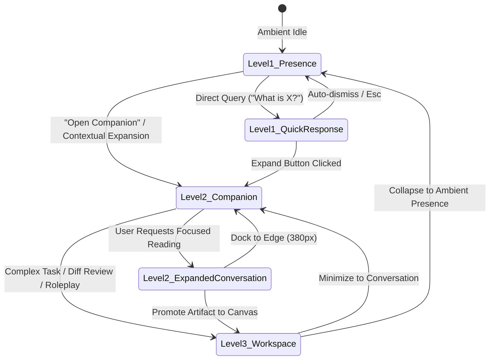

# MAVE UI V2 — VSM6 / VSM6.1: Final Cross-Surface Visual Integration, Motion Continuity & Prototype Closeout

## 1. Executive Summary & Objective

**VSM6 / VSM6.1** represents the final visual integration, motion continuity audit, and prototype closeout for the **MAVE UI V2 Adaptive Visual System**. 

The primary objective of this phase is to establish and prove that:
$$\text{Presence} \longrightarrow \text{Quick Response} \longrightarrow \text{Edge Companion} \longleftrightarrow \text{Expanded Conversation} \longrightarrow \text{Workspace} \longrightarrow \text{Presence}$$
feels like **ONE adaptive MAVE interface**, governed by a singular visual language and calm, desktop-first spatial physics, rather than a fragmented collection of unrelated applications.

---

## 2. Visual Hierarchy & Cross-Surface Identity

All surfaces share the authoritative **MAVE Design System Foundation** established in the MAVE UI Kit:

| Design Dimension | Authoritative Token / Rule | Concrete Implementation |
| :--- | :--- | :--- |
| **Canvas Background** | `--mave-bg: #05060D` with atmospheric radial gradients | Deep, low-contrast dark backdrop (`radial-gradient` cyan/violet subtle glows) |
| **Glass Surfaces** | `--mave-glass-gradient`, `backdrop-filter: blur(22px) saturate(140%)` | Semi-translucent glass panels with 1px border (`var(--mave-edge)`) and inner top highlight |
| **Wordmark Typography**| `'Jost', sans-serif`, weight: 300, tracking: `0.36em` – `0.42em` | Centered, unhurried, calm wordmark capsule across Idle Presence and surface headers |
| **Interface Typography**| `'Manrope', sans-serif`, weights: 400 (regular), 600 (semi-bold) | Humanist, legibly structured body text with authentic kerning and contrast |
| **Monospace / Labels** | `'JetBrains Mono', monospace`, tracking: `0.18em`, uppercase | Faint uppercase identifiers (`YOU`, `MAVE`, `DIFF`, `SOURCE`, `WHY`) |
| **Iconography** | Unified SVG icon component library (`Icons.tsx`) | Authoritative `1.75px` stroke weight, rounded caps/joins, zero raw unicode emojis |
| **Color Accents** | Primary: `#5B84FF` (Blue), Voice/Live: `#5FD2FF` (Cyan), Cognitive: `#9A72FF` (Violet) | Status indicators: `#5FE0A8` (Success), `#FFC46B` (Warning), `#FF7A85` (Error) |

---

## 3. Surface Relationships & Adaptive Spatial Topology



### 3.1 Level 1: Ambient Presence (`PresenceSurface`)
- **Idle State:** Extremely compact capsule (`fit-content`, 50px height, 25px radius) displaying only the unhurried `M A V E` wordmark with subtle resting specular edge.
- **Listening State:** Compact content-aware spacing accommodating the active orb, wordmark, acoustic waveform, and subtle listening label with zero empty gaps (`MAVE | waveform | Listening...`).
- **Thinking State:** Cognitive living wave with gentle violet ambient halo without acoustic bar flickering.
- **Speaking State:** Dynamic waveform reflecting audio RMS levels paired with responsive quick response capsule when immediate synthesis occurs.
- **Quick Response Bubble:** Anchors immediately above/near Presence, remains compact, does not turn into a mini chat window, preserves Presence as the ambient anchor, and expands only upon explicit user intent.

### 3.2 Level 2: Conversation Presentation Differentiation (`ConversationShell`)
Companion and Expanded Conversation fulfill two distinct desktop purposes while preserving the identical dialogue context:
- **Desktop Companion Mode (`sidecar`, 360–420px, nominally 380px):**
  - **Purpose:** *Coexist with active work.* Sits docked on the display edge alongside host applications (code editors, browsers, word processors).
  - **Structure:** Open spatial typography, minimal chrome, no message bubbles, pinned-on-top toggle.
- **Expanded Conversation Mode (`floating`, 560–720px, nominally 640px):**
  - **Purpose:** *Focused reading requested by user.* Materially wider reading space for complex explanations and cards.
  - **Constraint:** Not full-screen. Centered, viewport-bounded canvas with breathing room.
  - **State Preservation:** Identical timeline, same cards, identical composer draft, preserved scroll context.
- **Zero Jargon Invariant:** Replaced developer labels (`Sidecar`, `Presentation Mode`, `Surface Level`) with human-centric desktop terms (`Desktop Companion`, `Conversation`, `Pin on Top`).

### 3.3 Level 3: Artifact-Dominant Workspace (`WorkspaceShell`)
- **Core Law:** *The current artifact or task is primary.* Workspace is not a permanent 3-column application shell.
- **Diff Review Default:** `showConversation = false`, `showContext = false`. The diff artifact immediately commands the full viewport canvas.
- **Optional Drawer Rails:** Explicit user actions materialize the Conversation rail or Context panel as smooth drawers without resetting or shrinking the primary artifact unexpectedly.
- **Narrow Responsive Adaptation:** Automatically transitions to full-width overlaid drawers below 860px width (`@container (max-width: 860px)` and `@media (max-width: 860px)`).

---

## 4. Perceptual Continuity Law & Motion Foundation

### 4.1 Perceptual Continuity vs Literal Morph
> [!IMPORTANT]
> **MAVE preserves perceptual continuity across surface transitions.**
> Surface continuity does **NOT** imply a literal shared-element DOM object morph.

Perceptual continuity is achieved through:
1. **Coordinated Motion Curves:** Smooth opacity fades, subtle scale (`0.985 → 1.0`), and vertical translation (`8–10px`).
2. **Harmonious Sizing:** Natural width transitions where applicable without abrupt snapping.
3. **Unified Material Palette:** Unbroken visual language (frosted glass, Jost wordmark, specular edge, Manrope body).
4. **Stable State Continuity:** Continuous conversation state, intact card data, persistent background tasks, and zero remount flashes or blank white frames.

### 4.2 Authoritative Motion Curves & Durations
Three desktop-calibrated mathematical curves govern all animations:
1. **Entrance Curve (`--mave-ease-enter`):**
   - Formula: `cubic-bezier(0.25, 1, 0.5, 1)` (*easeOutQuart*)
   - Duration: `450ms` (`--mave-dur-enter`)
   - Purpose: Cards arriving, quick response materialization, dialog fade-in.
2. **Surface Morph / Docking Curve (`--mave-ease-glide`):**
   - Formula: `cubic-bezier(0.65, 0, 0.35, 1)` (*easeInOutCubic*)
   - Duration: `800ms` (`--mave-dur-glide`)
   - Purpose: Surface transitions, workspace docking, drawer sliding.
3. **Micro-Interaction Curve (`--mave-ease-pop`):**
   - Formula: `cubic-bezier(0.34, 1.56, 0.64, 1)` (*easeOutBack*)
   - Duration: `200ms` (`--mave-dur-quick`)
   - Purpose: Button presses, chip selection, presence mark scale pops.

---

## 5. Reduced Motion Accessibility Contract

MAVE strictly respects user system preferences for reduced motion:

```css
@media (prefers-reduced-motion: reduce) {
  :root {
    --mave-dur-enter: 0.01ms !important;
    --mave-dur-glide: 0.01ms !important;
    --mave-dur-quick: 0.01ms !important;
    --mave-v2-motion-fast: 0.01ms !important;
    --mave-v2-motion-normal: 0.01ms !important;
    --mave-v2-motion-smooth: 0.01ms !important;
  }

  *, *::before, *::after {
    animation-duration: 0.01ms !important;
    animation-iteration-count: 1 !important;
    transition-duration: 0.01ms !important;
  }

  /* Suppress continuous ambient and waveform movement */
  .mave-v2-waveform-bar,
  .mave-v2-thinking-wave,
  .mave-orb-canvas {
    animation: none !important;
    transform: none !important;
  }
}
```

- When reduced motion is active, animated acoustic waves and orb orbit rotations are halted immediately.
- Non-animated visual indicators (e.g., solid color status dots, typography status labels) clearly communicate state truthfully without disorientation.

---

## 6. Real Runtime Motion Verification

Motion evidence was recorded and verified live inside UI Lab across three primary operational flows:

| Flow Name | Sequence Observed | Motion Continuity Quality |
| :--- | :--- | :--- |
| **Flow A: Presence Lifecycle** | `idle → listening → thinking → speaking → idle` | Calm expansion from wordmark capsule to acoustic bars, gentle violet thinking pulse, speaking response, smooth return to idle. Zero snapping. |
| **Flow B: Conversation Presentation** | `Presence → Quick Response → Edge Companion → Expanded Conversation → Edge Companion` | Quick Response anchors above presence capsule; expands cleanly into edge companion (380px); explicit user expansion to centered reading width (640px) preserves all messages and state; docks back without flash. |
| **Flow C: Artifact Promotion** | `Conversation Diff Card → Workspace → Optional Chat Rail → Workspace → Conversation` | Diff card promotes into full-canvas diff review; Chat rail drawer slides smoothly on user request without disturbing artifact; collapses cleanly. |

All recordings were captured in external scratch artifacts (`<brain>/scratch/recordings/`) and verified free of:
- Remount flashes or white frames
- Vertical snaps or unexpected width jumps
- Scrollbar flashes or layout shifts
- Temporary empty containers
- Center-screen takeovers unless explicitly requested by the user

---

## 7. Scroll Ownership Invariant

To eliminate awkward double scrollbars and scrolling collisions:
- **Outer Containers (`ConversationShell`, `WorkspaceShell`):** Hardened with `overflow: hidden; box-sizing: border-box`.
- **Dedicated Scroll Owners:**
  - In Conversation: Only `[data-testid="conversation-timeline"]` (`overflow-y: auto`) scrolls.
  - In Workspace: Only `[data-testid="workspace-primary-work-area"]` or specific artifact views scroll.
  - In Rich Cards: The card body handles its internal pre-formatted diff or code scroll without expanding the outer card boundary.
- **Scrollbar Styling:** Subtle, ultra-thin (5px), low-contrast WebKit scrollbars (`--mave-scrollbar-thumb: var(--mave-line)`) that fade into the glass canvas.

---

## 8. Prototype Boundary & Non-Regression Law

The MAVE UI V2 code adheres to rigorous architectural isolation:
1. **Isolated Namespace:** All V2 components exist exclusively within `apps/desktop/src/renderer/src/ui-v2/`.
2. **Zero Runtime Side Effects:** Interactive buttons emit typed synthetic callbacks (`onAllowApproval`, `onDenyApproval`, `onSendMessage`). No premature OS-level or IPC commands are wired.
3. **Production Isolation:** The existing production milestone 4 surface (`SurfaceView.tsx`, `MaveCapsule.tsx`) remains 100% untouched and functional.
4. **Read-Only Reference Integrity:** `docs/uiref/` and `docs/pic/` remain strictly unmodified read-only design references.
