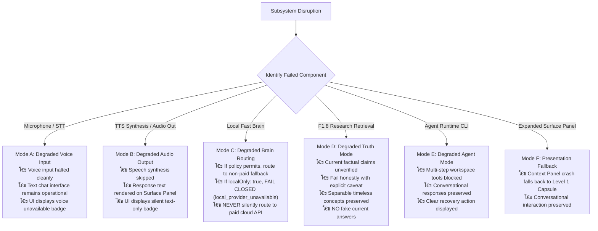
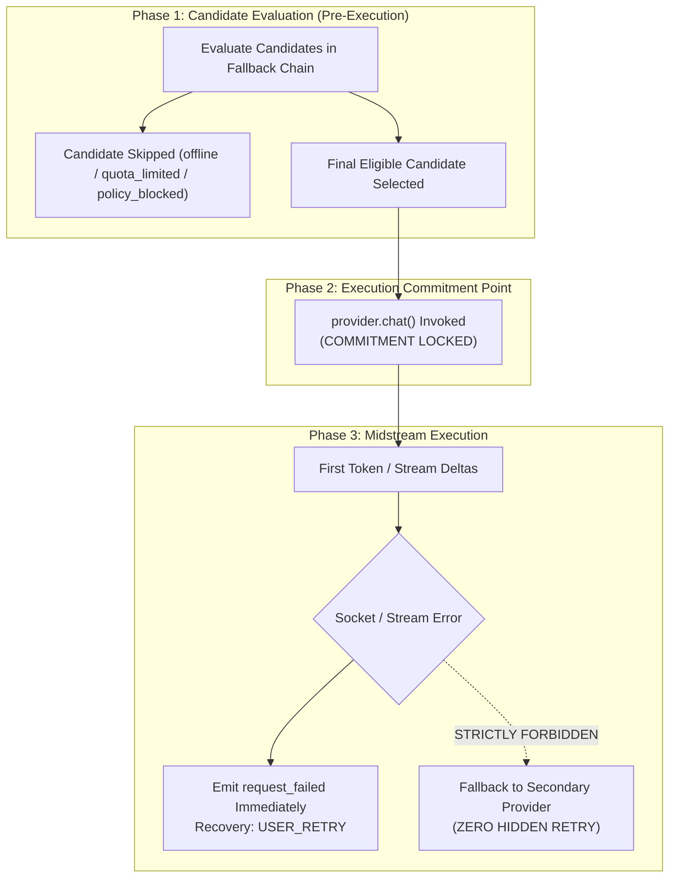

# MAVE F1.9-E: Degraded-Mode Arbitration, Recovery Policy & Failure Classification
## Final Reconciled Implementation Handoff Plan

**Status**: ARCHITECTURE PREPARATION COMPLETED โ€” IMPLEMENTATION PENDING HOME PC
**Audit Baseline**: `09e97cf`
**Target Branch**: `work/f1.9-diagnostics-implementation` (Base Home PC HEAD: `327318a`)
**Target Environment**: `C:\project\MAVE-f1.6`

---

## 1. Executive Summary & Canonical Invariants

Phase F1.9-E establishes MAVE's runtime behavior when subsystems experience partial failure, quota exhaustion, network timeouts, or hardware disconnections.

The core principle governing F1.9-E is:
> **Degraded mode preserves available functionality rather than declaring the entire system dead, while strictly enforcing privacy and billing boundaries.**

### Non-Negotiable Invariants:
1. **`Privacy Lock (localOnly: true)`**: If local Fast Brain (`qwen2.5:1.5b`) is unavailable while `localOnly: true`, MAVE **MUST FAIL CLOSED** with canonical error code `local_provider_unavailable`. Cloud fallback is **STRICTLY FORBIDDEN**.
2. **`Billing Guardrail (allowPaidApis: false)`**: Default billing permission is `billingPermission: 'forbidden'`. MAVE must **NEVER** silently route to metered paid APIs without explicit user authorization. Credential presence does not equal billing permission.
3. **`F1.4 Midstream Commit Boundary`**: Execution commitment occurs at the moment `provider.chat()` is invoked. Even if zero tokens have streamed, midstream failures immediately emit `request_failed`. **Zero hidden cross-provider retry is permitted.**
4. **`F1.8 Degraded Truth Invariant`**: If research is required for a `CURRENT` or `BREAKING` claim and external retrieval is down, MAVE must fail honestly with an explicit caveat. **NO fake current answers from model parametric memory.** Separable timeless concepts are answered while current claims are caveated.
5. **`Cancellation != Failure`**: User barge-in or UI abort emits `request_cancelled` with status `'cancelled'`. Failure counters are not incremented; no error toasts are shown.

---

## 2. Canonical Diagnostics Taxonomy Reconciliation

All diagnostic telemetry emitted in F1.9-E must conform strictly to canonical schema types without field drift:

### Exact 7 Diagnostic Phases:
```ts
export type DiagnosticPhase =
  | 'START'
  | 'READY'
  | 'PROGRESS'
  | 'SUCCESS'
  | 'FAILURE'
  | 'CANCELLED'
  | 'DEGRADED';
```
*(Note: `STREAM_CHUNK` is strictly NOT a canonical phase. Streaming deltas are progress events under `PROGRESS` or captured at the turn level).*

### Exact 5 Diagnostic Severities (Lowercase & Case-Sensitive):
```ts
export type DiagnosticSeverity = 'debug' | 'info' | 'warn' | 'error' | 'fatal';
```

### Exact 6 Recovery Class Names:
```ts
export type RecoveryClass =
  | 'SAFE_AUTOMATIC'
  | 'USER_RETRY'
  | 'REAUTH_REQUIRED'
  | 'CONFIGURATION_REQUIRED'
  | 'MANUAL_SERVICE_RECOVERY'
  | 'BLOCKED_BY_POLICY';
```
*(Note: Serialized abbreviations such as `MANUAL`, `BLOCKED`, or `AUTO` are strictly prohibited).*

### Exact Billing Permission:
In the F1.9-C.1 schema, the canonical default-deny value is:
```ts
billingPermission: 'forbidden'
```
*(Do not introduce `disabled_by_policy` as a new enum value).*

---

## 3. Degraded Modes (Modes A through F)

MAVE defines 6 bounded degraded modes that gracefully preserve user interaction:



### Mode Specifications:

1. **Mode A โ€” Degraded Voice Input**:
   - **Trigger**: Microphone unplugged, audio buffer overrun, or Faster-Whisper worker crash.
   - **System Action**: Cleanly abort active voice session; emit `voice_session_failed`; transition Surface to text chat mode.
   - **Recovery**: `CONFIGURATION_REQUIRED` (if device missing) or `SAFE_AUTOMATIC` (restart worker on next turn).

2. **Mode B โ€” Degraded Audio Output**:
   - **Trigger**: Edge-TTS network timeout, WebSocket drop, or speaker buffer starved.
   - **System Action**: Display full assistant response on Surface Panel; omit spoken speech; suppress audio error dialogs.
   - **Recovery**: `SAFE_AUTOMATIC` on subsequent turns.

3. **Mode C โ€” Degraded Brain Routing**:
   - **Trigger**: Ollama daemon offline, weights unloaded with insufficient VRAM, or HTTP connection refused.
   - **System Action**:
     - If `localOnly: true`: Fail closed immediately; emit `local_provider_unavailable`; report `BLOCKED_BY_POLICY`.
     - If `localOnly: false` and `allowPaidApis: false`: Evaluate eligible subscription runtimes (Claude/Codex/Antigravity) if profile allows. If none available, fail closed.
     - **NEVER** route to paid cloud APIs (`billingPermission: 'forbidden'`).
   - **Recovery**: `MANUAL_SERVICE_RECOVERY` (prompt user to start Ollama).

4. **Mode D โ€” Degraded Truth Mode (F1.8 Invariant)**:
   - **Trigger**: External search provider unavailable or rate-limited during a `CURRENT` or `BREAKING` factual turn.
   - **System Action**:
     - Assess if query contains separable timeless knowledge (e.g. *"Define P/E and tell me Apple's current P/E"*).
     - Answer timeless concept accurately from model parametric knowledge.
     - State explicitly: *"Current figures cannot be verified because external research retrieval is currently unavailable."*
     - **NEVER** substitute model memory as verified current truth.
   - **Recovery**: `USER_RETRY` once external network/search recovers.

5. **Mode E โ€” Degraded Agent Runtime**:
   - **Trigger**: CLI process exit non-zero, OAuth token expired, or rate-limited.
   - **System Action**: Provider marked `auth_error` or `quota_limited`; conversational models continue operating.
   - **Recovery**: `REAUTH_REQUIRED` (user runs `claude login`) or wait for quota reset window.

6. **Mode F โ€” Presentation Fallback**:
   - **Trigger**: Level 3 Context Panel crashes or window bounds fail.
   - **System Action**: Fall back cleanly to Level 1 Ambient Capsule; preserve active session in SQLite.
   - **Recovery**: `SAFE_AUTOMATIC`.

---

## 4. Failure Classification & Recovery Matrix

| Disruption Event | Canonical Error Code | Diagnostic Reason | Recovery Class | Action Taken by MAVE | User Action Required |
| :--- | :--- | :--- | :--- | :--- | :--- |
| **Ollama Daemon Offline** | `local_provider_unavailable` | `ollama_daemon_unreachable` | `MANUAL_SERVICE_RECOVERY` | Exclude Ollama; fail closed if `localOnly`. | Start Ollama service (`ollama serve`). |
| **Model Tag Missing** | `model_unavailable` | `model_tag_missing` | `MANUAL_SERVICE_RECOVERY` | Provider healthy; model marked unavailable. | Run `ollama pull qwen2.5:1.5b`. |
| **Midstream Token Drop** | `provider_unavailable` | `stream_disconnected` | `USER_RETRY` | Emit `request_failed` immediately; NO hidden retry. | Click "Try Again" button. |
| **Subscription OAuth Expired** | `provider_auth` | `oauth_token_expired` | `REAUTH_REQUIRED` | Mark provider `auth_error`; route to fallback. | Run CLI login in terminal. |
| **Subscription Quota Limited** | `quota_limited` | `rate_limit_exceeded` | `USER_RETRY` | Quota status set to `quota_limited` until `resetAt`. | Wait for reset window or switch provider. |
| **Paid API Blocked by Policy** | `provider_unconfigured` | `billing_policy_denied` | `BLOCKED_BY_POLICY` | Skip candidate during pre-execution evaluation. | Enable `allowPaidApis` in settings. |
| **LocalOnly Cloud Block** | `local_provider_unavailable` | `cloud_fallback_prohibited` | `BLOCKED_BY_POLICY` | Fail closed immediately; zero cloud calls. | Connect local model or disable `localOnly`. |
| **Microphone Detached** | `runtime_error` | `audio_device_missing` | `CONFIGURATION_REQUIRED` | Handoff to text chat mode on Surface. | Re-plug microphone or select in settings. |
| **Edge-TTS Socket Timeout** | `runtime_error` | `tts_network_timeout` | `SAFE_AUTOMATIC` | Render text on Surface; skip voice playback. | None (transient network glitch). |
| **User Barge-In Abort** | `cancelled` | `user_barge_in` | `SAFE_AUTOMATIC` | Halt audio playback buffer; turn `cancelled`. | None (intentional user action). |

---

## 5. F1.4 Midstream Execution Invariant



### Invariant Rules:
1. **Candidate Skipped $\neq$ Execution Attempt**: Skipping an offline or quota-limited candidate during routing evaluation is not an execution attempt. `routeAttempts` increments only on actual `provider.chat()` invocation.
2. **Zero Secondary Fallback After Invocation**: Once `provider.chat()` is invoked, the execution boundary is crossed. If the provider fails (even with 0 tokens emitted), MAVE **MUST NOT** catch the error and invoke another provider on the same turn. The turn must fail cleanly with `request_failed`.

---

## 6. Invariant Unit Test Specifications (E01โ€“E20)

Before promotion, the following deterministic tests must pass in `@mave/core`:

- **TEST-E01**: `localOnly: true` with offline Ollama throws `local_provider_unavailable` and emits 0 network requests.
- **TEST-E02**: `allowPaidApis: false` (`billingPermission: 'forbidden'`) blocks OpenAI API candidate with `BLOCKED_BY_POLICY`.
- **TEST-E03**: Stream drop after token 1 emits `request_failed` with zero secondary provider call.
- **TEST-E04**: Stream drop with 0 tokens emitted after `provider.chat()` invocation emits `request_failed` with zero secondary provider call.
- **TEST-E05**: Quota expired (`now >= resetAt`) transitions status to `'unknown'`, not `'available'`.
- **TEST-E06**: User barge-in emits `request_cancelled`, status `'cancelled'`, reason `'user_barge_in'`, error `null`.
- **TEST-E07**: Degraded Mode A preserves operational text chat interface when STT crashes.
- **TEST-E08**: Degraded Mode B renders text on Surface Panel when TTS times out.
- **TEST-E09**: Degraded Mode D caveats current claims when research retrieval is blocked.
- **TEST-E10**: Degraded Mode D preserves and answers separable timeless concepts during retrieval outage.
- **TEST-E11**: Candidate evaluation skipping 2 offline providers results in `attemptedProviderIds.length === 1` and `routeAttempts === 1`.
- **TEST-E12**: Recovery class `REAUTH_REQUIRED` excludes provider from subsequent auto-routing until re-probed.
- **TEST-E13**: Recovery class `MANUAL_SERVICE_RECOVERY` displays actionable daemon launch guidance.
- **TEST-E14**: Pre-execution transient network timeout triggers `SAFE_AUTOMATIC` retry with backoff.
- **TEST-E15**: Credential present in environment does not alter `billingPermission: 'forbidden'`.
- **TEST-E16**: `RouteTelemetry` keys remain strictly the 8 canonical fields during degraded turns.
- **TEST-E17**: Exact 7 diagnostic phases are strictly validated by Zod parser.
- **TEST-E18**: Exact 5 lowercase severities are strictly validated by Zod parser.
- **TEST-E19**: Exact 6 recovery classes are strictly validated by Zod parser.
- **TEST-E20**: Midstream cancellation aborts provider `AbortSignal` and releases residency leases immediately.
