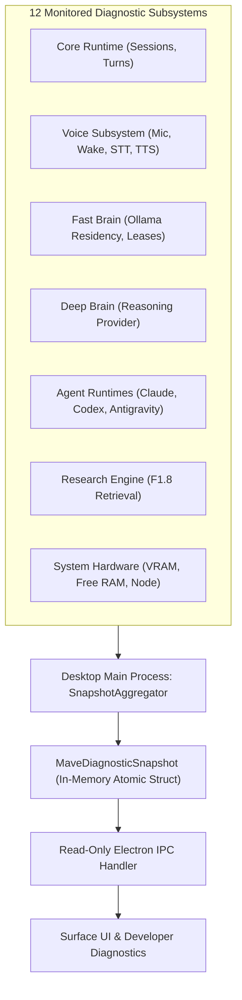
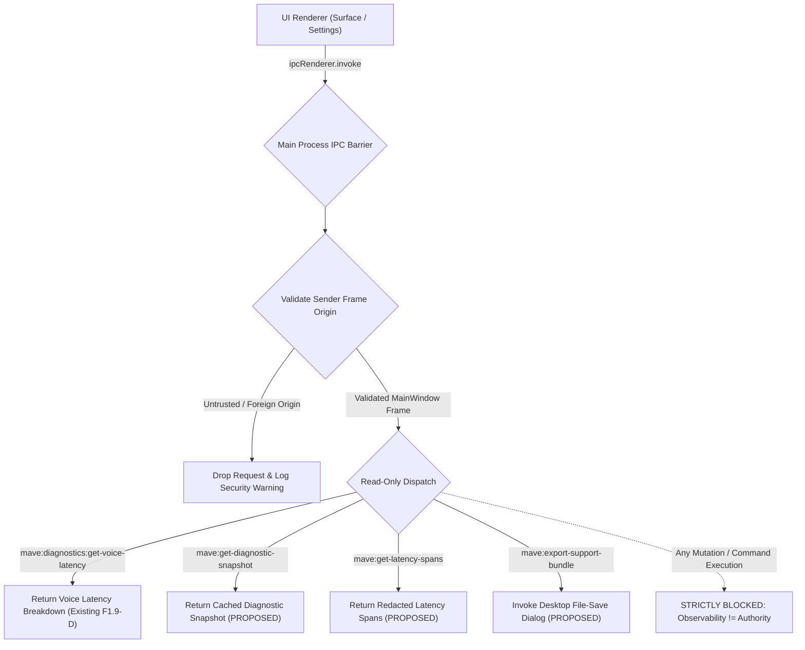

# MAVE F1.9-F: Diagnostic Snapshot Aggregation, Support Export & Read-Only IPC
## Final Reconciled Implementation Handoff Plan

**Status**: ARCHITECTURE PREPARATION COMPLETED โ€” IMPLEMENTATION PENDING HOME PC
**Audit Baseline**: `09e97cf`
**Target Branch**: `work/f1.9-diagnostics-implementation` (Base Home PC HEAD: `327318a`)
**Target Environment**: `C:\project\MAVE-f1.6`

---

## 1. Executive Summary & Purpose

Phase F1.9-F formalizes the unified diagnostic snapshot model answering **"Is MAVE healthy right now?"**, provides a privacy-safe, allowlist-redacted support bundle generator, and secures the Electron IPC boundary.

### Foundational Principles:
1. **`Observability != Authority`**: Diagnostic snapshot queries and exports inspect and format system state, but possess zero capability to execute commands, repair files, or alter provider settings.
2. **`Source Truth for Provider Health`**: Canonical `ProviderHealth` preserves its authoritative 8-status contract from `packages/contracts/src/brain.ts`. F1.9 snapshots support a companion reachability state: `operationalHealth = 'unknown'` for un-probed or stale evidence.
3. **`Strict Allowlist Export Projection`**: Support exports only include explicitly whitelisted diagnostic keys. Prompts, assistant markdown text, auth tokens, local file paths, and audio buffers are **STRICTLY EXCLUDED**.
4. **`Read-Only IPC Boundary`**: IPC channels in `apps/desktop/src/main/ipc.ts` validate sender frame origins and expose only read-only getters. Support bundle saving crosses a filesystem boundary via a dedicated, user-authorized Electron `showSaveDialog` dialog.

---

## 2. Diagnostic Snapshot Truth Model (`MaveDiagnosticSnapshot`)



### Snapshot Schema Structure:
```ts
export type SubsystemHealthStatus =
  | 'AVAILABLE'
  | 'DEGRADED'
  | 'UNAVAILABLE'
  | 'UNCONFIGURED'
  | 'UNKNOWN';

export interface MaveDiagnosticSnapshot {
  readonly timestamp: number;
  readonly overallStatus: SubsystemHealthStatus;
  readonly coreRuntime: {
    readonly status: SubsystemHealthStatus;
    readonly activeSessions: number;
    readonly activeTurns: number;
  };
  readonly voice: {
    readonly status: SubsystemHealthStatus;
    readonly micOwnership: 'wake' | 'voice' | 'none';
    readonly wakeEngine: { readonly provider: string; readonly listening: boolean };
    readonly stt: { readonly provider: string; readonly status: string };
    readonly tts: { readonly provider: string; readonly status: string };
    readonly lastLatency?: VoiceLatencyDiagnostics;
  };
  readonly fastBrain: {
    readonly status: SubsystemHealthStatus;
    readonly providerId: string;
    readonly modelId: string;
    readonly residencyState: 'unloaded' | 'loading' | 'warm' | 'in_use' | 'unloading' | 'unavailable';
    readonly activeLeases: number;
    readonly vramUsageBytes?: number;
  };
  readonly deepBrain: {
    readonly status: SubsystemHealthStatus;
    readonly configuredProviderId?: string;
  };
  readonly agentRuntimes: Record<string, {
    readonly status: SubsystemHealthStatus;
    readonly version?: string;
    readonly authStatus: 'configured' | 'unconfigured' | 'auth_error' | 'not_required';
    readonly quotaStatus: 'available' | 'quota_limited' | 'rate_limited' | 'unknown';
  }>;
  readonly research: {
    readonly status: SubsystemHealthStatus;
  };
  readonly system: {
    readonly platform: string;
    readonly nodeVersion: string;
    readonly memoryFreeGiB: number;
    readonly gpuAvailable: boolean;
  };
}
```

### Staleness & The Unknown State:
- **Staleness Boundary (Candidate TTL: 30,000 ms)**: Probes older than TTL are marked `operationalHealth = 'unknown'`.
- **Never Fabricate Health**: A never-checked provider is **NEVER** marked `healthy`, `unavailable`, or `unconfigured`. It must report `unknown`.

---

## 3. Privacy-Safe Support Export Architecture

Generating a support bundle enables troubleshooting without exfiltrating private user data:

```text
โ”Œโ”€โ”€โ”€โ”€โ”€โ”€โ”€โ”€โ”€โ”€โ”€โ”€โ”€โ”€โ”€โ”€โ”€โ”€โ”€โ”€โ”€โ”€โ”€โ”€โ”€โ”€โ”€โ”€โ”€โ”€โ”€โ”€โ”€โ”€โ”€โ”€โ”€โ”€โ”€โ”€โ”€โ”€โ”€โ”€โ”€โ”€โ”€โ”€โ”€โ”€โ”€โ”€โ”€โ”€โ”€โ”€โ”€โ”€โ”€โ”€โ”€โ”€โ”€โ”€โ”€โ”€โ”€โ”€โ”€โ”€โ”€โ”€โ”
โ”‚                   PRIVACY-SAFE SUPPORT EXPORT BUNDLE                   โ”‚
โ”œโ”€โ”€โ”€โ”€โ”€โ”€โ”€โ”€โ”€โ”€โ”€โ”€โ”€โ”€โ”€โ”€โ”€โ”€โ”€โ”€โ”€โ”€โ”€โ”€โ”€โ”€โ”€โ”€โ”€โ”€โ”€โ”€โ”€โ”€โ”€โ”€โ”€โ”€โ”€โ”€โ”€โ”€โ”€โ”€โ”€โ”€โ”€โ”€โ”€โ”€โ”€โ”€โ”€โ”€โ”€โ”€โ”€โ”€โ”€โ”€โ”€โ”€โ”€โ”€โ”€โ”€โ”€โ”€โ”€โ”€โ”€โ”€โ”ค
โ”‚ STRICT ALLOWLIST (Permitted Forensics):                                โ”‚
โ”‚ โ€ข System OS platform, CPU architecture, Node & Electron versions       โ”‚
โ”‚ โ€ข Component runtime versions (Ollama v0.5.x, Python 3.11)              โ”‚
โ”‚ โ€ข MaveDiagnosticSnapshot (current state of all 12 subsystems)          โ”‚
โ”‚ โ€ข Aggregated latency breakdown metrics (STT, Brain TTFT, TTFA medians) โ”‚
โ”‚ โ€ข Canonical error codes, diagnostic reasons, and recovery classes      โ”‚
โ”‚ โ€ข Quota state and provider health probe history (last 200 events)      โ”‚
โ”œโ”€โ”€โ”€โ”€โ”€โ”€โ”€โ”€โ”€โ”€โ”€โ”€โ”€โ”€โ”€โ”€โ”€โ”€โ”€โ”€โ”€โ”€โ”€โ”€โ”€โ”€โ”€โ”€โ”€โ”€โ”€โ”€โ”€โ”€โ”€โ”€โ”€โ”€โ”€โ”€โ”€โ”€โ”€โ”€โ”€โ”€โ”€โ”€โ”€โ”€โ”€โ”€โ”€โ”€โ”€โ”€โ”€โ”€โ”€โ”€โ”€โ”€โ”€โ”€โ”€โ”€โ”€โ”€โ”€โ”€โ”€โ”€โ”ค
โ”‚ STRICT PROHIBITION (Zero-Tolerance Redaction):                         โ”‚
โ”‚ โœ• Conversation transcripts, user prompts, markdown completions         โ”‚
โ”‚ โœ• API keys, OAuth tokens, authorization headers, passwords, cookies     โ”‚
โ”‚ โœ• Local project file paths, filenames, or directory structures         โ”‚
โ”‚ โœ• Audio recordings, PCM frames, or spectrograms                        โ”‚
โ””โ”€โ”€โ”€โ”€โ”€โ”€โ”€โ”€โ”€โ”€โ”€โ”€โ”€โ”€โ”€โ”€โ”€โ”€โ”€โ”€โ”€โ”€โ”€โ”€โ”€โ”€โ”€โ”€โ”€โ”€โ”€โ”€โ”€โ”€โ”€โ”€โ”€โ”€โ”€โ”€โ”€โ”€โ”€โ”€โ”€โ”€โ”€โ”€โ”€โ”€โ”€โ”€โ”€โ”€โ”€โ”€โ”€โ”€โ”€โ”€โ”€โ”€โ”€โ”€โ”€โ”€โ”€โ”€โ”€โ”€โ”€โ”€โ”˜
```

### Desktop Save-Dialog Boundary:
- Support exports are **NEVER** uploaded automatically to external servers.
- Export requires an explicit user action in Settings.
- The Electron main process prompts the user via `dialog.showSaveDialog()`, writing an inspectable, unencrypted JSON or ZIP archive to the user-chosen location.
- **Candidate Size Ceiling**: Total uncompressed archive size is clamped strictly to $\le 10\text{ MB}$.

---

## 4. Electron IPC Security (`apps/desktop/src/main/ipc.ts`)

Electron IPC channels expose diagnostic state to the UI renderer under strict defensive controls:



### Channel Security Rules:
1. **Confirmed Existing Channel**:
   - `mave:diagnostics:get-voice-latency` (Verified from F1.9-D).
2. **Proposed Channels (Pending Home PC Implementation)**:
   - `mave:get-diagnostic-snapshot`
   - `mave:get-latency-spans`
   - `mave:export-support-bundle`
3. **Frame Origin Validation**:
   - Every handler asserts `event.senderFrame === mainWindow.webContents.mainFrame`.
4. **Deep-Frozen Payloads**:
   - Snapshot payloads are frozen (`Object.freeze`) before serialization to prevent renderer-induced mutations.

---

## 5. Security Threat Model for Diagnostics

1. **Threat 1: Credential Leakage via Snapshot**:
   - *Attack*: A provider probe captures an API key or auth header in its raw error string.
   - *Mitigation*: The `SnapshotAggregator` passes all error messages through regex redaction replacing tokens with `[REDACTED]`.
2. **Threat 2: IPC Injection from Compromised Renderer**:
   - *Attack*: Malicious script in renderer attempts to invoke shell commands via diagnostic IPC.
   - *Mitigation*: Diagnostic IPC channels are strictly read-only getters. Zero command execution channels exist.
3. **Threat 3: Disk Denial of Service via Support Export**:
   - *Attack*: An attacker triggers thousands of support exports to fill host disk space.
   - *Mitigation*: Support export requires interactive user save dialog; event queues are bounded ring buffers.

---

## 6. F01โ€“F36 Diagnostic & Export Test Matrix

The following 36 automated unit/integration tests must pass in `@mave/core` and `apps/desktop`:

- **TEST-F01**: `MaveDiagnosticSnapshot` conforms strictly to Zod schema.
- **TEST-F02**: Stale provider probe (>30s) reports `operationalHealth: 'unknown'`.
- **TEST-F03**: Never-checked provider reports `unknown`, not `healthy` or `unconfigured`.
- **TEST-F04**: Snapshot aggregation completes in <50ms without blocking turn processing.
- **TEST-F05**: Concurrent turn requests do not corrupt in-memory snapshot state.
- **TEST-F06**: Support export bundle includes only allowlisted keys.
- **TEST-F07**: Support export bundle contains zero instances of `apiKey` or bearer tokens.
- **TEST-F08**: Support export bundle contains zero conversation prompt texts.
- **TEST-F09**: Support export bundle contains zero assistant markdown completion texts.
- **TEST-F10**: Support export bundle replaces absolute host user paths with relative paths.
- **TEST-F11**: Support export bundle contains zero raw PCM audio buffers.
- **TEST-F12**: Support export bundle uncompressed size is clamped within candidate limit (10 MB).
- **TEST-F13**: Diagnostic ring buffer caps retention strictly at 1,000 events without memory growth.
- **TEST-F14**: IPC channel `mave:diagnostics:get-voice-latency` returns valid latency breakdown.
- **TEST-F15**: IPC handler rejects invocations from untrusted sender frames.
- **TEST-F16**: IPC handler deep-freezes snapshot objects before transit.
- **TEST-F17**: SQLite diagnostic event table persists error codes without raw prompts.
- **TEST-F18**: Fast Brain residency state accurately reflects `OllamaResidencyManager`.
- **TEST-F19**: Deep Brain availability accurately reflects model catalog status.
- **TEST-F20**: Agent runtime auth status accurately reflects CLI OAuth presence.
- **TEST-F21**: Quota scope (`runtime` vs `model` vs `unknown`) is preserved in snapshot.
- **TEST-F22**: Reset window expiry transitions quota status to `unknown`.
- **TEST-F23**: High-frequency diagnostic bursts do not leak memory.
- **TEST-F24**: Support export generation requires explicit desktop dialog interaction.
- **TEST-F25**: Background auto-upload of support export is strictly non-existent.
- **TEST-F26**: Voice subsystem snapshot accurately reflects microphone ownership.
- **TEST-F27**: Research subsystem snapshot accurately reflects retrieval availability.
- **TEST-F28**: Core runtime snapshot reports accurate active session and turn counts.
- **TEST-F29**: System hardware snapshot reports accurate free memory and GPU availability.
- **TEST-F30**: Diagnostic events carry monotonic integer timestamps.
- **TEST-F31**: Zero shell execution capabilities are imported into diagnostic modules.
- **TEST-F32**: Zero file write permissions exist in snapshot getter channels.
- **TEST-F33**: Pino logger output redacts secrets before stdout dispatch.
- **TEST-F34**: Support export ZIP archive is valid and inspectable with standard tools.
- **TEST-F35**: Diagnostic telemetry remains strictly decoupled from frozen `RouteTelemetry`.
- **TEST-F36**: Diagnostic telemetry remains strictly decoupled from F1.8 `ResearchTelemetry`.
