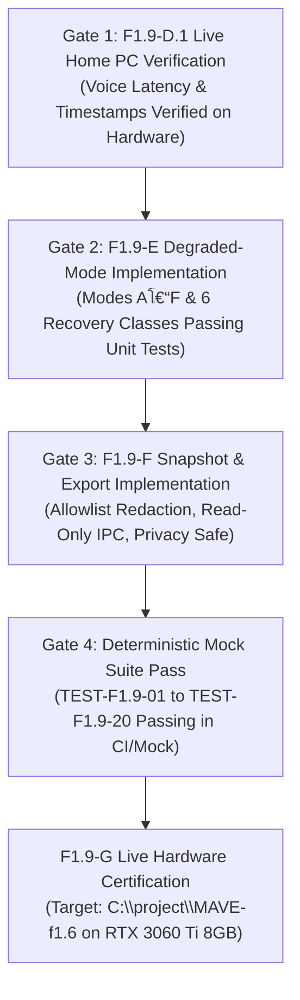

# MAVE F1.9-G: Live Reliability Certification Strategy & Test Plan
## Final Reconciled Certification Plan

**Status**: CERTIFICATION PLAN FINALIZED โ€” LIVE CERTIFICATION PENDING HOME PC
**Audit Baseline**: `09e97cf`
**Target Implementation**: `C:\project\MAVE-f1.6`
**Target Branch**: `work/f1.9-diagnostics-implementation` (Base Home PC HEAD: `327318a`)
**Target Hardware Environment**: **NVIDIA GeForce RTX 3060 Ti (8 GB VRAM)**, Windows 11

---

## 1. Certification Prerequisites and Strict Entry Gates

Live reliability certification on hardware constitutes the empirical proof that MAVE can explain every failure, preserve user privacy, enforce policy boundaries, and recover deterministically. To prevent testing unstable code, F1.9-G enforces strict sequential gating:



### Entry Gate Descriptions:
1. **Gate 1 โ€” F1.9-D.1 Live Verification**:
   - Voice timestamps (`wakeDetectedAt`, `speechEndedAt`, `sttFinalAt`, `brainFirstTokenAt`, `playbackStartedAt`) verified running without `NaN` or negative values on Home PC hardware.
2. **Gate 2 โ€” F1.9-E Implementation Complete**:
   - Modes Aโ€“F, 6 recovery classes, and F1.4 midstream commit boundary implemented and passing unit tests.
3. **Gate 3 โ€” F1.9-F Snapshot & Support Export Complete**:
   - `MaveDiagnosticSnapshot` aggregator, allowlist support export generator, and read-only IPC security handlers verified.
4. **Gate 4 โ€” Deterministic Mock Suite 100% Pass**:
   - All 20 canonical tests pass deterministically under mock conditions before live hardware stress is applied.

---

## 2. Hardware Environment Baseline (NVIDIA RTX 3060 Ti, 8 GB VRAM)

- **GPU**: NVIDIA GeForce RTX 3060 Ti (GA104).
- **Physical VRAM Ceiling**: **8,192 MiB (8 GB)**.
- **Residency Budget**:
  - Fast Brain (`qwen2.5:1.5b` via Ollama): ~1.2 GiB VRAM allocation.
  - Deep Brain (`qwen2.5:7b` via Ollama): ~4.7 GiB VRAM allocation.
  - Dual resident headroom: ~2.1 GiB reserved for Windows DWM, Electron renderer, and display buffers.
- **Prewarm Invariant (Milestone Pre-M5 C3.1)**:
  - Booting MAVE or executing diagnostic presence checks **MUST ALLOCATE ZERO VRAM LEASES**.
  - Assert `OllamaResidencyManager.getActiveLeases() === 0` and MAVE resident model bytes === 0.
  - *(Note: Physical OS GPU VRAM via nvidia-smi is NOT asserted as 0 MiB, as Windows and background apps consume OS VRAM).*

---

## 3. Preserved Canonical Test Matrix (TEST-F1.9-01 through TEST-F1.9-20)

All 20 canonical test definitions established in Section 30 of the F1.9 audit are preserved verbatim with corrected assertions:

| Test ID | Target Architectural Invariant | Verification Method | Expected Outcome / Assertion |
| :--- | :--- | :--- | :--- |
| **TEST-F1.9-01** | `RouteTelemetry` Exact 8 Fields | Inspect runtime `RouteTelemetrySchema` keys. | Exactly 8 canonical keys match; rejecting injected fields. |
| **TEST-F1.9-02** | End-to-End Trace Correlation | Dispatch voice turn (Wake $\to$ STT $\to$ Brain $\to$ TTS $\to$ Surface). | Root `traceId` is shared across all diagnostic events. Child `requestId` values may differ across subrequests. |
| **TEST-F1.9-03** | Health $\neq$ Quota Separation | Mock provider returning HTTP 429 rate limit. | `operationalHealth === 'healthy'`; `quotaState.status === 'quota_limited'`. |
| **TEST-F1.9-04** | Model Availability $\neq$ Provider Health | Remove model tag in local Ollama catalog while daemon runs. | Provider `healthy`; model availability `unavailable`; `diagnosticReason === 'model_tag_missing'`. |
| **TEST-F1.9-05** | Paid API Credential $\neq$ Permission | Set `OPENAI_API_KEY` with `allowPaidApis: false` (`billingPermission: 'forbidden'`). | Router skips candidate; records `BLOCKED_BY_POLICY`; 0 outbound network calls. |
| **TEST-F1.9-06** | Canonical Error + Diagnostic Reason | Force Fast Brain failure (socket closed). | Canonical `local_provider_unavailable`, companion `fast_brain_unavailable`, and sanitized raw cause. |
| **TEST-F1.9-07** | Startup Self-Check Zero VRAM Load | Boot MAVE; trigger diagnostic presence probe. | Dispatches `/api/version` and `/api/tags`; `activeLeases === 0`; MAVE model bytes === 0. |
| **TEST-F1.9-08** | Ollama Daemon Disappearance Detection | Terminate mock Ollama mid-turn. | Health transitions to `'unavailable'`; turn terminates with `local_provider_unavailable`. |
| **TEST-F1.9-09** | Residency Stale State Reconciliation | Inject out-of-sync mock `/api/ps` response. | Residency manager reconciles lease state with `/api/ps` without dropping active locks. |
| **TEST-F1.9-10** | Voice STT Failure Degrades to Text | Inject crash into Faster-Whisper worker pipe. | Emits `voice_session_failed`; surface preserves operational text chat interface. |
| **TEST-F1.9-11** | TTS Failure Degrades to Surface Display | Inject network disconnect into Edge-TTS. | Assistant text rendered on Surface Panel; audio playback fails gracefully without app crash. |
| **TEST-F1.9-12** | LocalOnly Policy Fail-Closed | Configure `localOnly: true`; disable local Fast Brain. | Router rejects cloud fallbacks; fails closed with `local_provider_unavailable`; 0 cloud calls. |
| **TEST-F1.9-13** | Pre-Execution Skip $\neq$ Execution Attempt | Router chain with 2 offline/quota providers and 1 online fallback. | Offline providers skipped; `attemptedProviderIds.length === 1`; `routeAttempts === 1`. |
| **TEST-F1.9-14** | Midstream Failure No Hidden Retry | Induce socket drop during `provider.chat()`. | Turn immediately emits `request_failed`; zero fallback to secondary provider. |
| **TEST-F1.9-15** | Cancellation $\neq$ Request Failed | Dispatch user barge-in / UI abort signal. | Turn status `'cancelled'`; reason `'user_barge_in'`; error is null; failure counter unchanged. |
| **TEST-F1.9-16** | Secret Redaction Invariant | Feed raw log containing `apiKey`, `token`, and `authorization`. | Redaction filter replaces secrets with `[REDACTED]`. Zero secret entropy in output. |
| **TEST-F1.9-17** | Diagnostic Retention Boundedness | Push burst of 5,000 synthetic events into buffer. | Memory ring buffer caps strictly at configured limit without memory exhaustion. |
| **TEST-F1.9-18** | Agent Runtime Unknown Quota Handling | Query Claude Code / Codex CLI mock returning no rate headers. | `quotaState.status` reports `'unknown'`, never fabricated numbers. |
| **TEST-F1.9-19** | Research Telemetry Decoupling | Execute research turn (`CURRENT` topic). | `ResearchTelemetry` captures search stats; `RouteTelemetry` remains strictly 8 frozen fields. |
| **TEST-F1.9-20** | Zero Diagnostic Tool Authority | Inspect diagnostic probe capabilities. | Zero capability to invoke shell commands or mutate files. |

---

## 4. Exact Canonical Error Codes (17 Unabbreviated Values)

In accordance with [`packages/contracts/src/brain.ts`](file:///d:/project/MAVE-f1.9/packages/contracts/src/brain.ts#L364-L384), canonical error codes must never be abbreviated:

1. `provider_unavailable`
2. `provider_timeout`
3. `provider_auth`
4. `provider_limit`
5. `provider_invalid_response`
6. `cancelled`
7. `runtime_error`
8. `fast_brain_unavailable`
9. `profile_unavailable`
10. `model_unavailable`
11. `provider_unconfigured`
12. `quota_limited`
13. `rate_limited`
14. `auth_required`
15. `local_provider_unavailable`
16. `routing_timeout`
17. `generation_cancelled`

---

## 5. Voice Latency & Playback Observation Boundary

- **Software Buffer Dispatch Proxy**:
  - `playbackStartedAt` marks the exact moment the first synthesized audio chunk is dispatched into the OS audio output buffer.
  - It is **NOT** confirmed acoustic onset (the moment sound waves reach the user's ears).
  - Software latency reports must acknowledge that hardware DAC and OS driver buffers introduce unobserved acoustic delay.
  - Claims of microsecond hardware acoustic accuracy or fabricated driver latency bounds ($\le 20\text{ ms}$) are strictly prohibited.

---

## 6. Live Test Safety & Safe Rollback

1. **Mock-First Requirement**:
   - All deterministic tests (`TEST-F1.9-01` through `TEST-F1.9-20`) must execute by default against **in-memory mocks and synthetic fault injection**.
   - Tests must **NEVER** delete real local Ollama models (`ollama rm`) or kill actual system daemons (`taskkill /f /im ollama.exe`) during standard test runs.
2. **Non-Destructive Rollback**:
   - Destructive Git operations (`git reset --hard`, `git clean -fd`, `git push --force`) are **STRICTLY FORBIDDEN**.
   - Rollback planning must preserve all implementation commits, branch histories, and untracked user/model files.

---

## 7. Multi-Tier Certification Evidence Model

Certification requires distinguishing planned test suites from actual recorded empirical evidence:

```text
โ”Œโ”€โ”€โ”€โ”€โ”€โ”€โ”€โ”€โ”€โ”€โ”€โ”€โ”€โ”€โ”€โ”€โ”€โ”€โ”€โ”€โ”€โ”€โ”€โ”€โ”€โ”€โ”€โ”€โ”€โ”€โ”€โ”€โ”€โ”€โ”€โ”€โ”€โ”€โ”€โ”€โ”€โ”€โ”€โ”€โ”€โ”€โ”€โ”€โ”€โ”€โ”€โ”€โ”€โ”€โ”€โ”€โ”€โ”€โ”€โ”€โ”€โ”€โ”€โ”€โ”€โ”€โ”€โ”€โ”€โ”€โ”€โ”€โ”
โ”‚                     FIVE-TIER CERTIFICATION EVIDENCE                   โ”‚
โ”œโ”€โ”€โ”€โ”€โ”€โ”€โ”€โ”€โ”€โ”€โ”€โ”€โ”€โ”€โ”€โ”€โ”€โ”€โ”€โ”€โ”€โ”€โ”ฌโ”€โ”€โ”€โ”€โ”€โ”€โ”€โ”€โ”€โ”€โ”€โ”€โ”€โ”€โ”€โ”€โ”€โ”€โ”€โ”€โ”€โ”€โ”ฌโ”€โ”€โ”€โ”€โ”€โ”€โ”€โ”€โ”€โ”€โ”€โ”€โ”€โ”€โ”€โ”€โ”€โ”€โ”€โ”€โ”€โ”€โ”€โ”€โ”€โ”€โ”ค
โ”‚ EVIDENCE TIER        โ”‚ SCOPE                โ”‚ REQUIRED ARTIFACT        โ”‚
โ”œโ”€โ”€โ”€โ”€โ”€โ”€โ”€โ”€โ”€โ”€โ”€โ”€โ”€โ”€โ”€โ”€โ”€โ”€โ”€โ”€โ”€โ”€โ”ผโ”€โ”€โ”€โ”€โ”€โ”€โ”€โ”€โ”€โ”€โ”€โ”€โ”€โ”€โ”€โ”€โ”€โ”€โ”€โ”€โ”€โ”€โ”ผโ”€โ”€โ”€โ”€โ”€โ”€โ”€โ”€โ”€โ”€โ”€โ”€โ”€โ”€โ”€โ”€โ”€โ”€โ”€โ”€โ”€โ”€โ”€โ”€โ”€โ”€โ”ค
โ”‚ 1. Contract Tests    โ”‚ Zod schemas, enums   โ”‚ Vitest JSON report       โ”‚
โ”œโ”€โ”€โ”€โ”€โ”€โ”€โ”€โ”€โ”€โ”€โ”€โ”€โ”€โ”€โ”€โ”€โ”€โ”€โ”€โ”€โ”€โ”€โ”ผโ”€โ”€โ”€โ”€โ”€โ”€โ”€โ”€โ”€โ”€โ”€โ”€โ”€โ”€โ”€โ”€โ”€โ”€โ”€โ”€โ”€โ”€โ”ผโ”€โ”€โ”€โ”€โ”€โ”€โ”€โ”€โ”€โ”€โ”€โ”€โ”€โ”€โ”€โ”€โ”€โ”€โ”€โ”€โ”€โ”€โ”€โ”€โ”€โ”€โ”ค
โ”‚ 2. Mock Reliability  โ”‚ Fault injection      โ”‚ Mock runner 20/20 pass   โ”‚
โ”œโ”€โ”€โ”€โ”€โ”€โ”€โ”€โ”€โ”€โ”€โ”€โ”€โ”€โ”€โ”€โ”€โ”€โ”€โ”€โ”€โ”€โ”€โ”ผโ”€โ”€โ”€โ”€โ”€โ”€โ”€โ”€โ”€โ”€โ”€โ”€โ”€โ”€โ”€โ”€โ”€โ”€โ”€โ”€โ”€โ”€โ”ผโ”€โ”€โ”€โ”€โ”€โ”€โ”€โ”€โ”€โ”€โ”€โ”€โ”€โ”€โ”€โ”€โ”€โ”€โ”€โ”€โ”€โ”€โ”€โ”€โ”€โ”€โ”ค
โ”‚ 3. Live GPU / Ollama โ”‚ RTX 3060 Ti VRAM     โ”‚ Empirical /api/ps logs;  โ”‚
โ”‚                      โ”‚ Zero startup load    โ”‚ activeLeases === 0 proof.โ”‚
โ”œโ”€โ”€โ”€โ”€โ”€โ”€โ”€โ”€โ”€โ”€โ”€โ”€โ”€โ”€โ”€โ”€โ”€โ”€โ”€โ”€โ”€โ”€โ”ผโ”€โ”€โ”€โ”€โ”€โ”€โ”€โ”€โ”€โ”€โ”€โ”€โ”€โ”€โ”€โ”€โ”€โ”€โ”€โ”€โ”€โ”€โ”ผโ”€โ”€โ”€โ”€โ”€โ”€โ”€โ”€โ”€โ”€โ”€โ”€โ”€โ”€โ”€โ”€โ”€โ”€โ”€โ”€โ”€โ”€โ”€โ”€โ”€โ”€โ”ค
โ”‚ 4. Live Voice Timing โ”‚ Faster-Whisper, TTS  โ”‚ Real voice session logs  โ”‚
โ”‚                      โ”‚ Buffer dispatch proxyโ”‚ (F1.9-D.1 timestamps).   โ”‚
โ”œโ”€โ”€โ”€โ”€โ”€โ”€โ”€โ”€โ”€โ”€โ”€โ”€โ”€โ”€โ”€โ”€โ”€โ”€โ”€โ”€โ”€โ”€โ”ผโ”€โ”€โ”€โ”€โ”€โ”€โ”€โ”€โ”€โ”€โ”€โ”€โ”€โ”€โ”€โ”€โ”€โ”€โ”€โ”€โ”€โ”€โ”ผโ”€โ”€โ”€โ”€โ”€โ”€โ”€โ”€โ”€โ”€โ”€โ”€โ”€โ”€โ”€โ”€โ”€โ”€โ”€โ”€โ”€โ”€โ”€โ”€โ”€โ”€โ”ค
โ”‚ 5. Export Privacy    โ”‚ Support bundle       โ”‚ Redaction audit dump     โ”‚
โ”‚                      โ”‚ Allowlist inspection โ”‚ (zero secrets/prompts).  โ”‚
โ””โ”€โ”€โ”€โ”€โ”€โ”€โ”€โ”€โ”€โ”€โ”€โ”€โ”€โ”€โ”€โ”€โ”€โ”€โ”€โ”€โ”€โ”€โ”ดโ”€โ”€โ”€โ”€โ”€โ”€โ”€โ”€โ”€โ”€โ”€โ”€โ”€โ”€โ”€โ”€โ”€โ”€โ”€โ”€โ”€โ”€โ”ดโ”€โ”€โ”€โ”€โ”€โ”€โ”€โ”€โ”€โ”€โ”€โ”€โ”€โ”€โ”€โ”€โ”€โ”€โ”€โ”€โ”€โ”€โ”€โ”€โ”€โ”€โ”˜
```

> [!IMPORTANT]
> A planned artifact is **NOT** proof of test execution. No subsystem may be certified as `PASS` without actual execution and captured empirical evidence on the Home PC.
