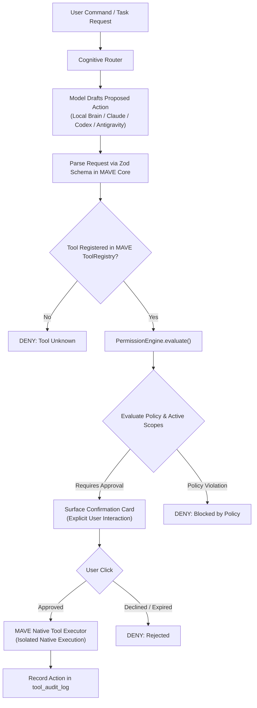

# MAVE Milestone 5: Pre-Implementation Architecture Review
## Final Reconciled Architecture Preparation & Security Readiness

**Status**: ARCHITECTURE PREPARATION RECONCILED โ€” IMPLEMENTATION BLOCKED UNTIL PRE-M5 AND F1.10 PASS
**Audit Baseline**: `09e97cf`
**Target Environment**: `C:\project\MAVE-f1.6`
**Implementation Authorization**: **STRICTLY BLOCKED** (`toolUse = false` remains enforced)

---

## 1. Executive Summary & Foundational Invariants

Milestone 5 defines MAVE's transition from an assistant that only "answers" into an AI assistant that can safely "execute approved real-world tasks" (file reading/editing, Git operations, authorized commands, and MCP tools).

However, intelligence alone must **NEVER** grant execution authority.

### Inviolable Safety Invariants:
1. **`LLM PROPOSAL != EXECUTION AUTHORITY`**: The model drafts proposed actions; MAVE's Permission Engine decides whether they execute.
2. **`INTELLIGENCE ESCALATION != TOOL PERMISSION`**: Selecting a frontier reasoning brain (Claude Code, Codex, Antigravity) grants cognitive bandwidth, zero host execution rights.
3. **`SIMILARITY != PERMISSION`**: High vector similarity to past verified fixes is diagnostic evidence, never authority to mutate state.
4. **`MCP != PERMISSION BYPASS`**: Model Context Protocol tools pass through the exact same Permission Engine as native tools.
5. **`SUBSCRIPTION ACCESS != TOOL AUTHORITY`**: Subscription CLI availability does not bypass MAVE policy.
6. **`Pre-M5 toolUse = false`**: All active providers and contracts enforce `toolUse: false`. Agent CLIs run in safe restricted modes.

---

## 2. Actual Agent Adapter Reality in Source Code

Inspection of the actual provider adapters in `packages/providers/src/brain/` confirms that each subscription runtime enforces fundamentally distinct, non-uniform CLI arguments, stdio configurations, and execution constraints:

```text
โ”Œโ”€โ”€โ”€โ”€โ”€โ”€โ”€โ”€โ”€โ”€โ”€โ”€โ”€โ”€โ”€โ”€โ”€โ”€โ”€โ”€โ”€โ”€โ”€โ”€โ”€โ”€โ”€โ”€โ”€โ”€โ”€โ”€โ”€โ”€โ”€โ”€โ”€โ”€โ”€โ”€โ”€โ”€โ”€โ”€โ”€โ”€โ”€โ”€โ”€โ”€โ”€โ”€โ”€โ”€โ”€โ”€โ”€โ”€โ”€โ”€โ”€โ”€โ”€โ”€โ”€โ”€โ”€โ”€โ”€โ”€โ”€โ”€โ”€โ”€โ”€โ”€โ”€โ”€โ”€โ”€โ”€โ”€โ”€โ”€โ”€โ”€โ”€โ”€โ”€โ”€โ”€โ”€โ”€โ”€โ”€โ”€โ”€โ”€โ”€โ”€โ”€โ”€โ”€โ”€โ”
โ”‚                                   ACTUAL PROVIDER ADAPTER REALITY                                      โ”‚
โ”œโ”€โ”€โ”€โ”€โ”€โ”€โ”€โ”€โ”€โ”€โ”€โ”€โ”€โ”€โ”€โ”€โ”€โ”€โ”€โ”€โ”ฌโ”€โ”€โ”€โ”€โ”€โ”€โ”€โ”€โ”€โ”€โ”€โ”€โ”€โ”€โ”€โ”€โ”€โ”€โ”€โ”€โ”€โ”€โ”€โ”€โ”€โ”€โ”€โ”€โ”€โ”€โ”€โ”€โ”€โ”€โ”€โ”€โ”€โ”€โ”ฌโ”€โ”€โ”€โ”€โ”€โ”€โ”€โ”€โ”€โ”€โ”€โ”€โ”€โ”€โ”€โ”€โ”€โ”€โ”€โ”€โ”€โ”€โ”ฌโ”€โ”€โ”€โ”€โ”€โ”€โ”€โ”€โ”€โ”€โ”€โ”€โ”€โ”€โ”€โ”€โ”€โ”€โ”€โ”€โ”€โ”ค
โ”‚ Provider Adapter   โ”‚ Exact CLI Arguments Enforced         โ”‚ Stdio Pipe Handling  โ”‚ Tool Handling Today โ”‚
โ”œโ”€โ”€โ”€โ”€โ”€โ”€โ”€โ”€โ”€โ”€โ”€โ”€โ”€โ”€โ”€โ”€โ”€โ”€โ”€โ”€โ”ผโ”€โ”€โ”€โ”€โ”€โ”€โ”€โ”€โ”€โ”€โ”€โ”€โ”€โ”€โ”€โ”€โ”€โ”€โ”€โ”€โ”€โ”€โ”€โ”€โ”€โ”€โ”€โ”€โ”€โ”€โ”€โ”€โ”€โ”€โ”€โ”€โ”€โ”€โ”ผโ”€โ”€โ”€โ”€โ”€โ”€โ”€โ”€โ”€โ”€โ”€โ”€โ”€โ”€โ”€โ”€โ”€โ”€โ”€โ”€โ”€โ”€โ”ผโ”€โ”€โ”€โ”€โ”€โ”€โ”€โ”€โ”€โ”€โ”€โ”€โ”€โ”€โ”€โ”€โ”€โ”€โ”€โ”€โ”€โ”ค
โ”‚ Claude Code        โ”‚ -p <prompt> --verbose                โ”‚ stdio:               โ”‚ Hard-coded          โ”‚
โ”‚ (claude.ts)        โ”‚ --tools "" --safe-mode               โ”‚ ['ignore','pipe',    โ”‚ --tools ""          โ”‚
โ”‚                    โ”‚ --disable-slash-commands             โ”‚  'pipe']             โ”‚ toolUse: false      โ”‚
โ”‚                    โ”‚ --strict-mcp-config                  โ”‚ Stdin closed/ignored โ”‚                     โ”‚
โ”‚                    โ”‚ --output-format stream-json          โ”‚                      โ”‚                     โ”‚
โ”œโ”€โ”€โ”€โ”€โ”€โ”€โ”€โ”€โ”€โ”€โ”€โ”€โ”€โ”€โ”€โ”€โ”€โ”€โ”€โ”€โ”ผโ”€โ”€โ”€โ”€โ”€โ”€โ”€โ”€โ”€โ”€โ”€โ”€โ”€โ”€โ”€โ”€โ”€โ”€โ”€โ”€โ”€โ”€โ”€โ”€โ”€โ”€โ”€โ”€โ”€โ”€โ”€โ”€โ”€โ”€โ”€โ”€โ”€โ”€โ”ผโ”€โ”€โ”€โ”€โ”€โ”€โ”€โ”€โ”€โ”€โ”€โ”€โ”€โ”€โ”€โ”€โ”€โ”€โ”€โ”€โ”€โ”€โ”ผโ”€โ”€โ”€โ”€โ”€โ”€โ”€โ”€โ”€โ”€โ”€โ”€โ”€โ”€โ”€โ”€โ”€โ”€โ”€โ”€โ”€โ”ค
โ”‚ OpenAI Codex       โ”‚ exec --json --ephemeral              โ”‚ stdio:               โ”‚ Hard-coded          โ”‚
โ”‚ (codex.ts)         โ”‚ --sandbox read-only                  โ”‚ ['pipe','pipe',      โ”‚ --sandbox read-only โ”‚
โ”‚                    โ”‚ --skip-git-repo-check                โ”‚  'pipe']             โ”‚ toolUse: false      โ”‚
โ”‚                    โ”‚ -m <model> -                         โ”‚ Prompt written;      โ”‚                     โ”‚
โ”‚                    โ”‚                                      โ”‚ stdin immediately ENDโ”‚                     โ”‚
โ”œโ”€โ”€โ”€โ”€โ”€โ”€โ”€โ”€โ”€โ”€โ”€โ”€โ”€โ”€โ”€โ”€โ”€โ”€โ”€โ”€โ”ผโ”€โ”€โ”€โ”€โ”€โ”€โ”€โ”€โ”€โ”€โ”€โ”€โ”€โ”€โ”€โ”€โ”€โ”€โ”€โ”€โ”€โ”€โ”€โ”€โ”€โ”€โ”€โ”€โ”€โ”€โ”€โ”€โ”€โ”€โ”€โ”€โ”€โ”€โ”ผโ”€โ”€โ”€โ”€โ”€โ”€โ”€โ”€โ”€โ”€โ”€โ”€โ”€โ”€โ”€โ”€โ”€โ”€โ”€โ”€โ”€โ”€โ”ผโ”€โ”€โ”€โ”€โ”€โ”€โ”€โ”€โ”€โ”€โ”€โ”€โ”€โ”€โ”€โ”€โ”€โ”€โ”€โ”€โ”€โ”ค
โ”‚ Google Antigravity โ”‚ --input-format stream-json           โ”‚ stdio:               โ”‚ Hard-coded          โ”‚
โ”‚ (antigravity.ts)   โ”‚ --output-format stream-json          โ”‚ ['pipe','pipe',      โ”‚ --sandbox           โ”‚
โ”‚                    โ”‚ --sandbox                            โ”‚  'pipe']             โ”‚ toolUse: false;     โ”‚
โ”‚                    โ”‚ --disable-slash-commands             โ”‚ Prompt written;      โ”‚ If step_type==tool, โ”‚
โ”‚                    โ”‚ --model <model>                      โ”‚ stdin immediately ENDโ”‚ KILLS process!      โ”‚
โ””โ”€โ”€โ”€โ”€โ”€โ”€โ”€โ”€โ”€โ”€โ”€โ”€โ”€โ”€โ”€โ”€โ”€โ”€โ”€โ”€โ”ดโ”€โ”€โ”€โ”€โ”€โ”€โ”€โ”€โ”€โ”€โ”€โ”€โ”€โ”€โ”€โ”€โ”€โ”€โ”€โ”€โ”€โ”€โ”€โ”€โ”€โ”€โ”€โ”€โ”€โ”€โ”€โ”€โ”€โ”€โ”€โ”€โ”€โ”€โ”ดโ”€โ”€โ”€โ”€โ”€โ”€โ”€โ”€โ”€โ”€โ”€โ”€โ”€โ”€โ”€โ”€โ”€โ”€โ”€โ”€โ”€โ”€โ”ดโ”€โ”€โ”€โ”€โ”€โ”€โ”€โ”€โ”€โ”€โ”€โ”€โ”€โ”€โ”€โ”€โ”€โ”€โ”€โ”€โ”€โ”ค
โ”‚ CLASSIFICATION     โ”‚ EXISTING IMPLEMENTATION              โ”‚ EXISTING             โ”‚ EXISTING            โ”‚
โ”‚                    โ”‚ (Source Truth in packages/providers) โ”‚ IMPLEMENTATION       โ”‚ IMPLEMENTATION      โ”‚
โ””โ”€โ”€โ”€โ”€โ”€โ”€โ”€โ”€โ”€โ”€โ”€โ”€โ”€โ”€โ”€โ”€โ”€โ”€โ”€โ”€โ”ดโ”€โ”€โ”€โ”€โ”€โ”€โ”€โ”€โ”€โ”€โ”€โ”€โ”€โ”€โ”€โ”€โ”€โ”€โ”€โ”€โ”€โ”€โ”€โ”€โ”€โ”€โ”€โ”€โ”€โ”€โ”€โ”€โ”€โ”€โ”€โ”€โ”€โ”€โ”ดโ”€โ”€โ”€โ”€โ”€โ”€โ”€โ”€โ”€โ”€โ”€โ”€โ”€โ”€โ”€โ”€โ”€โ”€โ”€โ”€โ”€โ”€โ”ดโ”€โ”€โ”€โ”€โ”€โ”€โ”€โ”€โ”€โ”€โ”€โ”€โ”€โ”€โ”€โ”€โ”€โ”€โ”€โ”€โ”€โ”˜
```

### Critical Finding: CLI Tool Brokering is UNVERIFIED
- **Source Inspection Proves**:
  1. `ClaudeCodeBrainProvider`: Stdin is ignored (`stdio: ['ignore', 'pipe', 'pipe']`). Prompt is passed via CLI flag (`-p`). There is zero stdin channel to return tool results.
  2. `CodexBrainProvider`: Stdin receives the prompt and is **immediately closed** (`child.stdin?.end()`). Codex cannot pause to wait for approval or receive results.
  3. `AntigravityBrainProvider`: Stdin receives NDJSON and is **immediately closed** (`child.stdin?.end()`). If `step_type === 'tool'` is detected on stdout, MAVE **immediately kills the child process** (`child.kill()`).
- **Policy Invariant**:
  $$\text{AGENT CLI TOOL BROKERING} = \text{\textbf{UNVERIFIED PROVIDER CAPABILITY}}$$
  MAVE must **NOT** attempt to broker tool execution through subscription CLIs in Milestone 5 MVP until an interactive, bidirectional pause-and-resume protocol is independently proven on the target CLI versions.

---

## 3. M5 MVP Native Execution Strategy

Rather than relying on unverified CLI tool interception, the Milestone 5 MVP must adopt a **MAVE-Owned Native Execution Architecture**:



### Strategic Rules:
1. **100% MAVE-Owned Tools**: The MVP executes only native tools authored within `@mave/core` (file read, git status, bounded file write, sandboxed test execution).
2. **CLIs Kept in Safe Mode**: Subscription CLIs continue to operate strictly as conversational reasoning / analytical planning engines with safe-mode flags intact.

---

## 4. Trusted Approval Contract & Anti-Spoofing Architecture

### Invariant: Speech and Model Claims Do Not Grant Authority
- **Voice is for Intent, Not Destructive Consent**: Spoken words, wake word triggers, acoustic confirmations, or spoken passphrases **NEVER** constitute trusted approval for Level 2 (External Side Effect) or Level 3 (Destructive) actions. Background audio, television noise, and acoustic misclassification create unacceptable risk.
- **Renderer / LLM Immunity**: An LLM stating *"The user approved this command in conversation"* is an untrusted string. An Electron renderer sending an IPC event without a cryptographically signed approval token is rejected.

### Cryptographic One-Time Approval Token:
Every interactive confirmation prompt generates an ephemeral in-memory `ApprovalRecord`:
```ts
export interface TrustedApprovalToken {
  readonly approvalId: string;       // Cryptographic UUID v4
  readonly taskId: string;           // Bound to specific Task
  readonly stepId: string;           // Bound to specific atomic Step (Anti-Replay)
  readonly toolId: string;           // Bound to exact Tool
  readonly targetHash: string;       // SHA256 of normalized target path/endpoint
  readonly argumentsHash: string;    // SHA256 of exact validated arguments
  readonly riskLevel: 0 | 1 | 2 | 3;
  readonly issuedAt: number;
  readonly expiresAt: number;        // Strict TTL (Default: 60,000ms)
  readonly consumed: boolean;        // Single-use guarantee
}
```

### Pre-Execution TOCTOU Revalidation:
Immediately before executing an approved tool:
1. Verify `now <= token.expiresAt`.
2. Verify `token.consumed === false`. Mark `token.consumed = true`.
3. Re-hash arguments and target path; assert `currentHash === token.argumentsHash`.
4. Re-run `PermissionEngine.evaluate()`. If filesystem permissions, project boundaries, or user policy changed between prompt display and button click, **FAIL CLOSED**.

---

## 5. Task Cancellation Ownership & Decoupling

Cancellation semantics must cleanly separate transient audio interactions from long-running engineering tasks:

```text
โ”Œโ”€โ”€โ”€โ”€โ”€โ”€โ”€โ”€โ”€โ”€โ”€โ”€โ”€โ”€โ”€โ”€โ”€โ”€โ”€โ”€โ”€โ”€โ”€โ”€โ”€โ”€โ”€โ”€โ”€โ”€โ”€โ”€โ”€โ”€โ”€โ”€โ”€โ”€โ”€โ”€โ”€โ”€โ”€โ”€โ”€โ”€โ”€โ”€โ”€โ”€โ”€โ”€โ”€โ”€โ”€โ”€โ”€โ”€โ”€โ”€โ”€โ”€โ”€โ”€โ”€โ”€โ”€โ”€โ”€โ”€โ”€โ”€โ”€โ”€โ”€โ”€โ”€โ”€โ”€โ”€โ”€โ”€โ”€โ”€โ”€โ”€โ”€โ”€โ”€โ”€โ”€โ”€โ”€โ”€โ”€โ”€โ”€โ”€โ”
โ”‚                                 CANCELLATION DECOUPLING TAXONOMY                                 โ”‚
โ”œโ”€โ”€โ”€โ”€โ”€โ”€โ”€โ”€โ”€โ”€โ”€โ”€โ”€โ”€โ”€โ”€โ”€โ”€โ”€โ”€โ”€โ”€โ”€โ”€โ”€โ”ฌโ”€โ”€โ”€โ”€โ”€โ”€โ”€โ”€โ”€โ”€โ”€โ”€โ”€โ”€โ”€โ”€โ”€โ”€โ”€โ”€โ”€โ”€โ”ฌโ”€โ”€โ”€โ”€โ”€โ”€โ”€โ”€โ”€โ”€โ”€โ”€โ”€โ”€โ”€โ”€โ”€โ”€โ”€โ”€โ”€โ”€โ”ฌโ”€โ”€โ”€โ”€โ”€โ”€โ”€โ”€โ”€โ”€โ”€โ”€โ”€โ”€โ”€โ”€โ”€โ”€โ”€โ”€โ”€โ”€โ”€โ”€โ”€โ”€โ”ค
โ”‚ Event Trigger           โ”‚ Subsystem Affected   โ”‚ System Reaction      โ”‚ Impact on Active Task    โ”‚
โ”œโ”€โ”€โ”€โ”€โ”€โ”€โ”€โ”€โ”€โ”€โ”€โ”€โ”€โ”€โ”€โ”€โ”€โ”€โ”€โ”€โ”€โ”€โ”€โ”€โ”€โ”ผโ”€โ”€โ”€โ”€โ”€โ”€โ”€โ”€โ”€โ”€โ”€โ”€โ”€โ”€โ”€โ”€โ”€โ”€โ”€โ”€โ”€โ”€โ”ผโ”€โ”€โ”€โ”€โ”€โ”€โ”€โ”€โ”€โ”€โ”€โ”€โ”€โ”€โ”€โ”€โ”€โ”€โ”€โ”€โ”€โ”€โ”ผโ”€โ”€โ”€โ”€โ”€โ”€โ”€โ”€โ”€โ”€โ”€โ”€โ”€โ”€โ”€โ”€โ”€โ”€โ”€โ”€โ”€โ”€โ”€โ”€โ”€โ”€โ”ค
โ”‚ Voice Barge-In          โ”‚ Audio Output / TTS   โ”‚ Halts speaker buffer โ”‚ ZERO IMPACT. Task        โ”‚
โ”‚ (User speaks over TTS)  โ”‚ Edge-TTS chunker     โ”‚ immediately.         โ”‚ continues running.       โ”‚
โ”œโ”€โ”€โ”€โ”€โ”€โ”€โ”€โ”€โ”€โ”€โ”€โ”€โ”€โ”€โ”€โ”€โ”€โ”€โ”€โ”€โ”€โ”€โ”€โ”€โ”€โ”ผโ”€โ”€โ”€โ”€โ”€โ”€โ”€โ”€โ”€โ”€โ”€โ”€โ”€โ”€โ”€โ”€โ”€โ”€โ”€โ”€โ”€โ”€โ”ผโ”€โ”€โ”€โ”€โ”€โ”€โ”€โ”€โ”€โ”€โ”€โ”€โ”€โ”€โ”€โ”€โ”€โ”€โ”€โ”€โ”€โ”€โ”ผโ”€โ”€โ”€โ”€โ”€โ”€โ”€โ”€โ”€โ”€โ”€โ”€โ”€โ”€โ”€โ”€โ”€โ”€โ”€โ”€โ”€โ”€โ”€โ”€โ”€โ”€โ”ค
โ”‚ Spoken "MAVE Sleep"     โ”‚ Interaction Surface  โ”‚ Returns Surface to   โ”‚ ZERO IMPACT. Background  โ”‚
โ”‚                         โ”‚ Assistant state      โ”‚ ambient/capsule mode.โ”‚ task runs in background. โ”‚
โ”œโ”€โ”€โ”€โ”€โ”€โ”€โ”€โ”€โ”€โ”€โ”€โ”€โ”€โ”€โ”€โ”€โ”€โ”€โ”€โ”€โ”€โ”€โ”€โ”€โ”€โ”ผโ”€โ”€โ”€โ”€โ”€โ”€โ”€โ”€โ”€โ”€โ”€โ”€โ”€โ”€โ”€โ”€โ”€โ”€โ”€โ”€โ”€โ”€โ”ผโ”€โ”€โ”€โ”€โ”€โ”€โ”€โ”€โ”€โ”€โ”€โ”€โ”€โ”€โ”€โ”€โ”€โ”€โ”€โ”€โ”€โ”€โ”ผโ”€โ”€โ”€โ”€โ”€โ”€โ”€โ”€โ”€โ”€โ”€โ”€โ”€โ”€โ”€โ”€โ”€โ”€โ”€โ”€โ”€โ”€โ”€โ”€โ”€โ”€โ”ค
โ”‚ Step Timeout            โ”‚ Active Tool Step     โ”‚ Kills child process  โ”‚ Step marked TimedOut;    โ”‚
โ”‚ (timeoutMs exceeded)    โ”‚ Tool worker          โ”‚ via SIGTERM/SIGKILL. โ”‚ Task transitions Failed. โ”‚
โ”œโ”€โ”€โ”€โ”€โ”€โ”€โ”€โ”€โ”€โ”€โ”€โ”€โ”€โ”€โ”€โ”€โ”€โ”€โ”€โ”€โ”€โ”€โ”€โ”€โ”€โ”ผโ”€โ”€โ”€โ”€โ”€โ”€โ”€โ”€โ”€โ”€โ”€โ”€โ”€โ”€โ”€โ”€โ”€โ”€โ”€โ”€โ”€โ”€โ”ผโ”€โ”€โ”€โ”€โ”€โ”€โ”€โ”€โ”€โ”€โ”€โ”€โ”€โ”€โ”€โ”€โ”€โ”€โ”€โ”€โ”€โ”€โ”ผโ”€โ”€โ”€โ”€โ”€โ”€โ”€โ”€โ”€โ”€โ”€โ”€โ”€โ”€โ”€โ”€โ”€โ”€โ”€โ”€โ”€โ”€โ”€โ”€โ”€โ”€โ”ค
โ”‚ Explicit Task Cancel    โ”‚ Task Orchestrator    โ”‚ AbortSignal fired;   โ”‚ Task state set to        โ”‚
โ”‚ ("Cancel Task" in UI)   โ”‚ Active processes     โ”‚ all workers killed.  โ”‚ Cancelled immediately.   โ”‚
โ”œโ”€โ”€โ”€โ”€โ”€โ”€โ”€โ”€โ”€โ”€โ”€โ”€โ”€โ”€โ”€โ”€โ”€โ”€โ”€โ”€โ”€โ”€โ”€โ”€โ”€โ”ผโ”€โ”€โ”€โ”€โ”€โ”€โ”€โ”€โ”€โ”€โ”€โ”€โ”€โ”€โ”€โ”€โ”€โ”€โ”€โ”€โ”€โ”€โ”ผโ”€โ”€โ”€โ”€โ”€โ”€โ”€โ”€โ”€โ”€โ”€โ”€โ”€โ”€โ”€โ”€โ”€โ”€โ”€โ”€โ”€โ”€โ”ผโ”€โ”€โ”€โ”€โ”€โ”€โ”€โ”€โ”€โ”€โ”€โ”€โ”€โ”€โ”€โ”€โ”€โ”€โ”€โ”€โ”€โ”€โ”€โ”€โ”€โ”€โ”ค
โ”‚ App Shutdown / Quit     โ”‚ Entire Application   โ”‚ Graceful teardown;   โ”‚ Stored as Cancelled in   โ”‚
โ”‚                         โ”‚ Electron Main        โ”‚ processes reaped.    โ”‚ SQLite on restart.       โ”‚
โ””โ”€โ”€โ”€โ”€โ”€โ”€โ”€โ”€โ”€โ”€โ”€โ”€โ”€โ”€โ”€โ”€โ”€โ”€โ”€โ”€โ”€โ”€โ”€โ”€โ”€โ”ดโ”€โ”€โ”€โ”€โ”€โ”€โ”€โ”€โ”€โ”€โ”€โ”€โ”€โ”€โ”€โ”€โ”€โ”€โ”€โ”€โ”€โ”€โ”ดโ”€โ”€โ”€โ”€โ”€โ”€โ”€โ”€โ”€โ”€โ”€โ”€โ”€โ”€โ”€โ”€โ”€โ”€โ”€โ”€โ”€โ”€โ”ดโ”€โ”€โ”€โ”€โ”€โ”€โ”€โ”€โ”€โ”€โ”€โ”€โ”€โ”€โ”€โ”€โ”€โ”€โ”€โ”€โ”€โ”€โ”€โ”€โ”€โ”€โ”˜
```

> [!IMPORTANT]
> **Barge-in Invariant**: Acoustic barge-in is a conversational interrupt. It must **NEVER** silently terminate an active multi-step file refactor, compilation, or test run. Only an explicit task cancellation action from the user or task timeout can terminate an engineering task.

---

## 6. Audit Trail & Conceptual Outcomes

The Tool Audit Log records all execution attempts, approvals, and security denials:

### Conceptual Audit Outcomes:
- `ALLOW`: Pre-cleared by policy and scope; executed directly.
- `ASK`: Action submitted to interactive user approval.
- `DENY`: Action blocked by static policy, out-of-scope path, or security rule.
- `USER_APPROVED`: User clicked confirm on Surface Approval Card.
- `USER_REJECTED`: User clicked cancel or dismissed approval prompt.
- `APPROVAL_EXPIRED`: User did not respond within TTL (default: 60s); failed closed.
- `EXECUTED`: Tool completed with valid output.
- `FAILED`: Tool executed but returned non-zero exit code or threw exception.
- `CANCELLED`: Execution halted mid-run by user cancellation.
- `TIMED_OUT`: Execution exceeded `timeoutMs` and was terminated.

### Privacy & Redaction Boundaries:
- **Never Log Raw Prompts**: Audit records log the `toolId` and normalized arguments, never the userโ€™s conversational turn history or model CoT reasoning.
- **Mandatory Secret Scrubbing**: All argument records pass through MAVEโ€™s regex redaction filter (`apiKey`, `token`, `secret`, `password`, `bearer`, `.env` values $\to$ `[REDACTED]`).
- **Audit Denials**: All blocked attempts and rejected approvals must be audited, not just successful completions.

---

## 7. MCP Security & File/Terminal Safety Realities

1. **MCP Server Startup is a Trust Decision**: Launching an MCP server spawns a local process with ambient OS privileges. Intercepting JSON-RPC messages **does NOT** sandbox the MCP server's internal process execution. MCP server startup requires explicit user authorization.
2. **The Fallacy of "Safe" Test Execution**: Running `pnpm test` executes arbitrary code (`package.json` scripts, test fixtures). In Milestone 5 MVP, running test commands must be treated as **Level 1/2 Safe Local Action with Explicit Pre-Clearance**, requiring project-level user consent.
3. **Windows Filesystem Traversal Pitfalls**: Standard string path checks fail against NTFS Alternate Data Streams, 8.3 filenames, directory junctions, and case insensitivity. Target paths must be resolved via `fs.realpathSync()` and validated strictly within the canonical project root. Files matching `.env*`, `*.pem`, `id_rsa*`, or `.git/config` are hard-blocked.

---

## 8. Corrected Deterministic Test Matrix (M5 Planning Targets)

```text
โ”Œโ”€โ”€โ”€โ”€โ”€โ”€โ”€โ”€โ”€โ”€โ”€โ”€โ”€โ”€โ”€โ”€โ”€โ”€โ”€โ”€โ”€โ”€โ”€โ”€โ”€โ”€โ”€โ”€โ”€โ”€โ”€โ”€โ”€โ”€โ”€โ”€โ”€โ”€โ”€โ”€โ”€โ”€โ”€โ”€โ”€โ”€โ”€โ”€โ”€โ”€โ”€โ”€โ”€โ”€โ”€โ”€โ”€โ”€โ”€โ”€โ”€โ”€โ”€โ”€โ”€โ”€โ”€โ”€โ”€โ”€โ”€โ”€โ”€โ”€โ”€โ”€โ”€โ”€โ”€โ”€โ”€โ”€โ”€โ”€โ”€โ”€โ”€โ”€โ”€โ”€โ”€โ”€โ”€โ”€โ”€โ”€โ”€โ”€โ”€โ”€โ”€โ”€โ”€โ”€โ”
โ”‚                              CORRECTED M5 DETERMINISTIC TEST MATRIX                                    โ”‚
โ”œโ”€โ”€โ”€โ”€โ”€โ”€โ”€โ”€โ”€โ”€โ”€โ”€โ”€โ”€โ”ฌโ”€โ”€โ”€โ”€โ”€โ”€โ”€โ”€โ”€โ”€โ”€โ”€โ”€โ”€โ”€โ”€โ”€โ”€โ”€โ”€โ”€โ”€โ”€โ”€โ”€โ”€โ”€โ”€โ”€โ”€โ”€โ”€โ”€โ”€โ”€โ”€โ”ฌโ”€โ”€โ”€โ”€โ”€โ”€โ”€โ”€โ”€โ”€โ”€โ”€โ”€โ”€โ”€โ”€โ”€โ”€โ”€โ”€โ”€โ”€โ”€โ”€โ”€โ”€โ”€โ”€โ”€โ”€โ”€โ”€โ”€โ”€โ”€โ”€โ”€โ”€โ”€โ”€โ”€โ”€โ”€โ”€โ”€โ”€โ”€โ”€โ”€โ”€โ”€โ”€โ”ค
โ”‚ Test ID      โ”‚ Target Safety Invariant            โ”‚ Concrete Verification Method                       โ”‚
โ”œโ”€โ”€โ”€โ”€โ”€โ”€โ”€โ”€โ”€โ”€โ”€โ”€โ”€โ”€โ”ผโ”€โ”€โ”€โ”€โ”€โ”€โ”€โ”€โ”€โ”€โ”€โ”€โ”€โ”€โ”€โ”€โ”€โ”€โ”€โ”€โ”€โ”€โ”€โ”€โ”€โ”€โ”€โ”€โ”€โ”€โ”€โ”€โ”€โ”€โ”€โ”€โ”ผโ”€โ”€โ”€โ”€โ”€โ”€โ”€โ”€โ”€โ”€โ”€โ”€โ”€โ”€โ”€โ”€โ”€โ”€โ”€โ”€โ”€โ”€โ”€โ”€โ”€โ”€โ”€โ”€โ”€โ”€โ”€โ”€โ”€โ”€โ”€โ”€โ”€โ”€โ”€โ”€โ”€โ”€โ”€โ”€โ”€โ”€โ”€โ”€โ”€โ”€โ”€โ”€โ”ค
โ”‚ TEST-M5-01   โ”‚ Pre-M5 toolUse Frozen              โ”‚ Assert BrainCapabilitiesSchema defaults to false;  โ”‚
โ”‚              โ”‚                                    โ”‚ assert active provider instances have toolUse:falseโ”‚
โ”œโ”€โ”€โ”€โ”€โ”€โ”€โ”€โ”€โ”€โ”€โ”€โ”€โ”€โ”€โ”ผโ”€โ”€โ”€โ”€โ”€โ”€โ”€โ”€โ”€โ”€โ”€โ”€โ”€โ”€โ”€โ”€โ”€โ”€โ”€โ”€โ”€โ”€โ”€โ”€โ”€โ”€โ”€โ”€โ”€โ”€โ”€โ”€โ”€โ”€โ”€โ”€โ”ผโ”€โ”€โ”€โ”€โ”€โ”€โ”€โ”€โ”€โ”€โ”€โ”€โ”€โ”€โ”€โ”€โ”€โ”€โ”€โ”€โ”€โ”€โ”€โ”€โ”€โ”€โ”€โ”€โ”€โ”€โ”€โ”€โ”€โ”€โ”€โ”€โ”€โ”€โ”€โ”€โ”€โ”€โ”€โ”€โ”€โ”€โ”€โ”€โ”€โ”€โ”€โ”€โ”ค
โ”‚ TEST-M5-13A  โ”‚ Claude Code Safe-Mode Isolation    โ”‚ Inspect spawnFactory calls; assert args contain    โ”‚
โ”‚              โ”‚                                    โ”‚ --tools "" and --safe-mode; assert stdin: 'ignore' โ”‚
โ”œโ”€โ”€โ”€โ”€โ”€โ”€โ”€โ”€โ”€โ”€โ”€โ”€โ”€โ”€โ”ผโ”€โ”€โ”€โ”€โ”€โ”€โ”€โ”€โ”€โ”€โ”€โ”€โ”€โ”€โ”€โ”€โ”€โ”€โ”€โ”€โ”€โ”€โ”€โ”€โ”€โ”€โ”€โ”€โ”€โ”€โ”€โ”€โ”€โ”€โ”€โ”€โ”ผโ”€โ”€โ”€โ”€โ”€โ”€โ”€โ”€โ”€โ”€โ”€โ”€โ”€โ”€โ”€โ”€โ”€โ”€โ”€โ”€โ”€โ”€โ”€โ”€โ”€โ”€โ”€โ”€โ”€โ”€โ”€โ”€โ”€โ”€โ”€โ”€โ”€โ”€โ”€โ”€โ”€โ”€โ”€โ”€โ”€โ”€โ”€โ”€โ”€โ”€โ”€โ”€โ”ค
โ”‚ TEST-M5-13B  โ”‚ OpenAI Codex Read-Only Sandbox     โ”‚ Inspect spawn args; assert exec --sandbox read-onlyโ”‚
โ”‚              โ”‚                                    โ”‚ and --ephemeral; assert stdin ended after prompt.  โ”‚
โ”œโ”€โ”€โ”€โ”€โ”€โ”€โ”€โ”€โ”€โ”€โ”€โ”€โ”€โ”€โ”ผโ”€โ”€โ”€โ”€โ”€โ”€โ”€โ”€โ”€โ”€โ”€โ”€โ”€โ”€โ”€โ”€โ”€โ”€โ”€โ”€โ”€โ”€โ”€โ”€โ”€โ”€โ”€โ”€โ”€โ”€โ”€โ”€โ”€โ”€โ”€โ”€โ”ผโ”€โ”€โ”€โ”€โ”€โ”€โ”€โ”€โ”€โ”€โ”€โ”€โ”€โ”€โ”€โ”€โ”€โ”€โ”€โ”€โ”€โ”€โ”€โ”€โ”€โ”€โ”€โ”€โ”€โ”€โ”€โ”€โ”€โ”€โ”€โ”€โ”€โ”€โ”€โ”€โ”€โ”€โ”€โ”€โ”€โ”€โ”€โ”€โ”€โ”€โ”€โ”€โ”ค
โ”‚ TEST-M5-13C  โ”‚ Antigravity Tool Kill Invariant    โ”‚ Simulate step_update with step_type: 'tool';       โ”‚
โ”‚              โ”‚                                    โ”‚ assert provider kills child process immediately.   โ”‚
โ”œโ”€โ”€โ”€โ”€โ”€โ”€โ”€โ”€โ”€โ”€โ”€โ”€โ”€โ”€โ”ผโ”€โ”€โ”€โ”€โ”€โ”€โ”€โ”€โ”€โ”€โ”€โ”€โ”€โ”€โ”€โ”€โ”€โ”€โ”€โ”€โ”€โ”€โ”€โ”€โ”€โ”€โ”€โ”€โ”€โ”€โ”€โ”€โ”€โ”€โ”€โ”€โ”ผโ”€โ”€โ”€โ”€โ”€โ”€โ”€โ”€โ”€โ”€โ”€โ”€โ”€โ”€โ”€โ”€โ”€โ”€โ”€โ”€โ”€โ”€โ”€โ”€โ”€โ”€โ”€โ”€โ”€โ”€โ”€โ”€โ”€โ”€โ”€โ”€โ”€โ”€โ”€โ”€โ”€โ”€โ”€โ”€โ”€โ”€โ”€โ”€โ”€โ”€โ”€โ”€โ”ค
โ”‚ TEST-M5-22   โ”‚ Forged Approval Claim Rejection    โ”‚ Model outputs "User authorized this in chat";      โ”‚
โ”‚              โ”‚                                    โ”‚ assert PermissionEngine rejects without valid tokenโ”‚
โ”œโ”€โ”€โ”€โ”€โ”€โ”€โ”€โ”€โ”€โ”€โ”€โ”€โ”€โ”€โ”ผโ”€โ”€โ”€โ”€โ”€โ”€โ”€โ”€โ”€โ”€โ”€โ”€โ”€โ”€โ”€โ”€โ”€โ”€โ”€โ”€โ”€โ”€โ”€โ”€โ”€โ”€โ”€โ”€โ”€โ”€โ”€โ”€โ”€โ”€โ”€โ”€โ”ผโ”€โ”€โ”€โ”€โ”€โ”€โ”€โ”€โ”€โ”€โ”€โ”€โ”€โ”€โ”€โ”€โ”€โ”€โ”€โ”€โ”€โ”€โ”€โ”€โ”€โ”€โ”€โ”€โ”€โ”€โ”€โ”€โ”€โ”€โ”€โ”€โ”€โ”€โ”€โ”€โ”€โ”€โ”€โ”€โ”€โ”€โ”€โ”€โ”€โ”€โ”€โ”€โ”ค
โ”‚ TEST-M5-23   โ”‚ Replayed Approval Token Rejection  โ”‚ Present consumed approvalId; assert Permission-    โ”‚
โ”‚              โ”‚                                    โ”‚ Engine throws ApprovalTokenAlreadyConsumed error.  โ”‚
โ”œโ”€โ”€โ”€โ”€โ”€โ”€โ”€โ”€โ”€โ”€โ”€โ”€โ”€โ”€โ”ผโ”€โ”€โ”€โ”€โ”€โ”€โ”€โ”€โ”€โ”€โ”€โ”€โ”€โ”€โ”€โ”€โ”€โ”€โ”€โ”€โ”€โ”€โ”€โ”€โ”€โ”€โ”€โ”€โ”€โ”€โ”€โ”€โ”€โ”€โ”€โ”€โ”ผโ”€โ”€โ”€โ”€โ”€โ”€โ”€โ”€โ”€โ”€โ”€โ”€โ”€โ”€โ”€โ”€โ”€โ”€โ”€โ”€โ”€โ”€โ”€โ”€โ”€โ”€โ”€โ”€โ”€โ”€โ”€โ”€โ”€โ”€โ”€โ”€โ”€โ”€โ”€โ”€โ”€โ”€โ”€โ”€โ”€โ”€โ”€โ”€โ”€โ”€โ”€โ”€โ”ค
โ”‚ TEST-M5-24   โ”‚ Changed Tool Argument Invalidation โ”‚ Mutate target path after approval token issued;    โ”‚
โ”‚              โ”‚                                    โ”‚ assert TOCTOU check fails argument hash match.     โ”‚
โ”œโ”€โ”€โ”€โ”€โ”€โ”€โ”€โ”€โ”€โ”€โ”€โ”€โ”€โ”€โ”ผโ”€โ”€โ”€โ”€โ”€โ”€โ”€โ”€โ”€โ”€โ”€โ”€โ”€โ”€โ”€โ”€โ”€โ”€โ”€โ”€โ”€โ”€โ”€โ”€โ”€โ”€โ”€โ”€โ”€โ”€โ”€โ”€โ”€โ”€โ”€โ”€โ”ผโ”€โ”€โ”€โ”€โ”€โ”€โ”€โ”€โ”€โ”€โ”€โ”€โ”€โ”€โ”€โ”€โ”€โ”€โ”€โ”€โ”€โ”€โ”€โ”€โ”€โ”€โ”€โ”€โ”€โ”€โ”€โ”€โ”€โ”€โ”€โ”€โ”€โ”€โ”€โ”€โ”€โ”€โ”€โ”€โ”€โ”€โ”€โ”€โ”€โ”€โ”€โ”€โ”ค
โ”‚ TEST-M5-25   โ”‚ Expired Approval Rejection         โ”‚ Mock clock +65s past expiresAt; assert token deniedโ”‚
โ”œโ”€โ”€โ”€โ”€โ”€โ”€โ”€โ”€โ”€โ”€โ”€โ”€โ”€โ”€โ”ผโ”€โ”€โ”€โ”€โ”€โ”€โ”€โ”€โ”€โ”€โ”€โ”€โ”€โ”€โ”€โ”€โ”€โ”€โ”€โ”€โ”€โ”€โ”€โ”€โ”€โ”€โ”€โ”€โ”€โ”€โ”€โ”€โ”€โ”€โ”€โ”€โ”ผโ”€โ”€โ”€โ”€โ”€โ”€โ”€โ”€โ”€โ”€โ”€โ”€โ”€โ”€โ”€โ”€โ”€โ”€โ”€โ”€โ”€โ”€โ”€โ”€โ”€โ”€โ”€โ”€โ”€โ”€โ”€โ”€โ”€โ”€โ”€โ”€โ”€โ”€โ”€โ”€โ”€โ”€โ”€โ”€โ”€โ”€โ”€โ”€โ”€โ”€โ”€โ”€โ”ค
โ”‚ TEST-M5-26   โ”‚ Barge-In Does Not Cancel Task      โ”‚ Emit voice barge-in event while task is Running;   โ”‚
โ”‚              โ”‚                                    โ”‚ assert active task state remains Running.          โ”‚
โ”œโ”€โ”€โ”€โ”€โ”€โ”€โ”€โ”€โ”€โ”€โ”€โ”€โ”€โ”€โ”ผโ”€โ”€โ”€โ”€โ”€โ”€โ”€โ”€โ”€โ”€โ”€โ”€โ”€โ”€โ”€โ”€โ”€โ”€โ”€โ”€โ”€โ”€โ”€โ”€โ”€โ”€โ”€โ”€โ”€โ”€โ”€โ”€โ”€โ”€โ”€โ”€โ”ผโ”€โ”€โ”€โ”€โ”€โ”€โ”€โ”€โ”€โ”€โ”€โ”€โ”€โ”€โ”€โ”€โ”€โ”€โ”€โ”€โ”€โ”€โ”€โ”€โ”€โ”€โ”€โ”€โ”€โ”€โ”€โ”€โ”€โ”€โ”€โ”€โ”€โ”€โ”€โ”€โ”€โ”€โ”€โ”€โ”€โ”€โ”€โ”€โ”€โ”€โ”€โ”€โ”ค
โ”‚ TEST-M5-27   โ”‚ Denied Request Audit Logging       โ”‚ Submit unauthorized Level 3 request; verify        โ”‚
โ”‚              โ”‚                                    โ”‚ DENIED entry is persisted to tool_audit_log.       โ”‚
โ”œโ”€โ”€โ”€โ”€โ”€โ”€โ”€โ”€โ”€โ”€โ”€โ”€โ”€โ”€โ”ผโ”€โ”€โ”€โ”€โ”€โ”€โ”€โ”€โ”€โ”€โ”€โ”€โ”€โ”€โ”€โ”€โ”€โ”€โ”€โ”€โ”€โ”€โ”€โ”€โ”€โ”€โ”€โ”€โ”€โ”€โ”€โ”€โ”€โ”€โ”€โ”€โ”ผโ”€โ”€โ”€โ”€โ”€โ”€โ”€โ”€โ”€โ”€โ”€โ”€โ”€โ”€โ”€โ”€โ”€โ”€โ”€โ”€โ”€โ”€โ”€โ”€โ”€โ”€โ”€โ”€โ”€โ”€โ”€โ”€โ”€โ”€โ”€โ”€โ”€โ”€โ”€โ”€โ”€โ”€โ”€โ”€โ”€โ”€โ”€โ”€โ”€โ”€โ”€โ”€โ”ค
โ”‚ TEST-M5-28   โ”‚ Untrusted Test Script Quarantine   โ”‚ Attempt terminal.run_tests with modified pretest;  โ”‚
โ”‚              โ”‚                                    โ”‚ assert execution blocked pending explicit consent. โ”‚
โ””โ”€โ”€โ”€โ”€โ”€โ”€โ”€โ”€โ”€โ”€โ”€โ”€โ”€โ”€โ”ดโ”€โ”€โ”€โ”€โ”€โ”€โ”€โ”€โ”€โ”€โ”€โ”€โ”€โ”€โ”€โ”€โ”€โ”€โ”€โ”€โ”€โ”€โ”€โ”€โ”€โ”€โ”€โ”€โ”€โ”€โ”€โ”€โ”€โ”€โ”€โ”€โ”ดโ”€โ”€โ”€โ”€โ”€โ”€โ”€โ”€โ”€โ”€โ”€โ”€โ”€โ”€โ”€โ”€โ”€โ”€โ”€โ”€โ”€โ”€โ”€โ”€โ”€โ”€โ”€โ”€โ”€โ”€โ”€โ”€โ”€โ”€โ”€โ”€โ”€โ”€โ”€โ”€โ”€โ”€โ”€โ”€โ”€โ”€โ”€โ”€โ”€โ”€โ”€โ”€โ”˜
```

---

## 9. Comprehensive Architectural Classification Matrix

```text
โ”Œโ”€โ”€โ”€โ”€โ”€โ”€โ”€โ”€โ”€โ”€โ”€โ”€โ”€โ”€โ”€โ”€โ”€โ”€โ”€โ”€โ”€โ”€โ”€โ”€โ”€โ”€โ”€โ”€โ”€โ”€โ”€โ”€โ”€โ”€โ”€โ”€โ”€โ”€โ”€โ”€โ”€โ”€โ”€โ”€โ”€โ”€โ”€โ”€โ”€โ”€โ”€โ”€โ”€โ”€โ”€โ”€โ”€โ”€โ”€โ”€โ”€โ”€โ”€โ”€โ”€โ”€โ”€โ”€โ”€โ”€โ”€โ”€โ”€โ”€โ”€โ”€โ”€โ”€โ”€โ”€โ”€โ”€โ”€โ”€โ”€โ”€โ”€โ”€โ”€โ”€โ”€โ”€โ”€โ”€โ”€โ”€โ”€โ”€โ”€โ”€โ”€โ”€โ”€โ”€โ”
โ”‚                              ARCHITECTURAL STATUS CLASSIFICATION SUMMARY                               โ”‚
โ”œโ”€โ”€โ”€โ”€โ”€โ”€โ”€โ”€โ”€โ”€โ”€โ”€โ”€โ”€โ”€โ”€โ”€โ”€โ”€โ”€โ”€โ”€โ”€โ”€โ”€โ”€โ”€โ”€โ”€โ”€โ”€โ”€โ”€โ”€โ”€โ”€โ”€โ”€โ”€โ”€โ”€โ”ฌโ”€โ”€โ”€โ”€โ”€โ”€โ”€โ”€โ”€โ”€โ”€โ”€โ”€โ”€โ”€โ”€โ”€โ”€โ”€โ”€โ”€โ”€โ”€โ”€โ”€โ”€โ”€โ”€โ”€โ”€โ”€โ”€โ”€โ”€โ”€โ”ฌโ”€โ”€โ”€โ”€โ”€โ”€โ”€โ”€โ”€โ”€โ”€โ”€โ”€โ”€โ”€โ”€โ”€โ”€โ”€โ”€โ”€โ”€โ”€โ”€โ”€โ”€โ”ค
โ”‚ Architectural Element                   โ”‚ Current Documented / Source Statusโ”‚ Classification Category  โ”‚
โ”œโ”€โ”€โ”€โ”€โ”€โ”€โ”€โ”€โ”€โ”€โ”€โ”€โ”€โ”€โ”€โ”€โ”€โ”€โ”€โ”€โ”€โ”€โ”€โ”€โ”€โ”€โ”€โ”€โ”€โ”€โ”€โ”€โ”€โ”€โ”€โ”€โ”€โ”€โ”€โ”€โ”€โ”ผโ”€โ”€โ”€โ”€โ”€โ”€โ”€โ”€โ”€โ”€โ”€โ”€โ”€โ”€โ”€โ”€โ”€โ”€โ”€โ”€โ”€โ”€โ”€โ”€โ”€โ”€โ”€โ”€โ”€โ”€โ”€โ”€โ”€โ”€โ”€โ”ผโ”€โ”€โ”€โ”€โ”€โ”€โ”€โ”€โ”€โ”€โ”€โ”€โ”€โ”€โ”€โ”€โ”€โ”€โ”€โ”€โ”€โ”€โ”€โ”€โ”€โ”€โ”ค
โ”‚ toolUse: false in BrainCapabilities     โ”‚ packages/contracts/src/brain.ts   โ”‚ EXISTING IMPLEMENTATION  โ”‚
โ”‚ Claude --tools "" & stdin: 'ignore'     โ”‚ packages/providers/.../claude.ts  โ”‚ EXISTING IMPLEMENTATION  โ”‚
โ”‚ Codex --sandbox read-only & stdin.end() โ”‚ packages/providers/.../codex.ts   โ”‚ EXISTING IMPLEMENTATION  โ”‚
โ”‚ Antigravity process kill on tool step   โ”‚ packages/providers/.../antigrav.tsโ”‚ EXISTING IMPLEMENTATION  โ”‚
โ”‚ Risk Levels 0, 1, 2, 3 Taxonomy         โ”‚ MAVE_TOOL_AND_PERMISSION_MODEL.md โ”‚ DOCUMENTED ARCHITECTURE  โ”‚
โ”‚ Permission Scopes (once, session, etc.) โ”‚ MAVE_TOOL_AND_PERMISSION_MODEL.md โ”‚ DOCUMENTED ARCHITECTURE  โ”‚
โ”‚ Task Lifecycle States                   โ”‚ MAVE_SYSTEM_ARCHITECTURE.md       โ”‚ DOCUMENTED ARCHITECTURE  โ”‚
โ”‚ Invariant: LLM Proposal != Authority    โ”‚ MAVE_TOOL_AND_PERMISSION_MODEL.md โ”‚ DOCUMENTED ARCHITECTURE  โ”‚
โ”‚ Invariant: Similarity != Permission     โ”‚ MAVE_INTELLIGENCE_ESCALATION.md   โ”‚ DOCUMENTED ARCHITECTURE  โ”‚
โ”‚ Concrete ToolRegistry TypeScript Class  โ”‚ None in codebase                  โ”‚ PROPOSED DESIGN          โ”‚
โ”‚ Concrete PermissionEngine Class         โ”‚ None in codebase                  โ”‚ PROPOSED DESIGN          โ”‚
โ”‚ Concrete TaskOrchestrator Class         โ”‚ None in codebase                  โ”‚ PROPOSED DESIGN          โ”‚
โ”‚ SQLite tool_audit_log Table             โ”‚ None in codebase                  โ”‚ PROPOSED DESIGN          โ”‚
โ”‚ Cryptographic Approval Tokens           โ”‚ None in codebase                  โ”‚ PROPOSED DESIGN          โ”‚
โ”‚ Agent CLI Interactive Tool Brokering    โ”‚ None supported by current adaptersโ”‚ UNVERIFIED PROVIDER      โ”‚
โ”‚                                         โ”‚                                   โ”‚ CAPABILITY               โ”‚
โ”‚ Home PC Diagnostics HEAD (327318a)      โ”‚ C:\project\MAVE-f1.6              โ”‚ PENDING HOME SOURCE      โ”‚
โ”‚                                         โ”‚                                   โ”‚ INSPECTION               โ”‚
โ””โ”€โ”€โ”€โ”€โ”€โ”€โ”€โ”€โ”€โ”€โ”€โ”€โ”€โ”€โ”€โ”€โ”€โ”€โ”€โ”€โ”€โ”€โ”€โ”€โ”€โ”€โ”€โ”€โ”€โ”€โ”€โ”€โ”€โ”€โ”€โ”€โ”€โ”€โ”€โ”€โ”€โ”ดโ”€โ”€โ”€โ”€โ”€โ”€โ”€โ”€โ”€โ”€โ”€โ”€โ”€โ”€โ”€โ”€โ”€โ”€โ”€โ”€โ”€โ”€โ”€โ”€โ”€โ”€โ”€โ”€โ”€โ”€โ”€โ”€โ”€โ”€โ”€โ”ดโ”€โ”€โ”€โ”€โ”€โ”€โ”€โ”€โ”€โ”€โ”€โ”€โ”€โ”€โ”€โ”€โ”€โ”€โ”€โ”€โ”€โ”€โ”€โ”€โ”€โ”€โ”˜
```

---

## 10. Readiness Conclusion

This reconciled architecture audit confirms that MAVE's Milestone 5 tool and permission model is architecturally sound, but execution authority must **NOT** be enabled prematurely.

```text
================================================================================
M5 ARCHITECTURE PREPARATION RECONCILED
โ€” IMPLEMENTATION BLOCKED UNTIL PRE-M5 AND F1.10 PASS
================================================================================
```
